# BSidesCF2020-Hurdles

参考博客：https://blog.csdn.net/weixin_44037296/article/details/112298411

首先打开页面

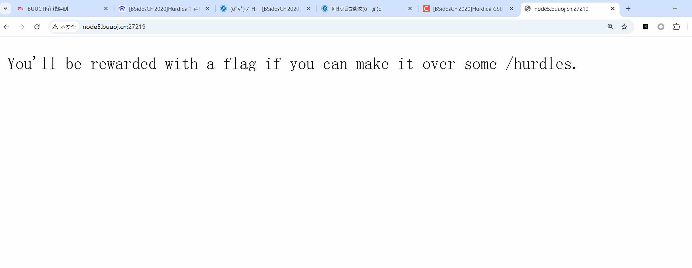

提示我们访问/hurdles

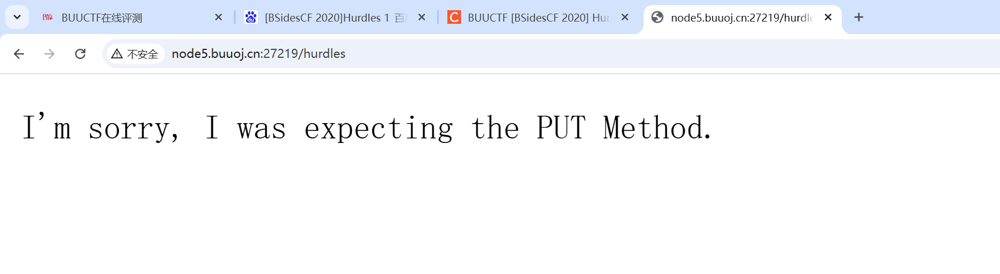

### -X参数 指定请求方式

需要我们使用PUT方式请求，使用curl命令，完成。也可以用bp

```
curl -X PUT http://node5.buuoj.cn:27219/hurdles
```

得到返回结果：

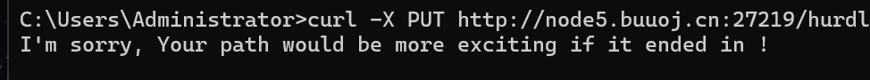

这里提示我们要在路径末尾填入`!`。

```
curl -X PUT http://node5.buuoj.cn:27219/hurdles/!
```

返回结果：

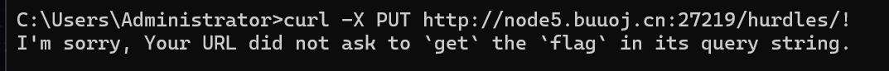

告诉我们需要在查询字符串中存在`get=flag`

```
curl -X PUT http://node5.buuoj.cn:27219/hurdles/!?get=flag
```

返回结果：

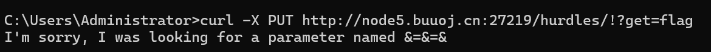

需要一个传参名为`&=&=&`，首先要先将其进行url编码，得到`%26%3D%26%3D%26`，构造传参

```
curl -X PUT "http://node5.buuoj.cn:27219/hurdles/!?get=flag&%26%3D%26%3D%26=1"
```

注意：这里的链接需要用双引号包裹

返回结果：

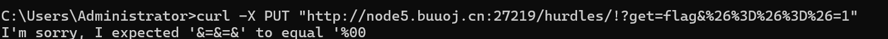

需要`&=&=&`传参的值为`%00（换行符）`，后面还跟了一个换行符，然后就是url编码：`%2500%0a`

```
curl -X PUT "http://node5.buuoj.cn:27219/hurdles/!?get=flag&%26%3D%26%3D%26=%2500%0a"
```

返回结果：


### -u参数 指定认证

需要指定认证，知道了用户名为`player`，但不知道密码，先随便猜测一个密码，使用`-u`参数指定：


构造：

```
curl -X PUT "http://node5.buuoj.cn:27219/hurdles/!?get=flag&%26%3D%26%3D%26=%2500%0a" -u "player:player"
```

返回结果：

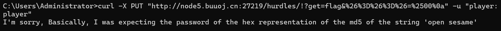

这里告诉我们密码为字符串`open sesame`的十六进制MD5值：`54ef36ec71201fdf9d1423fd26f97f6b`。

构造：

```
curl -X PUT "http://node5.buuoj.cn:27219/hurdles/!?get=flag&%26%3D%26%3D%26=%2500%0a" -u "player:54ef36ec71201fdf9d1423fd26f97f6b"
```

返回结果：

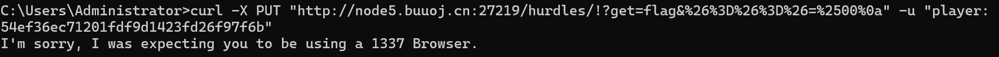

### -A参数 修改user-agent

又告诉我们需要使用1337 Brower浏览器，这里需要使用curl命令的`-A参数`，构造

```
curl -X PUT "http://node5.buuoj.cn:27219/hurdles/!?get=flag&%26%3D%26%3D%26=%2500%0a" -u "player:54ef36ec71201fdf9d1423fd26f97f6b" -A "1337 Browser"
```

返回结果：

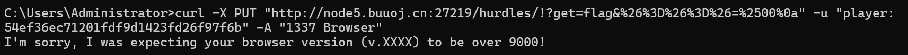

需要浏览器版本为`v.9000`，构造

```
curl -X PUT "http://node5.buuoj.cn:27219/hurdles/!?get=flag&%26%3D%26%3D%26=%2500%0a" -u "player:54ef36ec71201fdf9d1423fd26f97f6b" -A "1337 Browser v.9000"
```

返回结果：

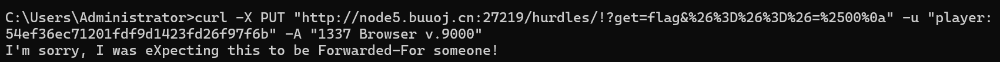

### -H参数 添加请求头

提示给出了`Forwarded-For`，猜测为修改`X-Forwared-For`为`127.0.0.1`，使用curl命令的`-H`参数添加HTTP请求头`X-Forwarded-For:127.0.0.1`：

```
curl -X PUT "http://node5.buuoj.cn:27219/hurdles/!?get=flag&%26%3D%26%3D%26=%2500%0a" -u "player:54ef36ec71201fdf9d1423fd26f97f6b" -A "1337 Browser v.9000" -H "X-Forwarded-For:127.0.0.1"
```

返回结果：

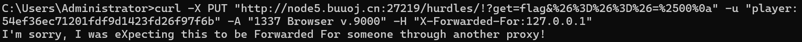

### 修改代理

提示需要使用代理，需要额外的代理转发，尝试使用`1.1.1.1`，构造

```
curl -X PUT "http://node5.buuoj.cn:27219/hurdles/!?get=flag&%26%3D%26%3D%26=%2500%0a" -u "player:54ef36ec71201fdf9d1423fd26f97f6b" -A "1337 Browser v.9000" -H "X-Forwarded-For:1.1.1.1,127.0.0.1"
```

返回结果：

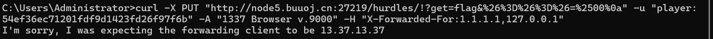

需要我们通过`13.37.13.37`这个地址的代理，把`1.1.1.1`替换：

```
curl -X PUT "http://node5.buuoj.cn:27219/hurdles/!?get=flag&%26%3D%26%3D%26=%2500%0a" -u "player:54ef36ec71201fdf9d1423fd26f97f6b" -A "1337 Browser v.9000" -H "X-Forwarded-For:13.37.13.37,127.0.0.1"
```

返回结果：

```
I'm sorry, I was expecting a Fortune Cookie
```

### -b参数 Cookie

需要Cookie ，猜测参数名为`Fortune`，使用curl命令的`-b`参数

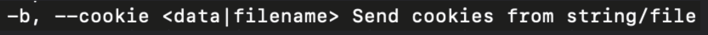

构造传参：

```
curl -X PUT "http://node5.buuoj.cn:27219/hurdles/!?get=flag&%26%3D%26%3D%26=%2500%0a" -u "player:54ef36ec71201fdf9d1423fd26f97f6b" -A "1337 Browser v.9000" -H "X-Forwarded-For:13.37.13.37,127.0.0.1" -b "Fortune=1"
```

返回结果：

```
I'm sorry, I was expecting the cookie to contain the number of the HTTP Cookie (State Management Mechanism) RFC from 2011.
```

需要**Cookie**中包含`2011`年的`RFC编号`，通过查阅资料：[Datatracker](https://datatracker.ietf.org/doc/rfc6265/)

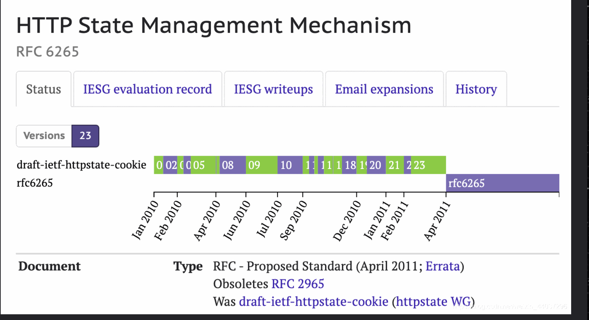

了解到了2011版的RFC协议的值为`6265`，构造

```
curl -X PUT "http://node5.buuoj.cn:27219/hurdles/!?get=flag&%26%3D%26%3D%26=%2500%0a" -u "player:54ef36ec71201fdf9d1423fd26f97f6b" -A "1337 Browser v.9000" -H "X-Forwarded-For:13.37.13.37,127.0.0.1" -b "Fortune=6265"
```

返回结果：

```
I'm sorry, I expect you to accept only plain text media (MIME) type.
```

提示只接受纯文本（MIME）形式的请求，也是通过`-H`参数修改请求头信息`Accept:text/plain`，构造传参：

```
curl -X PUT "http://node5.buuoj.cn:27219/hurdles/!?get=flag&%26%3D%26%3D%26=%2500%0a" -u "player:54ef36ec71201fdf9d1423fd26f97f6b" -A "1337 Browser v.9000" -H "X-Forwarded-For:13.37.13.37,127.0.0.1" -b "Fortune=6265" -H "Accept:text/plain"
```

返回结果：

```
I'm sorry, Я ожидал, что вы говорите по-русски.
```

是一句俄语，翻译成中文是

```
我以为你会说俄语
```

### Accept-Language

猜测应该说的是`Accept-Language`请求头的属性，查阅资料：[语言代码缩写表大全（用于Accept-Language）](https://blog.csdn.net/u014549283/article/details/81742104)
得到俄语的表示为`ru`，构造传参：

```
curl -X PUT "http://node5.buuoj.cn:27219/hurdles/!?get=flag&%26%3D%26%3D%26=%2500%0a" -u "player:54ef36ec71201fdf9d1423fd26f97f6b" -A "1337 Browser v.9000" -H "X-Forwarded-For:13.37.13.37,127.0.0.1" -b "Fortune=6265" -H "Accept:text/plain" -H "Accept-Language:ru"
```

返回结果：

```
I'm sorry, I was expecting to share resources with the origin https://ctf.bsidessf.net
```

### origin与Referer

需要我们的请求来自`https://ctf.bsidessf.net`，尝试添加请求头`Referer`属性，然后发现不行，用origin`请求头尝试

```
curl -X PUT "http://node5.buuoj.cn:27219/hurdles/!?get=flag&%26%3D%26%3D%26=%2500%0a" -u "player:54ef36ec71201fdf9d1423fd26f97f6b" -A "1337 Browser v.9000" -H "X-Forwarded-For:13.37.13.37,127.0.0.1" -b "Fortune=6265" -H "Accept:text/plain" -H "Accept-Language:ru" -H "origin:https://ctf.bsidessf.net"
```

返回结果：

```
I'm sorry, I was expecting you would be refered by https://ctf.bsidessf.net/challenges?
```

这次是就是`Referer`属性，添加请求头：`Referer:https://ctf.bsidessf.net/challenges`

```
curl -X PUT "http://node5.buuoj.cn:27219/hurdles/!?get=flag&%26%3D%26%3D%26=%2500%0a" -u "player:54ef36ec71201fdf9d1423fd26f97f6b" -A "1337 Browser v.9000" -H "X-Forwarded-For:13.37.13.37,127.0.0.1" -b "Fortune=6265" -H "Accept:text/plain" -H "Accept-Language:ru" -H "origin:https://ctf.bsidessf.net" -H "Referer:https://ctf.bsidessf.net/challenges"
```

返回结果：

```
Congratulations!
```

### -i参数 查看回显头部信息

提示祝贺结束。但是没有flag，猜测可能在返回的头部信息里，添加`-i`参数，查看回显的头部信息

```
curl -i -X PUT "http://node5.buuoj.cn:27219/hurdles/!?get=flag&%26%3D%26%3D%26=%2500%0a" -u "player:54ef36ec71201fdf9d1423fd26f97f6b" -A "1337 Browser v.9000" -H "X-Forwarded-For:13.37.13.37,127.0.0.1" -b "Fortune=6265" -H "Accept:text/plain" -H "Accept-Language:ru" -H "origin:https://ctf.bsidessf.net" -H "Referer:https://ctf.bsidessf.net/challenges"
```

返回结果：

```
HTTP/1.1 200 OK
X-Ctf-Flag: flag{8427a2e3-2f11-486f-9d32-c459f9147254}
Date: Thu, 08 May 2025 09:16:55 GMT
Content-Length: 16
Content-Type: text/plain; charset=utf-8
```

得到flag


