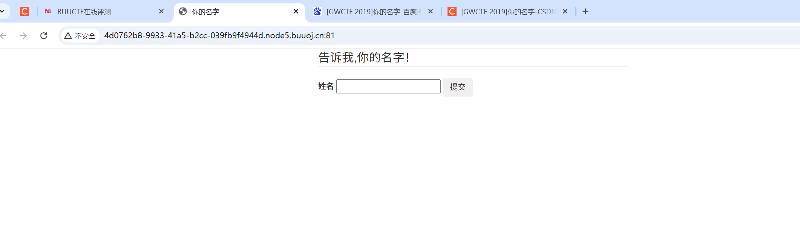
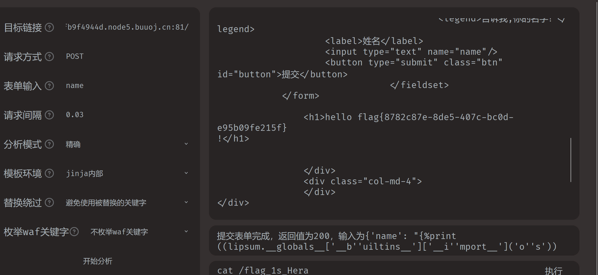

# GWCTF2019-你的名字

参考博客：https://blog.csdn.net/cjdgg/article/details/119813547

首先打开网页。



一个输入框，输入什么就会显示什么，这种题一般都是ssti模版注入。

尝试了`{{7*7}}`发现没有回显，可能是存在双大括号过滤，但是可以使用``的方式回显。

也可以用这种形式来进行外带

```
1
```

## fenjing一把梭



## 黑名单过滤逻辑错误

但是我们还不知道过滤了哪些东西。直接在网上找到了黑名单代码

```
blacklist = ['import', 'getattr', 'os', 'class', 'subclasses', 'mro', 'request', 'args', 'eval', 'if', 'for',
                 ' subprocess', 'file', 'open', 'popen', 'builtins', 'compile', 'execfile', 'from_pyfile', 'local',
                 'self', 'item', 'getitem', 'getattribute', 'func_globals', 'config']
for no in blacklist:
    while True:
        if no in s:
            s = s.replace(no, '')
        else:
            break
return s
```

这段代码会先从黑名单的第一个词开始经过循环过滤然后进行下一个字符串的过滤，但是因为config字符串是在黑名单的最后一个，所以黑名单中前面字符串的过滤都已经结束了，再进行config的过滤，所以我们在过滤字符中加入config就可以绕过

最终payload：

```
原payload


查看根目录下文件名 


拿到flag

```

---

另一种解法

## 拼接绕过

**直接拼接**

```





```

---

## set命令拼接

```





```

## 外带数据

如果``这种形式无法回显的话，还可以使用外带

```
1
```


