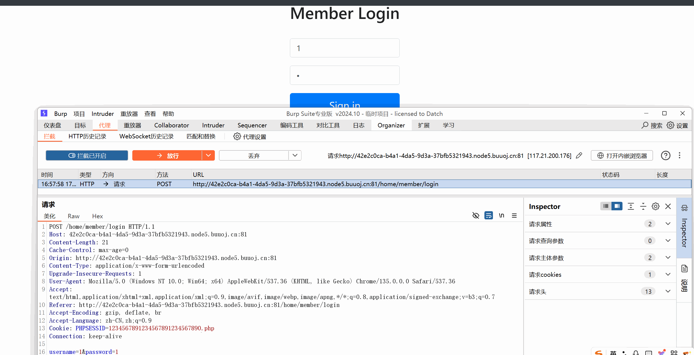
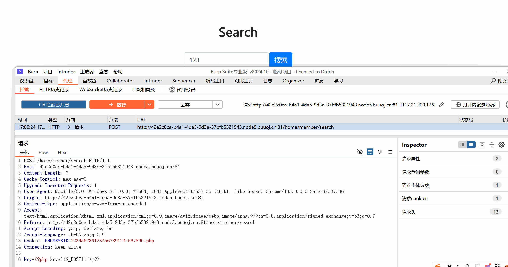
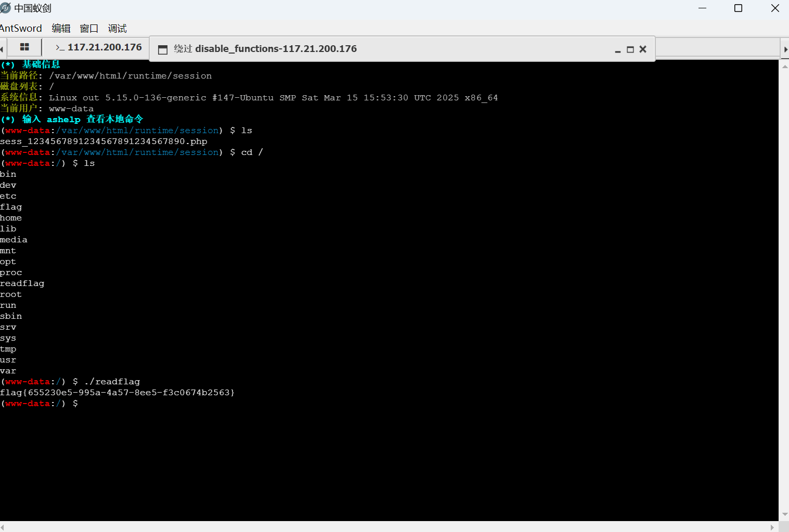

# GYCTF2020-EasyThinking

扫描目录发现有源码文件www.zip，访问下载
下载源码，打开README发现该环境使用了tp 6.0框架

## 知识点 tp6.0任意文件操作漏洞

[tp6.0任意文件操作漏洞分析](https://j0k3r.top/2020/03/02/ThinkPHP_v6.0.0_ArbitraryFileWriting/#%E6%BC%8F%E6%B4%9E%E7%AE%80%E4%BB%8B)

tp6.0会默认在/runtime/session/目录下，创建`sess_xxx`格式的文件，这里的xxx是PHPSESSID（32位），而文件的内容就是session的内容

---

代码审计

**web\app\home\controller\Member.php**

```
public function login(){
            if ($userId){
                session("UID",$userId);
                return redirect("/home/member/index");
            }
    }

public function search()
    {
        if (Request::isPost()){
            if (!session('?UID'))
            {
                return redirect('/home/member/login');            
            }
            $data = input("post.");
            $record = session("Record");
            if (!session("Record"))
            {
                session("Record",$data["key"]);
            }
```

---

```
phppublic function login(){  
    if ($userId){  
        session("UID",$userId);  
        return redirect("/home/member/index");  
    }  
}  
```

- **功能：**
  判断 `$userId` 是否存在，如果存在，则把用户ID保存到 session（标记用户已登录），然后跳转到会员首页。

------

```
phppublic function search()  
{  
    if (Request::isPost()){  
        if (!session('?UID'))  
        {  
            return redirect('/home/member/login');            
        }  
        $data = input("post.");  
        $record = session("Record");  
        if (!session("Record"))  
        {  
            session("Record",$data["key"]);  
        }  
    }  
}  
```

- **功能：**
  判断当前请求是否为 POST 请求。
  如果用户未登录（session 中没有 UID），跳转到登录页。
  获取 POST 的所有输入数据。
  如果 session 中没有存储“Record”，则把输入里的 `key` 写入 session 里的“Record”。

## 解题思路：

```
login页面抓包，修改PHPSESSID的值为xxx.php，保持32位的长度
进入之后在搜索页面
存在一个post传参，我们搜索的值也就是key的值，会保存在 PHPSESSID文件中
```

---

**1、在login页面下登录抓包，修改PHPSESSID值**



**2. search搜索页面，输入一句话木马抓包**

看到这里的PHPSESSID即为我们登录时修改的PHPSESSID值，那么我们的key会保存在 tp6 默认的session文件处



**3.webshell连接 url/runtime/session/sess_PHPSESSID**

```
http://42e2c0ca-b4a1-4da5-9d3a-37bfb5321943.node5.buuoj.cn:81/runtime/session/sess_1234567891234567891234567890.php
```

flag是在根目录下的，但是我们无法看到flag内容，发现这里有readflag文件 => 运行readflag来得到flag

突破disable_functions函数的限制，用蚁剑插件然后选择PHP7 Backtrace UAF模式即可



执行./readflag拿到flag


