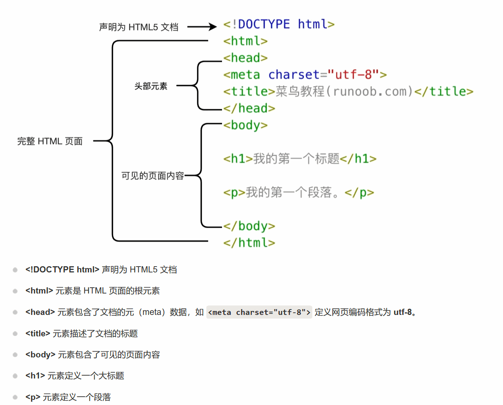
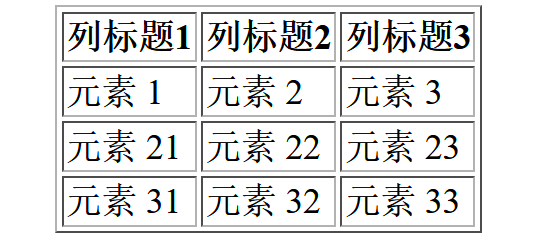
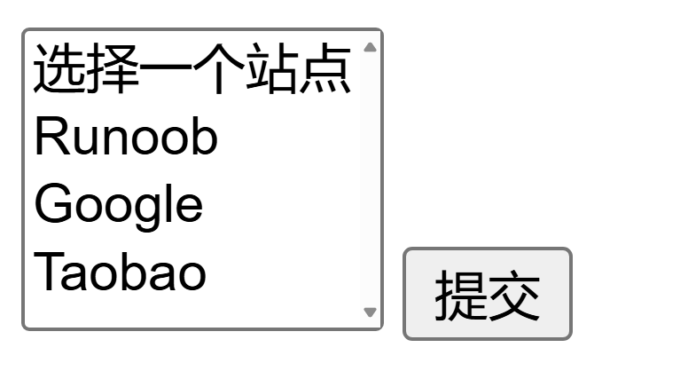

#  HTML简介

   HTML 是用来描述网页的一种语言。

- HTML 指的是超文本标记语言: **H**yper**T**ext **M**arkup **L**anguage

- HTML 不是一种编程语言，而是一种**标记**语言

- 标记语言是一套**标记标签** (markup tag)

- HTML 使用标记标签来**描述**网页

- HTML 文档包含了HTML **标签**及**文本**内容

- HTML文档也叫做 **web 页面**

  # HTML的学习

  ## 基础结构和语法

  ### 基础结构例子

  

### DOCTYPE

```
<!DOCTYPE html> //声明为 HTML5 文档 需要写在首行
```

### 标签

```
无属性标签 <标签名></标签名>

有属性标签 <标签名 属性名="属性值"></标签名>
```

### 整体结构

```
<html>...</html> 表示是一个html网页

<head>...</head> 头部信息，如果需要使用css样式要写在里面
 
<body>...</body> 身体部分，主要html代码要写在里面
```

### 自写html代码记录

```
<!-- 定义标题用<h1>标签，定义图片用标签 -->
<!-- 定义样式在标签上使用style属性 -->
<!-- 文档申明，表示html5 -->
<!DOCTYPE html>
<!-- 当前语言是英文 -->
<html lang="en">
<head>
    <!-- 告诉浏览器采用utf-8 -->
    <meta charset="UTF-8">
    <!-- 解决IE浏览器兼容性问题 -->
    <meta name="viewport" content="width=device-width, initial-scale=1.0">
    <!-- 网页标题，显示在浏览器的标签页中 -->
    <title>Hello HTML</title>
</head>
<body>
    <h1 style="color: red">HTML入门</h1>
    <!-- src属性：定义要展示的图片路径.alt属性：如果图片展示不出来要显示的文件内容 -->
    
</body>
</html>
```


## 常用的HTML标签

### 标题标签

标题标签：通过h1~h6来定义的。	

```
<h1></h1>~<h6></h6> 
```

### 段落、换行、水平线标签

段落标签：

```
<p>...</p> 一对<p></p>标签就是一个自然段，两对就是两个自然段会自动换行
常用属性：
	align 对齐方式：
			left 左对齐
			right 右对齐
			center 居中对齐
			justify 两端对齐
例如：
<p align="left"></p> 
左对齐段落
```

换行标签：

```
<br> 一个换行标签换一行
```

水平线标签：

```
<hr></hr> 效果为在页面中添加一条水平线
常用属性：
	color：设置水平线颜色；
    width：设置水平线长度；
    size：设置水平线高度；
    align：设置水平线对齐方式(默认居中)，可取值 left 或 right。
例如：
<hr color="red"></hr>
红色水平线
```

### 文本标签

```
<b>...</b>	字体加粗 
<strong>...</strong>	定义加重语气 和加粗没区别
<i>...</i>	斜体  
<em></em>	定义着重字体 和斜体没区别
<u>...</u>	下划线
<s>...</s>	删除线 
<del>...<\del>	删除线  和删除线无区别
<sub>...</sub>	下标	例如：x<sub>2</sub>得到x₂
<sup>...</sup>	上标	例如：x<sup>2</sup>得到x²

<font>...</font>	字体标签
	常用属性： 
	color	颜色
	face	字体
	size	字号
例如：<font color="red" face="黑体" size="7">字体标签</font>
网页上显示字体标签，并修改字体为宋体，颜色为红色，字号为7
```

### 列表

无序列表：

```
无序列表标签:
	<ul>
        <li>无序列表元素1</li>
        <li>无序列表元素2</li>
        <li>无序列表元素3</li>
    </ul>
常用属性：
	type="属性值" 列表的序号
	属性值：
	disc	实心原点(默认)
	square	实心方点
	circle	空心圆
	
列表之间是可以嵌套的
li里面什么都能放，甚至可以再放一个ul
例如：
 <ul>
    <li>
        <ul>
            <li></li>
        </ul>
    </li>
  </ul>
  
  <ul type="circle">
  	<li>...</li>
  	<li>...</li>
  </ul>
  元素前有空心圆图标
```

有序列表：

```
有序列表标签：
    <ol>
        <li>有序列表元素1</li>
        <li>有序列表元素2</li>
        <li>有序列表元素3</li>
    </ol>
常用属性：
	type="属性值"	列表的序号
	属性值：
	1	阿拉伯数字(默认)
	a	小写字母
    A	大写字母
    i	小写罗马字母
    I	大写罗马字母 
例如：
<ol type="a"'>
	<li>...</li>
	<li>...</li>
</ol>
有序列表从a开始编号
```

### div和span标签

div标签：

```
<div>...</div>
	<div> 是一个块元素
	<div> 元素在语义上不表示任何特定类型的内容
	div 可以将内容分组，从而可以使用 class 或是 id 属性方便的定义内容的格式，
	也可以在一段文档中划分标记出使用另一种语言书写的内容（使用 lang 属性）
```

span标签：

```
<span>...</span>
	<span> 则是行内元素
	可以用来编组元素以达到某种样式意图（通过使用类或者 id 属性）
```

总结：

- div 标签，是用来布局的，但是现在**一行只能放一个 div**；
- div 的开始标签和结束标签都不能省略；
- span 标签，也是用来布局的，一行上可以放好多个 span；
- span 的开始标签和结束标签都不能省略；

### img图片标签

```

	常用属性：
	src	设置图片路径
	title	当鼠标停在图片上的文字
	width	设置图片宽度
	height	设置图片高度
	border	设置图片边框大小
	alt	设置当前指定路径找不到图片时，用来代替显示的文本内容
	align	对齐方式
例如：

```

### a超链接标签

```
<a></a>	用于从一个页面链接到另外一个页面
	常用属性：
	href	页面或者文件地址，如果设置为#则不会跳转到其他页面
	target	规定在何处打开链接文档
	值        	描述
	_blank	在新窗口打开被链接的页面
	_self	默认设置，在当前的页面/框架打开被链接的页面
	_parent	在父框架集中打开被链接的页面
	_top	在整个窗口中打开被链接的页面
	framename	在指定框架中打开被链接的页面
例如：
<a href="./pages/introduction.html" target="_blank">introduction</a>
表示新开页面打开网站
```

### 表格

```
表格标签：
	<table></table>
	tr	表示表格中的行（每一行可以包含多个th和tr）
	td	表示表格中的标准单元格
	th	表示表格中的表头单元格（具有标题的效果，字体加粗，居中显示）
	
	table常用属性：
	border	设置边框，属性值为像素值
	cellspacing	设置单元格边框之间的间距
	cellpadding	设置单元格与单元内容之间的间距
	width	设置表格宽度
	height	设置表格高度
	align	设置表格在网页中的水平对齐方式：
	left	居左
	center	居中
	right	居右
	
	 tr和th 常用属性 
       align 每行中文本内容的水平方向对齐方式
       valign 每行中文本内容的垂直方向对齐方式（top bottom middle）
       bgcolor 设置行的背景颜色
       
       
    合并单元格：
    <td>的colspan和rowspan分别规定单元格横跨的列数和行数
    纵向合并 rowspan
    横向合并 colspan
```

自写表格：

```
	<table border="1" align="center">
        <tr>
            <th>列标题1</th>
            <th>列标题2</th>
            <th>列标题3</th>
        </tr>
        <tr>
            <td>元素 1</td>
            <td>元素 2</td>
            <td>元素 3</td>
        </tr>
        <tr>
            <td>元素 21</td>
            <td>元素 22</td>
            <td>元素 23</td>
        </tr>
        <tr>
            <td>元素 31</td>
            <td>元素 32</td>
            <td>元素 33</td>
        </tr>
    </table>
```

效果图：



### form表单标签

```
<form></form>
	所有标签都有的属性：
	       id属性   用来标识元素的唯一性
	       name属性 提交数据时的参数名
	       style属性 设置元素的行内样式
	       class属性 设置元素的样式名
	       
	必有属性：
	action	指定表单提交的地址，一般为服务器接口地址
	method	指定表单提交的方式，一般为get或post
		get提交 GET
        post提交 POST
    target 提交数据时打开窗口的方式
    	_self 当前窗口
        _blank 空白窗口
        
    get请求和post请求的区别：
    	1.get请求时参数会跟在浏览器地址后面，而post请求不会
        2.get请求相当于post而言，不那么安全
        3.get请求传递的数据长度是有限的，而post请求基本没有（长度与服务器有关）
        4.get请求比post快（2倍）
        5.get请求有缓存，而post无
        
        form是块级元素
        表单提交时，必须设置表单元素的name属性值，否则无法获取数据
        表单需要结合表单元素一起使用
```

### input标签

```
<input type="">
	type属性：
    text	文本输入框
	password	密码输入框
	checkbox	复选框
	radio	单选框，如果需要单选，要设置name属性
	submit	提交按钮，默认有一个“提交”的按钮
	reset	重置按钮，默认有一个“重置”的按钮
	button	按钮，默认只有一个方格，需要设置value显示按钮的值
	color	颜色选择框
	file	上传文件按钮，如果需要上传多个文件，需要设置multiple
	number	数字输入框，只能输入数字
	date	日期选择框
	time	时间选择框
	
	常用属性：
	value    元素的值
	readonly  只读状态
	maxlength  最多输入的长度
	disabled   禁用标签
	checked	单选框、复选框中表示默认选中
	disabled	表示禁用，不会被选择。代码如下：

如果要提交数据必须设置name属性
```

### textarea文本框标签

```
<textarea></textarea>
	常用属性：
	cols	规定文本区域内可见的列数
	rows	规定文本区域内可见的行数
	value	定义文本区域的内容
	disabled	设置为disabled将禁用文本区域
	maxlength	限制用户输入的最大字符数
	placeholder	规定一个简短的提示，描述文本区域期望的输入值
	required	设置为required会在提交表单时验证字段是否已填写‌
```

### lable标签

```
<lable></lable>	标签可以 直接包含 表单 和 相关文字信息 , 点击 label 标签的范围 , 就可以触发表单的操作
	常用属性：
	for	该属性值应该与相关控件的id属性值相同
当用户点击<label>内的任何部分时，浏览器会自动将焦点转移到与之相关的表单控件上
例如：   <label for="username">用户名：</label>
        <input type="text" name="username" id="username"> 
当点击用户名时会自动转移到输入文本框中
```

### 下拉框标签

```
<select></select>
	常用属性：
     multiple  设置下拉框多选
     size      设置下拉框可见选项数
     disabled  禁用元素
     
option：下拉框的选项标签
      selected  默认选中值
      disabled  禁用某个选项
      value     提交给服务器的选项值
例如：
<form method="post" action="">
    <select multiple="multiple" name="q[]">
    <option value="">选择一个站点</option>
    <option value="RUNOOB">Runoob</option>
    <option value="GOOGLE">Google</option>
    <option value="TAOBAO">Taobao</option>
    </select>
    <input type="submit" value="提交">
</form>
```

效果图：



