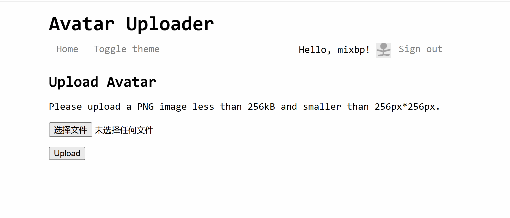
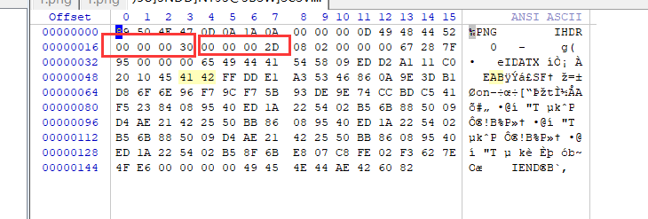
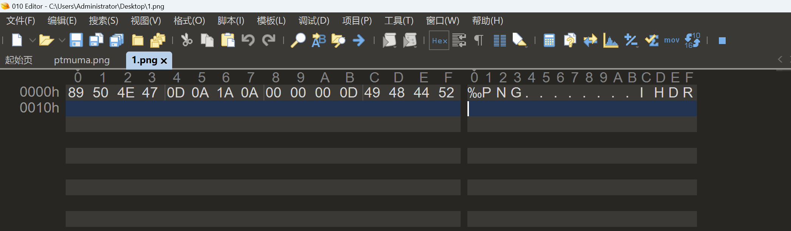
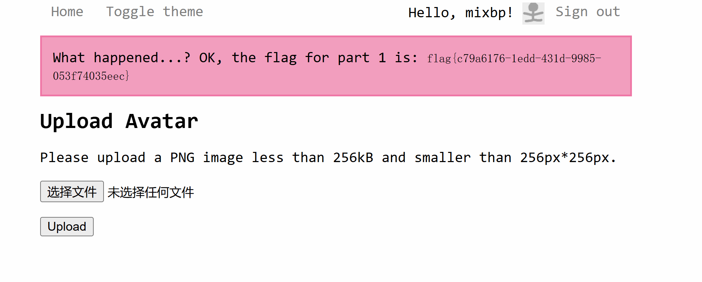

# HarekazeCTF2019-AvatarUploader

一打开是一个文件上传页面，并且提示我们传入png文件



试着传webshell上去发现实在没办法，然后看了下wp说是要看源码

源码：

代码审计：

```
<?php
// 关闭错误报告，可能会隐藏一些错误信息，在开发阶段可考虑开启（例如 error_reporting(E_ALL)）
error_reporting(0); 
 
// 引入配置文件，可能包含一些常量和配置信息
require_once('config.php'); 
// 引入工具类文件，可能包含一些常用的工具函数
require_once('lib/util.php'); 
// 引入会话管理类文件，可能包含安全会话相关的功能
require_once('lib/session.php'); 
 
// 创建一个新的 SecureClientSession 对象，使用预定义的 CLIENT_SESSION_ID 和 SECRET_KEY 作为参数
$session = new SecureClientSession(CLIENT_SESSION_ID, SECRET_KEY); 
 
// 检查是否有文件被上传，如果文件不存在或不是通过 HTTP POST 上传的文件，输出错误信息
if (!file_exists($_FILES['file']['tmp_name']) ||!is_uploaded_file($_FILES['file']['tmp_name'])) {
  error('No file was uploaded.');
}
 
// 检查文件大小，如果文件大小超过 256000 字节，输出错误信息
if ($_FILES['file']['size'] > 256000) {
  error('Uploaded file is too large.');
}
 
// 检查文件类型
$finfo = finfo_open(FILEINFO_MIME_TYPE);
// 获取文件的 MIME 类型
$type = finfo_file($finfo, $_FILES['file']['tmp_name']);
finfo_close($finfo);
// 如果文件类型不是 image/png，输出错误信息
if (!in_array($type, ['image/png'])) {
  error('Uploaded file is not PNG format.');
}
 
// 检查文件的宽高
$size = getimagesize($_FILES['file']['tmp_name']);
// 如果文件的宽度或高度大于 256 像素，输出错误信息
if ($size[0] > 256 || $size[1] > 256) {
  error('Uploaded image is too large.');
}
// 如果文件的类型不是 IMAGETYPE_PNG，输出错误信息并显示 FLAG1（可能是用于调试或意外情况）
if ($size[2]!== IMAGETYPE_PNG) {
  // I hope this never happens...
  error('What happened...? OK, the flag for part 1 is: <code>'. getenv('FLAG1'). '</code>');
}
 
// 生成一个随机的文件名，使用 bin2hex(random_bytes(4)) 生成一个 8 位的十六进制字符串并添加.png 后缀
$filename = bin2hex(random_bytes(4)). '.png';
// 将上传的文件移动到 UPLOAD_DIR 目录下，并使用生成的随机文件名
move_uploaded_file($_FILES['file']['tmp_name'], UPLOAD_DIR. '/'. $filename);
 
// 在会话中存储文件名
$session->set('avatar', $filename);
// 显示一个成功的消息
flash('info', 'Your avatar has been successfully updated!');
// 重定向到根目录
redirect('/');
```

我们的最终目的是要通过这个if，使其输出flag

```
if ($size[2]!== IMAGETYPE_PNG) {
  // I hope this never happens...
  error('What happened...? OK, the flag for part 1 is: <code>'. getenv('FLAG1'). '</code>');
}
```

所以这题简单点来说就是，我们传入一个文件，经过finfo_file函数去判断图片类型。必须是image/png。

然后用getimagesize去判断图片大小且图片类型不能是png，这两个函数应该是有什么特性和差异。

## getimagesize函数

getimagesize() 函数用于获取图像大小及相关信息，成功返回一个数组，失败则返回 FALSE 并产生一条 E_WARNING 级的错误信息。

getimagesize() 函数将测定任何 GIF，JPG，PNG，SWF，SWC，PSD，TIFF，BMP，IFF，JP2，JPX，JB2，JPC，XBM 或 WBMP 图像文件的大小并返回图像的尺寸以及文件类型及图片高度与宽度。

返回结果说明

- 索引 0 给出的是图像宽度的像素值
- 索引 1 给出的是图像高度的像素值
- 索引 2 给出的是图像的类型，返回的是数字，其中1 = GIF，2 = JPG，3 = PNG，4 = SWF，5 = PSD，6 = BMP，7 = TIFF(intel byte order)，8 = TIFF(motorola byte order)，9 = JPC，10 = JP2，11 = JPX，12 = JB2，13 = SWC，14 = IFF，15 = WBMP，16 = XBM
- 索引 3 给出的是一个宽度和高度的字符串，可以直接用于 HTML 的 <image> 标签
- 索引 bits 给出的是图像的每种颜色的位数，二进制格式
- 索引 channels 给出的是图像的通道值，RGB 图像默认是 3
- 索引 mime 给出的是图像的 MIME 信息，此信息可以用来在 HTTP Content-type 头信息中发送正确的信息，如： header("Content-type: image/jpeg");

---

## finfo_file函数

该函数可以检测文件的MIME类型。因为有时候我们只根据文件后缀来判断是不准确的

```
$finfo = finfo_open(FILEINFO_MIME_TYPE); 
$mime = finfo_file($finfo, $savepath); 
echo $mime;
```

---

这里有个特性，我们把png图片的数据全部破坏掉，只保留文件头。getimagesize就读取不到它的文件宽高和类型了

那么就可以绕过getimagesize的判断，而finfo_file照样可以识别出这是个PNG图片，从而得到flag。

PNG的宽高是由它的文件格式决定的。



网上随便找一张图片，将文件头以外的所有字节删除。



然后上传图片即可拿到flag




