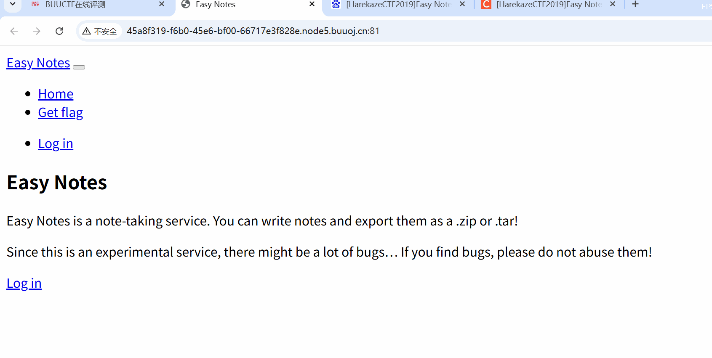
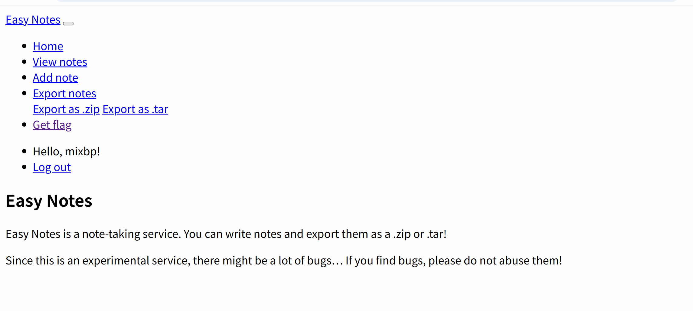
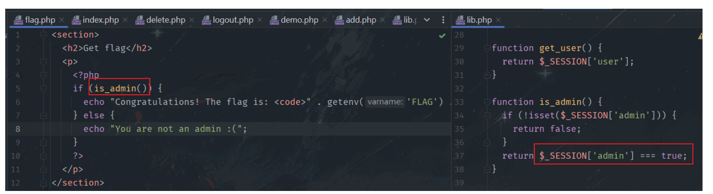
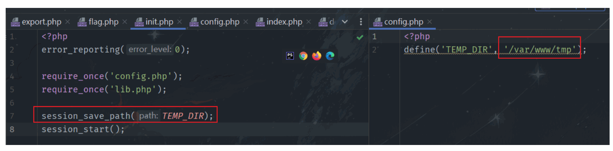
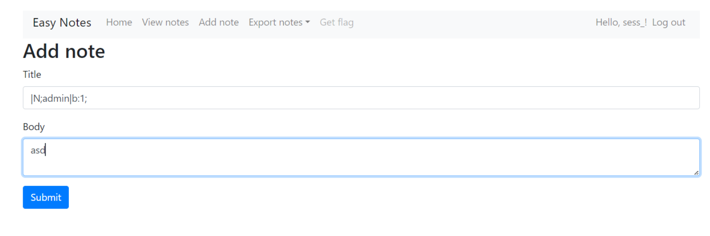

# HarekazeCTF2019-EasyNotes

首先打开网页



发现有一个Get flag，点击以后显示You are not an admin :(

登录之后发现有几个功能点，可以添加节点，然后使用`Export`导出



我们查看源码：
发现想要拿到flag的条件是`$_SESSION['admin']=true`



如果我们能控制session文件，就可以拿到flag了。



并且我们可以发现session存储的文件的路径为：`/var/www/tmp`

然后看export.php

```
<?php
require_once('init.php');

if (!is_logged_in()) {
  redirect('/?page=home');
}

$notes = get_notes();

if (!isset($_GET['type']) || empty($_GET['type'])) {
  $type = 'zip';
} else {
  $type = $_GET['type'];
}

$filename = get_user() . '-' . bin2hex(random_bytes(8)) . '.' . $type;
$filename = str_replace('..', '', $filename); // avoid path traversal
$path = TEMP_DIR . '/' . $filename;

if ($type === 'tar') {
  $archive = new PharData($path);
  $archive->startBuffering();
} else {
  // use zip as default
  $archive = new ZipArchive();
  $archive->open($path, ZIPARCHIVE::CREATE | ZipArchive::OVERWRITE);
}

for ($index = 0; $index < count($notes); $index++) {
  $note = $notes[$index];
  $title = $note['title'];
  $title = preg_replace('/[^!-~]/', '-', $title);
  $title = preg_replace('#[/\\?*.]#', '-', $title); // delete suspicious characters
  $archive->addFromString("{$index}_{$title}.json", json_encode($note));
}

if ($type === 'tar') {
  $archive->stopBuffering();
} else {
  $archive->close();
}

header('Content-Disposition: attachment; filename="' . $filename . '";');
header('Content-Length: ' . filesize($path));
header('Content-Type: application/zip');
readfile($path);

```

这里可以看到导出的文件也是会写到`/var/www/tmp`目录下，所以我们可以尝试session伪造，伪造一个session文件。

```
$filename = get_user() . '-' . bin2hex(random_bytes(8)) . '.' . $type;
$filename = str_replace('..', '', $filename); // avoid path traversal
$path = TEMP_DIR . '/' . $filename;
```

`get_user()`会获取用户名，`bin2hex(random_bytes(8))`会生成16进制[字符串](https://so.csdn.net/so/search?q=字符串&spm=1001.2101.3001.7020)，

如果我们用户名为`sess_`，并且`$type=.`，那么两个`.`会被替换为空，所以最终文件名就符合session文件的格式了，session文件名可控

 然后再看一下session内容是否可控。

由于默认`session_serialize_handler=php`，那么序列化规则为：

| 处理器 | 对应的存储格式                                      |
| ------ | --------------------------------------------------- |
| php    | 键名 ＋ 竖线 ＋ 经过 serialize() 函数反序列处理的值 |

所以`$_SESSION['admin']=true`需要满足：

```
admin|b:1;
```

但是由于我们导出的文件中有一些内容，防止被污染，我们需要这么写：

```
|N;admin|b:1;
```



添加之后导出：

```
/export.php?type=.
```

最后替换一下`PHPSESSID`为文件名就能拿到flag了。


