## Java

---

## 注释

### 单行注释

格式：//注释信息

### 多行注释

格式：/\*注释信息\*/

### 文档注释

格式：/\**注释信息\*/

## 关键字

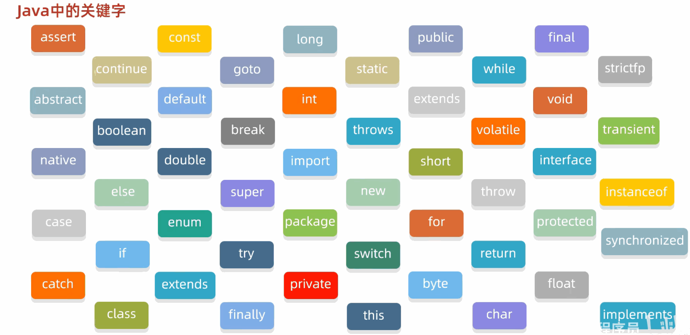

### class

```
public class HelloWorld{

}
```

用于（创建/定义）一个类

类是Java最基本的组成单元

## 字面量

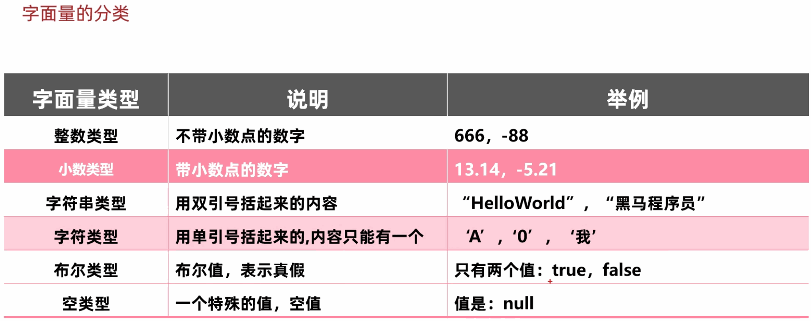

### \t制表符

在打印的时候，把**前面字符串**的长度**补齐到8**，**或者8的整数倍**。最少补1个空格，最多补8个空格。

```
public class HelloWorld{
	public static void main(String[] args){
		System.out.println("name" + '\t' + "age");
		System.out.println("tom" + '\t' + "23");
	}
}
```

## 变量

**int**  整数类型

 **byte **

**short**

**long**   定义时，数据值要加一个L作为后缀.可以大写也可以小写

**double**  小数类型

**float**   定义时，数据值要加一个F作为后缀

**char** 字符类型

**String**  字符串类型 注：S**要大写**

**boolean** **布尔类型**

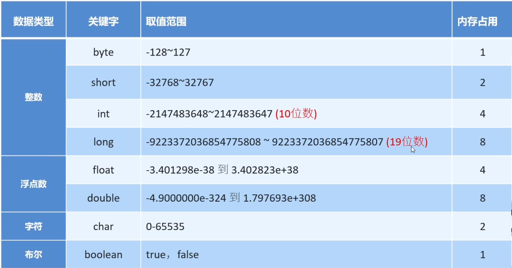

注意事项：

1.只能存一个值

2.变量名不允许重复定义

3.一条语句可以定义多个变量

int a=1,b=2,c=3;

4.变量在使用之前必须要进行赋值，否则会报错

5.变量要注意作用域范围

## 数据类型

分为基本数据类型和引用数据类型

### 基本数据类型

基本类型是 Java 中最简单、最基本的数据类型，用于存储原始的数据值。它们直接存储数据，大小固定，并且没有附带任何方法或功能。

Java 有 8 种基本数据类型：

| 数据类型  | 大小   | 默认值   | 示例                   |
| --------- | ------ | -------- | ---------------------- |
| `byte`    | 1 字节 | 0        | `byte b = 10;`         |
| `short`   | 2 字节 | 0        | `short s = 100;`       |
| `int`     | 4 字节 | 0        | `int i = 1000;`        |
| `long`    | 8 字节 | 0L       | `long l = 100000000L;` |
| `float`   | 4 字节 | 0.0f     | `float f = 3.14f;`     |
| `double`  | 8 字节 | 0.0      | `double d = 3.14159;`  |
| `char`    | 2 字节 | ‘\u0000’ | `char c = 'A';`        |
| `boolean` | 1 字节 | `false`  | `boolean flag = true;` |

- **数值类型**：`byte`、`short`、`int`、`long`、`float`、`double`。
- **字符类型**：`char`。
- **布尔类型**：`boolean`。

**注意：在定义long类型或float类型时，要在数据值的后面加一个L或者F，也可小写**

### 引用数据类型

引用数据类型的变量保存了对实际对象的引用（内存地址）。常见的引用类型包括类、数组和接口。

引用数据类型的例子：

- **类**：如 `String`、`ArrayList`、`Person` 等
- **数组**：如 `int[]`、`String[]` 等
- **接口**：如 `List`、`Runnable` 等

### 标识符

标识符：就是给类，方法，变量等起的名字。

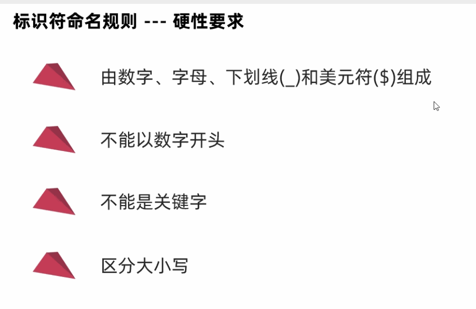

## 键盘录入（输入）

Scanner，这个类可以接收键盘输入的数字

使用步骤：
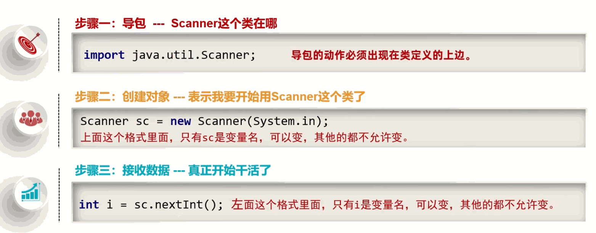

## 运算符

### 算术运算符

算术运算符和c差不多

+、-、*、/、%

如果在计算时有小数参与，结果可能会不准确

数字进行运算时，数据类型不一样不能运算，需要转成一样的，才能运算

**隐式转换：**取值范围小的数值–>取值范围大的数值

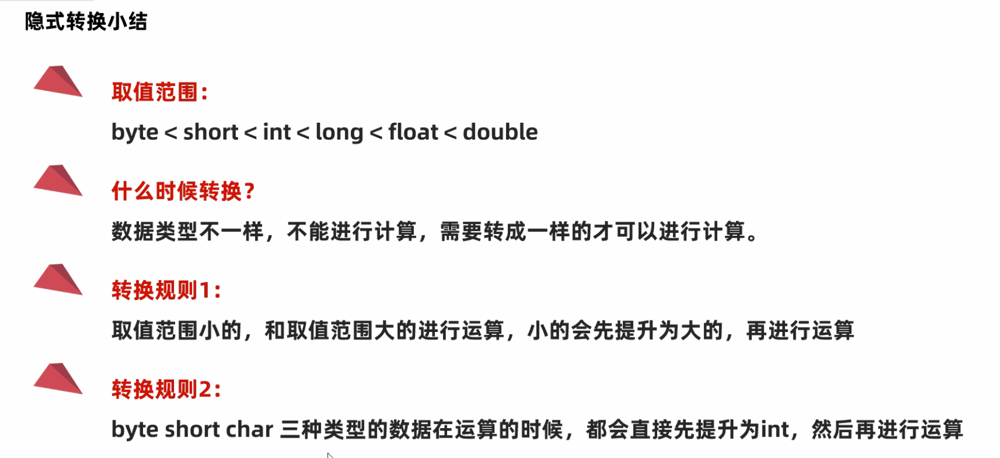

**强制转换：**取值范围大的数值–>取值范围小的数值 

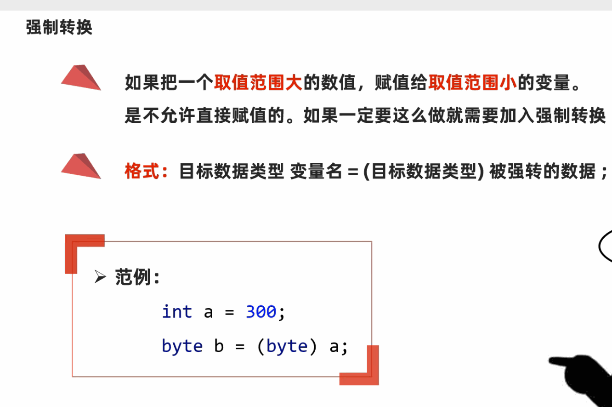

### 字符串相加

字符串的"+"操作，跟python差不多

从左到右依次运算

当"+"操作中出现字符串时，这个"+"是字符串连接符，会将前后的数据进行拼接。

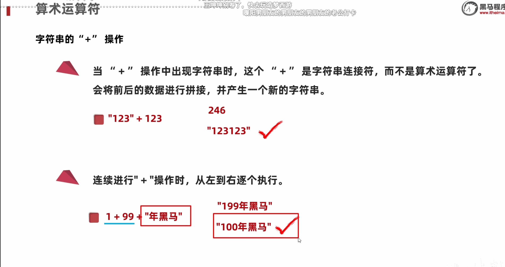

### 字符相加

当字符+字符或字符+数字时，会把字符通过ASCII码表查询到对应的数字再进行计算。

### 自增、自减

和c差不多

### 赋值运算符

=、+=、-=、*=、/=、%=等等 ，跟c差不多

细节：扩展的赋值运算符隐含了强制类型转换

```
short s = 1
s += 1 等同于 s = (short)(s+1);
```

### 关系运算符

==、!=、>、>=、<、<=等，和c差不多

关系运算符的结果都是boolean类型，要么是true、要么是false

### 逻辑运算符

**逻辑运算符：**

&、 |、 ^ 、!

&|，无论左边true false，右边都要执行

**短路与和短路或：**

&&、||  具有短路效果，当左边的表达式能确定最终的结果时，右边就不会参与运行了

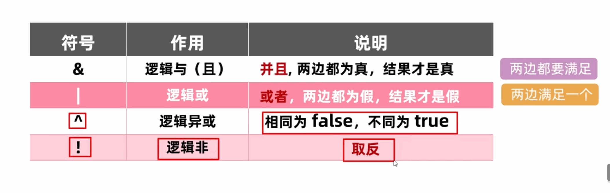

### 三元运算符

a > b ? a : b 、; 跟c差不多

### 优先级

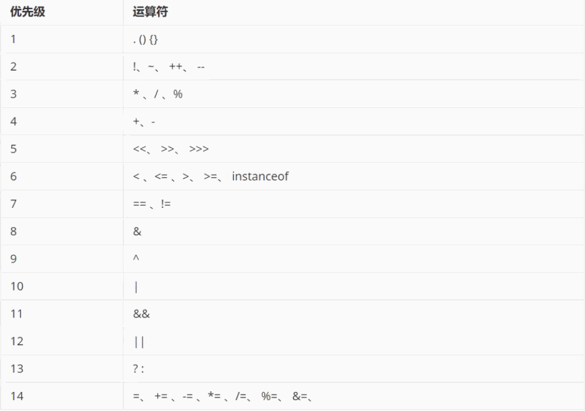

## 判断语句

### if语句

 跟c差不多

```
if(){

}

if(){

}else{

}

if(){

}else if{

}else{

}
```

### switch语句

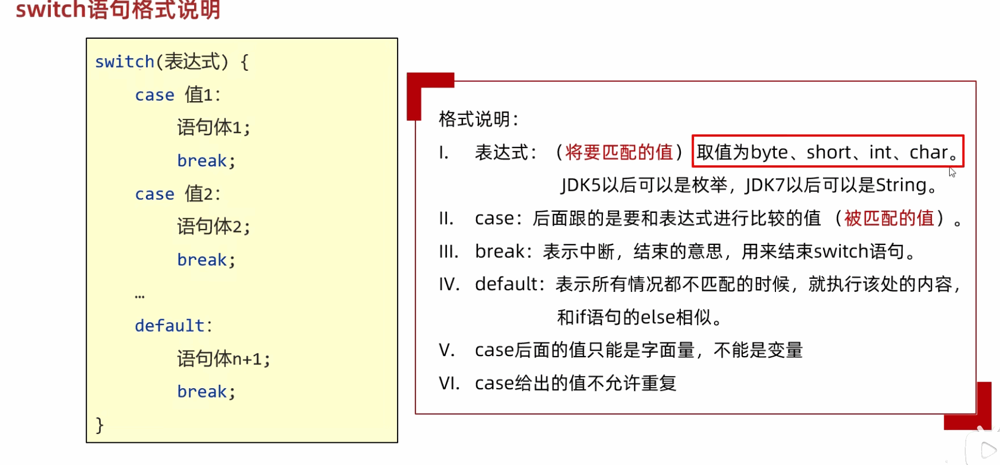

在jdk12时，可以使用 

```
switch(a)
case 值1-> {

}
```

匹配成功后，不需要写break就能直接中断

## 循环语句

跟c差不多有for，while，do…while

## 数组

### 数组的定义

```
格式一：
数据类型 [] 数组名
范例：int [] array


格式二：
数据类型 数组名[]
范例：int array[]
```

### 数组的静态初始化

```
格式一：
数据类型[] 数组名 = new 数据类型[]{元素1，元素2，元素3，元素4...};
范例：
int[] array = new int[]{11,22,33};
double[] array2 = new double[]{11.1,22.2,33.3};

格式二：（简化格式）
数据类型[] 数组名 = {元素1，元素2，元素3，元素4...};
范例：
int[] array = {11,22,33};
```

### 数组的地址值

```
int arr[]={1,2,3,4,5,6,7,8,9,10};
System.out.println(arr);

//打印的是第一个元素的地址值 [I@14ae5a5
[：表示当前是一个数组
I：表示当前数组里面的元素都是int类型
@：表示一个间隔符号（固定格式）
14ae5a5：数组真正的地址值（十六进制）
```

其他例如下标和c差不多

### 数组的遍历

```
//在Java当中，关于数组的一个长度属性：length
调用的方式：数组名.length

第一种 fro循环遍历
int arr[] = {1,2,3,4,5,6,7,8,9,10};
        
        for (int i=0;i<arr.length;i++) {
            System.out.println(arr[i]);
        }
        

```

```
第二种
arr.fori 自动生成循环

 arr.fori ==>  for (int i = 0; i < arr.length; i++) {
            
        }    
```

```
第三种  foreach语句遍历

for(type element: array)
{
    System.out.println(element);
}
```

### 数组的动态初始化

```
格式：
数据类型[] 数组名 = new 数据类型[数组长度];
```

数组默认初始化的规律：

**注意：**不同的数据类型对应不同的默认值

- 整数类型：0
- 小数类型：0.0
- 布尔类型：false
- 字符类型：‘\u0000’ 空格
- 引用类型：null

### java内存分配

栈      方法运行时使用的内存，比如main方法运行，进入方法栈中执行

堆      存储对象或者数组，new来创建的，都存储在堆内存中

方法区  	存储可以运行的class文件

本地方法栈	JVM在使用操作系统功能的时候使用，和我们开发无关

寄存器 		给cpu使用   ，和我们开发无关

## 方法

### 方法的定义与调用

```
public static void 方法名(){
	方法体（就是打包起来的代码）
}

方法的调用
方法名();
```

带参数的格式

有实参和形参的区别

```
public static void 方法名(int num1, int num2){

		方法体
		System.out.println(num1+num2);
		
}
```

带返回值的格式

```
public static 返回值类型 方法名(参数){
		方法体
		return 返回值;
}
```

### 方法的重载

在同一个类中，定义了多个同名的方法，这些同名的方法具有同种的功能。

每个方法具有不同的参数类型或参数个数，这些同名的方法，就构成了重载关系

与返回值类型无关

### 方法的基本数据型和引用数据类型

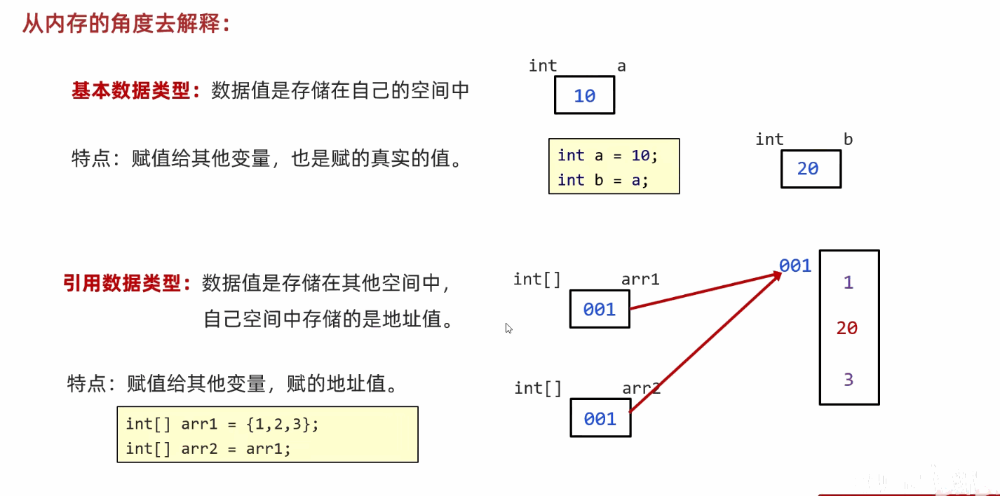

## 面向对象基础

### 类和对象

**类**是一个模板或蓝图，用于创建对象。类定义了对象的**属性**（成员变量）和**行为**（方法）。它是对现实世界中的一类事物的抽象描述。

类的构成：

- **成员变量（属性）**：表示对象的状态或特征。
- **方法（行为）**：表示对象可以执行的操作。

**对象**是类的一个实例。通过类定义的蓝图，我们可以创建多个对象，每个对象都有自己的属性值（状态）和可以执行的方法（行为）。对象在内存中有实际的存储空间，每个对象的属性是独立的。

**在JAVA中必须先设计类，才能获得对象**

```
public class 类名{    
    1.成员变量
    2.成员方法
    3.构造器
    4.代码块
    5.内部类
}

public class Phone{
   //属性（成员变量）
   String brand;
   
   //方法
   public void call(){
   
   }
}

创建对象
phone p1 = new phone();
```

### 创建类的对象

创建对象的语法是使用 `new` 关键字，并调用类的构造方法（如果有定义）。

**格式：类名 对象名 = new 类名();**

### 测试类、javaBean类、工具类（Utility Class）

1. 测试类（Test Class）

测试类通常用于单元测试（Unit Testing）。它的目的是验证你的代码是否按预期工作。Java 中有一些常用的测试框架，如 JUnit、TestNG 等，它们帮助你创建和运行测试。

**特点：**

- 包含测试方法，通常以 `@Test` 注解标注。
- 每个测试方法通常是独立的，验证特定功能或方法。
- 测试类不用于业务逻辑实现，而是用于验证程序的正确性。

**例子：**

```
import org.junit.jupiter.api.Test;
import static org.junit.jupiter.api.Assertions.assertEquals;

public class CalculatorTest {

    @Test
    public void testAdd() {
        Calculator calculator = new Calculator();
        int result = calculator.add(1, 2);
        assertEquals(3, result);
    }
}
```

在上面的代码中，`CalculatorTest` 类是一个测试类，`testAdd()` 是一个测试方法，它验证 `Calculator` 类中的 `add()` 方法是否正确。

1. ###### JavaBean 类

JavaBean 是一种符合特定规范的 Java 类，它通常用于数据封装。JavaBean 类的主要目的是通过提供一组 getter 和 setter 方法，使得它可以作为一个数据传输对象（DTO）在应用程序中传递数据。

**特点：**

- JavaBean 必须有一个无参构造函数。
- 类中的成员变量通常是私有的（`private`），通过公共的 getter 和 setter 方法访问。
- 它应该实现 `Serializable` 接口，以便可以进行序列化。
- 常用于数据库的实体映射或网络传输。

**例子：**

```
public class User implements java.io.Serializable {
    private String name;
    private int age;

    // 无参构造函数
    public User() {}

    // getter 和 setter 方法
    public String getName() {
        return name;
    }

    public void setName(String name) {
        this.name = name;
    }

    public int getAge() {
        return age;
    }

    public void setAge(int age) {
        this.age = age;
    }
}
```

在这个例子中，`User` 类是一个 JavaBean 类，包含了私有成员变量 `name` 和 `age`，以及它们的 getter 和 setter 方法。这个类符合 JavaBean 的规范，通常用于传递用户信息。

1. ###### 工具类（Utility Class）

工具类是一个包含一组静态方法的类，这些方法提供常用的功能，通常与某些操作或计算相关。工具类中的方法通常是通用的，因此可以在应用程序的不同部分重复使用。工具类通常只包含静态方法，并且不需要实例化。

**特点：**

- 工具类通常只包含静态方法，方便调用。
- 通常不需要实例化对象。
- 可以包含各种实用功能，如字符串处理、日期处理、数学计算等。

**例子：**

```
public class StringUtils {

    // 判断字符串是否为空
    public static boolean isEmpty(String str) {
        return str == null || str.trim().isEmpty();
    }

    // 字符串反转
    public static String reverse(String str) {
        if (str == null) {
            return null;
        }
        return new StringBuilder(str).reverse().toString();
    }
}
```

在上面的 `StringUtils` 类中，`isEmpty()` 和 `reverse()` 方法是工具方法。你可以直接调用这些静态方法而不需要创建 `StringUtils` 的实例。

主要区别总结：

- **测试类**：用于测试应用程序的代码是否按预期工作，通常包含测试框架（如 JUnit）的测试方法。
- **JavaBean 类**：用于封装数据，通常包含私有字段和公共的 getter/setter 方法，符合 JavaBean 的规范。
- **工具类**：包含常用的静态方法，用于实现通用功能（如字符串处理、文件操作等），通常不需要实例化。

### 类的封装

对象代表什么，就得封装对应的数据，并提供数据对应的行为

封装通常通过设置**私有属性**和**公共方法**来实现

```
public class Person {
    // 私有属性，外部无法直接访问
    private String name;
    private int age;

    // 公共的 getter 和 setter 方法
    public String getName() {
        return name;
    }

    public void setName(String name) {
        this.name = name;
    }

    public int getAge() {
        return age;
    }

    public void setAge(int age) {
        // 在 setter 方法中可以加入一些控制逻辑，确保数据合法
        if (age > 0) {
            this.age = age;
        } else {
            System.out.println("Age must be positive.");
        }
    }

    // 公共方法，类的行为
    public void introduce() {
        System.out.println("Hi, my name is " + name + " and I am " + age + " years old.");
    }
}

public class Test {
    public static void main(String[] args) {
        Person person = new Person();
        
        // 使用 setter 方法设置属性
        person.setName("Alice");
        person.setAge(25);
        
        // 使用 getter 方法获取属性值
        System.out.println(person.getName()); // 输出：Alice
        System.out.println(person.getAge());  // 输出：25

        // 调用公共方法
        person.introduce(); // 输出：Hi, my name is Alice and I am 25 years old.
    }
}
```

### 就近原则和this关键字

this用来调用成员变量，区分成员变量和局部变量

```
public class Phone{
   //属性（成员变量）
   private int age = 20;
   
   //方法
   public void method(){
   
    int age = 10;
    System.out.println(age); //输出10
    System.out.println(this.age); //输出20
   
   }
}
```

### 构造方法

作用：在创建对象的时候给成员变量进行赋值

**无参**数构造方法：	     初始化的对象时，成员变量的数据均采用默认值，

**有参**数构造方法:		在初始化对象的时候，同时可以为对象进行赋值。

**形式**

```
public class Student{
	
	修饰符 类名(参数){
	方法体
	
	}

}
```

**特点：**

1.方法名与类名相同，大小写也要一致

2.没有返回类型，连void也没有

3.没有具体的返回值(不能由retrun带回结果数据)

**执行时机:**

1.创建对象的时候由虚拟机调用，不能手动调用构造方法

2.每创建一次对象，就会调用一次构造方法

**注意事项**

① 构造方法的定义

如果没有定义构造方法，系统将给出一个默认的无参数构造方法

如果定义了构造方法，系统将不再提供默认的构造方法

② 构造方法的重载

带参构造方法，和无参数构造方法，两者方法名相同，但是参数不同，这叫做构造方法的重载

③ 推荐的使用方式

无论是否使用，都手动书写无参数构造方法，和带全部参数的构造方法

实例：

```
public class Student{
	private String name;
	private int age;
	
	public Student(){	// 空参构造方法
			...
	}
	
	public Student(String name,int age){ // 带全部参数的构造方法
			... 
	}
	
}
```

### 标准JavaBean

1. 类名需要见名知意
2. 成员变量使用private修饰
3. 提供至少两个构造方法
   1. 无参构造方法
   2. 带全部参数的构造方法
4. 成员方法
   提供每一个成员变量对应的setXxx()/getXxx()
   如果还有其他行为，也需要写上

例如：

```
package com.itheima.test6;

public class User{
	// 属性
	private String username;
	private String password;
	private String email;
	private String gender;
	private int age;
	
	// 空参
	public User(){
	
	}
	
	// 带全部参数的构造
	public User(String username,String password,String email,String gender,int age){
		this.username = username;
		this.password = password;
		this.email = email;
		this.gender = gender;
		this.age = age;
	}
	
	// get和set方法
	public void setUsername(String username){
		this.username = username;
	}
	
	public String getUsername(){
		return username;
	}
}
```

**快捷键：**

**alt + insert**

**alt + Fn + insert**

### static

static表示静态，是Java中的一个修饰符，可以修饰成员方法和成员变量

被static修饰的成员变量叫做**静态变量**(类变量)

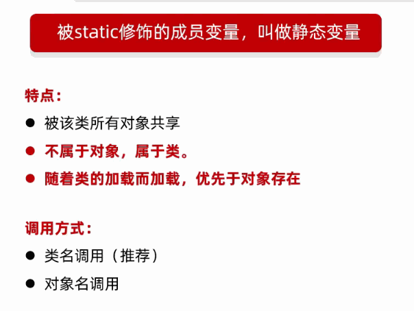

被static修饰的成员方法，叫做**静态方法**

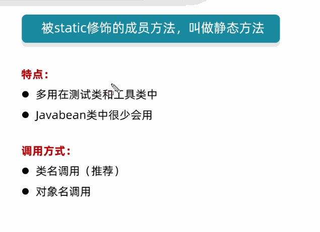

注意事项

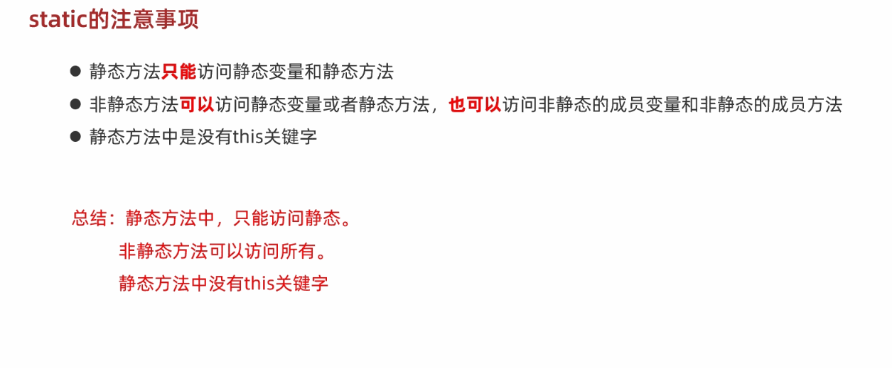

### 成员变量和局部变量

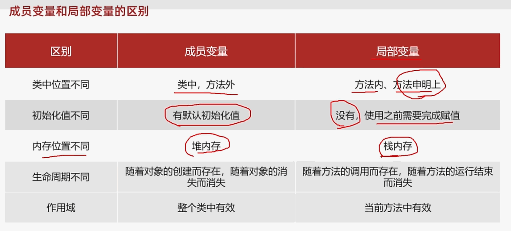

## API和API帮助文档

API：应用程序编程接口

简单理解：API就是别人已经写好的东西，我们不需要自己编写，直接使用即可

例如：Scanner、String、Random

Java API：指的就是JDK中提供的各种功能的Java类

这些类将底层的视线封装了起来，我们不需要关心这些类是如何实现的，只需要学习这些类如何使用即可

## 字符串

### String

java.lang.String 类代表字符串，Java 程序中的所有字符串文字(例如“abc”)都为此类的对象。

```
String name = "abc";
```

用+可以拼接

1. 特点：
   String是Java定义好的一个类。定义在java.lang包中，所以使用的时候不需要导包
2. java程序中的所有字符串文字都被实为此类的对象
3. 字符串不可变，它们的值在创建后不能被更改

### String构造方法

创建String对象的两种方式

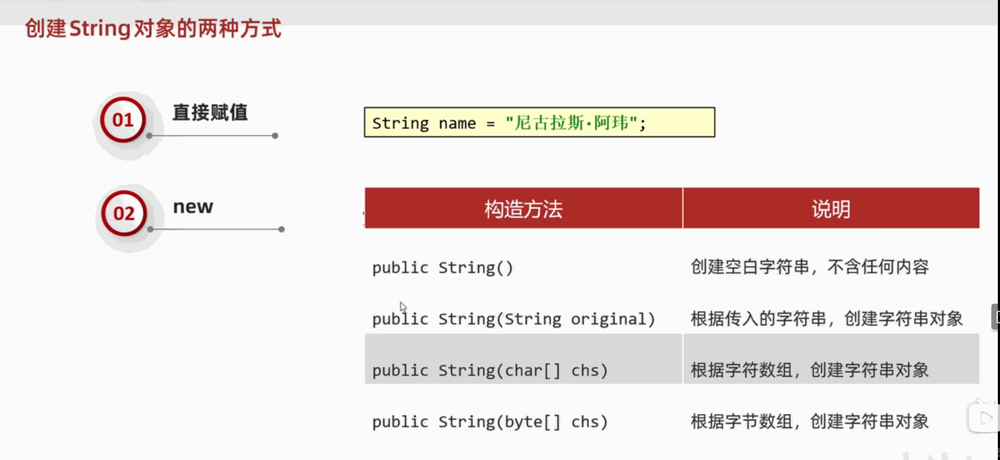

```
//直接赋值
String s1 = "abc"

//使用new的方式构造
//空参构造：获取一个空白的字符串对象
String s2 = new String();

//传递一个字符串，按照传递的字符串内容再创建一个新的字符串对象
String s3 = new String("abc");

//传递一个字符数组，根据字符数组的内容再创建一个新的字符串对象}
char[] chs = {'a','b','c','d'};
String s4 = new String(chs);
//abcd

//传递一个字节数组，会先去查对应的ascii码表上的值
byte[] bytes = {97,98.99,100};
String s5 = new String(bytes);
//abcd
```

### 字符串的比较

==比较，比较的是地址值是否相同

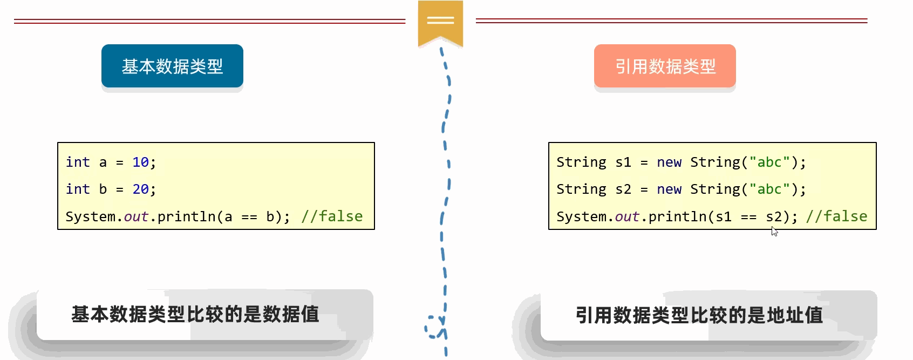

如果要正常比较字符串的数据值，需要用到方法

**boolean equals方法（要比较的字符串）		完全一样结果才是true，否则为false**

**boolean equalslgnoreCase（要比较的字符串）		忽略大小写的比较**

例如：

```
s1.equals(s2)  完全一样才是true，否则为false
s1.equalsIgnoreCase(s2)   比较时忽略大小写
返回的是boolean类型的值


boolean result1 = s1.equals(s2);
```

### StringBuilder

StringBulider可以看成是一个容器，创建之后里面的内容是可变的

作用：提高字符串的操作效率

它与`String`的主要区别在于，`String`对象是不可变的，每次对`String`进行修改都会生成新的字符串对象；而`StringBuilder`可以直接在原对象上修改内容，避免创建新的对象，从而提高效率。

**StringBuilder构造方法：**

```
//创建空白可变字符串
StringBulider s1 = new StringBulider();

//根据字符串的内容，创建可变字符串对象
StringBulider s2 = new StringBulider("abc");
```

**StringBuilder常用方法**

append()  添加数据，并返回对象本身

reverse()   翻转容器中的内容

length()	返回长度

toString() 实现吧StringBuilder转换为String

```
StringBuilder aa = new StringBuilder();  
//添加元素
aa.append("123"); //123

//反转
aa.reverse();   //321

//获取长度
aa.length();   //3

//转换为字符串
aa.tostring() 
```

### StringJoiner

Stringloiner跟StringBuilder一样，也可以看成是一个容器，创建之后里面的内容是可变的。

通常用于将多个字符串以指定分隔符连接成一个单一的字符串

作用:提高字符串的操作效率，而且代码编写特别简洁，但是目前市场上很少有人用。

**StringJoiner的构造方法**

```
StringJoiner sj1 = new StringJoiner(间隔符号);	

StringJoiner sj2 = new StringJoiner(间隔符号,开始符号,结束符号);
```

实例：

```
import java.util.StringJoiner;

public class Main {
    public static void main(String[] args) {
        StringJoiner joiner = new StringJoiner(", ", "[", "]");
        joiner.add("apple");
        joiner.add("banana");
        joiner.add("cherry");
        
        System.out.println(joiner.toString());  // 输出: [apple, banana, cherry]
    }
}
```

**常用操作**

add()	添加数据，并返回对象本身

length()	返回长度（字符出现的个数）

toString()	返回一个字符串（该字符串就是拼接之后的结果）

## 集合

### 集合的基本使用

集合中可以存引用数据类型和基本数据类型，但存放基本数据类型时，要使用对应的包装类

| 基本数据类型 | 包装类      |
| ------------ | ----------- |
| `boolean`    | `Boolean`   |
| `byte`       | `Byte`      |
| `char`       | `Character` |
| `short`      | `Short`     |
| `int`        | `Integer`   |
| `long`       | `Long`      |
| `float`      | `Float`     |
| `double`     | `Double`    |

**与数组的区别**

**数组**：数组的大小是固定的，一旦定义，就无法更改。在创建数组时，必须指定其长度，并且一旦数组创建完成，大小就不能再修改。

```
int[] arr = new int[5];  // 创建一个包含 5 个元素的数组
```

**集合**：集合的大小是动态的，可以根据需要自动增长或缩小。例如，`ArrayList` 可以根据添加或删除元素自动调整大小。

```
ArrayList<Integer> list = new ArrayList<>();
list.add(10);
list.add(20);
```

**创建集合的对象**

```
泛型：限定集合中存储数据的类型
ArrayList<包装类> list = new ArrayList<>();  只能存储这种包装类的  //在JDK7以上使用
```

**成员方法**

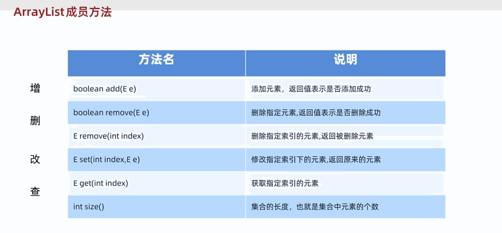

实例：

```
public class ArrayListDemo2{
	public static void main(String[] args){
	
	//创建一个集合
	ArrayList<String> list = new ArrayList<>();
	
	//添加元素
	list.add("aaa");
	list.add("aaa");
	list.add("bbb");
	list.add("ccc");
	
	System.out.println(list);
	//[aaa,aaa,bbb,ccc]
	
	//删除元素
	boolean result = list.remove("aaa");
	System.out.println(result);
	System.out.println(list);
	//true
	//[aaa,bbb,ccc]
	
	
	//删除指定索引的值，返回被删除元素
	String str = list.remove(0);
}
```

## 面向对象进阶

### 类的继承

Java中提供一个关键字extends，用这个关键字，我们可以让一个类和另一个类建立起继承关系

```
public class 子类 extends 父类{}
```

Student称为子类（派生类），Person称为父类（基类或超类）

```
// 父类
class Animal {
    void speak() {
        System.out.println("Animal speaks");
    }
}

// 子类
class Dog extends Animal {
    // 子类重写父类方法
    @Override
    void speak() {
        System.out.println("Dog barks");
    }
}

public class Main {
    public static void main(String[] args) {
        Dog dog = new Dog();
        dog.speak();  // 输出：Dog barks
        
        Animal animal = new Animal();
        animal.speak();  // 输出：Animal speaks
    }
}

```

**使用继承的好处**

可以把多个子类中重复的代码抽取到父类中了，提高代码的复用性

子类可以在父类的基础上，增加其他的功能，使子类更强大，

**使用条件**

当类与类之间，存在相同(共性)的内容，并满足子类是父类的一种，就可以考虑使用继承，来优化代码

#### 继承的特点

Java只支持单继承，不支持多继承，但支持多层继承。

单继承：一个子类只能继承一个父类。

不支持多继承：子类不能同时继承多个父类。

多层继承：子类A继承父类B，父类B可以继承父类C

**每一个类都直接或者间接的继承于Object**

#### 子类能继承能继承父类中的内容

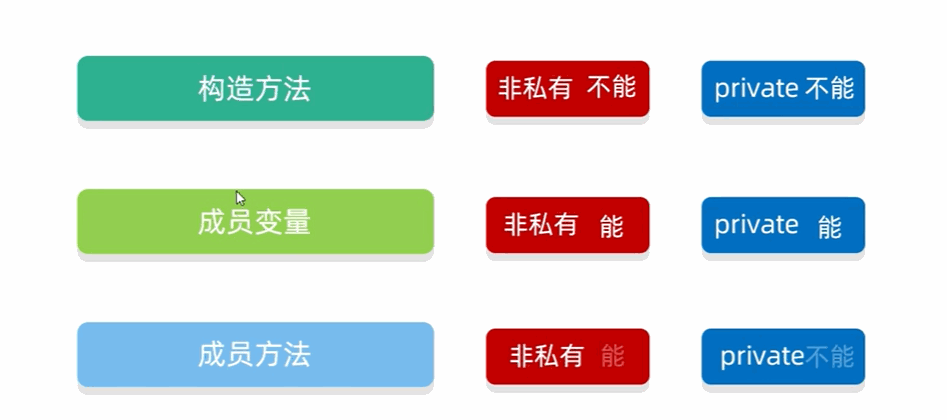

#### 成员变量和成员方法访问特点

**继承中：成员变量的访问特点**

遵循就近原则：谁离我近，我就用谁

```
pubilc class Fu {
	String name = "Fu";
}

public class Zi extends Fu{
	String name = "Zi";
	public void ziShow(){
		String name = "ziShow";
		System.out.println(name);
	}
}

// 输出ziShow
```

如果出现了重名变量，可以用关键字来区分

```
pubilc class Fu {
	String name = "Fu";
}

public class Zi extends Fu{
	String name = "Zi";
	public void ziShow(){
		String name = "ziShow";
		System.out.println(name);	// 打印局部变量ziShow
		System.out.println(this.name); // 打印本类成员变量Zi
		System.out.println(super.name); // 打印父类成员变量Fu
	}
}


```

---

**继承中：成员方法的访问特点**

也是就近原则

```
class Person{
	public void eat(){
		System.out.println("吃米饭，吃菜");
	}
	
	public void drink(){
		System.out.println("喝开水");
	}
}

class Student extends Person{
	
	pubilc void lunch(){
		// 先在本类中查看eat和drink方法，就会调用子类的，如果没有，就会调用从父类中继承下来的eat和drink方法
		this.eat();
		this.drink();
		
		// 直接调用父类中的eat和drink方法
		super.eat();
		super.drink();
	}
}
```

#### 方法的重写

当父类的方法不能满足子类现在的需求时，需要进行方法重写

**书写格式：**

在继承体系中，子类出现了和父类中一模一样的方法声明，我们就称子类这个方法时重写的方法

@Override重写注解

1. @Override是放在重写后的方法上，检验子类重写时语法是否正确。
2. 加上注解后如果有红色波浪线，表示语法错误
3. 建议重写方法都加@Override注解

```
class OverseasStudent extend Person{
	
	@Override
	public void eat(){
		System.out.println("吃意大利面");
	}
	
	@Override
	public void drink(){
		System.out.println("喝凉水");
	}
}
```

方法重写注意事项和要求

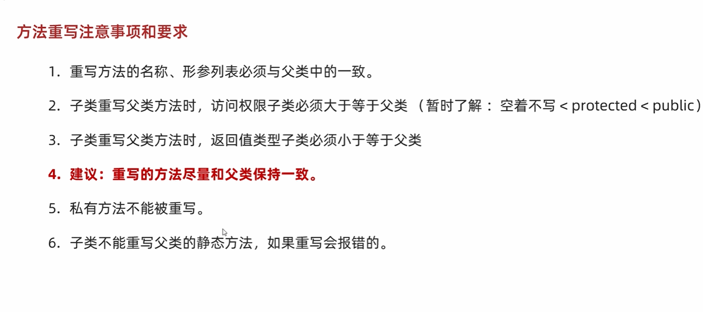

#### 构造方法的访问特点

**继承中：构造方法的访问特点**

父类中的构造方法不会被子类继承。

子类中所有的构造方法默认先访问父类中的无参构造，再执行自己

**为什么?**

子类在初始化的时候，有可能会使用到父类中的数据，如果父类没有完成初始化，子类将无法使用父类的数据

子类初始化之前，一定要调用父类构造方法先完成父类数据空间的初始化。

使用this()访问本类的构造方法

使用super访问父类的构造方法

**怎么调用父类构造方法的？**

子类构造方法的第一行语句默认都是：super()，不写也存在，且必须在第一行

如果想调用父类有参构造，必须手动写super进行调用

```
public class Student extends Person{

	// 访问父类的无参构造
	public Student(){
		super();
		System.out.println("123");
	}
	
	// 访问父类的带参构造
	public Student(String name,int age){
		super(name,age);
	}
	
}
```

#### this、super总结

this  ： 理解为一个变量，表示当前方法调用者的地址值

super: 代表父类存储空间

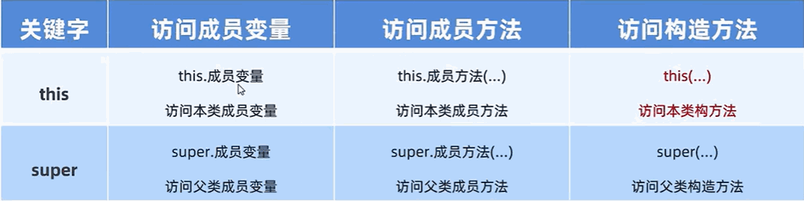

### 类的多态

**定义**

同类型的对象，表现出不同形态

**多态表现形式**

父类类型 对象名称 = 子类对象

**多态的前提**

1. 有继承关系
2. 有父引用指向子类对象               Fu f = new Zi();
3. 有方法重写

#### 多态调用成员特点

**多态方式创建对象：**

Animal a = new Dog()；

**变量调用：编译看左边，运行也看左边**

**方法调用：编译看左边，运行看右边**

编译看左边：javac编译代码的时候，会看左边的父类中有没有这个变量，如果有，编译成功，如果没有编译失败

运行看左边：java运行代码的时候，实际获取的就是左边父类中的成员变量的值

#### **多态的优势和弊端**

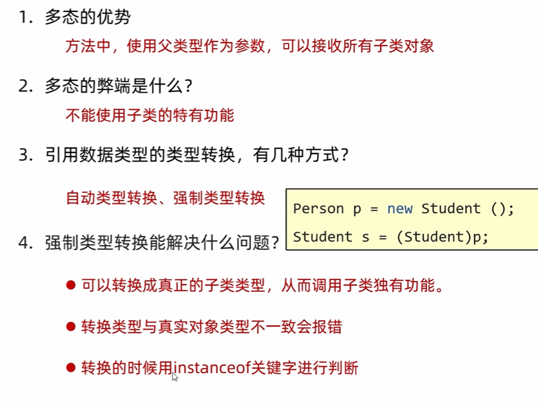

判断变量所记录的对象的是否是对应的类型

```
instanceof

if(a instanceof Dog)
{
	Dog d = (Dog) a;
	d.lookhome();
}
else if(a instanceof Cat)
{
	Cat c = (Cat) a;
	c.catchMouse();
}else{
	System.out.println("没有这个类型，无法转换");
}
```

**jdk14之后新特性**（不需要强转，在判断时自动转，如果是true，则自动转）

```
instanceof

if(a instanceof Dog d)
{
	d.lookhome();
}
else if(a instanceof Cat c)
{
	c.catchMouse();
}else{
	System.out.println("没有这个类型，无法转换");
}
```

### 包和final

####  包

包就是文件夹。用来管理各种不同功能的Java类，方便后期维护

包名通常基于公司或项目的域名（反向域名命名法）+包的作用，以减少与其他组织或项目的包名冲突。

例如公司网站是**www.itheima.com**

那么包名就应该是**com.itheima.domain**

**使用其他类的规则**

使用其他类时，需要使用全类名（com.itheima.包的作用.类名）

```
import com.itheima.domain.Student;

public class Test{
	public static void main(String[] args){
		Student s = new Student;
	}
}
```

**什么时候需要导包什么时候不需要**

- 使用同一个包中的类时，不需要导包
- 使用java.lang包中的类时，不需要导包
- 其他情况都需要导包
- **如果同时使用两个包中的同名类，需要使用全类名**

#### final

可以修饰方法、类、变量

final 方法：表明该方法是最终方法，不能被重写

final 类 ：表明该类是最终类，不能被继承

final 变量：叫做常量，只能被赋值一次

```
class Fu{
	public final void show(){
		System.out.println("父类的show方法");
	}
}
```

细节：

final修饰的变量是基本类型：那么变量存储的数据值不能发生改变

final修饰的变量是引用类型：那么变量存储的地址值不能发生改变，对象内部的可以改变

### 修饰符

在 Java 中，**修饰符**（Modifiers）用于控制类、方法、变量的访问权限、行为以及其他特性。修饰符分为两大类：**访问修饰符** 和 **非访问修饰符**。修饰符提供了对类、方法、属性等的访问控制、功能增强以及其他特性管理。

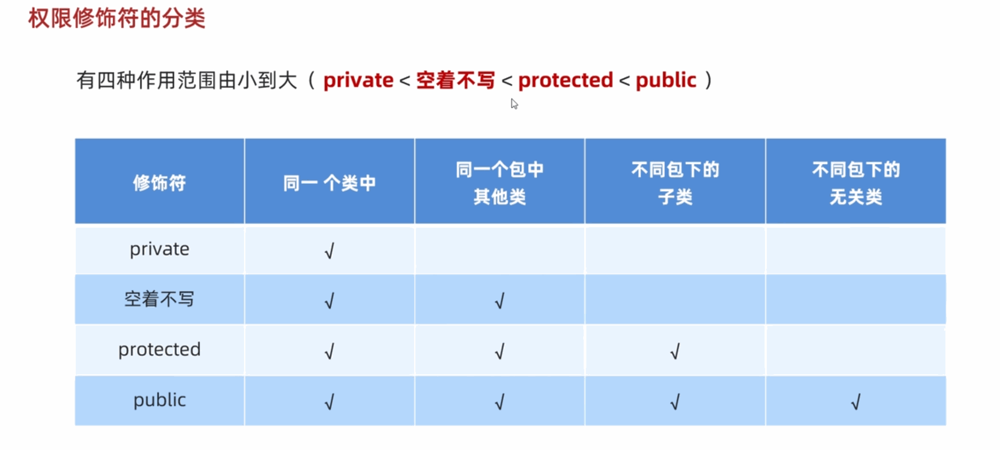

**访问修饰符**

访问修饰符用于定义类、方法、变量的访问范围，即控制哪些类、方法、变量可以被访问。Java 提供了四种访问修饰符：

**`public`**

- **含义**：表示该成员可以被任何其他类访问。
- **适用范围**：类、方法、变量。

```
public class MyClass {
    public int number;
}
```

**`private`**

- **含义**：表示该成员只能在定义它的类内部访问，不能在类外部访问。
- **适用范围**：方法、变量。

```
class MyClass {
    private int number;
    
    private void display() {
        System.out.println(number);
    }
}
```

**`protected`**

- **含义**：表示该成员可以在同一包中的其他类访问，也可以在不同包中通过继承访问。
- **适用范围**：方法、变量。

```
class MyClass {
    protected int number;
    
    protected void display() {
        System.out.println(number);
    }
}
```

**默认**

- **含义**：如果没有指定访问修饰符，默认是包私有，表示该成员仅能在同一包内的类中访问，包外不可访问。
- **适用范围**：方法、变量。

```
class MyClass {
    int number;  // 默认访问修饰符（包私有）
    
    void display() {
        System.out.println(number);
    }
}
```

### 抽象类和抽象方法

抽象方法：将共性的行为（方法）抽取到父类之后。由于每一个子类执行的内容是不一样，所以，在父类中不能确定具体的方法体。该方法就可以定义为抽象方法。

抽象类：如果一个类中存在抽象方法，那么该类就必须声明为抽象类

**作用：**

**抽取共性时，无法确定方法体，就把方法定义为抽象的。**

**强制让子类按照某种格式重写**

#### 抽象类和抽象方法的定义格式

**抽象方法的定义格式：**

```
public abstract 返回值类型 方法名(参数列表);
```

**抽象类的定义格式：**

```
public abstract class 类名{}
```

#### 抽象类和抽象方法的注意事项

- 抽象类不能实例化
- 抽象类中不一定有抽象方法，有抽象方法的类一定是抽象类
- 可以有构造方法
- 抽象类的子类

​	要么重写抽象类中的所有抽象方法

​	要么是抽象类

### 接口

在抽象类中，抽象方法本质上是定义接口规范：即规定高层类的接口，从而保证所有子类都有相同的接口实现，这样，多态就能发挥出威力。

如果一个抽象类没有字段，所有方法全部都是抽象方法：

```
abstract class Person {
    public abstract void run();
    public abstract String getName();
}
```

就可以把该抽象类改写为接口：`interface`。

在Java中，使用`interface`可以声明一个接口：

所谓`interface`，就是比抽象类还要抽象的纯抽象接口，因为它连字段都不能有。因为接口定义的所有方法默认都是`public abstract`的，所以这两个修饰符不需要写出来（写不写效果都一样）。

当一个具体的`class`去实现一个`interface`时，需要使用`implements`关键字。举个例子：

```
class Student implements Person {
    private String name;

    public Student(String name) {
        this.name = name;
    }

    @Override
    public void run() {
        System.out.println(this.name + " run");
    }

    @Override
    public String getName() {
        return this.name;
    }
}
```

我们知道，在Java中，一个类只能继承自另一个类，不能从多个类继承。但是，一个类可以实现多个`interface`，例如：

```
class Student implements Person, Hello { // 实现了两个interface
    ...
}
```

#### 接口中成员的特点

成员变量：

​	只能是常量

​	默认修饰符：piublic static final

构造方法：

​	没有

成员方法：

​	只能是抽象方法

​	默认修饰符：public abstract

JDK7以前：接口中只能定义抽象方法

JDK8的新特性：接口中可以定义有方法体的方法

JDK9的新特性：接口中可以定义私有方法

#### 接口和类之间的关系

类和类的关系：

​	继承关系，只能单继承，不能多继承，但是可以多层继承

类和接口的关系：

​	实现关系，可以单实现，也可以多实现，还可以在继承一个类的同时实现多个接口

接口和接口的关系：

​	继承关系，可以单继承，也可以多继承

#### default默认方法

在接口中，可以定义`default`方法。例如，把`Person`接口的`run()`方法改为`default`方法：

```
// interface
public class Main {
    public static void main(String[] args) {
        Person p = new Student("Xiao Ming");
        p.run();
    }
}

interface Person {
    String getName();
    default void run() {
        System.out.println(getName() + " run");
    }
}

class Student implements Person {
    private String name;

    public Student(String name) {
        this.name = name;
    }

    public String getName() {
        return this.name;
    }
}
```

接口中默认方法的定义格式：

```
public default 返回值类型 方法名(参数列表){}
```

接口中默认方法的注意事项：

1. ​	默认方法不是抽象方法，所以不强制被重写，但是如果被重写，重写的时候去掉default关键字
2. ​	public可以省略，default不能省略
3. ​	如果实现了多个接口，多个接口中存在相同名字的默认方法，子类就必须对该方法进行重写

如果没有重写，并且没有存在多个接口中有相同名字的默认方法，不用重写，可以直接调用接口中的默认方法

#### 接口中的静态方法

JDK8以后接口中新增的方法

 允许在接口中定义静态方法，需要用static修饰

**接口中静态方法的定义格式：**

```
格式：public static 返回值类型 方法名(参数列表){}

范例：public static void show(){}
```

接口中静态方法的注意事项：

- ​	静态方法只能通过接口名调用，不能通过实现类名或者对象名调用
- ​	public可以省略，static不能省略


#### 接口中的私有方法

JDK9新增的方法，使其在接口中的默认方法中调用

接口中私有方法的定义格式：

普通的私有方法格式：（给默认方法服务）

```
格式：private 返回值类型 方法名(参数列表){}
范例：private void show(){}
```

静态的私有方法格式：	（给静态方法服务）

```
格式：private static 返回值类型 方法名(参数列表){}
范例：private static void method(){}
```

#### 接口的应用（接口多态）

类似于多态

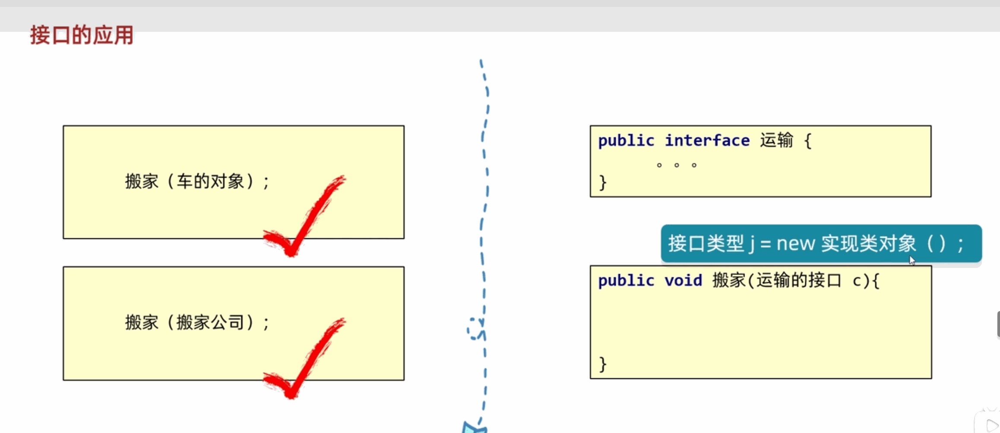


1. 接口代表规则，是行为的抽象。想要让哪个类拥有一个行为，就让这个类实现对应的接口就可以了。
2. 当一个方法的参数是接口时，可以传递接口所有实现类的对象，这种方式称之为接口多态

### 内部类

**内部类：写在一个类里面的类就叫做内部类**

1. 内部类表示的事物是外部类的一部分
2. 内部类单独出现没有任何意义

内部类的访问特点：

- 内部类可以直接访问外部类的成员，包括私有
- 外部类要访问内部类的成员，必须创建对象

例子：

```
public class Car{ // 外部类
	String carName;
	int carAge;
	int carColor;
	
	public void show(){
		System.out.println(this.carName);
		
		// 外部类要访问内部类的成员变量，必须创建对象
		Engine e = new Engine();
		System.out.println(e.engineName);
	}
	
	class Engine{ // 内部类
		String engineName;
		int engineAge;
		
		public void show(){
			System.out.println(engineName); 
			// 内部类要访问外部类的成员可以直接访问
			System.out.println(carName); 
		}
	}
}
```

####  成员内部类

- 写在成员位置的，属于外部类的成员
- 成员内部类可以被一些修饰符所修饰，比如：private，默认，protected，public，static等
- 在成员内部类里面，JDK16之前不能定义静态变量，JDK16开始才可以定义静态变量。

**获取成员内部类对象**

```
方式一：
在外部类中编写方法，对外提供内部类的镀锡

方式二：
直接创建格式：外部类名.内部类名 对象名 = 外部类对象.内部类对象;
范例：Outer.Inner oi = new Outer.new Inner();
```

**内部类获取外部类的成员变量**

```
public class Outer{
	private int a = 10;
	
	class Inner{
		private int a = 20;
		
		public void show(){
			int a = 30;
			System.out.println(a); // 30
			System.out.println(this.a); // 20
			System.out.println(Outer.this.a); // 10
		}
	}
}
```

#### 静态内部类

静态内部类只能访问外部类中的静态变量和静态方法，如果想要访问非静态的需要创建对象。

```
pulic class Car{
	String carName;
	int carAge;
	int carColor;
	
	static class Engine{
		String engineName;
		int engineAge;
	}
}
```

创建静态内部类对象的格式：外部类名.内部类名 对象名 = new 外部类名.内部类名();

调用非静态方法的格式：先创建对象，用对象调用。

调用静态方法的格式：外部类名.内部类名.方法名();

#### 局部内部类

1. 将内部类定义在方法里面就叫做局部内部类，类似于方法里面的局部变量。
2. 外界是无法直接使用，需要在方法内部创建对象并使用
3. 该类可以直接访问外部类的成员，也可以访问方法内的局部变量

#### 匿名内部类

匿名内部类本质上就是隐藏了名字的内部类

```
格式：
	new 类名或者接口名(){
		重写方法;
	};
```

应用

```
method(
	new Animal(){
		@Override
		public void eat(){
			System.out.println("狗吃骨头");
		}
	}
);

public static void method(Animal a){
	a.eat();
}
```

接口多态

```
Swim s = new Animal(){
		@Override
		public void eat(){
			System.out.println("狗吃骨头");
		}
	}
	
	//编译看左边，运行看右边
	s.eat();
```

匿名内部类调用方法

```
new Animal(){
		@Override
		public void eat(){
			System.out.println("狗吃骨头");
		}
	}.eat();
```

格式的细节：

包含了继承或实现，方法重写，创建对象。

整体就是一个类的子类对象或者接口的实现类对象

使用场景：

当方法的参数是接口或者类时，以接口为例，可以传递这个接口的实现类对象，如果实现类只要使用一次，就可以用匿名内部类简化代码。

## 反射

反射允许对封装类的字段，方法和构造函数的信息进行编程访问

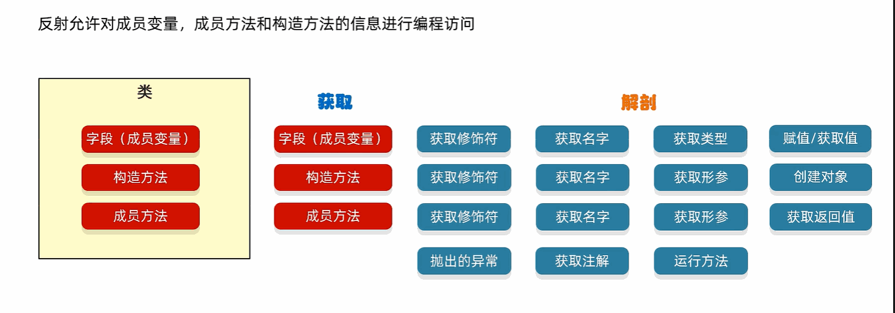

### 获取class对象的三种方式

1、Class c1 = 类名.class

```
Class c1 = Student.class
```

2、调用Class提供方法：public static Class forName(String package);

Class c2 = Class.forName(全类名)

```
Class c1 = class.forName("com.itheima.myreflect.Student");
```

3、Object提供的方法：public Class getClass();

Class c3 = 对象.getClass();

```
Student s = new Student;
Class c1 = s.getClass();
```

### 获取构造方法

**Class类中用于获取构造方法的方法**

```
Constructor<?>[] getConstructors()：返回所有公共构造方法对象的数组
Constructor<?>[] getDeclaredConstructors()：返回所有构造方法对象的数组
Constructor<T>[] getConstructor(Class<?>...parameterTypes)：返回单个公共构造方法对象
Constructor<T> getDeclaredConstrutor(Class<?>...parameterTypes)：返回单个构造方法对象
```

---

**Constructor类中用于创建对象的方法**

```
T newInstance(Object... initargs)：根据指定的构造方法创建对象
setAccessible(boolean flag)：设置为true，表示取消访问检查
```

示例：

先获取class对象，再获取构造方法

```
Class c1 = Class.forName("全类名");
Constructor[] cons1 = c1.getConstructors();
for(Constructor con:cons1)
{
	System.out.println(con);
}
```

或者

```
//暴力反射：表示临时取消权限检验
con4.setAccessible(true);
Student stu = (Student) con4.newInstance("张三",23);

System.out.println(stu);
```

---

### 获取成员变量

**Class类中用于获取成员变量的方法**

```
Field[] getFields()：返回所有公共成员变量对象的数组
Field[] getDeclaredFields()：返回所有成员变量对象的数组
Field getField(String name)：返回单个公共成员变量对象
Field getDeclaredField(String name)：返回单个成员变量对象
```

---

**Field类中用于创建对象的方法**

```
void set(Object obj,Object value)：赋值
Object get(Object obj)	获取值
```

例子：

```
Class clazz=Class.forName("全类名");
Field[] fie1=clazz.getConstructors();
for(Field field:fie2){
System.out.println(con)
}
```

---

### 获取成员方法

**Class类中用于获取成员方法的方法**

```
Method[] getMethods()：返回所有公共成员方法对象的数组，包括继承的
Method[] getDeclaredMethods：返回所有成员方法对象的数组，不包括继承的
Method getMethod(String name,Class<?>...parameterTypes)：返回单个公共成员方法对象
Method getDeclaredMethod(String name,Class<?>...parameterTypes)：返回单个成员方法对象
```

**Method类中用于创建对象的方法**

```
Object invoke(Object obj,Object... args)：运行方法
参数一：用obj对象调用该方法
参数而：调用方法的传递的参数（如果没有就不写）
返回值：方法的返回值（如果没有就不写）
```

例如：

```
Class<?> clazz = MyClass.class; // 获取Class对象
Method method = clazz.getMethod("myMethod"); // 获取Method对象
MyClass obj = new MyClass(); // 创建对象实例
method.invoke(obj); // 调用方法
```

---

```
Class c1 = Class.forName("java.lang.Runtime");
Method m2 = c1.getMethod("getRuntime");
Runtime c2 = Runtime.getRuntime();
Runtime c3 = (Runtime) m2.invoke(c2);
```

成员方法的调用示例：

```
Class<?> clazz = Class.forName("java.lang.String");
Method method = clazz.getMethod("toUpperCase");
String result = (String) method.invoke("hello"); // 相当于 "hello".toUpperCase()
System.out.println(result); // 输出 "HELLO"
```

