# MySQL

数据库的相关概念：

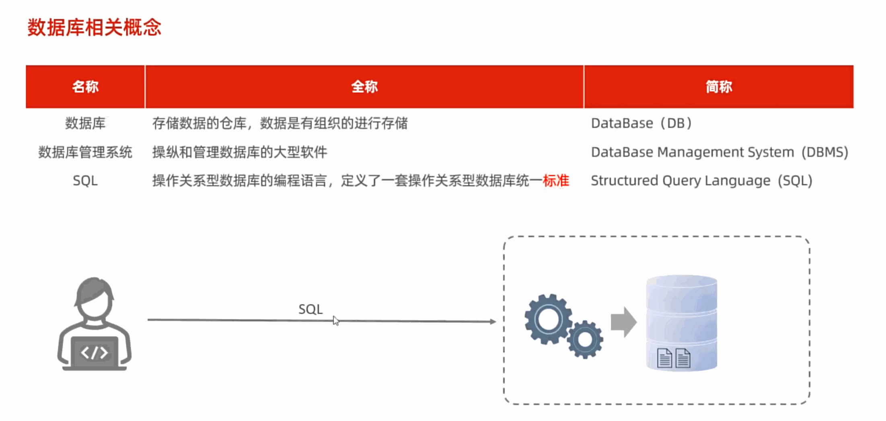

客户端的连接：

```
mysql -u root -p
mysql [-h 指定主机地址] [-P 指定连接端口] -u 指定连接用户名 -p 指定密码
```

数据模型：

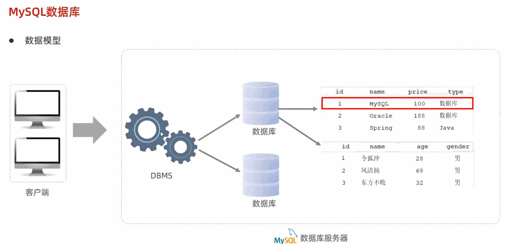

关系型数据库

概念：建立在关系模型基础上，由多张相互连接的二维表组成的数据库

特点：

1.使用表结构存储数据，格式统一，便于维护

2.使用SQL语言操作，标准统一，使用方便

# SQL

## SQL通用语法及分类

### SQL通用语法

1. SQL语句可以单行或多行书写，以分号结尾。

2. SQL语句可以使用空格/缩进来增强语句的可读性。

3. MySQL数据库的SQL语句不区分大小写，关键字建议使用大写

4. 注释：

   单行注释：--注释内容 或者 # 注释内容（MySQL特有）

   多行注释：/\*注释内容\*/

## SQL分类

SQL分类：

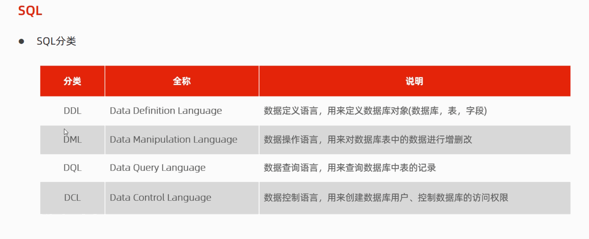

## DDL

### DDL-数据库操作

```
查询
	查询所有数据库
	SHOW DATABASES;
	查询当前数据库
	SELECT DATABASE()

创建
	CREATE DATABASE[IF NOT EXISTS]数据库名[DEFAULT CHARSET字符集][COLLATE 排序规则];
删除
	DROP DATABASE[IF EXISTS]数据库名;
使用
	USE 数据库名;

注意：[]的内容都是可选的
```

### DDL-表操作-查询

```
查询当前数据库所有表
	SHOW TABLES;
查询表结构
	DESC 表名;
查询指定表的建表语句;
	SHOW CREATE TABLE 表名;
	
注意：前提是需要先进入该数据库即使用use 数据库名;
```

### DDL-表操作-创建

```
CREATE TABLE 表名(
	字段1 字段1类型[COMMENT 字段1注释],
	字段2 字段2类型[COMMENT 字段2注释],
	字段3 字段3类型[COMMENT 字段3注释],
	......
	字段n 字段n类型[COMMENT 字段n注释]
)[COMMENT 表注释];

注意：[...]为可选参数，最后一个字段后面没有逗号
```

创建该表：

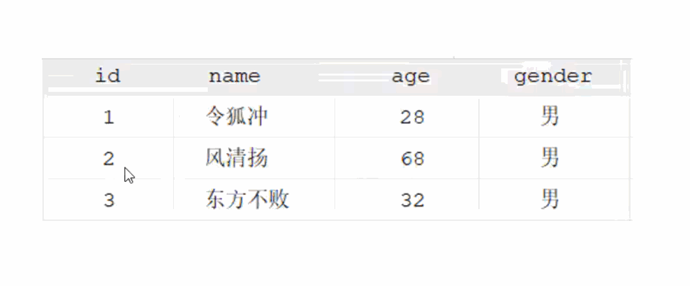

语法：

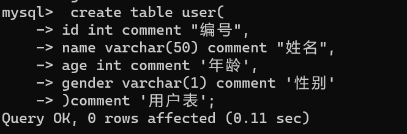

创建成功使用show tables查看：

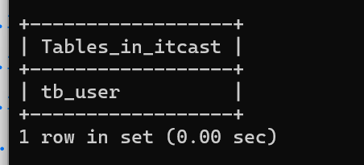

可以看到tb_user已经创建成功

### DDL-表操作-数据类型

MySQL中的数据类型有很多，主要分为三类：数值类型、字符串类型、日期时间类型

#### 数值类型：

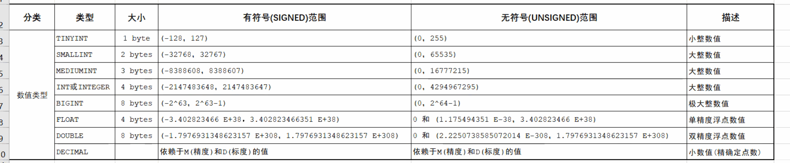

DECIMAL	M(精度)指长度	D(标度)指小数点后长度

例如：
age TINYINT UNSIGNED; 无符号类型 unsigned

score double(4,1)；	表示长度为4，1位小数

#### 字符串类型：

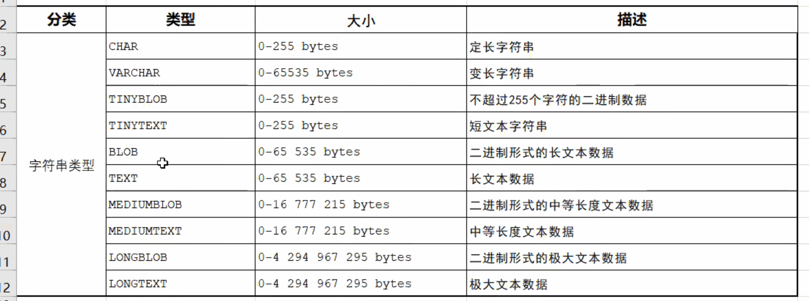

char(x)和varchar(x)后都要带参数,表示字符串能够存储的最大字符长度

char固定长度未被赋值的取余将被空格代替,最大长度是多少就占用多少空间

varchar会根据所存储的内容去计算占用的空间，有多少字符就占用多少空间

区别：

​	char()	性能好

​	varchar()	性能较差

例如：

用户名	username	varchar(50)	不定长

性别	gender	char(1)	定长

#### 日期类型：

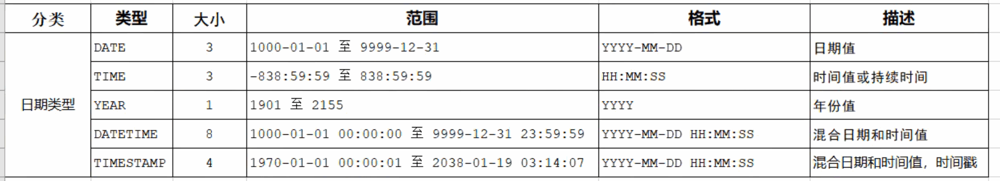

常用：DATE	TIME	DATETIME

样例：

使用合适的数值类型来储存数据

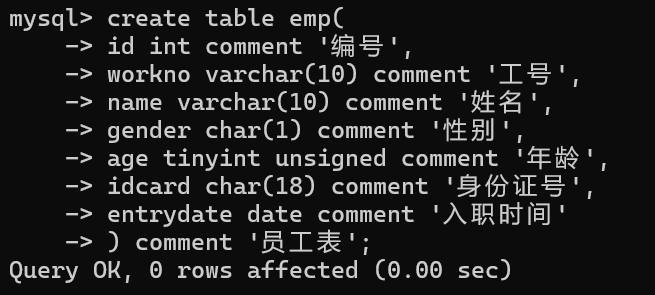

结果：

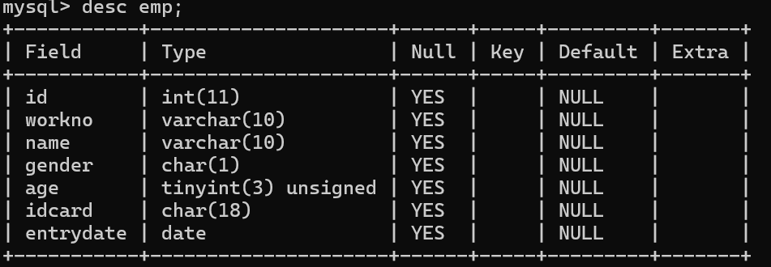

### DDL-表操作-修改

```
添加字段
	ALTER TABLE 表名 ADD 	字段名 类型(长度) [COMMENT 注释] [约束];
	
修改字段
	修改数据类型
		ALTER TABLE 表名 MODIFY 字段名 新数据类型(长度);
	修改字段名和字段类型
		ALTER TABLE 表名 CHANGE 旧字段名 新字段名 类型(长度) [COMMENT 注释] [约束];

删除字段
	ALTER TABLE 表名 DROP 字段名;
	
修改表名
	ALTER TABLE 表名 RENAME TO 新表名;
```

添加案例：

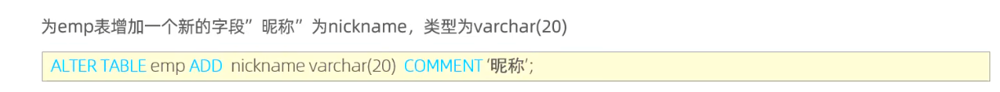


修改案例：

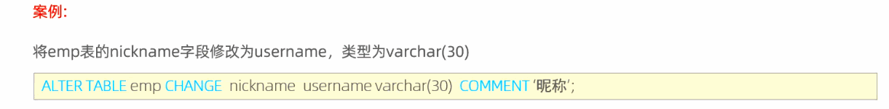

删除案例：
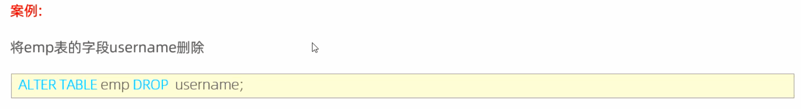

修改表名：
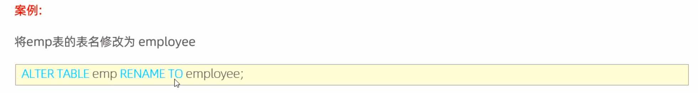

### DDL-表操作-删除

```
删除表
	DROP TABLE [IF EXISTS] 表名;
删除指定表，并重新创建该表
	TRUNCATE TABLE 表名;	等于清空这个表内的数据
```

## DML

### DML-添加数据

``` 
1.给指定字段添加数据
	INSERT INTO 表名 (字段名1,字段名2,...) VALUES (值1,值2,...);
2.给全部字段添加数据
	INSERT INTO 表名 VALUES (值1,值2,...);

3.批量添加数据
	INSERT INTO 表名 (字段名1,字段名2,...) VALUES (值1,值2,...),(值1,值2,...),(值1,值2,...);
	INSERT INTO 表名 VALUES (值1,值2,...),(值1,值2,...),(值1,值2,...);
```

注意：

- 插入数据时，指定的字段顺序需要与值的顺序是一一对应的。
- 字符串和日期型数据应该包含在引号中。
- 插入的数据大小，应该在字段的规定范围内。

### DML-修改数据

```
UPDATE 表名 SET 字段名1 = 值1,字段名2 = 值2,... [WHERE 条件];
```

案例：修改id为1的数据，将name修改为itheima


修改多个值：


注意：修改语句的条件可以有，也可以没有，如果没有条件，则会修改整张表的所有数据。

### DML-删除数据

```
DELETE FROM 表名 [WHERE 条件];
```

案例：将gender为女的数据删除


注意：

- DELETE语句的条件可以有，也可以没有，如果没有条件，则会删除整张表的所有数据
- DELETE语句不能删除某一个字段的值(可以使用UPDATE)。

## DQL

### DQL-语法

```
SELECT
	字段列表
FROM
	表名列表
WHERE
	条件列表
GROUP BY
	分组字段列表
HAVING
	分组后条件列表
ORDER BY
	排序字段列表
LIMIT
	分页参数
```

### DQL-基本查询

```
1.查询多个字段
SELECT 字段1,字段2,字段3... FROM 表名;
SELECT * FROM 表名;

2.设置别名
SELECT 字段1 [AS 别名1],字段2 [AS 别名2] ... FROM 表名;

3.去除重复记录
SELECT DISTINCT 字段列表 FROM 表名;
```

案例：

1.查询指定字段 name,workno,age返回

```
select name,workno,age from emp;
```

2.查询所有字段返回

```
select id,workno,name,gender,age,idcard,workaddress,entrydate from emp;

select * from emp;	也用通配符*查询所有字段
```

3.查询所有员工的工作地址，起别名

```
select workaddress as '工作地址' from emp;
 
as也可省略，效果一致
select workaddress '工作地址' from emp;
```

4.查询公司员工的上班地址(不要重复)

```
关键词：distinct
select distinct workaddress '工作地址' from emp;
```

### DQL-条件查询(WHERE)

1.语法：

```
SELECT 字段列表 FROM 表名 WHERE 条件列表;
```

2.条件：

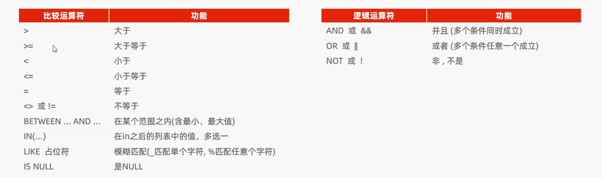

注意：

1.如果要查的值是null不能用 where 字段列表 = null 而是 where 字段列表 is null

如果要查不是null的值,要用where 字段列表 is not null

2.如果用了between..and...语句 注意范围

3.注意IN()和LIKE的用法：

LIKE的占位符：_表示匹配单个字符,%表示匹配任意个字符

例如查找姓名为两个字符的员工：select * from emp where name like '--';

### DQL-聚合函数

介绍：将**一列数据**作为一个整体，进行纵向计算

常见聚合函数：

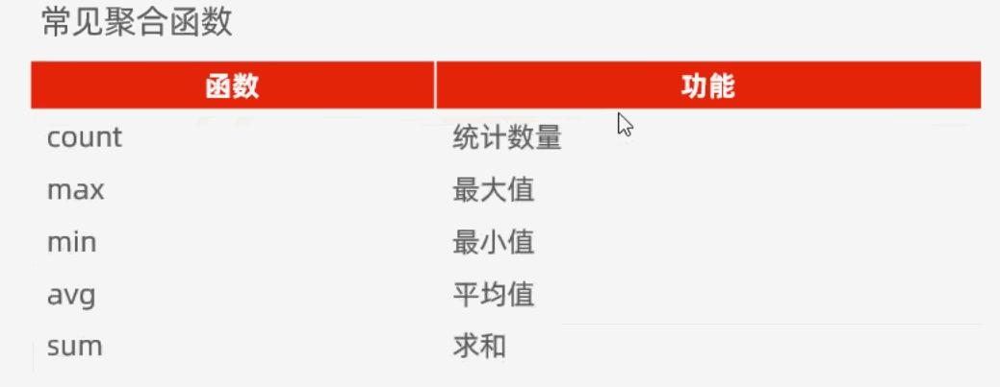

语法：

```
SELECT 聚合函数(字段列表) FROM 表名;
```

例如：统计西安地区员工的年龄之和

```
select sum(age) from emp where workaddress = '西安';
```

**注意：null值不参与所有聚合函数运算**

### DQL-分组查询(GROUP BY)

语法：

```
SELECT 字段列表 FROM 表名 [WHERE 条件] GROUP BY 分组字段名 [HAVING 分组后过滤条件];
```

where与having的区别：

- 执行时机不同：where是分组之前进行过滤，不满足where条件，不参与分组；而having是分组之后对结果进行过滤
- 判断条件不同：where不能对聚合函数进行判断，而having可以。

例如：

```
根据性别分组，统计男性员工 和 女性员工的数量
select gender,count(*) from emp group by gender;
根据性别分组，统计男性员工 和 女性员工的平均年龄
select gender,avg(age) from emp group by gender;
查询年龄小于45的员工，并根据工作地址分组，获取员工数量大于等于3的工作地址
select workaddress,count(*) from emp where age < 45 group by workaddress having count(*) >= 3;
```

注意：

- 执行顺序：where > 聚合函数 > having。
- 分组之后，查询的字段一般为聚合函数和分组字段，查询其他字段无任何意义

### DQL-排序查询(ORDER BY)

语法：

```
SELECT 字段列表 FROM 表名 ORDER BY 字段1 排序方式1,字段2 排序方式2;
```

**排序方式：**

- ASC：升序（默认值）
- DESC：降序

**注意：**

- 如果是多字段排序，当第一个字段值相同时，才会根据第二个字段进行排序
- ASC可省略

 例如：

```
根据年龄对公司的员工进行升序排序，如果年龄相同，再按照入职时间进行降序排序
select * from emp order by age asc,entrydate desc;	
```

### DQL-分页查询(LIMIT)

语法：

```
SELECT 字段列表 FROM 表名 LIMIT 起始索引,查询记录数;
```

注意：

- 起始索引从0开始，起始索引=（查询页码-1）* 每页显示记录数
- 分页查询是数据库的方言，不同的数据库有不同的实现，MySQL中是LIMIT
- 如果查询的是第一页数据，起始索引可以省略，直接简写为 limit 10

### DQL-执行顺序

执行顺序：

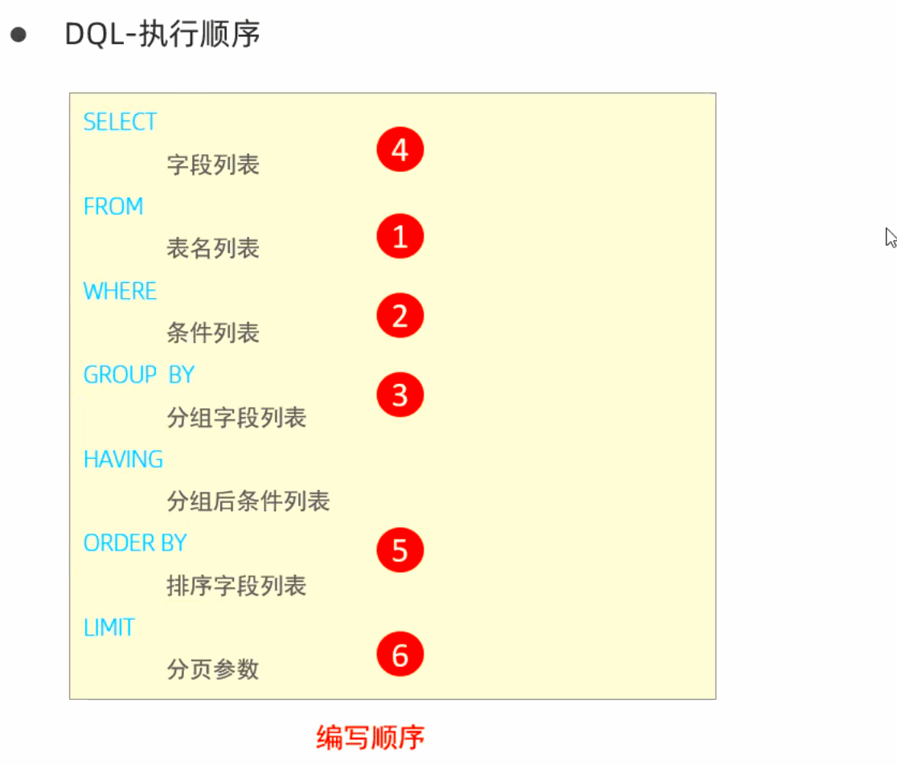

序号为执行顺序，语法为编写顺序

## DCL

介绍：用来管理数据库用户、控制数据库的访问权限。

### DCL-管理用户

语法：

```
查询用户
	USE mysql;
	SELECT * FROM user;

创建用户
	CREATE USER '用户名'@'主机名' IDENTIFIED BY '密码';

修改用户密码
	ALTER USER '用户名'@'主机名' IDENTIFIED WITH mysql_native_password BY '新密码';

删除用户
	DROP USER '用户名'@'主机名';
```

如果要让用户在任意主机访问该数据库只需要在创建用户时，主机名输入%

注意：

- 主机名可以使用%通配
- 这类SQL开发人员操作的比较少，主要是DBA(数据库管理员)使用

### DCL-权限控制

MySQL中定义了很多权限，以下是常用的一些权限：

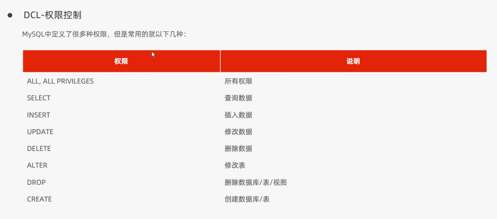

语法：

```
查询权限
	SHOW GRANTS FOR '用户名'@'主机名';
	
授予权限
	GRANT 权限列表 ON 数据库名.表名 TO '用户名'@'主机名';
	
撤销权限
	REVOKE 权限列表 ON 数据库名.表名 FROM '用户名'@'主机名';
```

注意：

- 多个权限之间，使用逗号分隔
- 授权时，数据库名和表名可以使用*进行通配，代表所有。

## 函数

### 字符串函数

MySQL内置的常用字符串函数：
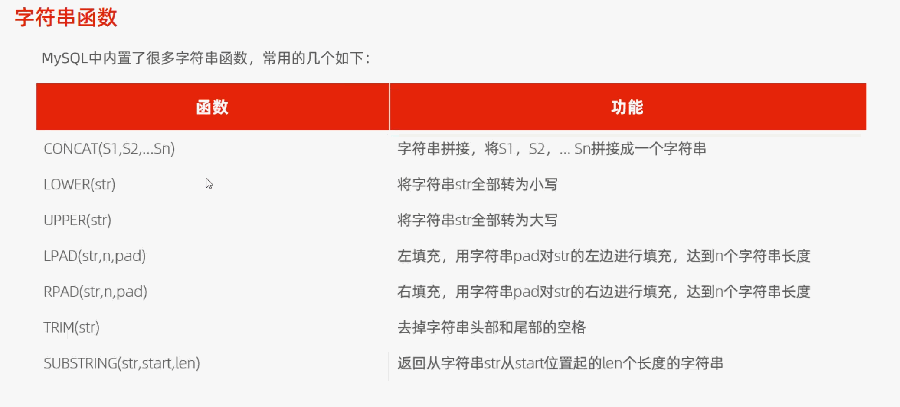

例如：

```
update emp set workno = lpad(workno,5,'0');
```

注意：substring函数截取字符串索引是从1开始的

### 数值函数

常用的数值函数：

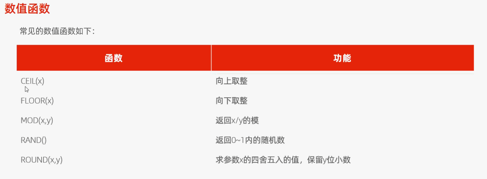

例如：

```
通过数据库的函数，生成一个六位数的随机验证码
select lpad(round(rand()*1000000,0),6,'0');
```

### 日期函数

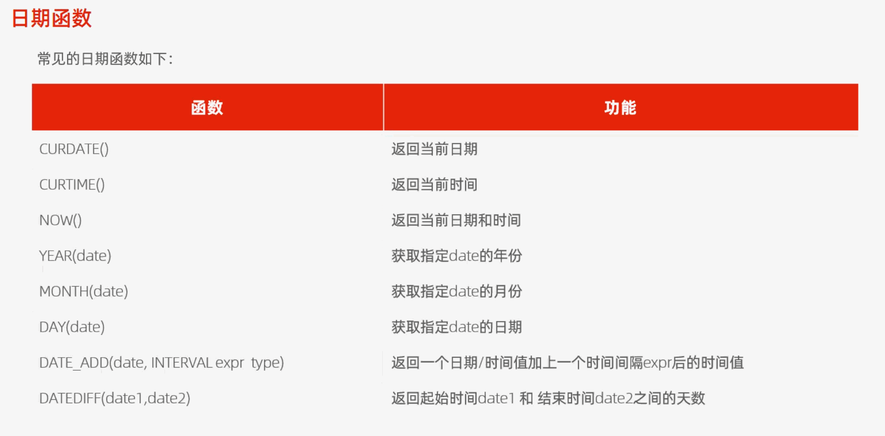

### 流程函数

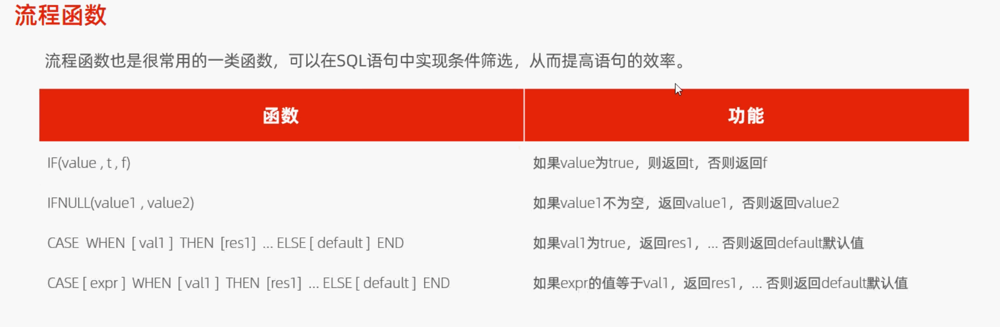

## 约束

概念：约束是作用于表中字段上的规则，用于限制存储在表中的数据

目的：保证数据库中数据的正确，有效性和完整性。

分类：

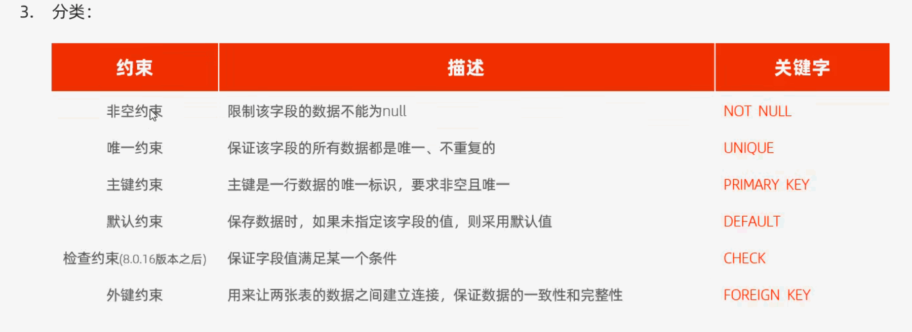

注意：约束是作用于表中字段上的，可以在创建表/修改表的时候添加约束

实现主键的自增长可使用`auto_increment`

### 外键约束

概念：外键用来让两张表的数据之间建立连接，从而保证数据的一致性和完整性。

语法：

```
添加外键
CREATE TABLE 表名(
		字段名 数据类型,
		...
		[CONSTRAINT] [外键名称] FOREIGN KEY(外键字段名) REFERENCES 主表(主表列名)
);

ALTER TABLE 表名 ADD CONSTRAINT 外键名称 FOREIGN KEY(外键字段名) REFERENCES 主表(主表字段名);

删除外键
ALTER TABLE 表名 DROP FOREIGN KEY 外键名称;
```

### 外键删除/更新行为

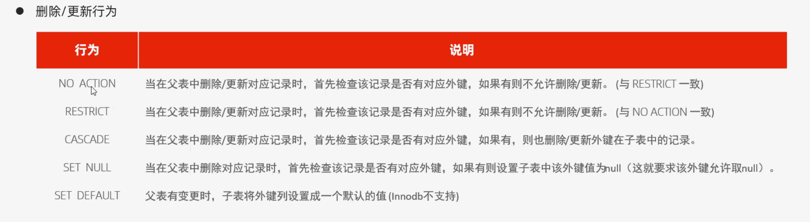

```
ALTER TABLE 表名 ADD CONSTRAINT 外键名称 FOREIGN KEY (外键字段) REFERENCES 主表名(主表字段名) ON UPDATE CASCADE ON DELETE CASCADE;
```

## 多表查询

### 多表关系

概述：
项目开发中，在进行数据库表结构设计时，会根据业务需求及业务模块之间的关系，分析并设计表结构，由于业务之间相互关联，所以各个表结构之间也存在着各种联系，基本上分为三种：

- 一对多(多对一)
- 多对多
- 一对一

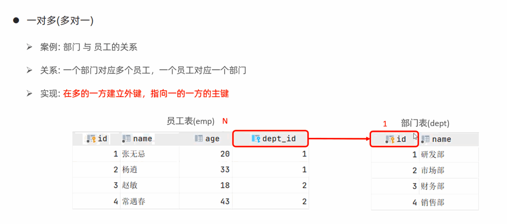

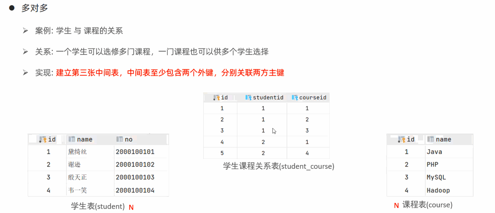

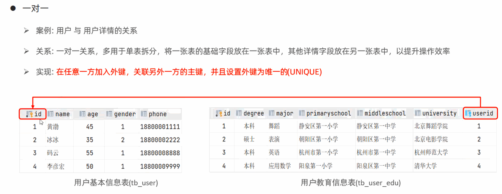

### 多表查询概述

概述：指从多张表中查询数据

笛卡尔积：笛卡尔积是指在数学中，两个集合 A集合 和 B集合所有的组合情况。（在多表查询时，需要消除无效的笛卡尔积）

多表查询分类：

连接查询

​	内连接：相当于查询A、B交集部分数据

​	外连接：

​		左外连接：查询左表所有数据，以及两张表交际部分数据

​		右外连接：查询右表所有数据，以及两张表交集部分数据

​	自连接：当前表与自身的连接查询，自连接必须使用表别名

子查询

### 连接查询-内连接

内连接查询语法：

```
隐式内连接
SELECT 字段列表 FROM 表1,表2 WHERE 条件 ...;

显式内连接
SELECT 字段列表 FROM 表1 [INNER] JOIN 表2 ON 连接条件 ...;
```

注意：内连接查询的是两张表交集的部分

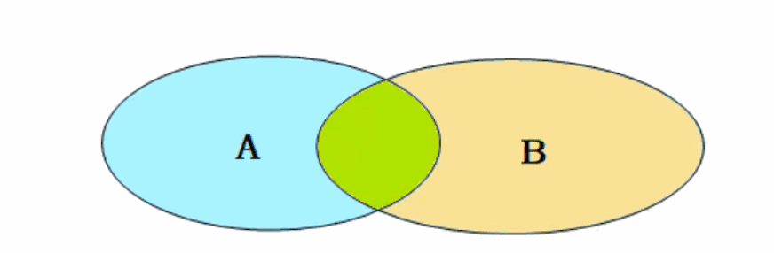

例子：

```
-- 查询员工姓名，及关联的部门的名称
-- 隐式
select e.name, d.name from employee as e, dept as d where e.dept = d.id;
-- 显式
select e.name, d.name from employee as e inner join dept as d on e.dept = d.id;
```

### 连接查询-外连接

外连接查询语法：

```
左外连接
SELECT 字段列表 FROM 表1 LEFT [OUTER] JOIN 表2 ON 条件 ...;
相当于查询表1(左表)的所有数据 包含 表1和表2交集部分的数据

右外连接
SELECT 字段列表 FROM 表1 RIGHT [OUTER] JOIN 表2 ON 条件 ...;
相当于查询表2(右表)的所有数据 包含 表1和表2交集部分的数据
```


例子：

```
-- 左
select e.*, d.name from employee  e left outer join dept  d on e.dept = d.id;
select d.name, e.* from dept d left outer join emp e on e.dept = d.id;  -- 这条语句与下面的语句效果一样

-- 右
select d.name, e.* from employee  e right outer join dept d on e.dept = d.id;
```

### 连接查询-自连接

自连接查询语法：

自连接查询，可以是内连接查询，也可以是外连接查询。

```
SELECT 字段列表 FROM 表A 别名A JOIN 表A 别名B ON 条件 ...;
```

注意：在自连接查询时必须取别名 

例子：

```
-- 查询员工及其所属领导的名字
select a.name, b.name from employee a, employee b where a.manager = b.id;
-- 没有领导的也查询出来
select a.name, b.name from employee a left join employee b on a.manager = b.id;
```

### 联合查询-union,union all

对于union查询，就是把多次查询的结果合并起来，形成一个新的查询结果集。

语法：

```
SELECT 字段列表 FROM 表A ...
UNION [ALL]
SELECT 字段列表 FROM 表B ...;
```

**注意事项**

- union all 会将全部的数据直接合并在一起，union 会对合并之后的数据去重
- **对于联合查询的多张表的列数必须保持一致，字段类型也需要保持一致**

### 子查询

概念：SQL语句中嵌套SELECT语句，称谓**嵌套查询**，又称**子查询**。

```
SELECT * FROM t1 WHERE column1 = (SELECT column1 FROM t2);
```

子查询外部的语句可以是INSERT/UPDATE/DELETE/SELECT的任何一个。

根据子查询结果不同，分为：

- 标量子查询（子查询结果为单个值）
- 列子查询（子查询结果为一列）
- 行子查询（子查询结果为一行）
- 表子查询（子查询结果为多行多列）

根据子查询位置，分为：WHERE之后、FROM之后、SELECT之后。

#### 标量子查询

子查询返回的结果是单个值（数字、字符串、日期等），最简单的形式，这种子查询成为标量子查询。

常用的操作符：=  <>  >  >=  <  <=

例子：

```
-- 查询销售部所有员工
select id from dept where name = '销售部';
-- 根据销售部部门ID，查询员工信息
select * from employee where dept = 4;
-- 合并（子查询）
select * from employee where dept = (select id from dept where name = '销售部');

-- 查询xxx入职之后的员工信息
select * from employee where entrydate > (select entrydate from employee where name = 'xxx');
```

#### 列子查询

子查询返回的结果是一列（可以是多行），这种子查询称为列子查询。

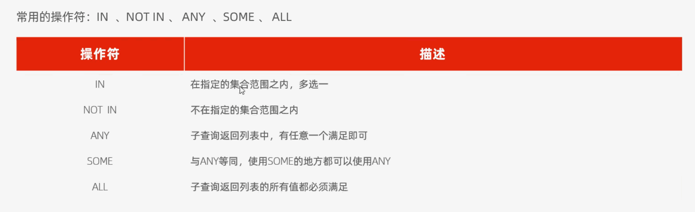

例子：

```
-- 查询销售部和市场部的所有员工信息
select * from employee where dept in (select id from dept where name = '销售部' or name = '市场部');

-- 查询比财务部所有人工资都高的员工信息
select * from employee where salary > all(select salary from employee where dept = (select id from dept where name = '财务部'));

-- 查询比研发部任意一人工资高的员工信息
select * from employee where salary > any (select salary from employee where dept = (select id from dept where name = '研发部'));
```

#### 行子查询

子查询返回的结果是一行（可以是多列），这种子查询称为行子查询。

常用的操作符：=、<>、IN、NOT、IN

例子：

```
-- 查询与xxx的薪资及直属领导相同的员工信息
select * from employee where (salary, manager) = (12500, 1);
select * from employee where (salary, manager) = (select salary, manager from employee where name = 'xxx');
```

#### 表子查询

子查询返回的结果是多行多列，这种子查询称为表子查询。

常用的操作符：IN

例子：

```
-- 查询与xxx1，xxx2的职位和薪资相同的员工
select * from employee where (job, salary) in (select job, salary from employee where name = 'xxx1' or name = 'xxx2');
-- 查询入职日期是2006-01-01之后的员工，及其部门信息
select e.*, d.* from (select * from employee where entrydate > '2006-01-01') as e left join dept as d on e.dept = d.id;
```

## 事务

事务是一组操作的集合，事务会把所有操作作为一个整体一起向系统提交或撤销操作请求，即这些操作要么同时成功，要么同时失败。

基本操作：

```
-- 1. 查询张三账户余额
select * from account where name = '张三';
-- 2. 将张三账户余额-1000
update account set money = money - 1000 where name = '张三';
-- 此语句出错后张三钱减少但是李四钱没有增加
模拟sql语句错误
-- 3. 将李四账户余额+1000
update account set money = money + 1000 where name = '李四';

-- 查看事务提交方式
SELECT @@AUTOCOMMIT;
-- 设置事务提交方式，1为自动提交，0为手动提交，该设置只对当前会话有效
SET @@AUTOCOMMIT = 0;
-- 提交事务
COMMIT;
-- 回滚事务
ROLLBACK;

-- 设置手动提交后上面代码改为：
select * from account where name = '张三';
update account set money = money - 1000 where name = '张三';
update account set money = money + 1000 where name = '李四';
commit;
```

操作方式二：

开启事务：
`START TRANSACTION 或 BEGIN TRANSACTION;`
提交事务：
`COMMIT;`
回滚事务：
`ROLLBACK;`

操作实例：

```
start transaction;
select * from account where name = '张三';
update account set money = money - 1000 where name = '张三';
update account set money = money + 1000 where name = '李四';
commit;
```

### 四大特性ACID

- 原子性(Atomicity)：事务是不可分割的最小操作但愿，要么全部成功，要么全部失败
- 一致性(Consistency)：事务完成时，必须使所有数据都保持一致状态
- 隔离性(Isolation)：数据库系统提供的隔离机制，保证事务在不受外部并发操作影响的独立环境下运行
- 持久性(Durability)：事务一旦提交或回滚，它对数据库中的数据的改变就是永久的

### 并发事务

| 问题       | 描述                                                         |
| ---------- | ------------------------------------------------------------ |
| 脏读       | 一个事务读到另一个事务还没提交的数据                         |
| 不可重复读 | 一个事务先后读取同一条记录，但两次读取的数据不同             |
| 幻读       | 一个事务按照条件查询数据时，没有对应的数据行，但是再插入数据时，又发现这行数据已经存在 |

> 这三个问题的详细演示：https://www.bilibili.com/video/BV1Kr4y1i7ru?p=55cd

并发事务隔离级别：

| 隔离级别              | 脏读 | 不可重复读 | 幻读 |
| --------------------- | ---- | ---------- | ---- |
| Read uncommitted      | √    | √          | √    |
| Read committed        | ×    | √          | √    |
| Repeatable Read(默认) | ×    | ×          | √    |
| Serializable          | ×    | ×          | ×    |

- √表示在当前隔离级别下该问题会出现
- Serializable 性能最低；Read uncommitted 性能最高，数据安全性最差

查看事务隔离级别：
`SELECT @@TRANSACTION_ISOLATION;`
设置事务隔离级别：
`SET [ SESSION | GLOBAL ] TRANSACTION ISOLATION LEVEL {READ UNCOMMITTED | READ COMMITTED | REPEATABLE READ | SERIALIZABLE };`
SESSION 是会话级别，表示只针对当前会话有效，GLOBAL 表示对所有会话有效
