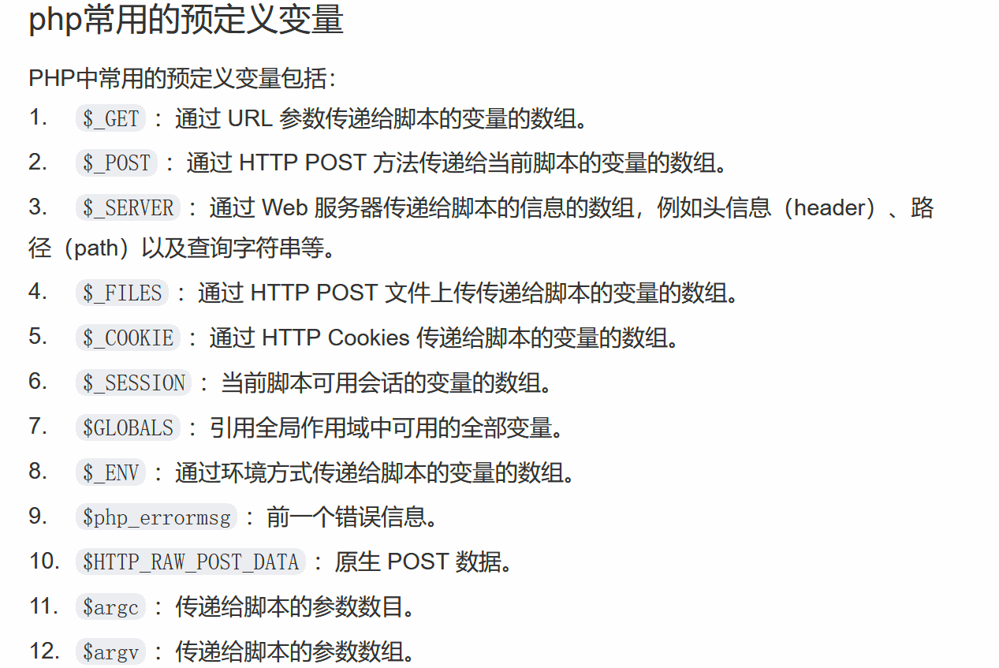
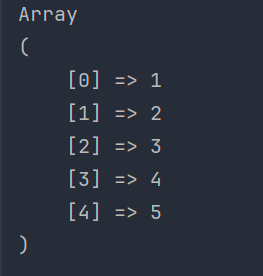
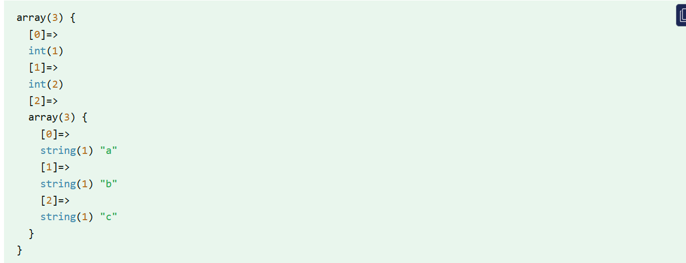
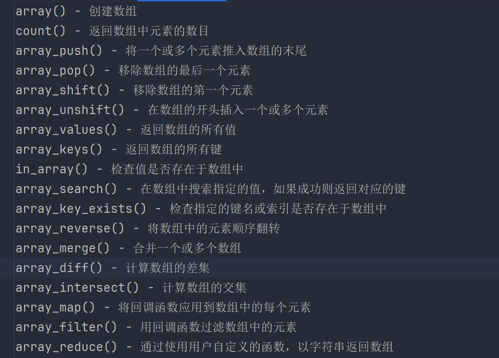
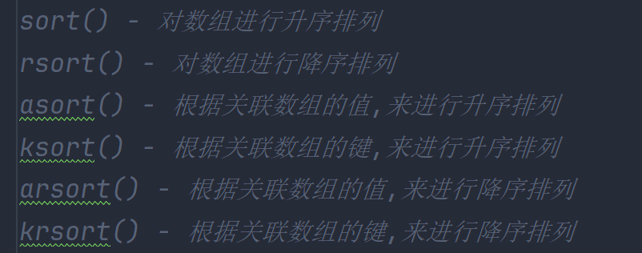
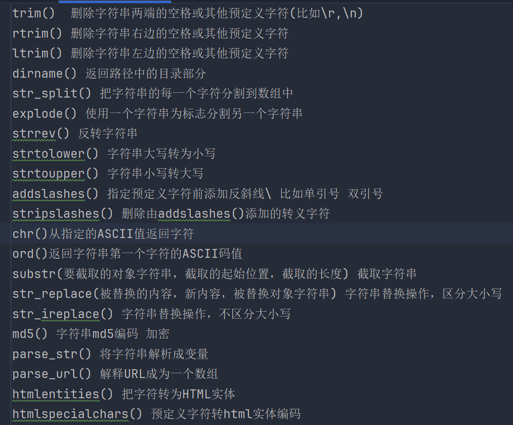
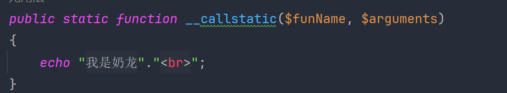
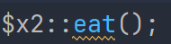

# PHP简介

- PHP（全称：PHP：Hypertext Preprocessor，即"PHP：超文本预处理器"）是一种通用开源脚本语言。
- PHP 脚本在服务器上执行。
- PHP 可免费下载使用。
- PHP 文件的默认文件扩展名是 .php。
- PHP 文件通常包含 HTML 标签和一些 PHP 脚本代码。

# PHP的学习

## 基本语法

```
<?php
// php 代码
?>

例如：
<!DOCTYPE html>
<html>
<body>

<h1>My first PHP page</h1>

<?php
echo "Hello World!";
?>

</body>
</html>
```

## PHP中的注释

```php
<?php
// 这是 PHP 单行注释

/*
这是
PHP 多行
注释
*/
?>
```

## 变量

定义变量：

变量以 $ 符号开始，后面跟着变量的名称

变量名必须以字母或者下划线字符开始

变量名只能包含字母、数字以及下划线（A-z、0-9 和 _ ）

变量名不能包含空格

变量名是区分大小写的（$y 和 $Y 是两个不同的变量）

```php
<?php
$a = 100;
?>
```

### 超全局变量       

PHP预定义变量，也称为超全局变量，是在PHP脚本的任何地方都可以访问的内置变量。这些变量用于存储有关PHP运行环境的全局信息，例如服务器信息、客户端请求数据、会话信息等。



### 打印变量

echo函数：

```php
<?php
// 打印字符串
echo "我是奶龙";

//打印变量
$a = 10;
echo $a;
//也可包含HTML标签
echo "我是奶龙<br>";
?>
```

print函数：

只允许输出一个字符串，返回值总为 1

```
<?php
print "奶龙";
?>
```

echo和print的区别：

echo 输出的速度比 print 快， echo 没有返回值，print有返回值1。

print_r函数：

可以输出stirng、int、float、array、object等

输出array时会用结构表示，print_r输出成功时返回true

例如：

```php
<?php
$a = array(1,2,3,4,5);
print_r($a);
?>
```

结果：



var_dump()函数

**var_dump()** 函数用于输出变量的相关信息。

**var_dump()** 函数显示关于一个或多个表达式的结构信息，包括表达式的类型与值。数组将递归展开值，通过缩进显示其结构。

例如：

```php
<?php
$a = array(1, 2, array("a", "b", "c"));
var_dump($a);
?>
```

结果：



### 删除变量

unset函数

```
unset(变量名);                                                                                      
```

### 变量作用域

PHP 有四种不同的变量作用域：

- local
- global
- static
- parameter

注意：在函数内定义的变量是局部变量只能在函数内调用，在函数内调用函数外定义的全局变量，我们需要在函数中的变量前加上 global 关键字：

### Static 作用域

当一个函数完成时，它的所有变量通常都会被删除。然而，有时候您希望某个局部变量不要被删除。

要做到这一点，请在您第一次声明变量时使用 **static** 关键字

### 判断变量是否存在

```
empty(变量名);	判断变量值是否为空或0然后返回true
isset(变量名);	判断变量存在然后返回true
区别：
empty 如果值为空或0；返回true
isset 只有值存在才返回true
```


## 数据类型

### 基本类型

- String（字符串）
- Integer（整型）
- Float（浮点型）
- Boolean（布尔型）
- Array（数组）
- Object（对象）
- NULL（空值）
- Resource（资源类型）

### 类型转换

1.自动转换：系统自己判定自己转换

2.强制类型转换：echo (类型)变量名;

说明：

1.bool true=1，false=0

2.以字母开头的字符串，永远为0；

3.以数字开头的字符串，取到碰到字符串为止（不会同时包含两个小数点）

### 类型比较

1.松散比较：使用两个等号==比较，只比较值，不比较类型	

例如：42=="42"	返回true

2.严格比较：用三个等号===比较，不仅比较值，还比较类型	

例如：	42==="42"	返回false

## 运算符

### 比较运算符

===全等于	当左边和右边的值和数据类型都相同是返回true

!==不绝对等于	当左边和右边的值不等时或者数据类型不相同时返回true

其他和c一样

### 组合比较符

```
$c = $a <=> $b;
```

- 如果 **$a > $b**, 则 **$c** 的值为 **1**。
- 如果 **$a == $b**, 则 **$c** 的值为 **0**。
- 如果 **$a < $b**, 则 **$c** 的值为 **-1**。

### 运算符优先级

优先级： &&  >  =  >  and 

优先级： ||  >  =  >  or

其他和c一样

### 并置运算符(字符串运算符)

并置运算符 (.) 用于把两个字符串值连接起来

$a .= $b	表示将$a后面接上$b

echo $a.$b;	也可直接输出$a.$b

```
<?php
$a = "hello";
$b = " world";
$a .= $b;
echo $a;

?>
```

### EOF定界符

EOF定界符：主要用于定义一个字符串，该字符串可以跨越多行，并且能够保持原有的格式和换行符

格式：

$a = <<<EOF

...

EOF;

EOF定界符的优点和适用场景：

1. ‌**保持格式**‌：Heredoc能够保持字符串内部的格式和换行符，适合输出大量HTML或JavaScript代码‌2。
2. ‌**变量解析**‌：在Heredoc中，变量会被正常解析，这使得在输出大量文本时更加方便和灵活‌12。
3. ‌**减少转义**‌：在Heredoc中不需要对特殊字符进行转义，简化了字符串的处理过程‌

例如：

```
<?php
$out = 
<<<EOF
    <a href="javascript:edit('asd', 'aaa')">编辑</a> |

    <font color="#ccc">删除</font>

    <a href="javascript:confirmurl('?m=admin&posid=12')">删除</a> |

    <font color="red">启用</font></a> |  

    <a href="javascript:preview('3','ds')"><font color="green">演示</font></a>
EOF;

echo $out;
?>
```

### 逻辑运算符

和c一样

### 三元运算符

```
(expr1) ? (expr2) : (expr3) 
```

和c一样

### 回车换行符

PHP_EOL：回车换行

## 条件判断

if语句

if...else语句

if...elseif...else语句

switch语句

和c一样

## 循环

### while循环和for循环

for循环和c差不多

while循环do while循环和c差不多

break	跳出循环

continue	跳到下次循环

exit	退出程序

### foreach

foreach 循环用于遍历数组。

```
<?php
foreach($array as $value) // 每次循环都会将数组元素的值赋值给$value
{
	要执行代码;
}

foreach($array as $key => $value) // 每次循环都会将将数组元素的键与值赋值给$key和$value
{
	要执行代码;
}

?>
```

例如：

```
<?php
$x=array("Google","Runoob","Taobao");
foreach ($x as $value)
{
    echo $value . PHP_EOL;
}
?>
```

输出结果：


## 数组

### 数值数组

数值数组的定义：$arr = array("...","...","...");

例如：

```
$cars = array("Volvo", "BMW", "Toyota");
```

### 关联数组

关联数组有点像c++里的map容器和python的字典

键值对：一个键对应一个值

关联数组的定义：$arr = array("..."=>"...","..."=>"...","..."=>"...");

例如：

```
$age = array("Ben"=>"37","Joe"=>"43");
$age["Peter"] = "35";
```

### 遍历数组

和c差不多就多了个foreach有点像c++的auto遍历

```
// 遍历数值数组
$len = count($$array);
for($i=0;$i<$len;$i++)
{
    echo $$array[$i]."<br>";
}

// foreach循环遍历数值数组
foreach ($array as $value)
{
    echo $value.PHP_EOL;
}

// 遍历关联数组
foreach($array as $key=>$value)
{
    echo "key=".$key.","."value=".$value."<br>";
}
```

### 多维数组

数值数组：会自动分配键值,从0开始

```
// 二维数组
$arr = array
(
    array("Volvo",100,96),
    array("BMW",60,59),
    array("Toyota",110,100)
);
```

关联数组：指定键

```
$sites = array
(
    "runoob"=>array
    (
        "菜鸟教程",
        "http://www.runoob.com"
    ),
    "google"=>array
    (
        "Google 搜索",
        "http://www.google.com"
    ),
    "taobao"=>array
    (
        "淘宝",
        "http://www.taobao.com"
    )
); 
```

### 数组相关函数

常用函数：



排序函数：



## 函数

### 函数的定义

function 函数名(变量名)

{

​	...

​	return (返回值);

}

注意：如果要在函数内调用全局变量前面要加global;

例如

```
<?php
$a = 100;
function add()
{
	global $a
	echo $a;
}

?>
```

## 字符串

### 常用字符串函数

trim()	删除字符串两端的空格和其他预定义字符(比如\r,\n)

```
a = "  nailong  ";
$a = trim($a);
echo $a;
```

dirname()	返回路径中的目录部分

```
echo __FILE__.'<br>'; // __FILE__代表当前文件的绝对路径
echo dirname(__FILE__).'<br>';
// 返回值：
// E:\CTF\newphp\字符串常用函数.php
// E:\CTF\newphp
```

strlen()	获取字符串的长度

strpos()函数	用于在字符串内查找一个字符或指定文本

htmlspecialchars()	预定义字符转html实体编码，只格式化&,',",<,>这几个特殊符号

substr()	截取字符串

其他常用字符串函数：



## 时间日期函数

```
<?php

// 格式化时间日期函数
$d = date('Y/m/d h:i:s');
echo $d.'<br>';

// time()时间戳函数
$t = time();
echo $t.'<br>';

// getdate() 当前时间的一个数组表示
$k = getdate();
print_r($k);
echo '<br>';
echo $k[0].'<br>'; // 取时间戳
echo $k['hours'].'<br>';


date_format()将日期时间对象转换为字符串

strtotime（string类型），可以把string类型转换成时间戳

date_create()来创建一个日期时间对象

?>
```

## 常量

### 定义常量

方式1：define('常量名','常量');

方式2：const 常量名 = 常量值;

区别：

1.define定义的常量名可以是特殊符号，若是特殊符号，则需要用echo constant（’ 常量名’）来打印；const 不能用特殊符号；

2.const不能用于if判断中

3.const用于类成员变量的定义，define不可用

### 预定义常量

系统自带的常量，可直接使用

`PHP_VERSION`：当前 PHP 解析器的版本。

`PHP_OS`：服务器的操作系统。

`PHP_INT_MAX`：最大的整数值。

`E_ERROR`、`E_WARNING`、`E_PARSE` 等：错误报告级别

### 魔术常量

魔术常量值随着它们在代码中的位置改变而改变

双下划线+常量名+双下划线

```
__LINE__	文件中的当前行号
__FILE__	文件的完整路径和文件名
__DIR__	文件所在的目录
__FUNCTION__	返回该函数被定义时的名字
__CLASS__	返回该类被定义时的名
__TRAIT__	Trait 的名字
__METHOD__	返回该方法被定义时的名字（区分大小写）
__NAMESPACE__	当前命名空间的名称（区分大小写）
```

## 文件

### 文件和目录操作

文件写入：

file_put_contents(文件名)
如果找不到该文件，会自动创建，先清空再写入内容

```
$a = file_put_contents('1.txt', 'Hello');
echo $a.'<br>';
```

文件读取：

readfile(文件名);	读取文件中的内容打印出来 返回值为文件内容的长度

```
$a = readfile('1.txt');
echo '<br>'.$a;
```

file_get_contents()读取文件内容 // 绝对路径 相对路径 网址路径

```
$a = file_get_contents('1.txt');
echo $a.'<br>';
```

fopen()	打开文件

fwrite()	写入

```
$a = fopen('1.txt','r');
echo gettype($a).'<br>';
```

fread()	读取文件

fgets()	读取一行

```
$b = fread($a,3);

$b = fgets($a);
echo $b.'<br>';
```

### 文件模式

```
// r+读写模式
$a = fopen('1.txt','r+');
$b = fwrite($a,'aaa'); // 返回写入长度 覆盖原内容
echo $b.'<br>';
fclose($a);

// w和w+模式都会先将文件清空

// a模式 追加模式 不会覆盖原内容
```

### 文件包含

include函数和require函数

include('文件名')：

返回一个警告
如果引入出错，代码继续向下执行，通常用于动态包含
include('...');

require('文件名')：

如果引入出错，代码就不会继续向下执行
require('include等文件包含函数.php');

include_once函数引入 除了原有功能还会once检测，如果文件曾经已经被包含过，不再包含

推荐使用require

## 面向对象

具体资料https://www.runoob.com/php/php-oop.html

### 类

定义了一件事物的抽象特点。

类的定义包含了数据的形式以及对数据的操作。

```
class Fruit
{
    public $name;
    public $color;

    function set_name($name)
    {
        $this->name = $name;
    }

    function get_name()
    {
        return $this->name;
    }

    function say()
    {
        echo $this->name."<br>";
    }

}
```

### 创建对象

类创建后，我们可以使用 **new** 运算符来实例化该类的对象

```
$apple = new Fruit();
```

### 调用成员方法

在实例化对象后，我们可以使用该对象调用成员方法，该对象的成员方法只能操作该对象的成员变量

$对象名->方法名(参数)

```
$apple->set_name("Apple");
$banana->set_name("Banana");
$apple->say();
```

### 类的方法和属性

如果想要调用或者对类的成员变量进行赋值需要用$this->变量名

```
$this->name = $name;
```

### 访问控制

PHP 对属性或方法的访问控制，是通过在前面添加关键字 public（公有），protected（受保护）或 private（私有）来实现的。

- **public（公有）：**公有的类成员可以在任何地方被访问。
- **protected（受保护）：**受保护的类成员则可以被其自身以及其子类和父类访问。
- **private（私有）：**私有的类成员则只能被其定义所在的类访问。

### 魔术方法

构造函数和析构函数

__construct()	类构造函数

1. 在创建一个新对象是，他会自动调用
2. 他可以用来初始化对象的属性或执行的其他必要的操作
3. 没有返回值

例如：

```
public function __construct($name="", $age=1)
{
    person::$sum++;
    $this->name = $name;
    $this->age = $age;
}
```

__destruct()	类的析构函数 不能加上任何参数

1.在对象销毁时会自动调用

2.可以用来执行一些清理操作，例如释放资源或关闭数据库连接

3当对象不在被引用或脚本执行结束前，析构函数会被自动调用

***


其他魔术方法：

__call()	在对象中调用一个不可访问方法时调用

当调用一个不可访问方法或者不存在的方法时会执行__call()方法

***


__callstatic()	静态调用

调用时格式：对象名::方法名(参数)

***


__unset()方法和 unset函数 ：当对不可访问属性调用unset()时被调用

可在对象外面删除对象的属性

例如：

```
public function __unset($content)
{
     echo "当测定私有成员{$content}时,自动调用".'<br>';
}
unset($c->name); // 删除c对象中的私有变量name
$c->say();
```

***

__tostring()方法	调用后可直接echo输出对象

例如：

```
public function __tostring()
{
    return "这个人的名字叫{$this->name}.年龄为{$this->age}.<br>";
}
$d = new personchild("奶龙",100);
echo $d;
```

***

__set()方法	可给私有属性赋值

```
public function __set($PName, $Value)
{
    $this->$PName = $Value;
}
$a->name = "小红"; // 给私有属性赋值
$a->age = 16;
```

***

__clone方法和clone关键字	用来复制对象产生一个副本

如果只需要直接复制就不需要再类中定义clone方法

如果在clone时需要重新赋初值

```
public function __clone()	//	定义__clone方法
{
    echo "调用__clone方法"."<br>";
    $this->age = -100;
    $this->name = "吴颖昇";
}
$e = clone $d;	//	调用clone方法复制对象
```

***

__get()方法	可获取私有属性

```
public function __get($PName)
{
    if($PName=="age")
    {
        return $this->age;
    }
    else
    {
        return $this->name;
    }
}
$a = new person("小明",60);
echo "姓名".$a->name."<br>"; // 直接访问私有属性name 自动调用__get方法可以间接获取
echo "年龄".$a->age."<br>"; // 直接调用__get方法 根据对象本身的情况返回不同的值
```


### static静态变量和self

定义：public static $变量名

调用：self::变量名

```
public static $gender;
self::$gender = 'male';
```

***


类常量

用const去定义常量，调用方式和static类似，用self调用，唯一区别是类常量不可修改

***


static静态方法定义：



调用静态方法:



### 类的继承

PHP中使用关键字**extends**来继承一个类,且PHP不支持多继承

```
class Child extends Parent 
{
   // 代码部分
}
```

### 类的方法重写和属性改写

方法重写 (就是改写父类覆盖)
如果从父类继承的方法不能满足子类的需求，可以对其进行改写
这个过程叫方法的覆盖（override），也称为方法的重写。

直接在子类内部改写方法或属性。

final关键字（在不想被改写的类或类的方法前加final）

- 防止类被改写
- 防止类的方法被重写。

**final不能用于属性**

***

调用父类中被重写的方法

parent关键字
parent::方法();

## 网络请求

### POST和GET

$_GET 变量：

预定义的 $_GET 变量用于收集来自 method="get" 的表单中的值。

从带有 GET 方法的表单发送的信息，对任何人都是可见的（会显示在浏览器的地址栏），并且对发送信息的量也有限制。

***


$_POST 变量：

预定义的 $_POST 变量用于收集来自 method="post" 的表单中的值。

从带有 POST 方法的表单发送的信息，对任何人都是不可见的（不会显示在浏览器的地址栏），并且对发送信息的量也没有限制。

***


$_SERVER["PHP_SELF"] 变量_

_$_SERVER["PHP_SELF"]是超级全局变量，返回当前正在执行脚本的文件名，与 document root相关。

所以， $_SERVER["PHP_SELF"] 会发送表单数据到当前页面，而不是跳转到不同的页面


***


$_REQUEST变量包含了$_GET，$__POST和$_COOKLE的内容


htmlspecialchars()方法  

htmlspecialchars() 函数把一些预定义的字符转换为 HTML 实体。以避免在HTML文档中引起解析错误或安全漏洞

```
& （和号） 成为 &amp;
" （双引号） 成为 &quot;
' （单引号） 成为 &#039;
< （小于） 成为 &lt;
> （大于） 成为 &gt;
```

